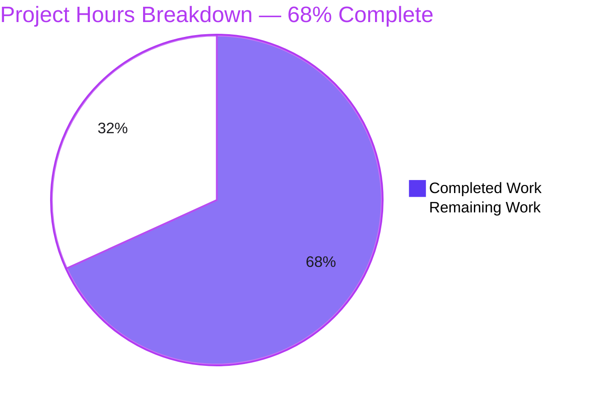
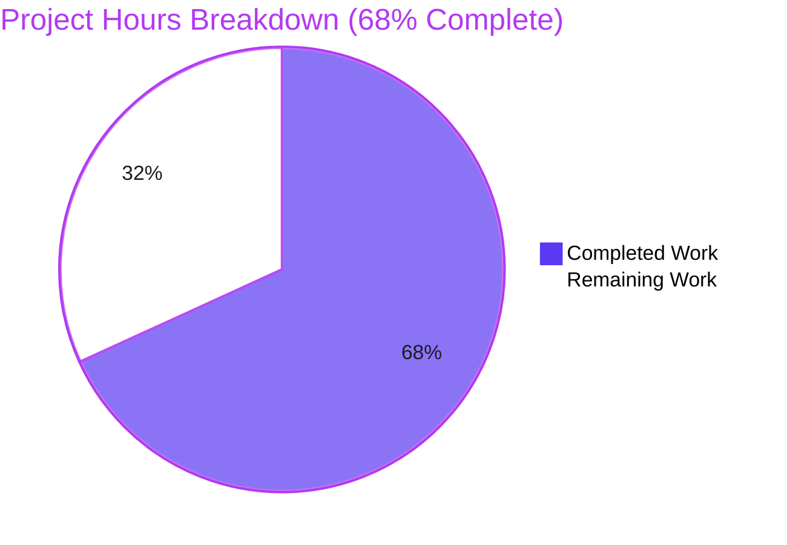

# 1. Executive Summary

## 1.1 Project Overview

The project is a two-endpoint HTTP greeting service. Express.js was introduced as its first third-party dependency and the server moved onto it: the original root greeting is preserved byte for byte, and a second endpoint returns exactly `Good evening`. The service stays one CommonJS file binding loopback `127.0.0.1:3000`, declares and locks its single dependency, publishes its contract in `README.md`, and keeps the installed tree out of version control. There is no user interface, data store or outbound integration; the only observable surface is the HTTP contract.

## 1.2 Completion Status

**15.0 completed hours ÷ 22.0 total hours = 68.2%, reported as 68% complete.**



| Metric | Hours |
|---|---|
| Total Hours | 22.0 |
| Completed Hours (Baseline: Human with agentic-assist) | 15.0 |
| Remaining Hours | 7.0 |
| Percent Complete | 68% |

Completion covers only the scoped work: the six functional requirements for the framework move and the new endpoint, plus the path-to-production work to operate it. Section 2.3 shows the derivation.

## 1.3 Key Accomplishments

- Express 5.2.1 is declared and locked; the tree installs reproducibly from `package-lock.json` (66 packages, sha512-pinned).
- One Express application serves `127.0.0.1:3000` and prints exactly the documented startup line (`server.js:1-6`, `server.js:27-29`).
- `GET /` serves the original greeting byte for byte: `200`, `text/plain`, 14 bytes ending in one newline.
- `GET /good-evening` serves `200`, `text/plain` and the 12-byte body `Good evening`, no trailing newline (`server.js:21-25`).
- The routing table is closed: every other path shape and unsupported method is refused `404`, with strict routing making trailing-slash variants distinct (`server.js:13`).
- `HEAD` and `OPTIONS` are served from the same registrations; query strings are ignored and matching stays case-insensitive.
- `README.md` publishes both bodies, the refusal behaviour and the run steps, and matches the service.
- The installed tree never enters version control; `.gitignore` holds `node_modules/`.

## 1.4 Critical Unresolved Issues

Four of ten scoped items remain open — all path-to-production; the six functional requirements are delivered.

| Issue | Impact | Owner | ETA |
|---|---|---|---|
| No automated regression gate for the byte-exact bodies; `npm test` is the placeholder script that exits 1 by design | A future edit to either body or to a route could pass unnoticed | Backend engineer | 3.0 h |
| Three transitive advisories remain in the locked tree (`proxy-addr` critical, `body-parser` high, `qs` moderate) | Off the request path today; on it the moment any middleware is mounted | Dependency owner | 2.0 h |
| The Node ≥ 18 runtime floor is advisory only — no `engines` field or version-manager file | A below-floor host installs successfully and fails at request time | Backend engineer | 0.5 h |
| The documented bind on `127.0.0.1:3000` was never exercised on a target host | Deployment is unproven on the host that will run it | Release owner | 1.5 h |

## 1.5 Access Issues

No access issues identified. The service reads no credential, environment variable, database or external service, and its dependency tree resolves from the public npm registry.

## 1.6 Recommended Next Steps

1. **[High]** Add a byte-asserting regression suite and make it the `test` script, excluding the native-`http` fixtures from discovery.
2. **[Medium]** Validate a deployment on the target host: clean install, `node server.js` on `127.0.0.1:3000`, both endpoints and one refusal.
3. **[Medium]** Review and re-resolve the three transitive advisories, then re-verify both bodies byte for byte on the re-pinned tree.
4. **[Medium]** Declare the runtime floor with an `engines` field plus a version-manager file.
5. **[Low]** Reconcile `package.json#main` (an absent `index.js`) and retire the placeholder test script once the suite lands.

# 2. Project Hours Breakdown

## 2.1 Completed Work Detail

| Component | Hours | Description |
|---|---|---|
| Express dependency declared and locked (FR-A) | 2.0 | `package.json:11-13` declares the single runtime dependency `express` `^5.2.1`; `package-lock.json` pins the resolved tree (66 packages, registry URLs, sha512 digests, `engines.node >= 18`); `npm ls --depth=0` reports `express@5.2.1` with no unmet peer. |
| Express application, listener and startup output (FR-B) | 1.5 | `server.js:1-6` requires Express and creates one application; `server.js:27-29` listens on the `127.0.0.1`/`3000` module constants and prints the single documented line. |
| Root greeting preserved byte-exact (FR-C) | 1.5 | `server.js:15-19` writes status `200`, `text/plain` and the 14-byte `Hello, World!\n` body through the low-level response pattern, adding no `ETag`. |
| Second greeting endpoint (FR-D) | 1.0 | `server.js:21-25` writes status `200`, `text/plain` and the 12-byte `Good evening` body with no trailing newline. |
| Closed routing contract (FR-E) | 2.5 | Strict routing enabled before the first registration (`server.js:13`); every unregistered path, trailing-slash variant and unsupported method refused `404`; `HEAD` and `OPTIONS` answered from the same registrations; query string ignored; matching case-insensitive; no middleware and no request reading. |
| Published contract and install hygiene (FR-F) | 2.0 | `README.md` publishes the dependency, both bodies, the refusal behaviour with its case-insensitivity qualification, the install and run steps and the bound URL; `.gitignore` keeps the installed tree untracked. |
| Byte-level acceptance verification (acceptance sequence) | 3.5 | Clean install from the lockfile, static check, then 56 assertions over both bodies, the refusal matrix, framework method handling, matching semantics, concurrency, robustness and termination, plus the dependency-failure probe. |
| Contract consistency across source and README | 1.0 | The routing comment at `server.js:8-12` and the published refusal statement at `README.md:12-13` now describe the same case-insensitive matching the service performs. |
| **Total completed** | **15.0** | Matches Completed Hours in Section 1.2. |

## 2.2 Remaining Work Detail

| Category | Hours | Priority |
|---|---|---|
| Automated regression suite for the byte-exact contract, wired as the `test` script and excluding the native-`http` fixtures from discovery | 3.0 | High |
| Dependency advisory review and re-pin, followed by byte-level re-verification of the contract | 2.0 | Medium |
| Runtime pin: `engines` field plus a version-manager file, confirmed against the host | 0.5 | Medium |
| Target-host deployment validation: clean install, bind on `127.0.0.1:3000`, both endpoints and one refusal exercised | 1.5 | Medium |
| **Total remaining** | **7.0** | Matches Remaining Hours in Section 1.2 and the pie chart in Section 7. |

## 2.3 Hours Calculation and Validation

| Step | Value |
|---|---|
| Completed hours (sum of Section 2.1) | 15.0 |
| Remaining hours (sum of Section 2.2) | 7.0 |
| Total project hours (completed + remaining) | 22.0 |
| Completion percentage (15.0 ÷ 22.0 × 100) | 68.2% → 68% |

Every completed hour traces to a functional requirement delivered in the five in-scope files or to the verification that proves it; every remaining hour traces either to an open risk the project itself recorded (`engines` pin, dependency advisories, regression suite) or to path-to-production validation on a target host. Confidence is high for the completed figures, which are anchored in file-level evidence and observed behaviour, and medium for the remaining figures, which depend on how much re-verification an advisory re-pin turns out to require.

# 3. Test Results

The repository carries no test framework and `npm test` runs the placeholder script that exits 1 by design, so the acceptance evidence is an operator-driven gate: `curl` requests against the running service with status, header and raw-byte assertions (`cmp`, `od -c`, `Content-Length`) rather than text comparison. The gate was executed against the delivered tree and every count below is from that run — 56 assertions, 56 passed, 0 failed. The project has no coverage instrumentation, so the coverage column is not applicable throughout.

| Area / Category | Framework | Tests | Passed | Failed | Coverage | What This Proves |
|---|---|---|---|---|---|---|
| Install, dependency resolution and static check | `npm ci`, `npm ls`, `node --check` | 3 | 3 | 0 | n/a | The tree reproduces exactly from the lockfile (66 packages) and `server.js` parses as valid source |
| Service startup and output fidelity | Process capture + `curl` | 3 | 3 | 0 | n/a | One listener starts, prints exactly the documented startup line, and writes nothing to stderr |
| Root greeting endpoint | `curl` + `cmp`/`od -c` | 6 | 6 | 0 | n/a | `GET /` returns `200`, `text/plain`, `Content-Length: 14` and the byte-exact `Hello, World!\n` body, with no `ETag` |
| Second greeting endpoint | `curl` + `cmp`/`od -c` | 5 | 5 | 0 | n/a | `GET /good-evening` returns `200`, `text/plain`, `Content-Length: 12` and the byte-exact body ending in `g`, not a newline |
| Refusal matrix — path shapes and methods | `curl` status + content-type assertions | 17 | 17 | 0 | n/a | Every unregistered path, trailing-slash variant, near miss and unsupported method is refused `404` with `text/html; charset=utf-8` |
| Framework method handling and refusal hygiene | `curl -I`, `curl -X OPTIONS`, response-body scan | 10 | 10 | 0 | n/a | `HEAD` and `OPTIONS` are derived from the `GET` registration, and refusals disclose no paths, stack frames or internals |
| Matching semantics, negotiation and robustness | `curl` + `cmp` | 9 | 9 | 0 | n/a | Query strings are ignored, matching is case-insensitive, an `Accept: application/json` request still gets `text/plain`, keep-alive works, 50 parallel requests stay byte-correct, and a 100 KB body is refused without disturbing the routes |
| Lifecycle and termination | `kill -TERM` + follow-up probes | 3 | 3 | 0 | n/a | `SIGTERM` exits `143`, the port is released, and nothing further is logged |

**Not Covered** — capabilities delivered but not exercised by any test, and what to verify before release:

- **Automated regression safety net.** No suite exists, so nothing re-checks either body, the refusal matrix or the method handling after a future edit. This is the highest-value gap and is costed as the High-priority task in Section 2.2.
- **A bind on the documented port `3000`.** The port is a module constant (`server.js:4`) and the acceptance run used a private port on the host, so the literal bind on `3000` is unproven; exercise it on the target host.
- **The three native-`http` fixture scripts.** They bind the same fixed port and are never started, so their behaviour is static evidence only.
- **Dependency vulnerability scanning.** No gate runs `npm audit`; the three advisories are known and still pinned, not tested and cleared.
- **Performance, latency and memory characteristics.** No load or profiling run was performed; the handlers are three synchronous statements with no I/O, and no target is defined.

# 4. Runtime Validation & UI Verification

The service is headless — `text/plain` responses, no rendered view, no assets and no client code — so runtime validation drove the HTTP surface directly, against a live process on the loopback interface.

- ✅ **Start-up** — `node server.js` starts one listener and prints exactly `Server running at http://127.0.0.1:3000/`; stderr is empty, and no per-request logging appears.
- ✅ **Root greeting journey** — `GET /` returns `200`, `text/plain`, 14 bytes, byte-identical to `Hello, World!\n`, with `X-Powered-By: Express` and no `ETag`.
- ✅ **Second greeting journey** — `GET /good-evening` returns `200`, `text/plain`, 12 bytes, byte-identical to `Good evening`, final byte `0x67`.
- ✅ **Refusals** — eight unregistered path shapes (including `/good-evening/`, `/hello`, `//good-evening`, `/GOOD-EVENING/`) and five unsupported methods return `404` with the framework's `text/html; charset=utf-8` page.
- ✅ **Method handling** — `HEAD /` returns `200` with no `Content-Length` header at all; `OPTIONS /` returns `200`, `Allow: GET, HEAD` and a 9-byte body.
- ✅ **Matching semantics** — `/?x=1` is byte-identical to `/`, `/GOOD-EVENING` is served with the second body, and an `Accept: application/json` request still receives `text/plain`.
- ✅ **Access boundary** — the listener answers on loopback and refuses a non-loopback address (`curl` exit 7), so the `127.0.0.1` binding holds at runtime.
- ✅ **Concurrency and robustness** — 50 parallel requests split across both routes are byte-correct; a 100 KB request body is refused `404` and both routes keep serving afterwards.
- ✅ **Lifecycle** — `SIGTERM` terminates with status `143`, the port is released, and no shutdown output is written.
- ✅ **Dependency failure mode** — started without `node_modules`, the process fails fast at the import with `MODULE_NOT_FOUND` and exit 1 instead of serving a degraded response.

Never exercised at runtime: a bind on the literal port `3000` (the port is a module constant and validation used a private port on this host); any browser or visual surface (none exists); a graceful shutdown path (none exists — the process terminates on signal without draining); and the three native-`http` fixture scripts, which are never started because they contend for the same fixed port.

# 5. Compliance & Quality Review

## 5.1 Compliance Matrix

| Deliverable | Benchmark | Status | Evidence |
|---|---|---|---|
| Express declared and locked | Dependency discipline: declared, pinned with integrity, no extras | ✅ Pass | `package.json:11-13`; `package-lock.json` (lockfileVersion 3, 66 packages, sha512); `npm ls --depth=0` |
| Express actually serves the requests | Framework introduction is real, not decorative | ✅ Pass | `server.js:1,6,27-29`; `X-Powered-By: Express` on 200s and 404s |
| Root greeting preserved | Backward compatibility of an existing contract | ✅ Pass | `server.js:15-19`; 14 bytes byte-compared to `Hello, World!\n` |
| Second endpoint body fidelity | Requirement fidelity to the requested string | ✅ Pass | `server.js:21-25`; 12 bytes byte-compared to `Good evening`, no newline |
| Explicit, closed routing contract | Contract clarity: refusals explicit, not incidental | ✅ Pass | `server.js:13` plus the two registrations; 17 refusal assertions |
| Published contract accuracy | Documentation matches observable behaviour | ✅ Pass | `README.md:6-24`; every claim re-measured against the running service |
| Scope discipline | Only the intended files touched | ✅ Pass | Five files differ from the pre-Express tree; fixtures, fixtures data and binaries untouched |
| Verification standard without new tooling | Evidence that does not add dependencies the project excluded | ✅ Pass | 56-assertion operator gate; no test asset or devDependency added |
| Codebase conventions preserved | Style and structure continuity | ✅ Pass | CommonJS, single file, two-space indentation, low-level `statusCode`→`setHeader`→`end` pattern |
| User-specified rules | Compliance with every rule the user set | ✅ Pass | The single rule states no requirement (name only, no body), so nothing can depart from it |
| Automated regression safety net | Quality gate protecting a byte-exact contract | ⚠ Partial | No suite exists; `npm test` is the placeholder that exits 1 by design |
| Dependency and runtime hardening | Production readiness of the dependency and runtime floor | ⚠ Partial | Three advisories recorded and still pinned; runtime floor advisory only |

## 5.2 AAP & Rule Divergences and Gaps

| What the AAP/Rule Required | What Was Delivered Instead | Why It Diverged | Impact | Remediation |
|---|---|---|---|---|
| `server.js` described as 28 lines and `README.md` as 23 lines | `server.js` is 29 lines and `README.md` 24, because the accurate wording needs one more comment line and one more wrapped line | Expressing the corrected statements within the old line counts would have dropped a true claim | None on behaviour: no code byte moved and every required statement is present | None needed; no runtime artefact references a line number |
| A before/after byte comparison made by running `Test.test..js` as a live oracle | The comparison was made by byte assertion against the recorded pre-change values instead | That fixture binds the fixed loopback port and cannot run alongside a live instance without contending for it | The preserved contract is proven directly; the oracle adds no property the byte comparison lacks | None needed; the oracle can be run on an isolated host if a fixture-level comparison is wanted |
| The README treated as confirmed rather than edited | `README.md:12-13` qualified so the refusal claim is true of the service, and `server.js:8-12` aligned with it | The unconditional claim was false: matching is case-insensitive, so a case variant of a registered path is served `200` | The published contract now matches behaviour; the required refusal statement is kept | None |
| The documented bind is `127.0.0.1:3000` | Runtime validation bound a private port, verifying the `127.0.0.1` restriction and the `3000` constant separately | The port is a module constant that the project forbids making configurable, and the fixed port is shared on the build host | The literal bind on `3000` is unproven here | Section 2.2, target-host deployment validation (1.5 h) |
| No test asset; `npm test` exits 1 by design | Only the operator-driven acceptance gate exists; the placeholder script is unchanged | Adding a runner, dependency and discovery pattern was excluded as a larger change than the feature | No automated guard against a future edit to a body or a route | Section 2.2, regression suite (3.0 h, High) |
| The three dependency advisories recorded and left in place | The locked tree is left exactly as measured; no re-pin | The advisory-bearing packages never execute while no middleware is mounted, and re-resolving would change the tree the contract was measured against | Advisories remain in the installed tree | Section 2.2, advisory review and re-pin (2.0 h) |
| Runtime pinning left as a deferred enhancement | No `engines` field and no version-manager file | Pinning a runtime is a change the request did not ask for | A host below Node 18 installs successfully and fails at request time | Section 2.2, runtime pin (0.5 h) |
| — (no requirement either way) | `package.json#main` still names an absent `index.js`, and the placeholder `test` script remains | Both are pre-existing and inert for the documented run command | A consumer resolving the package entry point instead of `node server.js` would fail | None; optional cleanup once the suite lands |

No divergence from the user's rules exists. The project's only rule reproduces its name with no body text, so it states no requirement, constraint or prohibition — nothing in the tree can comply with it or depart from it, and no file entered scope because of it.

**The missing regression gate is the one gap that affects how safely this codebase can be changed** (Section 2.2, 3.0 h). Both bodies are byte-exact, and the two differ by a single invisible newline: the root body ends in `\n` at 14 bytes while the second ends in `g` at 12 bytes (`server.js:18`, `server.js:24`). A text comparison that trims trailing whitespace reports both as passing, so a regression here is silent unless `Content-Length` and the raw bytes are asserted. With `npm test` occupied by a placeholder that always exits 1, the contract is guarded only by a hand-run sequence; a suite built on Node's own test runner plus an HTTP client, asserting status, content type, length and bytes across both routes, the refusal matrix and the method handling, is the smallest change that restores that guard.

**The three advisories are a deliberate position that a dependency change would invalidate** (2.0 h). `proxy-addr` (critical), `body-parser` (high) and `qs` (moderate) are transitive only, and neither handler reads a request body, query or header, so none of them executes for either literal route. That conclusion is conditional on the tree as locked: mounting any middleware would put the parsing packages on the request path and reverse it. Re-resolving the tree is therefore safe only if both bodies and the refusal matrix are re-asserted afterwards, because the framework's `404` page and its method handling come from `router` and `finalhandler` and can shift with a version bump.

**The runtime floor is advisory, so a below-floor host fails late rather than early** (0.5 h). Express 5.2.1 declares `engines.node >= 18`, but `package.json` declares no `engines` field and the repository carries no version-manager file (`.nvmrc` class), so npm treats the floor as advisory: installation succeeds on an older runtime and the failure surfaces as a request-time error. Declaring the floor costs minutes and converts a production incident into an install-time refusal. This intersects with the deployment task, which is also where the literal bind on `127.0.0.1:3000` — never exercised here because the port is a shared resource on the build host — should be confirmed.

# 6. Risk Assessment

Risks below are forward-looking: what could still go wrong once this codebase is operated and changed.

| Risk | Category | Severity | Probability | Mitigation | Status |
|---|---|---|---|---|---|
| No automated regression gate: a future edit to either body or to a route can ship undetected, and the two bodies differ by one invisible newline | Technical | Medium | High | Add the byte-asserting suite from Section 2.2 and make it the `test` script | Open |
| Framework-generated behaviour (`404` page bytes, absent `Content-Length` on `HEAD`, the `OPTIONS` `Allow` body) shifts under a `router`/`finalhandler` upgrade | Technical | Low | Low | Assert status and content type on refusals rather than page text, and re-run the acceptance gate after any dependency change | Open |
| Transitive advisories in the locked tree (`proxy-addr` critical, `body-parser` high, `qs` moderate) become reachable if any middleware is mounted | Security | High | Low | Keep the request path middleware-free; re-review advisories before adding one; re-pin with re-verification | Accepted |
| No authentication, transport security or rate limiting: the `127.0.0.1` bind is the only access boundary | Security | High | Low | Treat the loopback bind as a hard invariant; add authentication, TLS and rate limiting before any wider bind | Accepted |
| A bind conflict is silent: a second instance prints the startup banner and exits 0 with no diagnostic | Operational | Medium | Medium | Judge liveness over HTTP, never by the banner or exit status; check the port before starting an instance | Open |
| No error handling, graceful shutdown or signal handling: termination is abrupt and an in-flight response is cut only by luck of timing | Operational | Medium | Medium | Add a shutdown path and a server `error` handler if the service ever takes multi-request traffic; today handlers complete in microseconds | Accepted |
| No request logging, error logging or health endpoint: traffic and failures are invisible in operation | Operational | Medium | High | Add structured request logging and a health endpoint before operating the service beyond a tutorial | Accepted |
| The runtime floor is advisory and the port is a module constant with no configuration surface | Operational | Medium | Low | Declare `engines`, pin the host runtime, and confirm the bind on the target host (Section 2.2) | Open |

# 7. Visual Project Status



Colour key: Completed Work = Dark Blue `#5B39F3`; Remaining Work = White `#FFFFFF` with a Violet-Black `#B23AF2` outline.

**Remaining hours by category (from Section 2.2)**

| Category | Hours | Priority |
|---|---|---|
| Automated regression suite | 3.0 | High |
| Dependency advisory review and re-pin | 2.0 | Medium |
| Target-host deployment validation | 1.5 | Medium |
| Runtime pin (`engines` + version-manager file) | 0.5 | Medium |
| **Total** | **7.0** | |

**Delivered capability coverage**

| Area | State |
|---|---|
| Express dependency declared and locked | Complete |
| Express serving both endpoints | Complete |
| Root greeting preserved byte-exact | Complete |
| Second greeting endpoint | Complete |
| Closed routing contract and refusals | Complete |
| Published contract and install hygiene | Complete |
| Automated regression gate | Not started |
| Runtime pin and deployment validation | Not started |

# 8. Summary & Recommendations

The delivered change does what the project set out to do: Express.js is the project's first declared, locked dependency, the server runs as a single Express application on `127.0.0.1:3000`, the original greeting is preserved byte for byte at `GET /`, and `GET /good-evening` returns exactly the requested `Good evening` with no trailing newline. The routing table is closed and explicit — trailing-slash variants, near misses and unsupported methods are refused by the framework rather than answered by a catch-all — and the published contract in `README.md` describes the served behaviour, including the case-insensitive matching that a case variant of a registered path exercises.

That delivery is 68% of the work scoped at 22.0 hours: 15.0 hours complete, 7.0 hours remaining. The residue is not feature work. It is the hardening the project explicitly deferred: an automated regression gate for a contract whose two bodies differ by one invisible newline, a review of three transitive advisories that are safe only while no middleware is mounted, a runtime pin that turns a below-floor host into an install-time failure instead of a request-time one, and one validation pass on the host that will actually run the service.

The critical path to production is short and ordered. First, build the byte-asserting suite and make it `npm test` (3.0 h) — until then nothing protects the contract, and the placeholder script that exits 1 gives a false sense of a failing gate rather than a missing one. Second, validate a deployment on the target host, binding `127.0.0.1:3000` and exercising both endpoints plus one refusal (1.5 h), which is the only place the documented port is proven. Third, re-resolve the dependency advisories and re-verify both bodies and the refusal matrix on the re-pinned tree (2.0 h). Fourth, declare the Node ≥ 18 floor (0.5 h).

Success for the next milestone is measurable: `npm test` exits 0 and asserts 14 and 12 bytes for the two routes plus the full refusal matrix; the service answers on `127.0.0.1:3000` on the target host and refuses a non-loopback address; `npm audit` is clean or its residue is documented with a reason; `package.json` declares its runtime floor. Production readiness today is conditional: the service is correct and its published contract is accurate, but it has no automated guard, no observability, no graceful shutdown and a dependency position left as recorded — acceptable for a loopback tutorial service, insufficient for anything exposed beyond the local host.

| Metric | Value |
|---|---|
| Completion (hours-based) | 68% (15.0 of 22.0 h) |
| Functional requirements delivered | 6 of 6 |
| Path-to-production items outstanding | 4 |
| Acceptance assertions passed | 56 of 56 |
| Declared dependencies | 1 (`express` `^5.2.1`, resolved 5.2.1) |

# 9. Development Guide

## System Prerequisites

- **Node.js 18 or newer.** Express 5.2.1 declares `engines.node >= 18`; the repository itself declares no floor, so this is a prerequisite you must satisfy, not one the manifests enforce. Validated on Node v22.23.5.
- **npm 7 or newer**, the minimum that reads the `lockfileVersion` 3 lockfile. Validated on npm 11.21.0.
- **A free TCP port 3000 on the loopback interface.** Host and port are module constants (`server.js:3-4`); there is no environment variable, config file or CLI option that changes them.
- **No credentials, services or data stores.** Neither handler reads a request header, query, body or cookie, and nothing in the tree reads `process.env`.

## Environment Setup

The repository is flat and needs no environment preparation beyond a checkout: no `.env` file, no virtual environment, no service to start, no build output directory. The only generated path is `node_modules/`, which is git-ignored and appears when you install.

```bash
cd <checkout>
ls server.js package.json package-lock.json README.md .gitignore
```

## Dependency Installation

Install from the lockfile so the tree matches the versions the contract was measured against. A fresh checkout cannot start until this has run, because `server.js:1` resolves `express` from `node_modules/`.

```bash
CI=true npm ci --no-fund --no-audit
```

Expected: exit 0 with `added 66 packages`. Confirm the resolved tree:

```bash
npm ls --depth=0
```

Expected output:

```text
hello_world@1.0.0 <checkout-path>
└── express@5.2.1
```

No unmet peer, no extraneous package.

## Static Check

There is no build step: `server.js` is the deployed artifact (CommonJS, no transpiler, bundler or type checker). The only static gate is a syntax check:

```bash
node --check server.js
```

Expected: no output, exit 0.

## Application Startup

```bash
node server.js
```

Expected: exactly one line on stdout and nothing on stderr.

```text
Server running at http://127.0.0.1:3000/
```

The process runs in the foreground. Stop it with `Ctrl+C`, or from another shell with `kill -TERM <pid>` — it exits with status 143 and writes no shutdown message.

## Verification Steps

Run these against the started service. Compare bytes, not text: the two greeting bodies differ only in a trailing newline.

```bash
# 1. Root greeting: 200, text/plain, 14 bytes ending in a newline
curl -sS -D - -o root.txt http://127.0.0.1:3000/
od -c root.txt          # H e l l o ,   W o r l d !  \n
cmp root.txt <(printf 'Hello, World!\n') && echo "root body OK"

# 2. Second greeting: 200, text/plain, 12 bytes, no trailing newline
curl -sS -D - -o eve.txt http://127.0.0.1:3000/good-evening
od -c eve.txt           # G o o d   e v e n i n g
cmp eve.txt <(printf 'Good evening') && echo "second body OK"

# 3. Refusals: 404 for every other path and unsupported method
for p in /does-not-exist /good-evening/ /evening /goodevening; do
  curl -s -o /dev/null -w "$p %{http_code} %{content_type}\n" "http://127.0.0.1:3000$p"
done
for m in POST PUT DELETE PATCH; do
  curl -s -o /dev/null -w "$m / %{http_code}\n" -X "$m" http://127.0.0.1:3000/
done

# 4. Framework method handling
curl -sS -I http://127.0.0.1:3000/                       # 200, no Content-Length header
curl -sS -X OPTIONS -D - http://127.0.0.1:3000/          # 200, Allow: GET, HEAD, body "GET, HEAD"

# 5. Matching semantics
curl -s -o /dev/null -w '%{http_code}\n' 'http://127.0.0.1:3000/?x=1'      # 200
curl -s -o /dev/null -w '%{http_code}\n' http://127.0.0.1:3000/GOOD-EVENING # 200
```

Expected summary: both greetings `200` with the exact byte counts above; every refusal `404` with `text/html; charset=utf-8`; `HEAD` `200` with no `Content-Length`; `OPTIONS` `200` with `Allow: GET, HEAD`.

## Example Usage

```bash
node server.js &                       # start in the background
sleep 1
curl -s http://127.0.0.1:3000/         # Hello, World!
curl -s http://127.0.0.1:3000/good-evening   # Good evening
curl -s -o /dev/null -w '%{http_code}\n' http://127.0.0.1:3000/does-not-exist  # 404
kill -TERM %1                          # stop it; exit status 143, port released
```

## Troubleshooting

| Symptom | Cause | Resolution |
|---|---|---|
| `Error: Cannot find module 'express'` with exit 1 | Dependencies are not installed; `node_modules/` is git-ignored | Run `CI=true npm ci --no-fund --no-audit` |
| The startup line prints but requests fail to connect | A bind conflict is silent: a second instance prints the banner and exits 0 while another process holds port 3000 | Confirm liveness over HTTP, never by the banner or the exit status; find the process holding the port and stop it |
| `npm test` fails with `Error: no test specified` | The `test` script is a placeholder that exits 1 by design | Expected; it is not a regression. Use the verification steps above until a real suite replaces it |
| Two bodies look identical in a terminal | The root body ends in a newline and the second does not | Compare `Content-Length` (14 vs 12) or the raw bytes with `cmp`/`od -c` |
| The service refuses to start on an older runtime | The Node ≥ 18 floor is advisory; nothing in the manifests enforces it | Run `node --version`; use Node 18 or newer (validated on v22.23.5) |
| `npm audit` reports vulnerabilities | Three transitive advisories are pinned in the locked tree | Recorded position: no middleware is mounted, so those packages never execute for either route. Review before mounting middleware or re-pinning the tree |

# 10. Appendices

## A. Command Reference

| Purpose | Command |
|---|---|
| Install from the lockfile | `CI=true npm ci --no-fund --no-audit` |
| Confirm the resolved tree | `npm ls --depth=0` |
| Static syntax check | `node --check server.js` |
| Start the service | `node server.js` |
| Root greeting headers and body | `curl -sS -D - -o root.txt http://127.0.0.1:3000/` |
| Second greeting headers and body | `curl -sS -D - -o eve.txt http://127.0.0.1:3000/good-evening` |
| Status code only | `curl -s -o /dev/null -w '%{http_code}\n' http://127.0.0.1:3000/<path>` |
| Framework method handling | `curl -sS -I http://127.0.0.1:3000/` and `curl -sS -X OPTIONS -D - http://127.0.0.1:3000/` |
| Byte comparison of a body | `cmp root.txt <(printf 'Hello, World!\n')` |
| Byte dump of a body | `od -c root.txt` |
| Stop the service | `kill -TERM <pid>` |
| Placeholder test script | `npm test` (exits 1 by design) |
| Dependency audit | `CI=true npm audit` |

## B. Port Reference

| Port | Interface | Purpose | Notes |
|---|---|---|---|
| 3000 | `127.0.0.1` (loopback only) | The service's only listener | Module constant at `server.js:4`; no configuration surface; no fallback port; a bind conflict is silent (the second instance prints the banner and exits 0) |

No other port is opened, and the process makes no outbound connection at runtime.

## C. Key File Locations

| Path | Role |
|---|---|
| `server.js` | The entire service: Express import, application, routing comment, strict-routing setting, both `GET` registrations with their byte-exact bodies, listener and startup line (29 lines) |
| `package.json` | Manifest: the single dependency `express` `^5.2.1`, the placeholder `test` script, no `engines` field (308 bytes) |
| `package-lock.json` | `lockfileVersion` 3 lockfile pinning the 66-package tree with registry URLs and sha512 digests (844 lines) |
| `.gitignore` | Single entry `node_modules/`, keeping the installed tree out of version control |
| `README.md` | Published contract: dependency, both endpoints with bodies, refusal behaviour, install and run steps, bound URL (24 lines) |
| `Test.test..js`, `!@#$%^&().js`, `QWYFFG…_server.js` | Native-`http` fixture scripts kept for their pathological filenames; they bind the same fixed port and are not part of the served service |
| `phonenumber.csv`, `Response.txt`, the binary artifacts | Unread fixtures and artifacts; no code path references them |
| `blitzy/documentation/` | Specification documents for this project; not part of the runtime |

## D. Technology Versions

| Component | Version | Notes |
|---|---|---|
| Node.js | v22.23.5 validated | Floor is 18 or newer (Express 5.2.1 `engines.node`); nothing in the repository enforces it |
| npm | 11.21.0 validated | 7 or newer required to read the lockfile |
| Express | 5.2.1 resolved (declared `^5.2.1`) | MIT licensed; the registry's current `latest` is a later minor, so the lockfile — not the range — is the pin |
| Lockfile format | `lockfileVersion` 3 | 67 package entries (root plus 66 under `node_modules`) |
| Installed closure | 66 packages | `router` performs the literal path and method matching; `finalhandler` renders the default `404`; no package on the request path reads a request body |
| Module format | CommonJS | No `type` field, no transpiler, bundler or type checker |

## E. Environment Variable Reference

The service reads none. No configuration key is defined or consumed, and the process ignores the environment entirely.

| Variable | Required | Read by | Default |
|---|---|---|---|
| — | None | — | Host `127.0.0.1` and port `3000` are module constants (`server.js:3-4`) |

## F. Developer Tools Guide

| Tool | Use in this project | Notes |
|---|---|---|
| `node --check` | The only static gate | There is no linter, formatter or type checker, and none is configured |
| `curl` | Driving the HTTP contract | Assert status, content type, `Content-Length` and bytes; on refusals assert status and content type, never the framework's HTML text |
| `cmp`, `od -c` | Byte comparison and dumps | Required because the two bodies differ only by a trailing newline |
| `npm ls` | Confirming the resolved dependency tree | `npm ls --depth=0` reports the single direct dependency |
| `npm audit` | Dependency advisory review | Reports three transitive advisories in the locked tree; no gate runs it automatically |
| `npm test` | Not usable as a gate | The script is a placeholder that exits 1 by design |

## G. Glossary

| Term | Meaning |
|---|---|
| **Byte-exact body** | A response body whose bytes are asserted exactly; the root greeting is 14 bytes including its trailing newline, the second greeting is 12 bytes with none |
| **Strict routing** | The Express setting that treats `/foo` and `/foo/` as different paths; enabled at `server.js:13`, which is why a trailing-slash variant is refused |
| **Case-insensitive matching** | Express's default path matching, under which `/GOOD-EVENING` is served by the `/good-evening` registration — a framework behaviour the documentation now states |
| **Declared and locked** | A dependency named in `package.json` and pinned, with integrity, in `package-lock.json`; the lockfile is what fixes the tree |
| **Loopback bind** | Binding `127.0.0.1` only, which makes the operating system's network stack the service's sole access boundary |
| **Framework-derived response** | A response produced by Express rather than the handlers — the default `404` page, `HEAD` from a `GET` registration, and the `OPTIONS` `Allow` body |
| **Operator-driven gate** | A documented command sequence a person runs and compares against expected output, used here because the repository has no test framework |
