# Technical Specification

# 1. Introduction

## 1.1 Executive Summary

### 1.1.1 Project Overview

`hao-backprop-test` is a deliberately minimal, loopback-only Node.js HTTP service maintained as an integration fixture. `README.md` states its purpose in a single line — "test project for backprop integration" — and nothing else in the repository defines what "backprop" is: the repository contains no product description, roadmap, customer segment, pricing, or commercial documentation. The npm manifest (`package.json`) carries the more generic identity: package `hello_world`, version `1.0.0`, description "Hello world in Node.js", author `hxu`, MIT license.

The entire runtime surface is one CommonJS file, `server.js` (29 lines), which instantiates an Express 5 application (`const express = require('express')`, `const app = express()`), enables strict routing (`app.enable('strict routing')`, line 12), registers two literal `GET` routes, and binds a listener to the hardcoded loopback endpoint `127.0.0.1:3000` (lines 3–4, 26–28). Its complete external contract, confirmed both by reading `server.js` and by launching the service and issuing HTTP requests at the current HEAD, is:

| Request | Response | Body |
|---------|----------|------|
| `GET /` (lines 14–18) | `200 OK`, `Content-Type: text/plain` | `Hello, World!` plus trailing newline — 14 bytes |
| `GET /good-evening` (lines 20–24) | `200 OK`, `Content-Type: text/plain` | `Good evening` — 12 bytes, no trailing newline |
| Any other path or any non-`GET` method | `404 Not Found` | Express default 404 body |

Every response also carries Express's default `X-Powered-By: Express` header, and the process prints exactly one startup line, `Server running at http://127.0.0.1:3000/`, to standard output (line 27).

The repository is flat: 19 git-tracked files, of which all but four — `blitzy/documentation/Agent Action Plan.md`, `Build Prompt.md`, `Project Guide.md`, and `Technical Specifications.md` — sit at the repository root. Beside the runnable service and its two npm manifests, it holds non-runtime artifacts: three minimal Node `http` server scripts with pathological filenames (`Test.test..js`, `!@#$%^&().js`, and a 170-character `QWYFFGHGHFDDJFDame_…server.js`), an orphan data fixture `phonenumber.csv`, a defect-remediation transcript `Response.txt`, the original requirement note `codebase_context (42).md`, four binary artifacts (`20250304165759.mp4`, `s1.png`, `defect_for_task_1.docx`, `tech_spec.pdf`), and the generated `blitzy/documentation/` artifact set.

The Express-based shape of `server.js` is itself the product of the change set this specification covers. On branch `blitzy-62d685d6-e32c-4f29-bfd6-70d96dfe345a`, commits `b9350e9` ("Add Express ^5.2.1 as first project dependency"), `0fdbfb6` ("Re-platform server.js onto Express with /good-evening route"), `fcbd326` (`.gitignore`), `59adfc5` (`README.md`) and `f2c2ca4` (strict routing) sit on top of base commit `46e6dfe`, which held the earlier native-`http`, single-route, zero-dependency implementation.

### 1.1.2 Core Business Problem

The repository exists to give downstream tooling — the "backprop" integration named in `README.md` — a small, fully deterministic Node.js workload to ingest, analyze, and exercise against a known baseline. Within that purpose, the change set documented here solves four concrete problems.

**Discrete endpoints could not be expressed.** The original implementation (still preserved in the three filename fixtures) used Node's built-in `http` module with one route-agnostic handler: every method on every path received `200 OK` / `text/plain` / `Hello, World!\n`. Such a server cannot model "endpoints" at all. Re-platforming onto Express introduced a routing table — an explicit, declarative mapping from single literal paths to handlers — and with `strict routing` enabled, an explicit `404` for everything unregistered.

**A second greeting had to be added without disturbing the first.** The request (recorded verbatim in `blitzy/documentation/Build Prompt.md`: *"this is a tutorial of node js server hosting one endpoint that returns the response "Hello world". Could you add expressjs into the project and add another endpoint that return the response of "Good evening"?"*) required a new response while explicitly implying the existing one stays intact. The delivered solution preserves the root body byte-for-byte and adds `GET /good-evening` returning `Good evening`.

**The first third-party dependency had to be introduced reproducibly.** `package.json` previously declared no dependencies at all; it now declares `"express": "^5.2.1"`, and `package-lock.json` pins the resolved tree (lockfileVersion 3, 66 package entries including `express@5.2.1` and its 65 transitive packages, each with an `integrity` digest and `registry.npmjs.org` URL). `node_modules/` is excluded via `.gitignore`, so the repository stays source-only while remaining installable with `npm ci`.

**The HTTP contract had to become documentable and verifiable.** `README.md` now records the dependency, both endpoints, the `404` behavior for unregistered paths, and the run procedure, giving reviewers and integration tooling a written contract to test against.

Two open clarifications carry forward from the original ask, both recorded as assumptions in `blitzy/documentation/Agent Action Plan.md` §0.1.2: the path `/good-evening` was chosen because the requester named no path, and the root body remains `Hello, World!\n` even though the requester said "Hello world" and `codebase_context (42).md` asked for a `/hello` endpoint returning `"Hello world"`. Neither `/hello` nor a `"Hello world"` body exists in the code.

### 1.1.3 Key Stakeholders and Users

| Stakeholder | Role and interest | Evidence |
|-------------|-------------------|----------|
| Repository author / maintainer (`hxu`) | Owns and maintains the fixture; approves the dependency introduction | `package.json` `author` field |
| "backprop" integration tooling | The stated downstream consumer; needs a deterministic, small artifact to process | `README.md` line 2 |
| Local developer or operator | Installs dependencies, starts the process, smoke-tests both endpoints and the 404 paths | `README.md` "Running"; `blitzy/documentation/Project Guide.md` §9 |
| Local HTTP clients | The only consumers of the HTTP contract, reachable over loopback only | `server.js` line 3 (`127.0.0.1` binding) |
| Original requester | Authored the natural-language ask for Express plus a "Good evening" endpoint | `blitzy/documentation/Build Prompt.md`; `codebase_context (42).md` |
| Blitzy platform agents | Produced the action plan, implemented the change, and ran the validation recorded in the documentation set | `blitzy/documentation/Agent Action Plan.md`, `Project Guide.md` |

No end-user segment, paying customer, external API consumer, or operations team is identified anywhere in the repository: the service is not network-reachable beyond the host, has no accounts, and records no user-facing telemetry.

### 1.1.4 Expected Business Impact and Value Proposition

The value of this system is determinism and reviewability at a very small footprint, not feature breadth.

| Value driver | Concrete manifestation |
|--------------|------------------------|
| Deterministic HTTP contract | Two fixed plaintext responses with byte-exact bodies (14 and 12 bytes) and stable status/content-type; unsuitable paths return a stable `404` |
| Reproducible dependency graph | `express` pinned by `package-lock.json` (`lockfileVersion` 3, 66 packages, SRI digests) and installable with `npm ci`; `node_modules/` kept out of version control |
| Auditable change surface | The entry point is 29 lines; the feature changed exactly five files — `server.js`, `package.json`, `package-lock.json`, `.gitignore`, `README.md` — as recorded in `blitzy/documentation/Project Guide.md` §5 |
| Framework conventions adopted | Express routing (`app.get`, `app.listen`) replaces hand-rolled request handling, so further literal endpoints can be added without URL parsing code |
| Unchanged exposure boundary | The listener remains loopback-only; no authentication, TLS, persistence, or request-input handling was introduced (route callbacks accept `req` but never read it) |
| Tooling-resilience coverage retained | The three pathological-filename scripts remain in the repository as filesystem/tooling fixtures |

The trade-offs the change introduced are equally explicit and are carried through the rest of this specification: the installable dependency count moved from 0 to 66 packages; unregistered paths that previously returned the greeting now return `404`; responses gained the `X-Powered-By: Express` header; the three duplicate scripts are no longer byte-identical to `server.js`; and the service can no longer be started without first installing dependencies.


## 1.2 System Overview

### 1.2.1 Project Context

#### 1.2.1.1 Business Context and Market Positioning

`hao-backprop-test` is not a market-facing product and makes no competitive claim. No pricing, personas, customer segments, service-level commitments, or roadmap exist in the repository; `package.json` carries no `repository`, `homepage`, `bugs`, or `keywords` metadata, and the license is the permissive MIT. Its positioning is internal and instrumental: `README.md` labels it a "test project for backprop integration", which makes the repository a **controlled input artifact** — a workload small enough to be understood exhaustively, running long enough to be observed, and producing output fixed enough to be asserted on.

Two framings coexist in the repository and are worth distinguishing, because they explain the shape of both the code and the requirement history:

- **Tutorial framing** — `codebase_context (42).md` and `blitzy/documentation/Build Prompt.md` describe a Node.js tutorial project serving greetings to an HTTP client. This framing supplies the greeting content and the "add a second endpoint" ask.
- **Fixture framing** — `README.md` (the repository's own name and description) recasts the same code as an integration test bed for "backprop", a term defined nowhere in the repository.

The delivered implementation serves both framings: it is trivial enough to read as tutorial code (29 lines, one file, two routes) and deterministic enough to serve as a fixture.

#### 1.2.1.2 Current System Limitations

The limitations below are observed in the current HEAD. They fall into two groups: limits of the running service, and limits of the repository's documentation and consistency.

**Runtime and architectural limitations**

| Limitation | Detail | Evidence |
|------------|--------|----------|
| Loopback-only, fixed endpoint | Binds `127.0.0.1:3000` from `const` literals; no binding-failure handling, so a port conflict terminates the process with an unhandled `EADDRINUSE` error | `server.js` lines 3–4, 26–28 |
| No configuration layer | No `process.env` reads anywhere in executable code, no `.env` or config module, no CLI arguments; `package.json` `scripts` holds only the untouched npm-init placeholder `test` script | `package.json`; repository-wide text search for `process.env` matched only `blitzy/documentation/Technical Specifications.md` |
| No resilience features | No server `error` listener, no `SIGTERM`/`SIGINT` handling, no `try`/`catch` in handlers, no `clientError` handling, no resource cleanup; the process runs until externally killed | `server.js` (whole file); gaps catalogued as proposed features F-101–F-106 in `blitzy/documentation/Technical Specifications.md` §2.3 and `Response.txt` |
| No automated verification | No test files, no framework, no CI configuration, no linter, no container definition; validation in this repository is manual (start the process, issue requests) | `package.json` `test` script exits 1 by design; `blitzy/documentation/Project Guide.md` §3 |
| Framework-disclosure header | Responses carry `X-Powered-By: Express`, which the earlier native-`http` implementation did not emit; suppression would require an explicit `app.disable('x-powered-by')` | observed in live responses; noted as optional in `blitzy/documentation/Agent Action Plan.md` §0.4.2 |
| Behavioral change for unregistered paths | Paths that previously received the greeting now receive `404`, and `/good-evening/` with a trailing slash is treated as a distinct, unregistered path because strict routing is enabled | `server.js` line 12; `README.md`; verified live |
| Manifest inconsistency | `package.json` declares `"main": "index.js"`, and no `index.js` exists in the repository; the declared entry point is therefore unusable and the file is only ever executed as `node server.js` | `package.json`; file inventory (19 tracked files, no `index.js`) |

**Repository and documentation limitations**

| Limitation | Detail | Evidence |
|------------|--------|----------|
| Documentation describes a superseded state | `blitzy/documentation/Technical Specifications.md` §1 characterizes the system as a 15-line native-`http` server with "zero production dependencies" and a route-agnostic catch-all response; `tech_spec.pdf` renders the same earlier-state specification (68 pages). The checked-in code is the Express implementation with one declared dependency and explicit routing | `blitzy/documentation/Technical Specifications.md` lines 9–20, 110; `tech_spec.pdf` page 1; `server.js`; `package.json` |
| Drift acknowledged internally | The same specification states that it "reflects the repository state at the time of analysis" and that "any modification to `server.js` invalidates F-001 – F-005 acceptance criteria" | `blitzy/documentation/Technical Specifications.md` §2.7.4 |
| Fixture divergence | The three duplicate scripts were documented as byte-identical copies of `server.js`; they are currently byte-identical to each other (md5 `05576d40…`) but no longer identical to `server.js` (md5 `a423b6d4…`), because they retain the native-`http` implementation | hashes of `Test.test..js`, `!@#$%^&().js`, the 170-character `QWYFFGH…server.js`, and `server.js`; `blitzy/documentation/Project Guide.md` §5 (F-005) |
| Dormant artifacts | `phonenumber.csv` (15 synthetic `message,phonenumber` rows) is imported by no code; `20250304165759.mp4`, `s1.png`, and `defect_for_task_1.docx` are unreferenced binaries; `Response.txt` describes a hardening programme that was never implemented | repository-wide text search; `blitzy/documentation/Technical Specifications.md` §2.2.6 |

For the two conflicting descriptions of the system — the native-`http`/zero-dependency account in `blitzy/documentation/Technical Specifications.md` and the Express/one-dependency account in the checked-in code — **the code is authoritative for this specification**. The documentation set predates the change set described in §1.1.1, and its own freshness note concedes that the code change invalidates it.

#### 1.2.1.3 Integration with the Existing Enterprise Landscape

The system integrates with nothing at runtime. It exposes exactly one network interface — the Express listener in `server.js` bound to loopback on port 3000 — and opens no outbound connections, because the route handlers perform no I/O of any kind: they set a status code and a content type and write a fixed string. There are no database drivers, HTTP clients, queue clients, caches, authentication providers, TLS terminators, proxies, log shippers, or instrumentation agents anywhere in the repository.

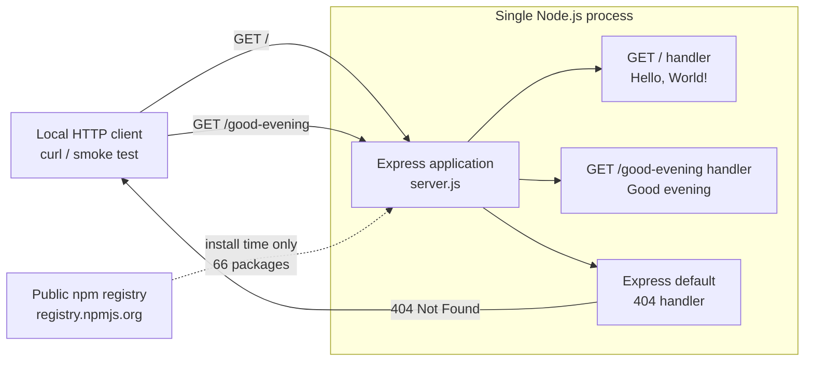

The single external touchpoint is **install-time**: `npm ci` or `npm install` fetches `express@5.2.1` and its 65 transitive packages from the public registry whose URLs and integrity digests are recorded in `package-lock.json`. Once installed, the service runs with no network dependency beyond the client's own loopback connection.

Adopting this service inside a larger enterprise landscape would therefore require work that does not exist today: external reachability (reverse proxy or TLS termination), environment-driven configuration, health/metrics surfaces, structured logging, graceful shutdown for orchestrators, and automated tests. Sections 1.3.2.2 and 1.3.2.3 record these as future-phase and uncovered-integration items rather than current capabilities.

### 1.2.2 High-Level Description

#### 1.2.2.1 Primary System Capabilities

| Capability | Implementation | Notes |
|------------|----------------|-------|
| Express application and listener | `const app = express()` (line 6); `app.listen(port, hostname, callback)` (lines 26–28) | Binds `127.0.0.1:3000` for the lifetime of the process |
| Root greeting route | `app.get('/', …)` (lines 14–18) | `200`, `text/plain`, byte-exact `Hello, World!\n` |
| Second greeting route | `app.get('/good-evening', …)` (lines 20–24) | `200`, `text/plain`, byte-exact `Good evening` |
| Explicit routing with strict paths | `app.enable('strict routing')` (line 12) | Trailing-slash variants and unregistered paths fall through to Express's default `404` |
| Startup observability | `console.log` in the listen callback (line 27) | Emits `Server running at http://127.0.0.1:3000/` as the only runtime output |
| Declared, locked dependency | `package.json` `dependencies.express` `^5.2.1`; `package-lock.json` `lockfileVersion` 3 | Enables reproducible `npm ci` installs of the 66-package tree |

The system has no other capability: no request parsing, no state, no persistence, no background work, no scheduled tasks, and no administrative surface.

#### 1.2.2.2 Major System Components

| Component | Path | Responsibility |
|-----------|------|----------------|
| Service entry point | `server.js` | Instantiates Express, registers both routes, enables strict routing, starts the listener |
| npm manifest | `package.json` | Package identity (`hello_world` 1.0.0, MIT), the single `express` dependency, placeholder `test` script |
| Dependency lockfile | `package-lock.json` | Pins `express@5.2.1` plus 65 transitive packages with resolved URLs and integrity digests |
| Install hygiene | `.gitignore` | Excludes `node_modules/` so installed dependencies are never committed |
| Project README | `README.md` | Documents the dependency, both endpoints, the `404` behavior, and the run procedure |

Supporting, non-runtime components:

| Component | Path | Role |
|-----------|------|------|
| Filename fixtures | `Test.test..js`, `!@#$%^&().js`, `QWYFFGHGHFDDJFDame_!@#$%^&(){}long_name_…server.js` | Standalone native-`http` servers retained to exercise filesystem/tooling handling of pathological names |
| Data fixture | `phonenumber.csv` | 15 synthetic `message,phonenumber` rows; not read by any code |
| Requirement history | `codebase_context (42).md`, `blitzy/documentation/Build Prompt.md` | The original `/hello` ask and the verbatim request that produced this change |
| Remediation transcript | `Response.txt` | JSON-wrapped action plan proposing six unimplemented hardening features |
| Documentation set | `blitzy/documentation/Agent Action Plan.md`, `Project Guide.md`, `Technical Specifications.md` | Requirement IDs, scope decisions, validation results, feature catalogue |
| Binary artifacts | `tech_spec.pdf`, `20250304165759.mp4`, `s1.png`, `defect_for_task_1.docx` | Unreferenced exports/attachments; not consumed by the service |

#### 1.2.2.3 Core Technical Approach

- **Language and module format** — JavaScript with CommonJS `require` semantics, one file, no transpilation step; nothing is exported (`module.exports` appears nowhere in the repository).
- **Runtime and framework** — Node.js hosting an Express 5 application. `express` is the project's first and only direct dependency; Express 5 requires Node.js 18 or newer, and the local runtime used during validation was Node 22.
- **Routing model** — A declarative table of two literal `GET` paths. Because `strict routing` is enabled, only the exact strings `/` and `/good-evening` are registered; all other paths, all trailing-slash variants, and all non-`GET` methods fall through to Express's default `404` handler.
- **Response construction** — Handlers deliberately use the low-level pattern `res.statusCode = 200; res.setHeader('Content-Type', 'text/plain'); res.end(...)`, which guarantees byte-exact bodies (including the presence or absence of a trailing newline) instead of relying on Express's string-sending defaults.
- **Configuration model** — None. Hostname and port are module-level `const` literals; there are no environment reads, config files, or command-line options.
- **Concurrency model** — The Node.js event loop with synchronous, non-blocking handlers; no promises, streams, timers, or worker threads in application code.
- **State and persistence** — None. Both handlers are pure functions of nothing: they ignore their `req` argument and return fixed strings.
- **Dependency management** — Declared in `package.json` and resolved in `package-lock.json`; installed output lives in `node_modules/`, which is git-ignored, so a fresh checkout must install before it can run.

The request lifecycle of the delivered service is:

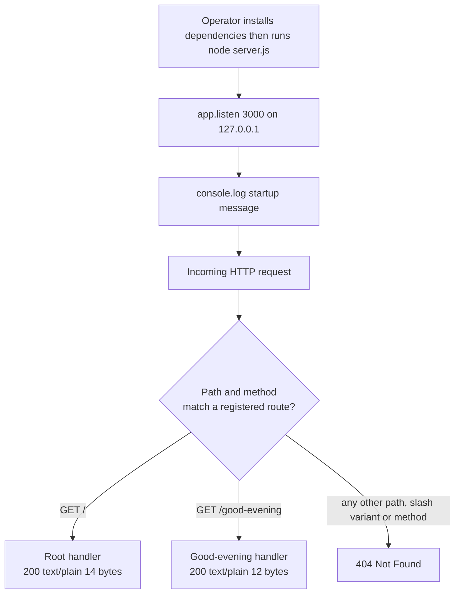

### 1.2.3 Success Criteria

#### 1.2.3.1 Measurable Objectives

| Objective | Measurement | Target and observed result |
|-----------|-------------|----------------------------|
| Start and bind successfully | Process starts and prints the startup line | `Server running at http://127.0.0.1:3000/`; observed on every launch |
| Preserve the root contract byte-exactly | Status, content type and body of `GET /` | `200`, `text/plain`, `Hello, World!\n` (14 bytes) — matched when re-verified at HEAD |
| Deliver the new contract byte-exactly | Status, content type and body of `GET /good-evening` | `200`, `text/plain`, `Good evening` (12 bytes, no newline) — matched when re-verified at HEAD |
| Reject unregistered requests | Status of an unregistered path and of a trailing-slash variant | `404` for `/does-not-exist`, `/good-evening/`, and `POST /` |
| Introduce the dependency reproducibly | Dependency declared and locked | `express ^5.2.1` in `package.json`; 66 packages pinned in `package-lock.json`; `npm ci` installs cleanly |
| Keep the change minimal | Files changed by the feature | 5 files (`server.js`, `package.json`, `package-lock.json`, `.gitignore`, `README.md`), per `blitzy/documentation/Project Guide.md` §5 |

The documentation set records the same objectives as a completion ledger: requirement delivery 4/4 (FR-A…FR-D), byte-exact contracts 2/2, in-scope files 5, functional checks 9/9, and 0 npm vulnerabilities across the 66-package tree (`blitzy/documentation/Project Guide.md` §3, §8).

#### 1.2.3.2 Critical Success Factors

- **A free port 3000 and a working loopback interface** — the service hardcodes `127.0.0.1:3000`, has no fallback port and no binding-error handling, so a conflict is fatal rather than recoverable.
- **Dependencies installed before startup** — `server.js` requires `express` at line 1; since `node_modules/` is git-ignored, `npm ci` or `npm install` is a prerequisite of `node server.js`.
- **A Node.js 18+ runtime** — the minimum for Express 5; the validation environment ran Node 22.
- **Byte discipline in the handlers** — the response bodies, and the presence or absence of a trailing newline, are verified by inspecting raw bytes rather than by eye.
- **Review of the recorded assumptions** — the endpoint path `/good-evening`, the un-normalized root body, and the `X-Powered-By` header are flagged as open confirmations rather than settled requirements (`blitzy/documentation/Agent Action Plan.md` §0.1.2; `blitzy/documentation/Project Guide.md` §1.6).

#### 1.2.3.3 Key Performance Indicators (KPIs)

No formal KPI, service-level objective, or monitoring contract exists: the repository defines no metrics, no targets, no alerting, and no instrumentation. The indicators below are therefore **derived from the observable purpose of the artifact and from the validation the project recorded**, and any future measurement would have to be introduced along with the observability features that do not exist today.

| Indicator | Definition | Target | Basis |
|-----------|------------|--------|-------|
| Contract fidelity | Share of the two registered routes returning byte-exact bodies | 100% (2/2 recorded) | Byte-level comparison of live responses; `Project Guide.md` §3 |
| Route coverage under test | Share of documented paths exercised (two routes plus unregistered and trailing-slash cases) | 100% (9/9 functional checks) | Functional harness and `curl` checks reported in `Project Guide.md` §3, §9.5 |
| Startup success | Share of launches that bind and log within the expected time | 100% on a free port | Live launch verification |
| Dependency integrity | Known vulnerabilities in the installed tree | 0 | `npm audit` over the 66-package tree, `Project Guide.md` §5 |
| Determinism | Share of requests that receive an identical response for a given path, method, and header set | 100% — handlers read no request input | Inspection of `server.js` lines 14–24 |
| Change discipline | Number of files touched relative to the intended change set | 5 of 5, no unrelated edits | `Project Guide.md` §5 compliance table |


## 1.3 Scope

### 1.3.1 In-Scope Elements

#### 1.3.1.1 Core Features and Functionalities

**Must-have capabilities.** These are the capabilities the current implementation delivers and therefore the ones this specification covers:

| Capability | Delivered by | Acceptance condition |
|------------|--------------|----------------------|
| Express application and loopback listener | `server.js` lines 1, 3–6, 26–28 | Binds `127.0.0.1:3000` and logs the startup line verbatim |
| Root greeting endpoint | `server.js` lines 14–18 | `GET /` returns `200`, `text/plain`, `Hello, World!\n` (14 bytes) |
| Second greeting endpoint | `server.js` lines 20–24 | `GET /good-evening` returns `200`, `text/plain`, `Good evening` (12 bytes) |
| Explicit routing with strict paths | `server.js` line 12 | Unregistered paths and trailing-slash variants return `404` |
| Declared and locked dependency | `package.json`, `package-lock.json` | `express ^5.2.1` declared; 66 packages pinned; `npm ci` installs cleanly |
| Install hygiene | `.gitignore` | `node_modules/` is ignored and never committed |
| Documented contract | `README.md` | Dependency, both endpoints, `404` behavior, and run steps are recorded |

**Primary user workflows.** The system supports exactly one operational workflow, and it is the workflow every consumer follows:

1. Install dependencies — `npm ci` (reproducible, from the lockfile) or `npm install`, from the repository root.
2. Start the service — `node server.js`; the process binds `127.0.0.1:3000` and prints `Server running at http://127.0.0.1:3000/`.
3. Exercise the contracts — `curl http://127.0.0.1:3000/` returns `Hello, World!`; `curl http://127.0.0.1:3000/good-evening` returns `Good evening`.
4. Observe rejection behavior — any other path, a trailing-slash variant such as `/good-evening/`, or a non-`GET` method returns `404`.
5. Terminate — the process runs until it is externally stopped; the service provides no shutdown path of its own.

A secondary, non-runtime workflow exists for tooling: scanning, hashing, or analyzing the repository as a fixture, including its pathological filenames and the documentation artifacts under `blitzy/documentation/`.

**Essential integrations.** The only integration required to operate the system is install-time access to the public npm registry, from which `package-lock.json` resolves `express@5.2.1` and its 65 transitive packages. Runtime integration is limited to two Express-internal collaborations: the router dispatching registered `GET` paths to handlers, and Express's default `404` handler terminating unmatched requests. No other integration is required, and none exists.

**Key technical requirements.**

| Requirement | Value / constraint |
|-------------|--------------------|
| Runtime | Node.js 18 or newer (Express 5 minimum); validated on Node 22 |
| Module format | CommonJS (`require`), single file, no transpilation, no exports |
| Framework | Express, declared as `^5.2.1` and locked at `5.2.1` |
| Routing surface | Exactly two literal `GET` paths: `/` and `/good-evening`; strict routing enabled |
| Response shape | `text/plain` with byte-exact bodies and no dynamic content |
| Network binding | `127.0.0.1:3000`, hardcoded as module constants |
| Configuration | None — no environment variables, config files, or command-line options |
| Repository layout | Flat, single-directory service with `blitzy/documentation/` as the only subtree |

#### 1.3.1.2 Implementation Boundaries

| Boundary dimension | Scope of this system |
|--------------------|----------------------|
| System boundary | One Node.js process executing `server.js` on one host; no child processes, clusters, or supervisors |
| Network boundary | The loopback interface only (`127.0.0.1`); the service is unreachable from other hosts and is not fronted by a proxy or TLS terminator |
| User groups covered | Local operators who start the process, local HTTP clients and smoke tests on the same host, and tooling that consumes the repository as a fixture |
| Data domains included | None. The only data the service handles are two fixed ASCII response strings; there is no persistent store, no cache, no session, and no request payload handling |
| Configuration boundary | Hardcoded constants in `server.js`; no environment or file-based configuration is read by any code path |
| Code boundary | `server.js` plus its npm manifests; the three filename fixtures, `phonenumber.csv`, `Response.txt`, and the binary artifacts are outside the running system |
| Geographic / market coverage | Not applicable — no network-facing deployment exists and no regional or regulatory dimension applies |

### 1.3.2 Out-of-Scope Elements

#### 1.3.2.1 Explicitly Excluded Features and Capabilities

The following capabilities are verified absent from the current implementation and are excluded from this specification's scope. Absence was established by reading `server.js` in full and by text-searching every code-bearing file in the repository.

| Category | Excluded capability and verification |
|----------|-------------------------------------|
| Routing | Methods other than `GET` — `POST /` returns `404`; no method-specific registration exists. Dynamic, parameterized, or wildcard routes — only two literal strings are registered |
| Request processing | Body, query-string, header, and cookie handling — both handlers accept `req` but never read it; no parsing middleware is installed |
| Configuration | Environment variables and config files — no `process.env` or config read exists in executable code; host and port are literals |
| Security | Authentication, authorization, TLS/HTTPS, input validation, rate limiting, and `X-Powered-By` suppression — none implemented; exposure is limited by the loopback binding instead |
| Persistence | Databases, ORMs, migrations, and file I/O — no driver imports and no file access in application code; startup logging writes to standard output only |
| Resilience | Server `error` handling, graceful shutdown, request-handler exception protection, `clientError` handling, and resource cleanup — specified in `Response.txt` as F-101–F-106 but not implemented |
| Observability | Structured logging, metrics, tracing, and health-check endpoints — the only output is one startup `console.log` |
| Lifecycle | Clustering, process managers, container definitions, and orchestrator manifests — none present |
| Tooling | Automated tests (the `test` script is an npm-init placeholder that exits 1), linters/formatters, CI pipelines, and type checking — none configured |
| Data | Consumption of `phonenumber.csv` — the file is present but imported by nothing |
| Entry point | `index.js` — declared as `package.json#main` but absent from the repository |
| Fixtures | The three pathological-filename scripts — deliberately left on the native `http` implementation and not re-platformed onto Express |

#### 1.3.2.2 Future Phase Considerations

Three candidate future phases are documented in the repository; none is implemented, and none changes the scope described above.

| Future phase | Content | Source and constraint |
|--------------|---------|-----------------------|
| Operational hardening (F-101–F-106) | Server `error` handler, `SIGTERM`/`SIGINT` graceful shutdown, handler `try`/`catch`, `clientError` handling, `req`/`res` validation, resource cleanup | `Response.txt`; catalogued in `blitzy/documentation/Technical Specifications.md` §2.3. Constrained to no metadata, dependency, port, hostname, or response-content changes |
| Original `/hello` requirement (F-201) | A path-discriminated `/hello` endpoint returning `"Hello world"` exactly as written | `codebase_context (42).md`; recorded as unmet in `blitzy/documentation/Technical Specifications.md` §2.4.1 |
| Optional quality enhancements | Minimal regression suite (`node:test` with `supertest`), `X-Powered-By` suppression, environment-driven host/port parameterization | `blitzy/documentation/Project Guide.md` §2.3, marked explicitly outside the delivered work |

Both the hardening programme and the original `/hello` requirement predate or sit beside the delivered change; neither was requested by the requester whose prompt produced the current implementation.

#### 1.3.2.3 Integration Points Not Covered

No integration point is active, and none is planned within the current scope. Specifically excluded are database connectivity, message brokers or queues, outbound HTTP clients, authentication/identity providers, TLS termination and reverse proxying, APM and log-shipping agents, service discovery, and any webhook or event-emitter surface. The system neither exposes nor consumes a third-party interface at runtime; the sole external touchpoint is the install-time fetch of npm packages. Any integration work would constitute a new phase, and — as §1.2.1.3 notes — would require configuration, observability, and lifecycle facilities that do not exist today.

#### 1.3.2.4 Unsupported Use Cases

The following use cases are explicitly not supported by the current implementation, and consumers must not assume otherwise:

- **Any externally reachable deployment.** The listener binds loopback only; exposing it requires additional infrastructure (reverse proxy, TLS termination, or networking changes) that lies outside this scope.
- **Production-grade operation.** There is no shutdown handling, no error recovery on bind failure, no health or readiness surface, no metrics, and no automated regression safety net; the artifact is positioned as a tutorial/integration fixture.
- **Multi-tenant or per-caller behavior.** Every request receives the same response for its path regardless of identity, headers, or origin; there is no authentication, authorization, tenancy, or quota concept.
- **Stateful interactions.** No sessions, cookies, tokens, or state tracking exist; nothing is persisted between requests or across restarts.
- **Content negotiation and alternate representations.** `text/plain` is the only media type; `Accept` headers are ignored because handlers do not read request headers.
- **Internationalization or localization.** Response bodies are fixed ASCII English strings compiled into the source.
- **API versioning or contract compatibility guarantees.** No versioning scheme, deprecation policy, or machine-readable contract (for example OpenAPI) exists; `README.md` prose is the only published description.
- **Dynamic or parameterized content.** There is no templating, path parameter, query processing, or file serving; `/good-evening/` and every other unregistered path return `404`.
- **Running the filename fixtures as equivalent servers.** The three duplicate scripts still return the greeting for every path and expose no `/good-evening` route, so they are not interchangeable with `server.js`.
- **Using the dormant artifacts.** `phonenumber.csv`, the media and document binaries, and `Response.txt` play no role in the running service.


## 1.4 References

#### Files Examined

- `README.md` — Repository identity (`hao-backprop-test`, "test project for backprop integration"), the documented HTTP contract for both endpoints and `404` behavior, and the `npm install` / `node server.js` run procedure with `http://127.0.0.1:3000/`.
- `server.js` — The single executable artifact: Express instantiation, hostname `127.0.0.1` and port `3000` constants, `app.enable('strict routing')`, the two `GET` route registrations with their byte-exact bodies, and the `app.listen` callback emitting the startup log.
- `package.json` — Package identity (`hello_world` v1.0.0, MIT, author `hxu`), the `express ^5.2.1` declaration, the unreachable `main: index.js` reference, and the placeholder `test` script.
- `package-lock.json` — npm `lockfileVersion` 3 lockfile pinning `express@5.2.1` plus 65 transitive packages with `registry.npmjs.org` URLs and sha512 integrity digests.
- `.gitignore` — Single entry `node_modules/`, establishing that installed dependencies are never committed and must be installed before running.
- `Test.test..js`, `!@#$%^&().js`, `QWYFFGHGHFDDJFDame_!@#$%^&(){}long_name_…server.js` — Three byte-identical native-`http` fixtures with pathological filenames; established both their continued route-agnostic behavior and their divergence from `server.js`.
- `phonenumber.csv` — Fifteen synthetic `message,phonenumber` rows not consumed by any code.
- `Response.txt` — JSON-wrapped action plan proposing the six unimplemented hardening features (server error handler, graceful shutdown, handler exception protection, `clientError` handling, request/response validation, resource cleanup).
- `codebase_context (42).md` — Original natural-language requirement for a `/hello` endpoint returning `"Hello world"`.
- `tech_spec.pdf` — 68-page rendered specification (`existing_project_2511_lakshya_github_5`) describing the pre-Express state of the system.
- `20250304165759.mp4`, `s1.png`, `defect_for_task_1.docx` — Unreferenced binary artifacts with no role in the running system.
- `blitzy/documentation/Agent Action Plan.md` — Requirement IDs FR-A…FR-D, the verbatim user prompt, scope boundaries (in-scope files, explicit exclusions), behavioral integration notes, and the Express 5 / Node.js 18+ compatibility research record.
- `blitzy/documentation/Project Guide.md` — Requirement-to-validation mapping, the 5-file change set, functional and dependency validation results, success metrics, risk register, and the development guide.
- `blitzy/documentation/Technical Specifications.md` — Feature catalogue F-001–F-006, proposed hardening F-101–F-106, the unimplemented `/hello` requirement F-201, and the freshness note in §2.7.4 that its acceptance criteria are invalidated by changes to `server.js`.
- `blitzy/documentation/Build Prompt.md` — The verbatim request that produced the current implementation.

#### Folders Examined

- Repository root (depth 0) — Flat layout of 19 git-tracked files; confirmed as the only non-subtree location of source, manifests, fixtures, and binary artifacts.
- `blitzy/` (depth 1) — Contains only the `documentation` subtree; no code or configuration.
- `blitzy/documentation/` (depth 2) — Four Markdown artifacts (Agent Action Plan, Build Prompt, Project Guide, Technical Specifications); no executables.

#### Web Sources

No external web sources were consulted for this section. The one externally-sourced fact it relies on — that Express 5 requires Node.js 18 or newer — is cited from the research record already captured in `blitzy/documentation/Agent Action Plan.md` §0.2.2 rather than from a live source.


# 2. Product Requirements

## 2.1 Feature Catalog

This section catalogues every requirement-bearing capability observable in `hao-backprop-test` at the current HEAD, in three evidence-based classes: **delivered** capabilities present in executable code, **proposed** capabilities documented in `Response.txt` and never implemented, and the **unmet original requirement** recorded in `codebase_context (42).md`. The repository contains no product backlog, ticketing system, roadmap, or test suite, so every priority label and status value below is inferred from the cited artifacts and states its basis.

Two provenance rules govern the catalogue:

- **The code is authoritative.** `blitzy/documentation/Technical Specifications.md` §2 already carries a feature catalogue, but it describes the superseded native-`http`, zero-dependency state: it characterises `server.js` as a 15-line route-agnostic server and its feature F-004 as a "Zero-Dependency Package Manifest". The checked-in `server.js` is an Express 5 application with two explicit routes and one declared dependency, so those items are superseded here. That document concedes the drift itself in §2.7.4: "any modification to `server.js` invalidates F-001 – F-005 acceptance criteria."
- **Existing IDs are retained where a capability survives.** F-001 – F-006 and F-101 – F-106 keep the identifiers used by the repository's documentation set so that prior traceability links still resolve; their content is corrected to the Express implementation. New identifiers cover capabilities the earlier catalogue did not carry.

### 2.1.1 Feature Classes and Status Distribution

| Feature Class | Feature IDs | Count | Evidence of Record |
|---------------|-------------|-------|--------------------|
| Delivered (in executable code) | F-001 – F-010 | 10 | `server.js`, `package.json`, `package-lock.json`, `.gitignore`, `README.md`, the three fixture scripts |
| Proposed hardening (not implemented) | F-101 – F-106 | 6 | `Response.txt` — the Agent Action Plan for the hardening programme |
| Unimplemented original requirement | F-201 | 1 | `codebase_context (42).md` |

### 2.1.2 Master Feature Inventory

| Feature ID | Feature Name | Feature Category | Status |
|------------|--------------|------------------|--------|
| F-001 | Express Application Hosting | Runtime Framework / Request Pipeline | Completed |
| F-002 | Loopback Listener Lifecycle | Network Transport / Process Lifecycle | Completed |
| F-003 | Startup Console Logging | Observability (Minimal) | Completed |
| F-004 | Root Greeting Endpoint (`GET /`) | Request/Response Handling | Completed |
| F-005 | Second Greeting Endpoint (`GET /good-evening`) | Request/Response Handling | Completed |
| F-006 | Explicit Routing with Strict Path Matching | Routing / Request Dispatch | Completed |
| F-007 | Declared and Locked Dependency Graph | Dependency Management / Build | Completed |
| F-008 | Published HTTP Contract Documentation | Documentation / Developer Experience | Completed |
| F-009 | Filesystem Edge-Case Filename Fixtures | Test Fixture / Tooling Resilience | Completed (retained, diverged) |
| F-010 | Orphan Data Fixture (`phonenumber.csv`) | Static Data Fixture | Present, Unused |
| F-101 | Server-Level `error` Event Handler | Resilience | Proposed (not implemented) |
| F-102 | Graceful Shutdown on SIGTERM/SIGINT | Lifecycle / Resilience | Proposed (not implemented) |
| F-103 | Request-Handler Exception Protection | Resilience | Proposed (not implemented) |
| F-104 | `clientError` Event Handler | Resilience | Proposed (not implemented) |
| F-105 | Request/Response Object Input Validation | Resilience / Defensive Programming | Proposed (not implemented) |
| F-106 | Resource Cleanup on Shutdown | Lifecycle | Proposed (not implemented) |
| F-201 | Path-Based `/hello` Routing with `"Hello world"` Body | Routing / Original Requirement | Not Implemented |

**Priority basis.** Priorities are relative to the artifact's stated purpose as a deterministic integration fixture (`README.md`: "test project for backprop integration"), not to a commercial roadmap.

| Priority | Feature IDs | Basis for the Label |
|----------|-------------|---------------------|
| Critical | F-001, F-002, F-004 | Without the framework, the listener, or the preserved root greeting there is no running service and no preserved contract (FR-B, FR-C in `blitzy/documentation/Agent Action Plan.md` §0.1.1) |
| High | F-005, F-006, F-007 | The new endpoint (FR-D), the explicit routing contract and the declared/locked dependency (FR-A) are the delivered change; each is asserted by a recorded validation check |
| Medium | F-009 | Intentional tooling fixture; its value is the pathological filename, not runtime behaviour (`Agent Action Plan.md` §0.6.2) |
| Low | F-003, F-008, F-010 | Informational or non-runtime: one startup log line, documentation prose, and an imported-by-nothing data file |
| High | F-101, F-102, F-103 | Labelled "critical production readiness gap" items in `Response.txt` §0.1 |
| Medium | F-104 | Labelled a resilience gap in `Response.txt`; severity unrated |
| Low | F-105, F-106 | Labelled defensive/future-placeholder in `Response.txt` §0.4 |
| Historical | F-201 | Superseded by the delivered change; the repository was repurposed as a fixture (`README.md`) |

### 2.1.3 Delivered Features (F-001 – F-010)

#### 2.1.3.1 F-001 Express Application Hosting

| Property | Value |
|----------|-------|
| Unique ID | F-001 |
| Feature Name | Express Application Hosting |
| Feature Category | Runtime Framework / Request Pipeline |
| Priority Level | Critical (inferred — the application object is the sole request pipeline) |
| Status | Completed |
| Primary Evidence | `server.js` lines 1 and 6; `package.json` line 12 |

| Description Aspect | Detail |
|--------------------|--------|
| Overview | `server.js` line 1 requires the framework (`const express = require('express')`) and line 6 instantiates the application (`const app = express()`). The Express application is the only request pipeline in the service: Express's bundled `router` dispatches registered literal paths to handlers and its bundled `finalhandler` terminates everything else. This replaces the superseded native `http.createServer((req, res) => …)` construction, which had no pipeline at all (still visible in `Test.test..js` lines 6–10). |
| Business Value | Delivers the requester's explicit ask to "add expressjs into the project" and makes `server.js` "actually use Express to serve requests, not merely have it installed" (`blitzy/documentation/Agent Action Plan.md` §0.7). Framework conventions replace hand-rolled request handling, so further literal endpoints cost one `app.get` registration instead of URL-parsing code (§0.4.1). |
| User Benefits | The service exposes a declarative routing table that a reader can verify at a glance: two `app.get` calls are the entire request surface. Adding a third greeting is a three-line change with no impact on the existing routes. |
| Technical Context | Express 5.2.1, CommonJS, single file, no transpilation step, nothing exported. No middleware is registered anywhere — a repository-wide text search finds no `app.use` call. Consequently the transitively installed `body-parser`, `serve-static`, `cookie`, `qs` and `mime-types` packages never execute: the handlers read no request input, so no parser is mounted. Framework defaults observed live at HEAD: `x-powered-by` **enabled** (every response carries `X-Powered-By: Express`), `etag` `"weak"` (never exercised, because handlers use `res.end` rather than `res.send`), `query parser` `simple`, `env` `development`, `trust proxy` `false`. |

| Dependency Type | Detail |
|-----------------|--------|
| Prerequisite Features | None — foundational. All other delivered features are realised inside this application object. |
| System Dependencies | Node.js 18 or newer (the minimum for Express 5); a successful `require('express')` resolution at process start, which in turn requires an install from `package-lock.json` because `node_modules/` is git-ignored |
| External Dependencies | The npm package `express` (declared `^5.2.1`, locked at `5.2.1`) and its 65 transitively installed packages |
| Integration Requirements | None beyond the listener established by F-002. No DI container, service registry, database, or configuration layer exists to integrate with (`Agent Action Plan.md` §0.4.1). |

#### 2.1.3.2 F-002 Loopback Listener Lifecycle

| Property | Value |
|----------|-------|
| Unique ID | F-002 |
| Feature Name | Loopback Listener Lifecycle |
| Feature Category | Network Transport / Process Lifecycle |
| Priority Level | Critical (inferred — without the listener nothing is reachable) |
| Status | Completed |
| Primary Evidence | `server.js` lines 3–4 and 26–28; live binding verified on port 3000 |

| Description Aspect | Detail |
|--------------------|--------|
| Overview | `app.listen(port, hostname, callback)` binds the Express application to the loopback interface on port 3000. Express creates and returns an underlying Node.js `http.Server`, so the listener's lifetime, error events and `close()` semantics are Node's, not Express's. The process remains running until it is signalled externally. |
| Business Value | Establishes the deterministic, network-reachable surface that the "backprop" integration target consumes (`README.md`), at an address that is stable across restarts. |
| User Benefits | One `node server.js` invocation yields a predictable endpoint at `http://127.0.0.1:3000/`, with no configuration step and no port selection logic to reason about. |
| Technical Context | Hostname `'127.0.0.1'` (line 3) and port `3000` (line 4) are module-level `const` literals; no `process.env` read, no config module, and no CLI-argument handling exists anywhere in executable code. The listen callback (lines 26–28) is the only startup hook. Because no `error` listener is attached to the returned server, a bind failure surfaces as an unhandled `error` event; `blitzy/documentation/Project Guide.md` §9.7 records `EADDRINUSE: address already in use 127.0.0.1:3000` as a reachable symptom, and the remediation is manual (free the port or edit the literal). Termination is by external signal only: no `SIGTERM`/`SIGINT` handler exists, and a live `kill -TERM` was observed to end the process with exit code `143` and no shutdown output. |

| Dependency Type | Detail |
|-----------------|--------|
| Prerequisite Features | F-001 — the listener is started on the Express application object |
| System Dependencies | Node.js `http.Server` (created by `app.listen`); `console` global for the startup line; an available TCP port 3000 on the loopback interface |
| External Dependencies | None at runtime |
| Integration Requirements | A free port 3000 and a functional loopback adapter; a supervisor or operator to terminate the process, since the service provides no shutdown path of its own |

#### 2.1.3.3 F-003 Startup Console Logging

| Property | Value |
|----------|-------|
| Unique ID | F-003 |
| Feature Name | Startup Console Logging |
| Feature Category | Observability (Minimal) |
| Priority Level | Low (inferred — informational only) |
| Status | Completed |
| Primary Evidence | `server.js` line 27; startup line observed verbatim on every launch |

| Description Aspect | Detail |
|--------------------|--------|
| Overview | On successful bind, the listen callback writes exactly one line to standard output: `Server running at http://127.0.0.1:3000/`. |
| Business Value | Gives operators and orchestration scripts a positive readiness signal: the string is stable and appears only after the socket is bound, so a waiter on that line can safely issue requests. |
| User Benefits | Immediate confirmation of the URL the service is reachable at, with the host and port already interpolated. |
| Technical Context | This is the only logging in the application. There are no per-request logs, no error logs, no shutdown logs, no log levels, no structured output, and no logging library. The message is a template literal interpolating the same `hostname` and `port` constants used for the bind, so the logged URL cannot disagree with the bound address while those constants remain the single source. |

| Dependency Type | Detail |
|-----------------|--------|
| Prerequisite Features | F-002 — the log fires from the listen callback, so it requires a successful bind (and therefore F-001) |
| System Dependencies | Node.js `console` global and an attached standard-output stream |
| External Dependencies | None |
| Integration Requirements | A log collector or terminal attached to the process standard output; no log-shipping or APM agent is present or configured |

#### 2.1.3.4 F-004 Root Greeting Endpoint (`GET /`)

| Property | Value |
|----------|-------|
| Unique ID | F-004 |
| Feature Name | Root Greeting Endpoint (`GET /`) |
| Feature Category | Request/Response Handling |
| Priority Level | Critical (inferred — this is the pre-existing contract the change had to preserve) |
| Status | Completed |
| Primary Evidence | `server.js` lines 14–18; live response `200`, `Content-Length: 14` |

| Description Aspect | Detail |
|--------------------|--------|
| Overview | `app.get('/', …)` answers the root path with status `200`, header `Content-Type: text/plain`, and the byte-exact body `Hello, World!` followed by a newline — 14 bytes. |
| Business Value | Preserves, byte for byte, the contract that existed before the framework migration, so the change remains backward compatible for any consumer and for the integration fixture's golden baseline (`Agent Action Plan.md` §0.1.2; `Project Guide.md` §5, FR-C). |
| User Benefits | Existing callers and smoke tests keep working unchanged: `curl http://127.0.0.1:3000/` prints `Hello, World!`. |
| Technical Context | The handler deliberately uses the low-level pattern `res.statusCode = 200; res.setHeader('Content-Type', 'text/plain'); res.end('Hello, World!\n')` rather than `res.send(...)`, which guarantees the trailing newline is preserved and that no content-type inference or `ETag` computation occurs (`Agent Action Plan.md` §0.5.2). The body is a source literal; `req` is accepted but never read. Two deviations from the pre-migration response are recorded and accepted: the framework adds `X-Powered-By: Express`, and the body's wording remains `Hello, World!` although the requester wrote "Hello world" and `codebase_context (42).md` asked for `"Hello world"` (§0.1.2, flagged for requester confirmation). |

| Dependency Type | Detail |
|-----------------|--------|
| Prerequisite Features | F-001 (pipeline) and F-002 (listener) |
| System Dependencies | Express `res` object supporting the Node `statusCode`/`setHeader`/`end` API |
| External Dependencies | None — the body is a literal |
| Integration Requirements | None; consumers need only reach `127.0.0.1:3000` over plain HTTP |

#### 2.1.3.5 F-005 Second Greeting Endpoint (`GET /good-evening`)

| Property | Value |
|----------|-------|
| Unique ID | F-005 |
| Feature Name | Second Greeting Endpoint (`GET /good-evening`) |
| Feature Category | Request/Response Handling |
| Priority Level | High (inferred — the newly requested capability, FR-D) |
| Status | Completed |
| Primary Evidence | `server.js` lines 20–24; live response `200`, `Content-Length: 12` |

| Description Aspect | Detail |
|--------------------|--------|
| Overview | `app.get('/good-evening', …)` answers that exact path with status `200`, header `Content-Type: text/plain`, and the byte-exact body `Good evening` — 12 bytes, with no trailing newline. |
| Business Value | Delivers the requester's stated ask to "add another endpoint that return the response of 'Good evening'", turning the single-route demonstration server into a two-endpoint routing example (`blitzy/documentation/Build Prompt.md`; `Agent Action Plan.md` §0.1.1, FR-D). |
| User Benefits | A second, independently addressable greeting is available for client tests and for tooling that asserts on discrete endpoints rather than on a catch-all response. |
| Technical Context | The handler mirrors the root handler's construction (`statusCode` / `setHeader` / `end`) so the body is byte-exact, including the deliberate absence of a trailing newline; the requester wrote the response without one, and the difference from the root greeting's style is flagged as an assumption for confirmation (`Agent Action Plan.md` §0.1.2). The endpoint's path was likewise not specified by the requester and was assumed to be `/good-evening` (kebab-case) instead of `/evening` or `/goodevening`. Because Express 5 reserves the characters `( ) [ ] ? + & !` in path patterns, the simple literal path avoids the migration pitfalls that changed path matching (§0.2.2). |

| Dependency Type | Detail |
|-----------------|--------|
| Prerequisite Features | F-001 (pipeline), F-002 (listener), F-006 (the route is matched only because explicit routing replaced the catch-all handler) |
| System Dependencies | Express `app.get` registration and literal path matching |
| External Dependencies | None |
| Integration Requirements | None; consumers need only reach `127.0.0.1:3000` over plain HTTP |

#### 2.1.3.6 F-006 Explicit Routing with Strict Path Matching

| Property | Value |
|----------|-------|
| Unique ID | F-006 |
| Feature Name | Explicit Routing with Strict Path Matching |
| Feature Category | Routing / Request Dispatch |
| Priority Level | High (inferred — it defines which requests succeed and which are refused) |
| Status | Completed |
| Primary Evidence | `server.js` line 12 (`app.enable('strict routing')`) and lines 14, 20; observed status codes for matched, unregistered, trailing-slash and non-`GET` requests |

| Description Aspect | Detail |
|--------------------|--------|
| Overview | Exactly two literal `GET` paths are registered — `/` and `/good-evening`. Trailing-slash variants are treated as distinct, unregistered paths because strict routing is enabled, and every other path or method falls through to Express's default `404 Not Found` handler. |
| Business Value | Converts the service from a route-agnostic responder into an endpoint model: the routing contract is explicit and enumerable, which is what a fixture must be for downstream tooling to assert against (`Agent Action Plan.md` §0.1.1, §0.4.2). |
| User Benefits | Predictable semantics: a request to a documented path returns content, and any typo, trailing slash, or unsupported method fails loudly with `404` instead of silently receiving a greeting. |
| Technical Context | Strict routing was applied as a QA refinement (commit `f2c2ca4`) after the initial re-platform, so `/good-evening/` returns `404` rather than content (`Project Guide.md` §5, QA Issue 1). Two Express defaults remain in force and are observable: matching is **case-insensitive** (because `case sensitive routing` is not enabled — `GET /GOOD-EVENING` returns `200`), and query strings do not affect matching (`GET /?x=1` returns `200`). Express also answers `HEAD` from the `GET` registration and `OPTIONS` with `200` and `Allow: GET, HEAD`; `POST`, `PUT`, `DELETE` and `PATCH` on a registered path return `404`. The `404` response is Express's default HTML body (`Cannot GET <path>`) served with `Content-Type: text/html; charset=utf-8`, `Content-Security-Policy: default-src 'none'` and `X-Content-Type-Options: nosniff`. |

| Dependency Type | Detail |
|-----------------|--------|
| Prerequisite Features | F-001 — the routing table belongs to the Express application object |
| System Dependencies | Express `router` (route matching) and `finalhandler` (default `404`) |
| External Dependencies | None |
| Integration Requirements | Consumers must construct requests against the exact registered literals; the trailing-slash and case behaviours are contract details, not configurable options, because no configuration surface exists |

#### 2.1.3.7 F-007 Declared and Locked Dependency Graph

| Property | Value |
|----------|-------|
| Unique ID | F-007 |
| Feature Name | Declared and Locked Dependency Graph |
| Feature Category | Dependency Management / Build |
| Priority Level | High (inferred — FR-A, and the precondition for the service starting at all) |
| Status | Completed |
| Primary Evidence | `package.json` lines 11–13; `package-lock.json` (`lockfileVersion` 3, 66 package entries); `.gitignore` |

| Description Aspect | Detail |
|--------------------|--------|
| Overview | `package.json` declares exactly one runtime dependency, `"express": "^5.2.1"`, and `package-lock.json` pins the resolved tree: `express@5.2.1` plus 65 transitive packages, 66 package entries in total, each with a `registry.npmjs.org` tarball URL and a `sha512-…` integrity digest. `.gitignore` excludes `node_modules/` so the repository stays source-only. |
| Business Value | Makes the first third-party dependency in the project's history reproducible and auditable: `npm ci` reproduces the exact tree from the committed lockfile, and the pinned digests give each artifact a verifiable identity (`Agent Action Plan.md` §0.3.1). |
| User Benefits | A fresh checkout installs deterministically with one command; reviewers can see the full footprint (0 → 66 packages) without inspecting `node_modules/`. |
| Technical Context | The declared range `^5.2.1` permits any 5.x release at or above 5.2.1, so the lockfile — not the manifest — is what guarantees reproducibility; `Project Guide.md` §6 records this as a low, mitigated risk. Express 5.2.1 declares 28 direct dependencies, including `router` (the routing engine behind `app.get`), `finalhandler` (the default `404`), `body-parser`, `qs`, `http-errors`, `statuses`, `accepts`/`type-is`/`mime-types`, `cookie`/`cookie-signature`, and `debug` (§0.3.1). The manifest also carries pre-existing inconsistencies that this feature deliberately left alone: `main` points to `index.js`, which does not exist in the repository, and the `test` script is the unmodified npm-init placeholder. |

| Dependency Type | Detail |
|-----------------|--------|
| Prerequisite Features | None; it is instead a prerequisite of F-001 — `require('express')` cannot resolve until the tree is installed |
| System Dependencies | npm CLI (7 or newer, to install a `lockfileVersion` 3 tree); access to a `node_modules/` path writable by the installing user |
| External Dependencies | The public npm registry (`registry.npmjs.org`) at install time, for all 66 packages |
| Integration Requirements | Install must precede startup, because `node_modules/` is git-ignored and therefore absent from a fresh checkout (`Project Guide.md` §9.3) |

#### 2.1.3.8 F-008 Published HTTP Contract Documentation

| Property | Value |
|----------|-------|
| Unique ID | F-008 |
| Feature Name | Published HTTP Contract Documentation |
| Feature Category | Documentation / Developer Experience |
| Priority Level | Low (inferred — classified as an optional deliverable in `Agent Action Plan.md` §0.5.1) |
| Status | Completed |
| Primary Evidence | `README.md` lines 4–23 |

| Description Aspect | Detail |
|--------------------|--------|
| Overview | `README.md` states the framework and dependency (`express` `^5.2.1`), both endpoints with their status, content type and body, the `404 Not Found` behaviour for any other path, and the run procedure (`npm install`, then `node server.js`) with the listening URL. |
| Business Value | Gives reviewers and integration tooling a written contract to test against without reading source, and records the deliberate behavioural change (unregistered paths now `404` instead of receiving the greeting) where a consumer will encounter it. |
| User Benefits | One page answers "what does this serve, and how do I start it", including the requirement to install dependencies first. |
| Technical Context | The document is prose; there is no machine-readable contract such as OpenAPI. Its two documented bodies match the observed byte-exact responses, including the root's trailing newline and the absence of one on `Good evening`, so the README is currently consistent with the running service. The project identity line remains `test project for backprop integration`, and the term "backprop" is defined nowhere in the repository. |

| Dependency Type | Detail |
|-----------------|--------|
| Prerequisite Features | F-004, F-005, F-006, F-007 — the document describes their behaviour, so it must be revised whenever any of them changes |
| System Dependencies | None |
| External Dependencies | One outbound documentation link, `https://expressjs.com/`, for the framework name |
| Integration Requirements | None; the file is not read by any code path |

#### 2.1.3.9 F-009 Filesystem Edge-Case Filename Fixtures

| Property | Value |
|----------|-------|
| Unique ID | F-009 |
| Feature Name | Filesystem Edge-Case Filename Fixtures |
| Feature Category | Test Fixture / Tooling Resilience |
| Priority Level | Medium (inferred — intentional fixture; explicitly retained, not modified) |
| Status | Completed (retained; diverged from `server.js`) |
| Primary Evidence | `Test.test..js`, `!@#$%^&().js`, and the 199-character `QWYFFGHGHFDDJFDame_…_server.js`; each 14 lines, all three byte-identical to each other (md5 `05576d40…`) and no longer identical to `server.js` (md5 `a423b6d4…`) |

| Description Aspect | Detail |
|--------------------|--------|
| Overview | Three standalone scripts at the repository root carry deliberately hostile filenames — a double dot in the basename, shell-special characters, and a 199-character name — and each contains a working Node.js server. They remain on the native `http` implementation and are route- and method-agnostic: live, `Test.test..js` returns `200` and `Hello, World!\n` for `/`, `/good-evening`, arbitrary nested paths, and even `POST /`. |
| Business Value | Gives any tool that ingests the repository — scanner, copier, archiver, parser — a known-good corpus for verifying that it handles pathological filenames without corrupting or skipping files. |
| User Benefits | Filesystem and tooling edge cases can be exercised without constructing them externally, and the fixtures are self-contained enough to run as sample servers. |
| Technical Context | The earlier catalogue required each duplicate to be "byte-identical to `server.js`". The Express re-platform broke that equality by design: `Agent Action Plan.md` §0.6.2 records the decision to leave the fixtures unchanged and accepts the divergence, because "their value lies in their pathological filenames rather than behavioral parity". They remain byte-identical to each other, so any two of them can still be compared. The earlier catalogue describes the long filename as "approximately 258 characters"; the actual basename is 199 characters. |

| Dependency Type | Detail |
|-----------------|--------|
| Prerequisite Features | F-001 – F-004 by shared lineage only: the fixtures preserve the pre-migration implementation that these features replaced. No runtime dependency exists either way. |
| System Dependencies | A filesystem and toolchain that accept the special characters in the filenames; the Node.js `http` module |
| External Dependencies | None — the fixtures declare and require nothing beyond Node built-ins |
| Integration Requirements | None; the fixtures bind the same loopback port 3000 and therefore cannot run concurrently with `server.js` |

#### 2.1.3.10 F-010 Orphan Data Fixture (`phonenumber.csv`)

| Property | Value |
|----------|-------|
| Unique ID | F-010 |
| Feature Name | Orphan Data Fixture (`phonenumber.csv`) |
| Feature Category | Static Data Fixture |
| Priority Level | Low (inferred — outside the running system) |
| Status | Present, Unused |
| Primary Evidence | `phonenumber.csv` — header plus 15 data rows |

| Description Aspect | Detail |
|------------------|--------|
| Overview | `phonenumber.csv` holds a `message,phonenumber` header and 15 synthetic rows whose numbers occupy the `+111111112xx` range, with short conversational messages. |
| Business Value | Provides a tabular sample for external tooling that scans repositories for data fixtures; it changes nothing about the service. |
| User Benefits | None at runtime. The file is informative only. |
| Technical Context | No executable code reads it: a repository-wide text search for file I/O and for the filename finds no reference in any `.js` file, and `server.js` contains no `fs` usage of any kind. It is cited only in documentation prose. Removing it would not alter startup, routing, or response bodies. |

| Dependency Type | Detail |
|-----------------|--------|
| Prerequisite Features | None |
| System Dependencies | None at runtime |
| External Dependencies | None |
| Integration Requirements | None |

### 2.1.4 Documented but Unimplemented Features (F-101 – F-106, F-201)

The seven features in this subsection are catalogued for completeness and traceability. None is present in executable code: `server.js` contains no `process.on`, no `try`, no `catch`, no `server.on`, and no header-disabling call, and the only route registrations in the repository are the two in F-004 and F-005.

**Provenance and scope note for F-101 – F-106.** All six come from `Response.txt`, a JSON-wrapped Agent Action Plan for a hardening bug fix. That plan targets the superseded native-`http` implementation — its line references (`server.js` lines 6–26) describe `http.createServer`, which no longer exists in `server.js` — and its §0.5 constraints assert that `package.json`, `package-lock.json` and `README.md` must not be modified, that no npm package may be added, and that "Express.js or other frameworks" is out of scope. The delivered change contradicts each of those constraints, and `Agent Action Plan.md` §0.1.2 records the ruling that resolves the conflict: the zero-dependency posture belongs "exclusively to the separate, not-yet-implemented `Response.txt` hardening remediation", and the requester's explicit instruction to add Express governs. The proposals therefore survive as work items, but their assumptions must be re-derived against the Express application before any of them is implemented; the underlying Node.js `http.Server` that `app.listen` returns still emits `error` and `clientError` and still exposes `close()`, so the technical intent remains reachable.

#### 2.1.4.1 F-101 Server-Level `error` Event Handler

| Property | Value |
|----------|-------|
| Unique ID | F-101 |
| Feature Name | Server-Level `error` Event Handler |
| Feature Category | Resilience |
| Priority Level | High (per `Response.txt` §0.1) |
| Status | Proposed (not implemented) |
| Primary Evidence | `Response.txt` §0.4 "Change #2"; absence in `server.js` |

| Description Aspect | Detail |
|--------------------|--------|
| Overview | Register an `error` listener on the server that logs a diagnostic line and exits non-zero on bind failures such as `EADDRINUSE` and `EACCES`. |
| Business Value | Replaces an unhandled `error` event — which crashes the process without a useful message — with a deterministic, observable failure path. |
| User Benefits | An operator encountering a port conflict sees an actionable line naming the cause instead of a stack trace. |
| Technical Context | Proposed against `http.createServer`; on the Express implementation the same listener attaches to the server returned by `app.listen`. The originating plan forbade adding a logging library, so only Node built-ins are available. |

| Dependency Type | Detail |
|-----------------|--------|
| Prerequisite Features | F-002 — the listener is the object that emits the event |
| System Dependencies | Node.js `process.exit`; the `http.Server` returned by `app.listen` |
| External Dependencies | None (the plan forbids new dependencies) |
| Integration Requirements | None |

#### 2.1.4.2 F-102 Graceful Shutdown on SIGTERM/SIGINT

| Property | Value |
|----------|-------|
| Unique ID | F-102 |
| Feature Name | Graceful Shutdown on SIGTERM/SIGINT |
| Feature Category | Lifecycle / Resilience |
| Priority Level | High (per `Response.txt` §0.1) |
| Status | Proposed (not implemented) |
| Primary Evidence | `Response.txt` §0.4 "Changes #4 and #5"; absence in `server.js`; observed exit code `143` on `SIGTERM` |

| Description Aspect | Detail |
|--------------------|--------|
| Overview | A `gracefulShutdown(signal)` function invoked from `process.on('SIGTERM')` and `process.on('SIGINT')` handlers calls `server.close()` to stop accepting connections, then forces exit after a 10-second timeout if connections do not drain. |
| Business Value | Prevents in-flight request loss on orchestrator-driven termination and on operator `Ctrl+C`. |
| User Benefits | Cleaner restart cycles and predictable termination semantics, including an exit code of 0 on a drained shutdown. |
| Technical Context | Today no signal handler exists, so the runtime's default disposition applies and the process dies immediately with exit code `143`. This feature and F-106 are introduced together, the cleanup hook running inside the `close` callback. |

| Dependency Type | Detail |
|-----------------|--------|
| Prerequisite Features | F-002; F-106 (the cleanup hook executes inside this feature's close callback) |
| System Dependencies | Node.js `process` global; `server.close()`; `setTimeout` for the force-exit guard |
| External Dependencies | None |
| Integration Requirements | An operator or orchestrator that sends `SIGTERM` or `SIGINT` |

#### 2.1.4.3 F-103 Request-Handler Exception Protection

| Property | Value |
|----------|-------|
| Unique ID | F-103 |
| Feature Name | Request-Handler Exception Protection |
| Feature Category | Resilience |
| Priority Level | High (per `Response.txt` §0.1) |
| Status | Proposed (not implemented) |
| Primary Evidence | `Response.txt` §0.4 "Change #1"; `server.js` handlers contain no `try`/`catch` |

| Description Aspect | Detail |
|--------------------|--------|
| Overview | Wrap the handler body in `try`/`catch`; on exception, log it and return `500 Internal Server Error` only when `res.headersSent` is `false`. |
| Business Value | Prevents a synchronous exception inside a handler from taking down the whole process. |
| User Benefits | The service stays up across pathological client interactions instead of restarting. |
| Technical Context | The current handlers perform three statements and cannot throw in practice, so the proposal is defensive future-proofing rather than a fix for an observed defect. It would be applied to both the F-004 and F-005 handlers, and Express's own error handling would additionally need consideration, since Express catches synchronous handler throws and routes them to error middleware. |

| Dependency Type | Detail |
|-----------------|--------|
| Prerequisite Features | F-004 and F-005 (the two handlers to be protected) |
| System Dependencies | `ServerResponse.headersSent`; Express error propagation to the default handler |
| External Dependencies | None |
| Integration Requirements | None |

#### 2.1.4.4 F-104 `clientError` Event Handler

| Property | Value |
|----------|-------|
| Unique ID | F-104 |
| Feature Name | `clientError` Event Handler |
| Feature Category | Resilience |
| Priority Level | Medium (per `Response.txt`) |
| Status | Proposed (not implemented) |
| Primary Evidence | `Response.txt` §0.4 "Change #3"; absence in `server.js` |

| Description Aspect | Detail |
|--------------------|--------|
| Overview | Register a `clientError` listener that answers malformed HTTP requests by ending the socket with a `400 Bad Request` status line. |
| Business Value | Keeps the listener alive through protocol violations sent by buggy clients or by scanners. |
| User Benefits | Malformed requests receive a defined refusal instead of interrupting the service. |
| Technical Context | The plan notes that no request or response object is available in this event, so the handler must write directly to the socket, guarding on `socket.writable`. |

| Dependency Type | Detail |
|-----------------|--------|
| Prerequisite Features | F-002 |
| System Dependencies | Node.js `http.Server` `clientError` event and raw socket write |
| External Dependencies | None |
| Integration Requirements | None |

#### 2.1.4.5 F-105 Request/Response Object Input Validation

| Property | Value |
|----------|-------|
| Unique ID | F-105 |
| Feature Name | Request/Response Object Input Validation |
| Feature Category | Resilience / Defensive Programming |
| Priority Level | Low (per `Response.txt`) |
| Status | Proposed (not implemented) |
| Primary Evidence | `Response.txt` §0.4 "Change #1"; absence in `server.js` |

| Description Aspect | Detail |
|--------------------|--------|
| Overview | Return early from the handler when `req` or `res` is falsy, logging the condition. |
| Business Value | Guards against a framework contract violation that would otherwise throw a null-reference error. |
| User Benefits | Marginal — it protects against an event the runtime does not produce under normal operation. |
| Technical Context | Defensive programming only; the originating plan offers no observed defect as justification, and no evidence in the repository shows a falsy argument reaching a handler. |

| Dependency Type | Detail |
|-----------------|--------|
| Prerequisite Features | F-004 and F-005 |
| System Dependencies | None |
| External Dependencies | None |
| Integration Requirements | None |

#### 2.1.4.6 F-106 Resource Cleanup on Shutdown

| Property | Value |
|----------|-------|
| Unique ID | F-106 |
| Feature Name | Resource Cleanup on Shutdown |
| Feature Category | Lifecycle |
| Priority Level | Low (per `Response.txt` — placeholder) |
| Status | Proposed (not implemented) |
| Primary Evidence | `Response.txt` §0.4 "Change #4" |

| Description Aspect | Detail |
|--------------------|--------|
| Overview | Define a cleanup hook inside the `gracefulShutdown` close callback for releasing sockets, file handles, or future external connections. |
| Business Value | Establishes the structural location for cleanup work so future resources have a defined place to be released. |
| User Benefits | Forward-compatible shutdown semantics; no observable benefit today. |
| Technical Context | In the originating plan the hook is a comment placeholder because the application owns no such resources — it holds no database connection, no file handle, and no cache. |

| Dependency Type | Detail |
|-----------------|--------|
| Prerequisite Features | F-102 (the hook runs inside its close callback) |
| System Dependencies | None |
| External Dependencies | None |
| Integration Requirements | None |

#### 2.1.4.7 F-201 Path-Based `/hello` Routing with `"Hello world"` Body

| Property | Value |
|----------|-------|
| Unique ID | F-201 |
| Feature Name | Path-Based `/hello` Routing with `"Hello world"` Body |
| Feature Category | Routing / Original Requirement |
| Priority Level | Historical (superseded by the delivered change) |
| Status | Not Implemented |
| Primary Evidence | `codebase_context (42).md`; observed `404` for `GET /hello` |

| Description Aspect | Detail |
|--------------------|--------|
| Overview | The repository's earliest requirement note asked for a Node.js tutorial project "that features one end point '/hello' that returns "Hello world" to the calling HTTP client". No `/hello` route exists: `GET /hello` returns `404`. |
| Business Value | None today — the repository was repurposed as an integration fixture (`README.md`), and the requester whose prompt produced the current implementation asked only to add Express and a `Good evening` endpoint. |
| User Benefits | None in the current scope. |
| Technical Context | The requirement is unmet in three respects: no `/hello` path is registered, the root body is `Hello, World!\n` rather than `"Hello world"`, and the project is presented as a test fixture rather than a tutorial. `Agent Action Plan.md` §0.1.2 flags the wording mismatch as an open confirmation — whether the root response should be normalised to `Hello world` and whether a `/hello` route should also be exposed — and deliberately preserves current behaviour instead of changing it unrequested. Delivering it would now be a single `app.get('/hello', …)` registration on the F-006 routing table. |

| Dependency Type | Detail |
|-----------------|--------|
| Prerequisite Features | Would build on F-001, F-002 and F-006 |
| System Dependencies | Express literal path registration |
| External Dependencies | None |
| Integration Requirements | Requester confirmation of the path and the exact body, since the note and the requester's own wording disagree |

### 2.1.5 Features Excluded from This Catalogue

Three further candidate enhancements are documented in the repository and are recorded here as **not features of this system**, because the delivering documentation places them explicitly outside the work performed: a minimal automated regression suite (`node:test` with `supertest`) recorded as "Optional, out of AAP scope" (`blitzy/documentation/Project Guide.md` §1.6, §2.3), suppression of the `X-Powered-By` header via `app.disable('x-powered-by')` (`Agent Action Plan.md` §0.4.2), and environment-variable parameterisation of host and port (`Project Guide.md` §2.3). None is implemented; each carries documented effort of approximately 2.0h, 0.25h and 1.0h respectively. They are carried forward as maintenance considerations in §2.4.5 rather than as requirements.

## 2.2 Functional Requirements Table

### 2.2.1 Requirement Conventions

Every functional requirement below carries the identifier `<feature-id>-RQ-<NNN>`, so a requirement's parent feature is legible from its ID alone. Priorities use the MoSCoW scale; complexity rates implementation effort for the smallest change that satisfies the requirement.

| Dimension | Values and Meaning |
|-----------|--------------------|
| Priority | **Must-Have** — the delivered or proposed behaviour fails without it; **Should-Have** — a documented property whose loss degrades the contract or its verifiability; **Could-Have** — observed Express default behaviour recorded so a test can rely on it |
| Complexity | **High** — cross-cutting or requiring new lifecycle machinery; **Medium** — more than a literal change or with platform-dependent behaviour; **Low** — a literal, a single call, or a present-or-absent file |
| Verification basis | The repository ships **no automated suite**: the `test` script in `package.json` is the npm-init placeholder that prints `Error: no test specified` and exits `1`. Acceptance criteria are therefore stated as externally observable HTTP, install, or file-system facts and were re-verified against HEAD by launching `node server.js` on Node v22.23.3 and issuing live requests. `blitzy/documentation/Project Guide.md` §3 records the parallel 9/9 functional harness and 15/15 total checks. |
| Table format | Requirement detail tables carry four columns (`Requirement ID`, `Description`, `Priority`, `Complexity`). Technical specifications and validation rules are given per feature as an attribute table with two columns. |

### 2.2.2 Delivered Feature Requirements (F-001 – F-010)

#### 2.2.2.1 F-001 Express Application Hosting

| Requirement ID | Description | Priority | Complexity |
|----------------|-------------|----------|------------|
| F-001-RQ-001 | `server.js` SHALL obtain the framework through CommonJS `require('express')` and create the application by calling the factory once, at module scope | Must-Have | Low |
| F-001-RQ-002 | The application SHALL register no middleware; request handling SHALL consist solely of literal route registrations and Express's built-in terminal handlers | Should-Have | Low |
| F-001-RQ-003 | `server.js` SHALL define the whole service in one executed file, exporting nothing and requiring no other project file | Must-Have | Low |

| Attribute | Specification |
|-----------|---------------|
| Acceptance Criteria | F-001-RQ-001: `server.js` line 1 is `const express = require('express')` and line 6 is `const app = express()`; the process starts without a module-resolution error once dependencies are installed. F-001-RQ-002: a text search across every `.js` file finds no `app.use` call and no `app.param`; the only Express API calls in the repository are `express()`, `app.enable`, `app.get` (×2) and `app.listen`. F-001-RQ-003: the repository contains exactly four `.js` files, only one of which is the entry point; `server.js` contains no `module.exports` and no `require` of a local path. |
| Input Parameters | None — the factory takes no arguments and no configuration object |
| Output / Response | A configured Express application instance held in the module-level `app` binding; request dispatch delegated to Express's router and default final handler |
| Performance Criteria | Instantiation is synchronous and completes before the listener is created; no framework-internal asynchronous work occurs at construction |
| Data Requirements | None — no configuration file, environment variable, or default-value table is read |
| Business Rules | Framework adoption is the deliverable the requester asked for and must be real, not merely installed: Express must serve the requests (`blitzy/documentation/Agent Action Plan.md` §0.7). The single-file, CommonJS convention must be preserved (§0.1.2). |
| Data Validation | None — no request data is parsed, so no validation of parsed input is possible or required |
| Security Requirements | Express defaults are inherited unmodified: `x-powered-by` remains enabled, advertising the framework on every response; `etag` remains `"weak"` but is never exercised because handlers call `res.end` rather than `res.send` |
| Compliance Requirements | MIT licence terms of `express` and of the 65 packages in its resolved tree |

#### 2.2.2.2 F-002 Loopback Listener Lifecycle

| Requirement ID | Description | Priority | Complexity |
|----------------|-------------|----------|------------|
| F-002-RQ-001 | The listener SHALL bind the loopback host `127.0.0.1` | Must-Have | Low |
| F-002-RQ-002 | The listener SHALL bind TCP port `3000`, with no fallback port selection | Must-Have | Low |
| F-002-RQ-003 | The listen callback SHALL execute exactly once on successful bind, and the process SHALL then remain running until externally signalled | Must-Have | Low |
| F-002-RQ-004 | Process termination SHALL occur through the runtime's default signal disposition, with no shutdown hook of the application's own | Could-Have | Low |

| Attribute | Specification |
|-----------|---------------|
| Acceptance Criteria | F-002-RQ-001: an inspecting tool shows the socket bound to `127.0.0.1:3000`, and the host is not reachable from a non-loopback address. F-002-RQ-002: the socket is on port `3000`; starting a second instance while the first runs produces `EADDRINUSE` rather than a shift to another port. F-002-RQ-003: `node server.js` prints the startup line once and the process persists, serving requests indefinitely. F-002-RQ-004: `kill -TERM <pid>` ends the process with exit code `143` and no shutdown output — observed. |
| Input Parameters | None — `hostname` and `port` are module-level `const` literals (`server.js` lines 3–4) |
| Output / Response | An open TCP listener on the loopback interface; the callback returns nothing |
| Performance Criteria | Bind completes during process start-up; no retry, back-off, or timeout logic exists. `Response.txt` §0.6 offers aspirational figures for the superseded implementation (under 50 ms per request, under 50 MB RSS, 100+ concurrent connections); none is a committed objective of this build |
| Data Requirements | None |
| Business Rules | A free port 3000 and a functional loopback interface are preconditions, not guarantees the service can restore: no `error` listener is attached to the server returned by `app.listen`, so `EADDRINUSE` is surfaced as an unhandled error event (`blitzy/documentation/Project Guide.md` §9.7 records it as a known symptom with a manual remedy). Loopback binding is the service's entire exposure boundary. |
| Data Validation | None |
| Security Requirements | Loopback-only binding; plain HTTP with no TLS, no authentication, and no client-address filtering. Any local process can reach the service. |
| Compliance Requirements | None documented |

#### 2.2.2.3 F-003 Startup Console Logging

| Requirement ID | Description | Priority | Complexity |
|----------------|-------------|----------|------------|
| F-003-RQ-001 | Exactly one line SHALL be written to standard output on successful bind | Must-Have | Low |
| F-003-RQ-002 | The line SHALL contain the bound host and port | Should-Have | Low |
| F-003-RQ-003 | No other application log output SHALL be produced: no per-request, error, or shutdown lines | Should-Have | Low |

| Attribute | Specification |
|-----------|---------------|
| Acceptance Criteria | F-003-RQ-001/RQ-002: standard output is exactly `Server running at http://127.0.0.1:3000/` followed by a newline. F-003-RQ-003: after serving requests and after termination, standard output contains no further line. |
| Input Parameters | None |
| Output / Response | One `console.log` write per process lifetime, emitted from the listen callback (`server.js` line 27) |
| Performance Criteria | Not applicable — a single synchronous write during start-up |
| Data Requirements | The `hostname` and `port` constants, interpolated into a template literal |
| Business Rules | The message is the documented readiness signal; because it is emitted from the listen callback, its appearance implies a successful bind. Log level, destination and format are not configurable. |
| Data Validation | None |
| Security Requirements | The line carries no secret, credential, or personal data: only the public loopback address |
| Compliance Requirements | None |

#### 2.2.2.4 F-004 Root Greeting Endpoint (`GET /`)

| Requirement ID | Description | Priority | Complexity |
|----------------|-------------|----------|------------|
| F-004-RQ-001 | `GET /` SHALL return status `200` | Must-Have | Low |
| F-004-RQ-002 | The response SHALL carry `Content-Type: text/plain` | Must-Have | Low |
| F-004-RQ-003 | The response body SHALL be byte-exact `Hello, World!` followed by a single `LF` — 14 bytes in total | Must-Have | Low |
| F-004-RQ-004 | The handler SHALL read no request input, so the response is independent of method-adjacent headers, query string and body | Must-Have | Low |

| Attribute | Specification |
|-----------|---------------|
| Acceptance Criteria | F-004-RQ-001/RQ-002: a live `GET /` returns `200 OK` with `Content-Type: text/plain`. F-004-RQ-003: `curl -s http://127.0.0.1:3000/ \| od -c` shows `Hello, World!\n` with no additional bytes; `Content-Length: 14`. F-004-RQ-004: `GET /?x=1` returns the same 14-byte body. |
| Input Parameters | The Express request object, accepted by the handler signature and never dereferenced |
| Output / Response | `200`, `text/plain`, 14-byte body; the response also carries `X-Powered-By: Express` and no `ETag` |
| Performance Criteria | Three synchronous statements — status assignment, header set, `res.end` — with no I/O, allocation of dynamic content, or computation |
| Data Requirements | The body is a source literal; nothing is read from disk, memory, or a client |
| Business Rules | The body, including its trailing newline, must not change: it is the pre-migration contract the change was required to preserve byte-for-byte (`Agent Action Plan.md` §0.1.2, FR-C; `Project Guide.md` §5). The handler must use `res.statusCode`/`res.setHeader`/`res.end` rather than `res.send`, because `res.send` of a string would infer `text/html` and compute an entity tag (§0.5.2). |
| Data Validation | None on the request; the body is validated by byte comparison in testing |
| Security Requirements | No request data is consumed, removing injection vectors at the handler. `X-Powered-By` advertises the framework; suppression would require `app.disable('x-powered-by')` and is documented as optional, not implemented |
| Compliance Requirements | None |

#### 2.2.2.5 F-005 Second Greeting Endpoint (`GET /good-evening`)

| Requirement ID | Description | Priority | Complexity |
|----------------|-------------|----------|------------|
| F-005-RQ-001 | `GET /good-evening` SHALL return status `200` | Must-Have | Low |
| F-005-RQ-002 | The response SHALL carry `Content-Type: text/plain` | Must-Have | Low |
| F-005-RQ-003 | The response body SHALL be byte-exact `Good evening` with no trailing newline — 12 bytes in total | Must-Have | Low |
| F-005-RQ-004 | The endpoint SHALL be registered at the literal path `/good-evening` | Must-Have | Low |

| Attribute | Specification |
|-----------|---------------|
| Acceptance Criteria | F-005-RQ-001/RQ-002: a live `GET /good-evening` returns `200 OK` with `Content-Type: text/plain`. F-005-RQ-003: `od -c` shows `Good evening` and no trailing newline; `Content-Length: 12`. F-005-RQ-004: the path is exactly `/good-evening` — requests to `/evening` or `/goodevening` return `404`. |
| Input Parameters | The Express request object, accepted and never dereferenced |
| Output / Response | `200`, `text/plain`, 12-byte body, plus `X-Powered-By: Express` |
| Performance Criteria | Three synchronous statements, identical in shape to F-004's handler |
| Data Requirements | The body is a source literal |
| Business Rules | The body must match the requester's wording exactly, with no newline added for stylistic consistency; the path and the missing newline are two of the three assumptions flagged for requester confirmation (`Agent Action Plan.md` §0.1.2). Express 5 reserves `( ) [ ] ? + & !` in path patterns; this literal path contains none of them (§0.2.2). |
| Data Validation | None on the request; the body is validated by byte comparison |
| Security Requirements | Same posture as F-004: no request data consumed, no input parsing mounted |
| Compliance Requirements | None |

#### 2.2.2.6 F-006 Explicit Routing with Strict Path Matching

| Requirement ID | Description | Priority | Complexity |
|----------------|-------------|----------|------------|
| F-006-RQ-001 | Exactly two literal `GET` paths SHALL be registered: `/` and `/good-evening` | Must-Have | Low |
| F-006-RQ-002 | Strict routing SHALL be enabled, so a trailing slash denotes a distinct, unregistered path | Must-Have | Medium |
| F-006-RQ-003 | Requests to unregistered paths SHALL be answered `404 Not Found` by Express's default handler | Must-Have | Low |
| F-006-RQ-004 | Requests using `POST`, `PUT`, `DELETE` or `PATCH` on a registered path SHALL be answered `404`; `HEAD` and `OPTIONS` SHALL follow Express's defaults | Should-Have | Low |
| F-006-RQ-005 | Path matching SHALL remain case-insensitive and unaffected by the query string | Could-Have | Low |

| Attribute | Specification |
|-----------|---------------|
| Acceptance Criteria | F-006-RQ-001: a repository-wide search for route registrations finds exactly `app.get('/')` and `app.get('/good-evening')`. F-006-RQ-002: `GET /good-evening/` returns `404` (observed); the setting is active as `app.get('strict routing') === true` after `app.enable`. F-006-RQ-003: `GET /does-not-exist` returns `404` with a 153-byte `text/html` body reading `Cannot GET /does-not-exist`, plus `Content-Security-Policy: default-src 'none'` and `X-Content-Type-Options: nosniff`. F-006-RQ-004: `POST /` → `404`, while `HEAD /` → `200` and `OPTIONS /` → `200` with `Allow: GET, HEAD`. F-006-RQ-005: `GET /GOOD-EVENING` → `200`, and `GET /?x=1` → `200`. |
| Input Parameters | The request method and path, matched by Express's router against registered literals |
| Output / Response | The matched handler's response, or Express's default `404` HTML body for anything unmatched |
| Performance Criteria | Literal-string matching with two candidates; no regular-expression evaluation and no route-parameter decoding occurs |
| Data Requirements | The registered path table, held in the application object; no external route configuration exists |
| Business Rules | The route table is closed: only the two registered literals serve content, and any other request must fail rather than fall back to a greeting. This behavioural change from the superseded catch-all is documented and accepted (`Agent Action Plan.md` §0.4.2; `Project Guide.md` §4). Strict routing was applied as QA Issue 1 after the initial re-platform (`Project Guide.md` §5). |
| Data Validation | Path and method are validated implicitly by the router; no application-level validation exists |
| Security Requirements | Unknown paths and unsupported methods are refused rather than silently answered, which removes the previous ability to probe the service with arbitrary paths and receive a `200`. The `404` response sets `X-Content-Type-Options: nosniff` and a restrictive `Content-Security-Policy` by framework default |
| Compliance Requirements | None |

#### 2.2.2.7 F-007 Declared and Locked Dependency Graph

| Requirement ID | Description | Priority | Complexity |
|----------------|-------------|----------|------------|
| F-007-RQ-001 | `package.json` SHALL declare exactly one runtime dependency: `express` at the range `^5.2.1` | Must-Have | Low |
| F-007-RQ-002 | `package-lock.json` SHALL pin the resolved tree — `express@5.2.1` plus 65 transitive packages — with a registry URL and an integrity digest per entry | Must-Have | Medium |
| F-007-RQ-003 | A reproducible install from the lockfile (`npm ci`) SHALL succeed and yield the pinned tree | Must-Have | Medium |
| F-007-RQ-004 | `node_modules/` SHALL be excluded from version control | Must-Have | Low |
| F-007-RQ-005 | No `devDependencies`, `peerDependencies` or `optionalDependencies` entry SHALL be declared | Should-Have | Low |

| Attribute | Specification |
|-----------|---------------|
| Acceptance Criteria | F-007-RQ-001: `package.json` contains a `dependencies` object with the single key `express`. F-007-RQ-002: `package-lock.json` reports `lockfileVersion` 3 and 66 `node_modules/<pkg>` entries, each with `resolved` pointing at `registry.npmjs.org` and a `sha512-…` `integrity` value; `express` is pinned at `5.2.1`. F-007-RQ-003: `npm ci` completes with `added 66 packages` and exit status 0; `npm ls` prints `hello_world@1.0.0` and `└── express@5.2.1` with no unmet peer. F-007-RQ-004: `node_modules/` is untracked and `.gitignore` contains the single entry `node_modules/`. F-007-RQ-005: the manifest has no dependency section other than `dependencies`. |
| Input Parameters | The manifest `dependencies` declaration; the lockfile; registry responses at install time |
| Output / Response | A populated `node_modules/` tree of 66 packages; a resolved lockfile mapping each package to an exact version, tarball URL and digest |
| Performance Criteria | Not formally specified. `Project Guide.md` §3 records a clean install of the 66-package tree and `0 vulnerabilities` from `npm audit`; the same install was re-verified at HEAD |
| Data Requirements | Package names, exact versions, resolved URLs and `sha512` integrity digests for all 66 entries |
| Business Rules | Installation must precede startup, because the entry point requires Express at line 1 and `node_modules/` is never committed. The declared caret range permits automatic minor and patch upgrades, so reproducibility depends on the lockfile rather than on the manifest (`Project Guide.md` §6). The project moved from 0 to 1 declared dependency and from 0 to 66 installed packages; this is the authorised departure from the former zero-dependency posture (`Agent Action Plan.md` §0.1.2, §0.3.1). |
| Data Validation | Integrity digests are verified by npm against the fetched tarballs; `npm audit` was run over the full tree with no reported vulnerabilities |
| Security Requirements | The dependency surface grows from nothing to a 66-package supply chain, whose integrity rests on the pinned digests; the recorded audit result of zero known vulnerabilities is a point-in-time observation, not a standing guarantee |
| Compliance Requirements | MIT licence for `express` and most transitives; ISC for `inherits`, `once`, `setprototypeof` and `wrappy`; BSD-3-Clause for `qs`. The project itself is MIT (`package.json` line 10) |

#### 2.2.2.8 F-008 Published HTTP Contract Documentation

| Requirement ID | Description | Priority | Complexity |
|----------------|-------------|----------|------------|
| F-008-RQ-001 | The README SHALL document both endpoints with their status, content type and body | Should-Have | Low |
| F-008-RQ-002 | The README SHALL document the `404` behaviour for any other path | Should-Have | Low |
| F-008-RQ-003 | The README SHALL document the framework dependency and the run procedure, including the bound URL | Should-Have | Low |
| F-008-RQ-004 | The bodies documented in the README SHALL match the responses the service actually returns | Should-Have | Low |

| Attribute | Specification |
|-----------|---------------|
| Acceptance Criteria | F-008-RQ-001/RQ-004: `README.md` states `GET /` → `200 OK`, `text/plain`, body `Hello, World!\n`, and `GET /good-evening` → `200 OK`, `text/plain`, body `Good evening`, matching the observed 14-byte and 12-byte responses. F-008-RQ-002: the README states that any other path returns `404 Not Found`. F-008-RQ-003: the README names the `express` `^5.2.1` dependency, gives the `npm install` and `node server.js` steps, and states that the server listens at `http://127.0.0.1:3000/`. |
| Input Parameters | None — the document is static prose |
| Output / Response | A human-readable contract; no machine-readable specification such as OpenAPI exists |
| Performance Criteria | Not applicable |
| Data Requirements | The endpoint table, the dependency name and range, and the bound URL |
| Business Rules | The README is the only published description of the service, so it is the de facto contract for reviewers and integration tooling. It must be revised whenever an endpoint, the dependency, or the bound address changes. |
| Data Validation | None automated; consistency is established by comparing the documented bodies with observed responses |
| Security Requirements | The document discloses the framework version and the bound address; both are already observable in responses and in the manifest |
| Compliance Requirements | None |

#### 2.2.2.9 F-009 Filesystem Edge-Case Filename Fixtures

| Requirement ID | Description | Priority | Complexity |
|----------------|-------------|----------|------------|
| F-009-RQ-001 | Three scripts SHALL be present at the repository root whose names cover three filename hazards: a repeated dot, shell-special characters, and an extreme name length | Must-Have | Low |
| F-009-RQ-002 | Each fixture SHALL remain runnable standalone as a Node.js server bound to the same loopback address and port | Must-Have | Low |
| F-009-RQ-003 | The three fixtures SHALL remain byte-identical to one another | Should-Have | Low |
| F-009-RQ-004 | The fixtures SHALL be excluded from the Express re-platform, superseding the earlier requirement that each be byte-identical to `server.js` | Should-Have | Low |

| Attribute | Specification |
|-----------|---------------|
| Acceptance Criteria | F-009-RQ-001: `Test.test..js`, `!@#$%^&().js` and the 199-character `QWYFFGHGHFDDJFDame_…_server.js` all exist and are tracked by git. F-009-RQ-002: running any one prints the same startup line and returns `200` `Hello, World!\n` for `/`, `/good-evening`, arbitrary nested paths, and `POST /` — verified live against `Test.test..js`. F-009-RQ-003: the three files share md5 `05576d40ab8d9f141d1073f784b26e1b`. F-009-RQ-004: the three files still contain `require('http')` and `http.createServer`, and differ from `server.js` (md5 `a423b6d4dc1c3156d7abc84ff3660a67`). |
| Input Parameters | The fixture filename and the request path or method, neither of which the handler inspects |
| Output / Response | `200`, `text/plain`, 14-byte greeting body for every request |
| Performance Criteria | Not applicable — fixtures exist for tooling, not for throughput |
| Data Requirements | Each fixture embeds the same 14-line native-`http` server source |
| Business Rules | Only `server.js` is the authoritative implementation; the fixtures are retained for their filenames, not for behavioural parity (`Agent Action Plan.md` §0.6.2). Two corrections to the earlier catalogue are recorded: the fixtures are 14 lines each, not 15, and the long filename is 199 characters, not approximately 258. |
| Data Validation | Byte-for-byte comparison among the three fixtures; the divergence from `server.js` is accepted, not a defect |
| Security Requirements | The fixtures bind the same loopback address and port and cannot run concurrently with the service; they add no network surface |
| Compliance Requirements | None |

#### 2.2.2.10 F-010 Orphan Data Fixture (`phonenumber.csv`)

| Requirement ID | Description | Priority | Complexity |
|----------------|-------------|----------|------------|
| F-010-RQ-001 | The file SHALL contain a `message,phonenumber` header and 15 synthetic data rows | Must-Have | Low |
| F-010-RQ-002 | The file SHALL NOT be read by any executable code | Must-Have | Low |

| Attribute | Specification |
|-----------|---------------|
| Acceptance Criteria | F-010-RQ-001: the first line is `message,phonenumber` followed by 15 rows whose numbers fall in the `+111111112xx` range. F-010-RQ-002: a text search for file I/O and for the filename across all `.js` files returns no match, and `server.js` contains no `fs` usage; deleting the file leaves startup and both endpoint responses unchanged. |
| Input Parameters | None — nothing reads the file |
| Output / Response | None at runtime |
| Performance Criteria | Not applicable |
| Data Requirements | 15 rows of synthetic `message,phonenumber` pairs |
| Business Rules | The fixture is data only and carries no runtime obligation; it is out of scope for the delivered feature (`Agent Action Plan.md` §0.6.2) |
| Data Validation | None; the rows are synthetic and their numbers are not real subscriber numbers |
| Security Requirements | No personal data: the messages are generic and the numbers are synthetic, so the file presents no privacy exposure |
| Compliance Requirements | None |

### 2.2.3 Proposed Feature Requirements (F-101 – F-106)

Requirements in this subsection are **not implemented**. Each acceptance criterion below states what the originating plan requires, not what the service does; the "as-built" column of §2.5 states the current position for each. All six are governed by the same recorded constraints, and all six carry the provenance caveat of §2.1.4: the plan targets the superseded native-`http` file and forbids the dependency and route changes that have since been made, so its target must be re-derived against the Express application before implementation.

#### 2.2.3.1 F-101 Server-Level `error` Event Handler

| Requirement ID | Description | Priority | Complexity |
|----------------|-------------|----------|------------|
| F-101-RQ-001 | An `error` listener on the server SHALL recognise at least `EADDRINUSE` and `EACCES` and log an actionable diagnostic | Must-Have | Low |
| F-101-RQ-002 | After logging, the process SHALL exit with status `1` instead of crashing on an unhandled error event | Must-Have | Low |

| Attribute | Specification |
|-----------|---------------|
| Acceptance Criteria | Starting a second instance while port 3000 is held logs an `already in use` message and the process exits with code `1` (`Response.txt` §0.6). |
| Input Parameters | The error object emitted by the server; its `code` property distinguishes the failure class |
| Output / Response | A diagnostic line on standard error, then process termination |
| Performance Criteria | Not specified; the handler runs once per fatal error |
| Data Requirements | The port literal, interpolated into the diagnostic message |
| Business Rules | Logging must use Node built-ins only — the plan forbids adding a logging library (`Response.txt` §0.4, §0.5) |
| Data Validation | The error code is matched against a fixed set; unrecognised codes still log and exit |
| Security Requirements | Messages must not disclose credentials; the plan logs the port number and the error message only |
| Compliance Requirements | None |

#### 2.2.3.2 F-102 Graceful Shutdown on SIGTERM/SIGINT

| Requirement ID | Description | Priority | Complexity |
|----------------|-------------|----------|------------|
| F-102-RQ-001 | Signal handlers SHALL be registered for both `SIGTERM` and `SIGINT` | Must-Have | Low |
| F-102-RQ-002 | `server.close()` SHALL be invoked exactly once per signal, stopping acceptance of new connections | Must-Have | Medium |
| F-102-RQ-003 | A force-exit guard SHALL terminate the process if connections have not drained within 10 seconds | Must-Have | Medium |
| F-102-RQ-004 | A drained shutdown SHALL exit with status `0` | Should-Have | Low |

| Attribute | Specification |
|-----------|---------------|
| Acceptance Criteria | Sending `SIGTERM` prints the signal name and a shutdown start message; on drained connections the process exits `0`; if connections remain open, the guard prints a forced-shutdown line and exits `1` (`Response.txt` §0.6). Currently a `SIGTERM` produces exit code `143` with no output. |
| Input Parameters | The signal name, passed to the shutdown function by each handler |
| Output / Response | Shutdown progress lines on standard output, then process termination |
| Performance Criteria | Connections must be given up to 10 seconds to finish before forced termination |
| Data Requirements | None |
| Business Rules | The process must not terminate while in-flight requests to `/` or `/good-evening` remain unanswered; the shutdown path must remain dependency-free |
| Data Validation | None |
| Security Requirements | Signal handlers are reachable only by local processes with permission to signal the process; they introduce no network surface |
| Compliance Requirements | Container convention: orchestrators send `SIGTERM` and expect a bounded, clean exit |

#### 2.2.3.3 F-103 Request-Handler Exception Protection

| Requirement ID | Description | Priority | Complexity |
|----------------|-------------|----------|------------|
| F-103-RQ-001 | The handler body SHALL be enclosed in `try`/`catch` so a synchronous exception cannot terminate the process | Must-Have | Low |
| F-103-RQ-002 | A `500 Internal Server Error` response SHALL be emitted only when `res.headersSent` is `false` | Must-Have | Medium |

| Attribute | Specification |
|-----------|---------------|
| Acceptance Criteria | Injecting a deliberate throw into a handler leaves the process running and returns `500`; when headers have already been sent, the catch block logs instead of attempting a second response (`Response.txt` §0.6). |
| Input Parameters | The thrown error object; the response's `headersSent` flag |
| Output / Response | A `500`, `text/plain`, `Internal Server Error` body when a response is still possible; otherwise a log line only |
| Performance Criteria | Zero overhead on the success path beyond entering and leaving the `try` block |
| Data Requirements | None |
| Business Rules | The response must not be written twice; the `headersSent` check is mandatory |
| Data Validation | None |
| Security Requirements | The catch block must not echo internal error detail to the client; the plan returns a fixed body |
| Compliance Requirements | None |

#### 2.2.3.4 F-104 `clientError` Event Handler

| Requirement ID | Description | Priority | Complexity |
|----------------|-------------|----------|------------|
| F-104-RQ-001 | A `clientError` listener SHALL be registered on the server | Must-Have | Low |
| F-104-RQ-002 | The listener SHALL terminate the socket with a `400 Bad Request` status line | Must-Have | Low |
| F-104-RQ-003 | The socket write SHALL be guarded, so an unwritable socket cannot itself throw | Should-Have | Low |

| Attribute | Specification |
|-----------|---------------|
| Acceptance Criteria | Sending a malformed request line produces a log line and an `HTTP/1.1 400 Bad Request` response, and the process keeps serving subsequent valid requests (`Response.txt` §0.6). |
| Input Parameters | The protocol error and the raw socket — this event supplies no request or response object |
| Output / Response | A raw status line written to the socket, then socket closure |
| Performance Criteria | The listener handles one malformed connection at a time and must not block the event loop |
| Data Requirements | None |
| Business Rules | The response must be written directly to the socket, because no response object exists in this event |
| Data Validation | None — the error is produced by the HTTP parser |
| Security Requirements | Refusing protocol violations protects availability against malformed-request flooding from local clients |
| Compliance Requirements | HTTP status-line syntax, since the response bypasses the framework's writer |

#### 2.2.3.5 F-105 Request/Response Object Input Validation

| Requirement ID | Description | Priority | Complexity |
|----------------|-------------|----------|------------|
| F-105-RQ-001 | The handler SHALL return early, without dereferencing them, when `req` or `res` is falsy | Should-Have | Low |

| Attribute | Specification |
|-----------|---------------|
| Acceptance Criteria | A handler invoked with a falsy argument logs a diagnostic and returns without throwing (`Response.txt` §0.4). |
| Input Parameters | The `req` and `res` values supplied to the handler |
| Output / Response | No response is written when the guard triggers |
| Performance Criteria | One truthiness test per request |
| Data Requirements | None |
| Business Rules | Intended as defensive programming; no defect in the repository demonstrates the condition |
| Data Validation | Falsy-ness check only |
| Security Requirements | Prevents a null-reference crash, which is a stability rather than a confidentiality control |
| Compliance Requirements | None |

#### 2.2.3.6 F-106 Resource Cleanup on Shutdown

| Requirement ID | Description | Priority | Complexity |
|----------------|-------------|----------|------------|
| F-106-RQ-001 | A cleanup hook SHALL execute inside the `server.close()` callback, before the process exits | Could-Have | Low |

| Attribute | Specification |
|-----------|---------------|
| Acceptance Criteria | The close callback runs a defined cleanup step (today a documented placeholder, because the application holds no external resource). |
| Input Parameters | None |
| Output / Response | Cleanup side effects, then process exit |
| Performance Criteria | Cleanup must complete inside the 10-second shutdown window defined by F-102 |
| Data Requirements | None |
| Business Rules | The hook exists to give future resources — database connections, file handles — a defined release point |
| Data Validation | None |
| Security Requirements | Ensures resources are released rather than leaked on restart |
| Compliance Requirements | None |

### 2.2.4 Unimplemented Original Requirement (F-201)

#### 2.2.4.1 F-201 Path-Based `/hello` Routing with `"Hello world"` Body

| Requirement ID | Description | Priority | Complexity |
|----------------|-------------|----------|------------|
| F-201-RQ-001 | The endpoint `/hello` SHALL be discriminated from other paths and serve the greeting | Could-Have | Low |
| F-201-RQ-002 | The response body SHALL be exactly `"Hello world"` as written in the original note | Could-Have | Low |
| F-201-RQ-003 | The project SHALL be presented as a tutorial | Could-Have | Low |

| Attribute | Specification |
|-----------|---------------|
| Acceptance Criteria | F-201-RQ-001: currently unmet — `GET /hello` returns `404`. Would be satisfied by a single `app.get('/hello', …)` registration. F-201-RQ-002: currently unmet — the only greeting body is `Hello, World!\n` at `/`. F-201-RQ-003: currently unmet — `README.md` presents the repository as a test project for integration, not a tutorial. |
| Input Parameters | The request path, matched against the registration that does not exist |
| Output / Response | Intended: `200`, `text/plain`, body `Hello world`; actual: `404` with Express's default HTML body |
| Performance Criteria | Not applicable while unimplemented |
| Data Requirements | The literal body `Hello world` |
| Business Rules | Implementing this would change the root contract or add a path that no requester of the delivered change asked for; `Agent Action Plan.md` §0.1.2 therefore parks it as an open confirmation rather than an action |
| Data Validation | None |
| Security Requirements | None beyond the platform-wide loopback boundary |
| Compliance Requirements | None |

## 2.3 Feature Relationships

### 2.3.1 Feature Dependency Map

The diagram records only relationships visible in the source artifacts. Solid arrows are realised in code at HEAD; dotted arrows are documented proposals that carry no implementation. F-010 (the orphan data fixture) has no edge at all: nothing reads it. F-009 connects to the delivered features only by shared lineage — the fixtures embody the implementation that F-001, F-004 and F-006 replaced.

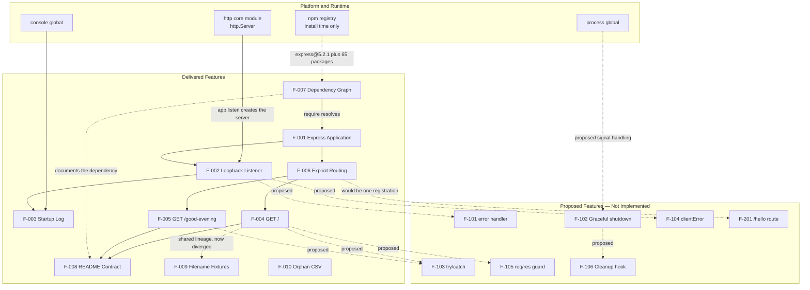

The relationships the diagram encodes, in the order they matter to a reader:

| Relationship | Kind | Evidence |
|--------------|------|----------|
| F-007 → F-001 | Hard prerequisite: `require('express')` cannot resolve until the 66-package tree is installed, so an uninstalled checkout cannot start | `server.js` line 1; `.gitignore`; `Project Guide.md` §9.7 `Cannot find module 'express'` |
| F-001 → F-006 → {F-004, F-005} | Composition: the routing table belongs to the application object, and both endpoints are rows in it | `server.js` lines 6, 12, 14, 20 |
| F-001 → F-002, F-002 → F-003 | Lifecycle ordering: the listener is started on the application object, and the only log line is emitted from the listen callback | `server.js` lines 26–28 |
| F-004, F-005 → F-008 | Documentation obligation: the README describes both responses, so it goes stale the moment either body or path changes | `README.md` lines 9–12 |
| F-004 → F-009 | Historical lineage only: the fixtures preserve the pre-migration implementation, and their byte-identity with `server.js` was deliberately broken | md5 `a423b6d4…` for `server.js` versus `05576d40…` for the three fixtures; `Agent Action Plan.md` §0.6.2 |
| F-101 – F-106 → F-002, F-004, F-005 | Proposed extensions only: the resilience features attach to the listener or wrap the handlers, and none is present | `Response.txt` §0.4; absence of `process.on`, `try`, `catch` and `server.on` in `server.js` |
| F-201 → F-006 | Would-be sibling of the two endpoints, requiring one more `app.get` registration and no other change | `codebase_context (42).md`; observed `404` for `GET /hello` |

Two relationship-level conflicts are recorded rather than resolved. First, the F-101 – F-106 proposals rest on a scope ruling that the delivered change has already broken: their plan forbids modifying `package.json`, `package-lock.json` and `README.md`, forbids adding any npm package, and places "Express.js or other frameworks" out of scope, whereas FR-A, FR-B and the README update were the delivered work. Second, the earlier catalogue's F-005-RQ-001 required the fixtures to remain byte-identical to `server.js`, which the re-platform made impossible; `Agent Action Plan.md` §0.6.2 accepts the divergence, and the superseded requirement is restated as F-009-RQ-004 in §2.2.2.9.

### 2.3.2 Integration Points

The service integrates with nothing at runtime beyond its own loopback socket and standard output. There is no database driver, message broker, outbound HTTP client, cache, identity provider, TLS terminator, proxy, service-discovery entry, log shipper, metrics agent, or webhook surface anywhere in the repository; the sole external touchpoint is an install-time fetch.

| Integration Point | Status | Source |
|-------------------|--------|--------|
| Loopback HTTP listener on `127.0.0.1:3000` | Active — the only network interface | F-002; `server.js` lines 3–4, 26–28 |
| Standard output (single startup line) | Active — the only outbound observability channel | F-003; `server.js` line 27 |
| Public npm registry (`registry.npmjs.org`) | Active at install time only, for 66 packages | F-007; `package-lock.json` `resolved` and `integrity` fields |
| Express router and default `404` handler | Active in-process collaboration | F-006; observed `404` bodies |
| Databases, queues, outbound HTTP, identity providers, TLS terminators, APM agents | Absent — verified by text search across all code-bearing files | §1.2.1.3, §1.3.2.3 |
| Machine-readable API contract (for example OpenAPI) | Absent — `README.md` prose is the only published contract | F-008 |

### 2.3.3 Shared Components

| Shared Element | Sharing Pattern | Features Involved |
|----------------|-----------------|-------------------|
| `hostname` and `port` constants (`'127.0.0.1'`, `3000`) | Declared once at module scope and consumed by both the bind and the startup message, so the logged URL cannot disagree with the bound address | F-002, F-003 |
| `res.statusCode` / `res.setHeader` / `res.end` response pattern | Reused verbatim by both handlers to guarantee byte-exact bodies and to bypass `res.send`'s content-type inference | F-004, F-005 |
| Express `app` object | The single object that owns the routing table and starts the listener | F-001, F-002, F-006 |
| `app.get(path, handler)` registration API | The one extension point for adding an endpoint; no router module, controller, or route file exists | F-004, F-005, F-006, and F-201 if implemented |
| `package.json` and `package-lock.json` | Declare the dependency and pin its resolved tree; both are inputs to the install that makes the service runnable | F-007, F-001 |
| Native-`http` server source | Duplicated byte-for-byte across three fixtures, and no longer shared with `server.js` | F-009; historical lineage to F-001, F-004, F-006 |
| `README.md` | The single prose contract that describes both endpoints and the `404` rule | F-008, F-004, F-005, F-006 |

### 2.3.4 Common Services

| Common Service | Provided By | Features That Depend On It |
|----------------|-------------|----------------------------|
| Node.js HTTP server and socket handling | The `http` core module, instantiated by `app.listen` | F-002, and transitively F-004, F-005, F-006 |
| Request dispatch and unmatched-request termination | Express `router` and `finalhandler`, bundled inside the installed tree | F-006, F-004, F-005 |
| Process lifecycle and signal delivery | The Node.js runtime's default signal disposition, since the application installs no handler | F-002 (current behaviour); F-102 would replace it |
| Standard-output stream | The Node.js `console` global | F-003 |
| Dependency resolution and integrity verification | npm CLI against the public registry, driven by the committed lockfile | F-007, F-001 |

No application-level shared service exists: there is no logging abstraction, no configuration service, no correlation or request-identifier scheme, and no error-classification layer. Every capability above is provided by the runtime or by a dependency rather than by project code.

## 2.4 Implementation Considerations

### 2.4.1 Technical Constraints

| Constraint | Affected Features | Source |
|------------|-------------------|--------|
| Port 3000 must be free; no fallback selection and no `error` listener, so a conflict is fatal | F-002, F-101 | `server.js` lines 4, 26; `Project Guide.md` §9.7 |
| Loopback-only binding — the service is unreachable from any other host and is not fronted by TLS or a proxy | F-002, F-004, F-005, F-006 | `server.js` line 3; §1.3.1.2 |
| Dependencies must be installed before startup: line 1 requires `express`, and `node_modules/` is git-ignored | F-001, F-007 | `server.js` line 1; `.gitignore`; `Project Guide.md` §9.7 |
| Node.js 18 or newer is required by Express 5, yet `package.json` declares no `engines` field, so the constraint is unenforced | F-001, F-007 | `Agent Action Plan.md` §0.2.2; `package.json` |
| Hostname and port are `const` literals; no environment variable, config file, or CLI argument is read anywhere in executable code | F-002, F-003 | `server.js` lines 3–4; repository-wide search for `process.env` |
| CommonJS, single file, no transpilation and no exports — the file is executed, not imported | F-001, F-009 | `server.js`; absence of `module.exports` and of `index.js` |
| `package.json#main` declares `index.js`, which does not exist, so the only working entry point is `node server.js` | F-007, F-008 | `package.json` line 5; no such file in the repository |
| No automated test suite: the `test` script prints `Error: no test specified` and exits `1` by design | All features | `package.json` lines 6–8; `Project Guide.md` §3 |
| Response bodies are fixed literals, including the presence of a trailing newline on `/` and its absence on `/good-evening` | F-004, F-005 | `server.js` lines 17, 23 |
| Express 5 reserves the characters `( ) [ ] ? + & !` in path patterns, constraining the naming of any future route | F-006, F-201 | `Agent Action Plan.md` §0.2.2 |
| The hardening proposals forbid adding dependencies, routes, or manifest changes — constraints the delivered change already violated | F-101 – F-106 | `Response.txt` §0.5; `Agent Action Plan.md` §0.1.2 |
| The three fixtures bind the same loopback address and port, so a fixture cannot run concurrently with the service | F-009 | Fixture sources; `server.js` lines 3–4 |

### 2.4.2 Performance Requirements

The repository commits to **no formal performance requirement, service-level objective, or latency budget**. No metric, target, alert threshold or instrumentation exists anywhere in the code or documentation set. The objectives below are therefore derived from the artifact's stated purpose and from the validation the project recorded; they are acceptance signals for correctness and determinism, not throughput commitments.

| Objective | Target | Basis |
|-----------|--------|-------|
| Startup succeeds and binds on a free port | 100% of launches | Startup line observed on every launch; `Project Guide.md` §4 |
| Registered routes return byte-exact bodies | 100% (2 of 2) | `od -c` byte comparisons; `Project Guide.md` §3, §5 |
| Determinism: identical response for a given path, method and query | 100% | Handlers read no request input; live re-verification at HEAD |
| Recorded functional checks pass | 15 of 15 | `Project Guide.md` §3 |
| Response latency | No target. `Response.txt` §0.6 proposes under 50 ms, under 50 MB RSS and 100+ concurrent connections, but those figures belong to the unimplemented hardened variant and are not committed here | `Response.txt` §0.6 |

Handler cost is three synchronous statements with no I/O, no allocation of dynamic content, and no computation, so any request latency is dominated by the Node.js HTTP stack and the client's own loopback round trip. There is no caching layer, no connection pooling, and no timeout configuration to tune.

### 2.4.3 Scalability Considerations

| Dimension | Disposition |
|-----------|-------------|
| Process model | A single Node.js process on one host; no cluster, no worker threads, no child processes, and no process manager |
| Concurrency model | The event loop with synchronous, non-blocking handlers; no promises, streams, timers or asynchronous callbacks in application code |
| Horizontal scaling | Not supported. The loopback binding and hardcoded port prevent running two instances on one host, and nothing allows an upstream load balancer to reach the service |
| Vertical scaling | Bounded only by the runtime; the application adds no memory-resident state beyond the loaded dependency tree of 66 packages |
| Load balancing | Not applicable — no proxying or upstream exists, so there is no scaling axis to balance |
| State and persistence | None. No session, cache, database or shared state, so instances would be trivially interchangeable if the port and binding were parameterised |
| Capacity controls | None. No rate limiting, no maximum-connection setting, no back-pressure, and no queue |

### 2.4.4 Security Implications

The exposure boundary is the loopback binding, not any security control: the service is reachable by every local process, and the application implements no authentication, authorisation, encryption, or input validation.

| Security Consideration | Status | Affected Features |
|------------------------|--------|-------------------|
| Network exposure | Loopback only (`127.0.0.1`); unreachable from other hosts | F-002, F-004, F-005, F-006 |
| Authentication and authorisation | Absent — no account, token, or access-control concept exists | All delivered features |
| Transport encryption | Absent — plain HTTP; no TLS terminator, certificate, or HTTPS listener | F-002 |
| Framework disclosure | `X-Powered-By: Express` is emitted on every response, including `404`s; suppression via `app.disable('x-powered-by')` is documented as optional and is not implemented | F-001, F-004, F-005 |
| Request input handling | No request data is read by any handler and no parsing middleware is mounted, so the injection surface is minimal — but there is likewise no validation, sanitisation, or content negotiation | F-001, F-004, F-005 |
| Availability under failure | A held port yields an unhandled error event, and `SIGTERM` terminates without draining; both are stability risks, and F-101, F-102 and F-104 are the documented, unimplemented remediations | F-002, F-101, F-102, F-104 |
| Dependency supply chain | The surface grew from zero to 66 packages; integrity rests on the pinned `sha512` digests in the lockfile, and `npm audit` reported zero known vulnerabilities when the project was validated — a point-in-time result, not a standing guarantee | F-007, F-001 |
| Sensitive data handling | No credential, secret, personal datum, or token exists in the repository; the only log line carries a public loopback address | F-003, F-010 |
| Dormant artifacts | `phonenumber.csv` (synthetic data), the media and document binaries, and `Response.txt` are unreferenced by code and expose no runtime surface | F-010 |
| Proposed features | F-101 – F-106 improve resilience and error observability and explicitly introduce no authentication, TLS, or authorisation | F-101 – F-106 |

### 2.4.5 Maintenance Requirements

| Maintenance Concern | Current State | Affected Features |
|---------------------|---------------|-------------------|
| Automated regression tests | None. The `test` script exits `1` by design, so contract changes rely on manual `curl` checks | All features |
| Linting and formatting | No linter or formatter configuration exists | All features |
| CI/CD | No `.github/` directory, pipeline file, or automated gate | All features |
| Containerisation | No `Dockerfile` or compose file; deployment is manual process start | F-002, F-102 |
| Type checking | None — plain JavaScript, no `tsconfig.json` | F-001 |
| Runtime version pinning | None — no `engines` field, so Node.js 18+ is a documented rather than enforced requirement | F-001, F-007 |
| Dependency currency | The manifest permits minor and patch upgrades through `^5.2.1`, making lockfile discipline and periodic `npm audit` the only integrity controls | F-007 |
| Contract documentation upkeep | `README.md` is the only published contract, so it must be revised with any change to a body, a path, the dependency, or the bound address | F-008, F-004, F-005, F-006 |
| Specification freshness | The repository's own `blitzy/documentation/Technical Specifications.md` describes the superseded native-`http`, zero-dependency state and its §2.7.4 concedes that "any modification to `server.js` invalidates F-001 – F-005 acceptance criteria"; the documentation set needs reconciliation with the Express implementation | F-001 – F-008 |
| Fixture upkeep | The three filename fixtures are retained unchanged, deliberately no longer byte-identical to `server.js`; any future requirement for behavioural parity would mean re-platforming all three | F-009 |
| Manifest inconsistencies | `package.json#main` points at an absent `index.js`, and the `test` script is a placeholder; both were deliberately left untouched and remain latent traps for tooling that trusts the manifest | F-007, F-008 |
| Dormant artifacts | `phonenumber.csv`, the media and document binaries, and `Response.txt` are unreferenced; they add repository noise but no runtime obligation | F-010 |
| Documented deferred enhancements | Three candidates are recorded as outside the delivered work: a minimal regression suite (`node:test` with `supertest`, about 2.0h), `X-Powered-By` suppression (about 0.25h), and environment-variable parameterisation of host and port (about 1.0h) | F-001, F-002, F-007, F-008 |
| Deferred hardening initiative | F-101 – F-106 remain unimplemented and, because their plan assumes the superseded implementation, must be re-derived against the Express application before they are attempted | F-101 – F-106 |

### 2.4.6 Per-Feature Consideration Summary

| Feature | Dominant Technical Constraint | Security Implication | Maintenance Obligation |
|---------|-------------------------------|----------------------|------------------------|
| F-001 Express Application Hosting | CommonJS single file; Express 5 needs Node ≥18, unenforced by the manifest | Framework disclosure through `X-Powered-By`; no middleware means no input parsing | Re-derive any change against Express 5 path-matching rules; keep the single-file convention |
| F-002 Loopback Listener Lifecycle | Free port 3000, hardcoded host and port, no bind-error handling | Loopback is the whole exposure boundary; plain HTTP only | Operators must free the port and terminate the process externally |
| F-003 Startup Console Logging | Emitted only from the listen callback | The line carries no sensitive data | The message must stay in step with the bound address if either literal changes |
| F-004 Root Greeting Endpoint | Body must stay byte-exact, including the trailing newline | No request data consumed; `X-Powered-By` present | Any body change must be mirrored in `README.md` |
| F-005 Second Greeting Endpoint | Body has no trailing newline; path and newline are unconfirmed assumptions | Same posture as F-004 | Confirm the three flagged assumptions before treating the contract as final |
| F-006 Explicit Routing with Strict Path Matching | Two literal paths only; trailing slash and case behaviour are framework defaults | Unknown paths and methods are refused rather than answered | Adding a route means updating documentation; reserved characters constrain naming |
| F-007 Declared and Locked Dependency Graph | Install must precede run; caret range permits minor upgrades | 66-package supply chain guarded by pinned digests | Keep the lockfile authoritative and re-audit the tree periodically |
| F-008 Published HTTP Contract Documentation | Prose only; no machine-readable contract | Discloses dependency and address already visible in responses | Must be revised with every contract change |
| F-009 Filesystem Edge-Case Filename Fixtures | Fixtures share the service's port and cannot run concurrently | No added network surface | Retained unchanged; parity with `server.js` is superseded |
| F-010 Orphan Data Fixture | Not read by any code | Synthetic data only; no personal information | None beyond keeping it out of the runtime path |
| F-101 – F-106 Proposed Hardening | Must be re-derived for the Express application; the plan forbids dependencies and manifest edits that the delivered change already made | Improve failure observability and availability without adding authentication or TLS | Unimplemented; would require the test suite that does not exist |
| F-201 Unimplemented `/hello` Route | Awaits requester confirmation of path and body wording | None beyond the platform-wide boundary | Would add a third documented endpoint to maintain |

## 2.5 Traceability Matrix

### 2.5.1 Requirement-to-Feature Mapping

The table links each feature to the requirement that originated it, so a delivered capability can be traced back to the requester's ask and an unimplemented one to the document that proposed it. `FR-A` – `FR-D` are the identifiers used by `blitzy/documentation/Agent Action Plan.md` §0.1.1 and by the compliance table in `Project Guide.md` §5.

| Feature | Originating Requirement | Current Status |
|---------|-------------------------|----------------|
| F-001 Express Application Hosting | FR-B ("Re-platform the HTTP transport onto Express"); supersedes the earlier catalogue's F-001 | Delivered |
| F-002 Loopback Listener Lifecycle | FR-B runtime invariants (`127.0.0.1`, `3000`, startup log preserved) | Delivered |
| F-003 Startup Console Logging | FR-B (startup log retained verbatim); earlier catalogue's F-003 | Delivered |
| F-004 Root Greeting Endpoint (`GET /`) | FR-C ("Preserve the existing greeting endpoint"); earlier catalogue's F-002 | Delivered |
| F-005 Second Greeting Endpoint (`GET /good-evening`) | FR-D ("Add a new 'Good evening' endpoint"); requester prompt in `Build Prompt.md` | Delivered |
| F-006 Explicit Routing with Strict Path Matching | Implicit prerequisite of FR-B (route-agnostic to explicit routing); QA Issue 1 recorded in `Project Guide.md` §5 | Delivered |
| F-007 Declared and Locked Dependency Graph | FR-A ("Add Express.js as a project dependency"); supersedes the earlier catalogue's F-004 "Zero-Dependency Package Manifest" | Delivered |
| F-008 Published HTTP Contract Documentation | "Documentation (optional)" deliverable in `Agent Action Plan.md` §0.5.1 and `Project Guide.md` §2.1 | Delivered |
| F-009 Filesystem Edge-Case Filename Fixtures | Earlier catalogue's F-005; explicitly out of scope in `Agent Action Plan.md` §0.6.2 | Retained, diverged |
| F-010 Orphan Data Fixture (`phonenumber.csv`) | Earlier catalogue's F-006; out of scope in `Agent Action Plan.md` §0.6.2 | Present, unused |
| F-101 – F-106 Proposed Hardening | Changes #1 – #5 in `Response.txt` §0.4; earlier catalogue's F-101 – F-106 | Not implemented |
| F-201 Path-Based `/hello` Routing | `codebase_context (42).md` (original requirement note) | Not implemented |

### 2.5.2 Source-to-Feature Mapping

| Source Artifact | Contributing Features | Evidence Location |
|-----------------|-----------------------|-------------------|
| `server.js` | F-001, F-002, F-003, F-004, F-005, F-006 | Lines 1, 3–4, 6, 12, 14–18, 20–24, 26–28 |
| `package.json` | F-007 | Lines 1–13, including `dependencies` at lines 11–13 |
| `package-lock.json` | F-007 | `lockfileVersion` 3; 66 `node_modules/` entries; `express@5.2.1` at line 230 |
| `.gitignore` | F-007 | Single entry `node_modules/` |
| `README.md` | F-008 | Lines 4–23 (HTTP Server and Running sections) |
| `Test.test..js`, `!@#$%^&().js`, `QWYFFGHGHFDDJFD…_server.js` | F-009 | 14 lines each; native `http` handler at lines 6–10 |
| `phonenumber.csv` | F-010 | Header plus 15 data rows |
| `Response.txt` | F-101 – F-106 | Sections 0.1 – 0.7; changes enumerated in §0.4 |
| `codebase_context (42).md` | F-201 | Single-line requirement note |
| `blitzy/documentation/Build Prompt.md` | F-005, F-006 | Verbatim requester prompt |
| `blitzy/documentation/Agent Action Plan.md` | F-001 – F-008 | §0.1 FR-A – FR-D; §0.4.2 behavioural notes; §0.6.2 exclusions |
| `blitzy/documentation/Project Guide.md` | F-001 – F-009 | §2.1 completed work; §3 validation; §5 compliance mapping |

### 2.5.3 Validation Evidence to Feature

Every row below was re-verified at HEAD by launching the service and inspecting its responses, files, or manifests; the third column records the parallel result from the project's own validation log.

| Validation Check | Features Verified | Recorded Result |
|------------------|-------------------|-----------------|
| Startup binds and prints the startup line | F-002, F-003 | Pass; 1 of 9 functional checks (`Project Guide.md` §3) |
| `GET /` status, content type and byte-exact body | F-004, F-006 | Pass; 3 of 9 checks; `Content-Length: 14`, `od -c` confirmed |
| `GET /good-evening` status, content type and byte-exact body | F-005, F-006 | Pass; 3 of 9 checks; `Content-Length: 12`, no newline |
| `GET /does-not-exist` returns `404` | F-006 | Pass; 1 of 9 checks |
| `GET /good-evening/` returns `404` (strict routing) | F-006 | Pass; 1 of 9 checks; QA Issue 1 resolved in commit `f2c2ca4` |
| `node --check server.js` exits 0 | F-001, F-004, F-005 | Pass (`Project Guide.md` §3) |
| `npm ci` installs the pinned tree | F-007 | Pass; "added 66 packages"; re-verified at HEAD |
| `npm ls` reports a clean direct dependency | F-007 | Pass; `hello_world@1.0.0` → `express@5.2.1`, no unmet peers |
| `npm audit` over the installed tree | F-007 | Pass; 0 vulnerabilities |
| Both manifests parse as JSON | F-007 | Pass; 2 checks |
| `.gitignore` keeps `node_modules/` untracked | F-007 | Pass; repository hygiene row in `Project Guide.md` §5 |
| Byte comparison among the three fixtures, and against `server.js` | F-009 | Divergence confirmed and accepted (md5 `a423b6d4…` versus `05576d40…`) |
| Text search for file I/O and for the fixture filename in code | F-010 | No match — the file is orphaned |

Individual requirement IDs (F-001-RQ-001 through F-201-RQ-003) are mapped to their acceptance criteria in §2.2, where each criterion states the exact observable that must be true. Because the repository ships no automated suite, none of these mappings is enforced by a test gate; they are enforced by re-run checks.

### 2.5.4 Cross-Reference to Process Flowcharts and Related Specifications

| Reference | Location and Relevance |
|-----------|------------------------|
| Request lifecycle flowchart (install, bind, log, request, dispatch, `404`) | §1.2.2.3 — the same path that F-001, F-002, F-004, F-005 and F-006 realise |
| Operational topology diagram (local client ↔ single Node.js process; install-time registry) | §1.2.1.3 — fixes the integration boundary that §2.3.2 restates per feature |
| Workflow W-01 Process Startup | `blitzy/documentation/Technical Specifications.md` §4.1.1, §4.3.1 — covers F-002 and F-003 |
| Workflow W-02 HTTP Request/Response Handling | Same document, §4.3.2 — covers F-004, F-005 and F-006; its byte-exactness assertions match F-004-RQ-003 and F-005-RQ-003 |
| Workflow W-03 Process Termination (external) | Same document, §4.3.3 — the current F-002 behaviour that F-102 proposes to replace |
| Workflow W-04 Bind-Failure Crash Path | Same document, §4.1.1 — the unhandled-error path that F-101 proposes to remedy |
| Workflows W-05 – W-08 Proposed hardening and W-09 `/hello` | Same document, §4.1.1 — the mapping of F-101 – F-106 and F-201 to flowcharts |
| Capability and exclusion baseline | §1.3.1.1 (in-scope capabilities), §1.3.2.1 (verified-absent capabilities), §1.3.2.2 (future phases), §1.3.2.4 (unsupported use cases) |
| Success criteria and indicators | §1.2.3.1 – §1.2.3.3 — the measurable objectives that F-002, F-004, F-005, F-006 and F-007 satisfy |
| Business context and current limitations | §1.2.1.1 – §1.2.1.2 — the framing that makes determinism, not feature breadth, the value of these features |
| Requirement provenance | `blitzy/documentation/Agent Action Plan.md` §0.1 (FR-A – FR-D, constraints, assumptions) and `Project Guide.md` §5 (compliance mapping) |
| Hardening proposal | `Response.txt` §0.4 – §0.5 — the source and scope constraints of F-101 – F-106 |

### 2.5.5 Assumptions, Constraints and Requirement Version Tracking

**Version record.** This catalogue is version 1.1 of the repository's feature inventory. Version 1.0 is the §2 catalogue inside `blitzy/documentation/Technical Specifications.md`, which documents the pre-Express, zero-dependency implementation; this version supersedes it for F-001 – F-006 and for F-101 – F-106, retains its identifiers where the capability survives, and adds F-007 – F-010. The superseded document states its own invalidation condition in §2.7.4: "This specification reflects the repository state at the time of analysis; any modification to `server.js` invalidates F-001 – F-005 acceptance criteria."

| Assumption or Constraint | Detail and Consequence |
|--------------------------|------------------------|
| Endpoint path `/good-evening` | The requester specified no path. The kebab-case literal was assumed (`Agent Action Plan.md` §0.1.2) and alternatives such as `/evening` or `/goodevening` remain open confirmations; changing it invalidates F-005-RQ-004 and F-008-RQ-001 |
| `Good evening` has no trailing newline | The body matches the requester's wording exactly rather than the root greeting's style; adding a newline would change the 12-byte contract asserted by F-005-RQ-003 |
| Root body stays `Hello, World!\n` | The requester wrote "Hello world" and `codebase_context (42).md` asked for `"Hello world"` at `/hello`; current behaviour is deliberately preserved and flagged for confirmation (`Agent Action Plan.md` §0.1.2). F-004-RQ-003 and F-201-RQ-002 record both sides |
| `X-Powered-By: Express` is retained | The header is a framework default that the pre-migration implementation did not emit; suppression is documented as optional and is not implemented, so F-001's security row and F-006's `404` responses both carry it |
| Status and priority labels are inferred | No backlog, ticketing system, or roadmap exists in the repository, so every label in §2.1 derives from the cited artifacts |
| Acceptance is proven by re-run checks, not by a test gate | The `test` script exits `1` by design, so §2.2 criteria are verifiable only by executing the documented `curl`, install and byte-comparison steps |
| `server.js` is the only authoritative implementation | The three fixtures are tooling artifacts; their divergence from `server.js` is accepted, so no acceptance criterion may be satisfied by fixture behaviour |
| F-101 – F-106 remain proposed on a re-based target | Their plan predates the Express migration, forbids the dependency and manifest changes that have since been made, and therefore must be re-derived before implementation |
| Runtime version evidence conflicts | `blitzy/documentation/Project Guide.md` §5 and §9.1 record Node v20.20.2, and `blitzy/documentation/Agent Action Plan.md` §0.2.2 records Node v22.22.2 as the local runtime; the behaviour asserted in §2.2 was re-verified on Node v22.23.3. All are Express-5-compatible (Node 18 or newer), so the discrepancy does not affect any acceptance criterion |

## 2.6 References

The inventory recorded at the start of this work called for six first-order sub-sections: Feature Catalog, Functional Requirements Table, Feature Relationships, Implementation Considerations, Traceability Matrix and References. All six are present, and no feature or requirement enumerated in the plan is left undocumented.

**Files examined**

- `server.js` — the canonical implementation; established F-001 (lines 1, 6), F-002 (lines 3–4, 26–28), F-003 (line 27), F-004 (lines 14–18), F-005 (lines 20–24) and F-006 (line 12), and proved the absence of signal handling, exception handling, header suppression, configuration reads and file I/O
- `package.json` — established F-007: `express` `^5.2.1` as the only dependency, `main` pointing at an absent `index.js`, and the placeholder `test` script that exits `1`
- `package-lock.json` — established the pinned tree behind F-007: `lockfileVersion` 3, 66 `node_modules/` entries, `express@5.2.1` with a `registry.npmjs.org` URL and `sha512` integrity digest
- `.gitignore` — established install hygiene: the single entry `node_modules/`
- `README.md` — established F-008: the documented dependency, both endpoints with status/content type/body, the `404` rule, the run procedure and the listening URL
- `Test.test..js`, `!@#$%^&().js`, `QWYFFGHGHFDDJFDame_!@#$%^&(){}long_name_…_server.js` — established F-009: 14-line native-`http` servers, byte-identical to one another, diverged from `server.js`, route- and method-agnostic when run
- `phonenumber.csv` — established F-010: a `message,phonenumber` header plus 15 synthetic `+111111112xx` rows, read by no code
- `Response.txt` — solely established F-101 – F-106: the six proposed hardening changes, their acceptance expectations and the §0.5 scope constraints that forbid dependency, manifest, route and framework changes
- `codebase_context (42).md` — solely established F-201: the original `/hello` requirement returning `"Hello world"`
- `blitzy/documentation/Build Prompt.md` — established the verbatim requester prompt that originated F-005 and F-006
- `blitzy/documentation/Agent Action Plan.md` — established FR-A – FR-D, the §0.1.2 constraints and the three flagged assumptions, the §0.4.2 behavioural integration notes (`404` semantics, `X-Powered-By`), the §0.6.2 exclusions, the §0.7 feature-addition rules and the dependency inventory rationale
- `blitzy/documentation/Project Guide.md` — established the completion ledger and validation evidence behind §2.5.3 (9/9 functional checks, 15/15 total, `npm ci`/`npm audit`/`npm ls`/`node --check` results), the commit-level change set, the accepted invariant tensions, the optional out-of-scope enhancements and the troubleshooting rules
- `blitzy/documentation/Technical Specifications.md` — established the earlier feature catalogue (F-001 – F-006, F-101 – F-106, F-201), the hardening scope constraints, the workflow inventory W-01 – W-09 and the §2.7.4 freshness concession that this version supersedes
- `20250304165759.mp4`, `s1.png`, `defect_for_task_1.docx`, `tech_spec.pdf` — established as dormant artifacts, referenced by documentation prose only and by no code path

**Folders examined**

- Repository root — 10 files plus one folder; confirmed the flat, single-directory layout, the absence of `.blitzyignore`, and the absence of any test, CI, lint, container or type-check configuration
- `blitzy/` and `blitzy/documentation/` — the only subtree, holding four code-free Markdown artifacts that carry requirement provenance and validation evidence
- `node_modules/` — generated by install from the committed lockfile, git-ignored, 66 packages; inspected only as install evidence

**Web sources**

No external web research was performed for this section; every claim rests on repository evidence or on live re-verification of the running service. Two external endpoints appear in the repository's own artifacts and were consulted transitively by tooling rather than by research:

- [web] `https://registry.npmjs.org/express` (and the per-package tarball URLs recorded in `package-lock.json`) — confirmed the resolved versions and integrity digests of the 66-package tree that F-007 pins
- [web] `https://expressjs.com/` — the framework reference linked from `README.md`, confirming the project-level attribution of F-001

**Live verification performed for this section**

- `node server.js` on Node v22.23.3 — startup line; `GET /` → `200`, `text/plain`, 14 bytes; `GET /good-evening` → `200`, `text/plain`, 12 bytes; `GET /good-evening/`, `GET /hello` and `GET /does-not-exist` → `404`; `POST`/`PUT`/`DELETE`/`PATCH` → `404`; `HEAD` → `200`; `OPTIONS` → `200` with `Allow: GET, HEAD`; `GET /GOOD-EVENING` → `200`; Express settings introspected for `strict routing`, `x-powered-by`, `etag`, `query parser`, `env` and `trust proxy`
- `npm ci` — reproduced the 66-package tree from the committed lockfile; `npm test` — confirmed the placeholder exits `1`; `node Test.test..js` — confirmed the fixture's route- and method-agnostic behaviour
- `git ls-files`, `md5sum`, `wc -l`, file-type census and repository-wide text searches for `require`/`import`, route registration, `process.env` and file I/O — established the feature boundary used throughout §2.1 and §2.2

# 3. Technology Stack

## 3.1 Programming Languages

The repository is written in a single language — JavaScript executed by Node.js — and everything else it contains is data or prose. The checked-in code is the authority for this section: `blitzy/documentation/Technical Specifications.md` describes a superseded native-`http`, zero-dependency state, so its stack narrative is relied on here only where it agrees with the code at HEAD.

### 3.1.1 Language and Module System by Component

| Component | Path | Language / dialect | Module system | Evidence |
|-----------|------|-------------------|---------------|----------|
| Runtime service (the only process that serves traffic) | `server.js` | JavaScript, conservative ECMAScript 2015 subset, executed directly by Node.js | CommonJS — `require('express')` | `server.js:1`, `:3–4`, `:6`, `:12`, `:14–24`, `:26–28` |
| Filename fixtures (3) | `Test.test..js`, `!@#$%^&().js`, `QWYFFGHGHFDDJFDame_…_server.js` | JavaScript (same subset) | CommonJS — `require('http')`, a Node built-in rather than a package | line 1 of each file; all three byte-identical (sha256 `332fc2d0…`) and distinct from `server.js` (sha256 `a9a9b304…`) |
| Package manifest | `package.json` | JSON | — | 14 lines, single `dependencies` entry |
| Dependency lockfile | `package-lock.json` | JSON, npm lockfile schema version 3 | — | `lockfileVersion: 3`, `requires: true`, 67 `packages` entries |
| Published contract | `README.md` | Markdown | — | one fenced `bash` run block |
| Requirement, plan and specification records | `codebase_context (42).md`; `blitzy/documentation/Agent Action Plan.md`, `Build Prompt.md`, `Project Guide.md`, `Technical Specifications.md` | Markdown; the specification also embeds JavaScript listings and Mermaid diagram source | — | `blitzy/documentation/` |
| Remediation transcript | `Response.txt` | JSON envelope whose single `sections[0].content` field holds Markdown and JavaScript prose | — | `Response.txt` |
| Data fixture | `phonenumber.csv` | CSV | — | header `message,phonenumber` plus 15 rows |
| Binary artifacts | `s1.png`, `20250304165759.mp4`, `tech_spec.pdf`, `defect_for_task_1.docx` | Not source code; no language | — | tracked, but referenced by no code path |

JavaScript is the only language on the request path. Across the repository, outside `node_modules/`, exactly four `require()` calls exist — `server.js:1` (`express`) and line 1 of each fixture (`http`) — and no other executable source file exists in any language. The tracked inventory is 20 files (`git ls-files`), of which four are JavaScript and the remainder are JSON, Markdown, CSV or binaries, so the absence of any other language is established by enumeration rather than by sampling. `node_modules/` holds dependencies' own sources and is git-ignored (`.gitignore`, sole line `node_modules/`), so it contributes no project source.

### 3.1.2 Justification for the Choice

- **Inherited, not selected.** The language was fixed before the current implementation existed: `codebase_context (42).md` asks for "a nodejs tutorial project", `package.json` describes the package as "Hello world in Node.js", and the delivered change re-platformed the service onto Express while leaving the language and runtime untouched (`blitzy/documentation/Agent Action Plan.md` §0.1.1, FR-B). JavaScript on Node.js is therefore a constraint the stack satisfies, not a decision the stack re-opens.
- **Proportional to the workload.** The entire runtime obligation is to bind a socket and return two fixed strings. Node's standard library supplies the HTTP server, the event loop and the console sink with no compilation step, no additional runtime, and no build artifacts, which is why the whole executable surface is one 29-line file.
- **No toolchain between source and execution.** The same language is written, reviewed and run: `node server.js` (documented in `README.md`) executes the checked-in source directly, so the source file *is* the deployed artifact. There is no transpiler, bundler, type checker, or code generator in the repository to keep in step.
- **Small, deliberately conservative language surface.** `server.js` uses `const`, arrow functions, a template literal for the startup line, string escapes (`'Hello, World!\n'`), and property access on the request and response objects. It contains no `let` or `var`, no classes, no `async`/`await`, no promises, no destructuring, no spread, no optional chaining and no generators. The low feature ceiling keeps the effective runtime floor low and keeps the file readable as the tutorial artifact its prompt asked for.
- **CommonJS because nothing declares otherwise.** `package.json` carries no `type` field, so Node resolves `.js` as CommonJS — consistent with the `require` call at line 1. `module.exports` appears nowhere in the repository, so the file is executed for its side effects rather than imported: there is no module API, and any future `require('./server.js')` would start a listener as a side effect.
- **Trade-offs accepted.** No static type checking, no linter or formatter, and no unit test runner exist, so correctness rests on reading the source and on the manual HTTP checks the project recorded. These are recorded as deferred enhancements in `blitzy/documentation/Project Guide.md` §2.3 rather than as gaps of the language choice.

### 3.1.3 Version and Compatibility Constraints

No language or runtime version is enforced by the project itself: `package.json` declares no `engines` field, and no `.nvmrc`, `.node-version`, `.tool-versions` or `.npmrc` file exists, so `engine-strict` is not enabled and npm treats any `engines` declaration as advisory. The binding floor comes from the dependency tree.

| Constraint | Value | Imposed by | Evidence |
|------------|-------|------------|----------|
| Minimum Node.js runtime | 18 | Eleven of the 66 installed packages declare it — `express@5.2.1` (`>= 18`) plus `body-parser`, `content-disposition`, `finalhandler` (`>= 18.0.0`), `merge-descriptors`, `mime-types`, `router`, `send`, `serve-static`, `type-is` and the nested `type-is/node_modules/content-type` (all `>=18`) | `node_modules/express/package.json`; lockfile `engines` entries; the remaining floors are permissive legacy declarations such as `>= 0.4` and `>= 0.8` |
| Project-declared runtime | None | `package.json` has no `engines` key | `package.json` |
| Minimum npm CLI | 7 | The committed lockfile uses `lockfileVersion` 3, the npm 7+ layout | `package-lock.json` |
| Module format | CommonJS | Absence of a `type` field in `package.json` | `package.json`; `require` usage in `server.js:1` |
| Build or transpile step | None required | No bundler, transpiler or type-checker configuration exists | repository inventory (20 tracked files) |
| Runtime used for development and verification in this environment | Node.js v22.23.3, npm 11.21.0 | The environment in which `server.js` was launched and its responses verified | `node -v`, `npm -v` |

Express 5's engines floor names Node 18, and Node 18 reached end of life on 2025-04-30, so the declared minimum is a compatibility floor rather than a supported-version statement. The wider support picture, as of 2026-10-26, is:

| Node.js line | Status | Latest patch in the line | Support window |
|--------------|--------|--------------------------|----------------|
| 26 | Current; becomes Active LTS on 2026-10-28 | 26.12.1 (2026-10-21) | Maintenance from 2027-10-20, EOL 2029-04-30 |
| 24 "Krypton" | Latest LTS | 24.22.1 (2026-10-21) | Active LTS from 2025-10-28; Maintenance from 2026-10-20; EOL 2028-04-30 |
| 22 "Jod" | Maintenance LTS — the line this repository's runtime belongs to | 22.23.4 (2026-10-21) | Active LTS from 2024-10-29; Maintenance from 2025-10-21; EOL 2027-04-30 |
| 18 "Hydrogen" | End of life — the line Express 5 names as its minimum | — | EOL 2025-04-30, no further updates including security patches |

Consequences of the unenforced floor: a host below Node 18 installs the tree (npm reports an `EBADENGINE` warning rather than failing) and then fails when `require('express')` loads a package that uses features the runtime lacks; and no repository mechanism — no `engines` field, no version-manager file, no CI job — pins or checks the runtime. Pinning the effective floor for production would mean adding an `engines` field and a version-manager file, which the delivered change deliberately did not do.

### 3.1.4 Languages Verified Absent

Every default-stack language candidate is absent from the repository. These names appear only as boilerplate prose inside `blitzy/documentation/Technical Specifications.md` §3.1.2, which itself records them as "verified absent" for the superseded implementation; the enumeration below re-establishes the claim against the code at HEAD.

| Language / runtime | Status | Evidence at HEAD |
|--------------------|--------|------------------|
| Python | Absent | No `.py` file among the 20 tracked files; no Python package in the dependency tree; no script invokes an interpreter other than `node` (`package.json` `scripts` holds only `test`) |
| TypeScript | Absent | No `.ts`/`.tsx` file, no `tsconfig.json`; the token occurs only in `Response.txt`'s exclusion list ("TypeScript conversion — Language choice is not part of the error handling requirements") and in the superseded specification's prose |
| Swift, Kotlin, Objective-C | Absent | No native source and no Xcode, Gradle or CocoaPods descriptor anywhere; no native build tooling in the repository |
| Java, Go, C#, Ruby, PHP | Absent | Not present in the tracked inventory, which is exhaustively enumerable at 20 files |
| Desktop and mobile host runtimes (Electron, React Native) | Absent | The dependency tree contains `express` and its closure only; no Electron, React Native or other application host is declared |
| Shell scripting | Absent | No script file with a shell shebang; the only shell text is the fenced `bash` block in `README.md` and command examples inside documentation |

The one non-JavaScript executable surface is the `npm`/`node` command line itself, which is tooling rather than project source and is covered in §3.6.


## 3.2 Frameworks and Libraries

The repository has exactly one framework and no supporting libraries of its own. Express 5.2.1 is the sole declared dependency and the only third-party code on the request path; the three filename fixtures deliberately bypass it and use Node's built-in `http` module instead.

### 3.2.1 Core Framework: Express 5.2.1

| Property | Value | Evidence |
|----------|-------|----------|
| Declared dependency | `"express": "^5.2.1"` — the only entry in `dependencies` | `package.json` lines 11–13 |
| Resolved version | 5.2.1 in the lockfile and on disk in `node_modules/express/` | `package-lock.json` `node_modules/express`; `node_modules/express/package.json` |
| Licence | MIT | `node_modules/express/package.json`; lockfile |
| Runtime requirement | `engines.node` `>= 18` | `node_modules/express/package.json` |
| Published package contents | `LICENSE`, `Readme.md`, `index.js`, `lib/` (no `bin`, no export map, no peer dependencies) | `node_modules/express/package.json`; `node_modules/express/` listing |
| Implementation modules | `lib/application.js`, `lib/express.js`, `lib/request.js`, `lib/response.js`, `lib/utils.js`, `lib/view.js` | `node_modules/express/lib/` |
| Direct dependencies | 28 | `node_modules/express/package.json` `dependencies` |
| Version currency | 5.2.1 installed; 5.3.0 is the current npm `latest` (published 2026-10-09), so the caret range permits an upgrade the lockfile has not taken | npm registry metadata; `package-lock.json` |

Express 5.0.0 reached general availability on 2024-09-10 according to the npm-published version history and the project's GitHub release; the framework's own blog post dates it 2024-09-09, a one-day discrepancy that does not affect this repository, which pins 5.2.1. The 4.x line remains published under a separate `latest-4` tag (4.22.3) and is not installed here.

**Why Express, and why one framework is enough.** The choice was requested rather than evaluated: `blitzy/documentation/Build Prompt.md` and `codebase_context (42).md` frame the work as adding Express to the Node.js tutorial server, and `blitzy/documentation/Agent Action Plan.md` §0.1.1 records the resulting requirements (FR-A add and lock Express; FR-B replace `http.createServer(...)` with `const app = express()`). The framework earns its place by replacing hand-rolled, route-agnostic request handling with a declarative routing table plus a default 404 handler — the behaviour change that turns the service from a catch-all responder into an endpoint model (§2.1.3.6). The project's earlier zero-dependency posture belongs to the unimplemented hardening plan in `Response.txt`, whose constraints the delivered change overrides (§0.1.2); the accepted cost is that the dependency surface grew from nothing to 66 packages for two literal routes.

### 3.2.2 Framework Surface Actually Used

`server.js` touches five Express APIs, all on the application object; no middleware, template engine, error-handling middleware or sub-application is registered.

| Call | Line | Purpose | Notes |
|------|------|---------|-------|
| `require('express')` | 1 | Load the factory | Resolves from `node_modules/express`; fails at startup if the tree is not installed |
| `express()` | 6 | Create the application | The application owns the routing table and the settings |
| `app.enable('strict routing')` | 12 | Treat trailing-slash variants as distinct paths | Consumed by the router, which receives `strict: this.enabled('strict routing')` (`node_modules/express/lib/application.js:76`) |
| `app.get('/', …)`, `app.get('/good-evening', …)` | 14, 20 | Register the two literal routes | Dispatch is performed by `router@2.2.0`; unmatched requests fall to `finalhandler@2.1.1` |
| `app.listen(port, hostname, cb)` | 26 | Bind the listener | Creates and starts a Node `http.Server`, which is therefore the object that owns `error`/`clientError` events and `close()` |

The handlers deliberately use the low-level Node response API — `res.statusCode`, `res.setHeader`, `res.end` — rather than Express's `res.send`, so no response helper performs content-type inference or ETag computation and both bodies are byte-exact, including the trailing newline on `/` and its deliberate absence on `/good-evening`. No `app.use` call exists anywhere in the repository, so the entire middleware layer is unused.

### 3.2.3 Express Defaults in Force

Four framework defaults are observable in the running service and are part of its effective behaviour, whether or not the code names them.

| Setting | Value | Source and effect |
|---------|-------|-------------------|
| `x-powered-by` | Enabled (default) | Every response carries `X-Powered-By: Express`, as confirmed on live `200` responses; suppression would require `app.disable('x-powered-by')`, which is documented as an optional enhancement and is not implemented (§2.4.4) |
| `etag` | `weak` | Set at `node_modules/express/lib/application.js:95`; never exercised, because the handlers call `res.end` and no response helper computes an entity tag |
| `query parser` | `simple` | Set at `application.js:97`, resolved by `compileQueryParser` to Node's built-in `querystring.parse` (`lib/utils.js:164–173`). The `qs` package is loaded by `lib/utils.js:20` but its parser is reachable only under the `extended` setting, which is not configured |
| `trust proxy` | `false` | Set at `application.js:99`; `compileTrust(false)` returns a constant-false function, so `proxy-addr`'s trust-subnet compilation is never invoked, and no handler reads `req.ip`, `req.protocol` or `req.hostname` |
| `env` | `development` | Default environment; no code reads it |

### 3.2.4 Compatibility Requirements

| Requirement | Detail | Consequence if unmet |
|-------------|--------|----------------------|
| Node.js 18 or newer | `express@5.2.1` `engines.node` `>= 18`, matched by ten transitive packages (§3.1.3) | `require('express')` fails at startup; npm warns but does not refuse the install, because no `engines` field and no `engine-strict` setting exist |
| npm 7 or newer | Required to interpret `lockfileVersion` 3 | `npm ci` cannot install the committed lockfile |
| Node's built-in `http.Server` semantics | `app.listen` returns a Node server, so bind failures surface as unhandled `error` events and termination is external | A held port 3000 aborts the process; `SIGTERM` ends it with exit code 143 and no drain (§2.1.3.2) |
| Express 5 path-matching rules | Express 5 reserves the characters `( ) [ ] ? + & !` in path patterns and changed wildcard syntax | Any future route must avoid those characters; the two literals `/` and `/good-evening` are unaffected (`Agent Action Plan.md` §0.2.2) |
| Strict-routing and default matching semantics | Strict routing makes `/good-evening/` a distinct, unregistered path; matching stays case-insensitive because `case sensitive routing` is not enabled | Trailing-slash variants and unknown paths return 404 (§2.1.3.6) |
| Framework default disclosure | `X-Powered-By: Express` is emitted on every response | The framework identity is published to any loopback client; the header is advisory only |

### 3.2.5 Runtime Stack Composition and Integration Requirements

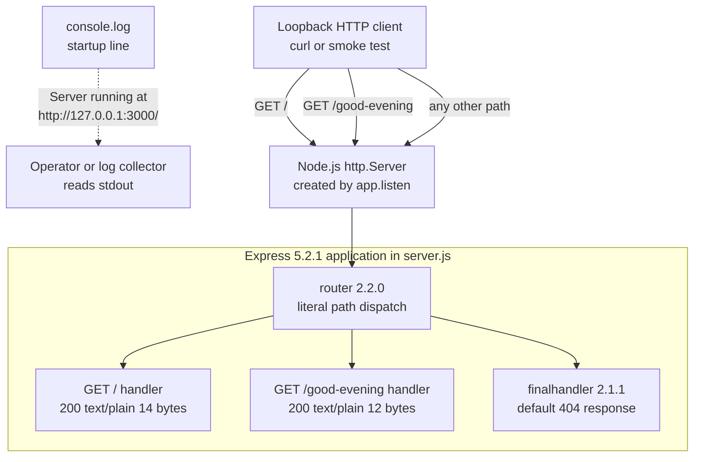

Every integration point between components is in-process or install-time; none is a network dependency at runtime.

| Integration | Direction | Contract | Evidence |
|-------------|-----------|----------|----------|
| `server.js` → `express` | Startup, in-process | `require('express')` must resolve from `node_modules/`, so installation precedes execution | `server.js:1`; `.gitignore` excludes `node_modules/` |
| `express` → Node.js | Startup | `engines.node >= 18`; relies on the runtime's `http`, `console`, `process` globals and event loop | `node_modules/express/package.json` |
| `express` → npm registry | Install time only | Resolves the lockfile's 66 packages from `registry.npmjs.org` with pinned `sha512` digests | `package-lock.json` |
| `app` → `router@2.2.0` | Per request | Literal path and method matching over the registered table | `server.js:12, 14, 20`; live `200` responses |
| `router` → `finalhandler@2.1.1` | Per unmatched request | Default 404 body `Cannot GET <path>` with `text/html; charset=utf-8` | live `404` responses (§2.1.3.6) |
| `app.listen` → Node `http.Server` | Startup | Binds `127.0.0.1:3000`; the returned server owns lifecycle events | `server.js:26–28` |
| `console.log` → stdout | Startup | One line, emitted only after a successful bind | `server.js:27` |
| `README.md` → the running contract | Documentation only | Describes both routes, the 404 behaviour, the dependency and the run command | `README.md` lines 4–23 |
| Fixture scripts → Node `http` | Standalone run | Independent servers on the same loopback port, not interchangeable with the Express service | line 1 of each fixture |

### 3.2.6 Supporting Libraries and Non-Selections

- **Supporting libraries: none.** `package.json` declares no `devDependencies`, `optionalDependencies` or `peerDependencies`, and no test runner, assertion library, HTTP client, or logging library exists in the tree. Everything the service needs beyond Express is a Node.js global or built-in (`http` in the fixtures, `console` and `process` in the service).
- **Fixtures stay framework-free.** `Test.test..js`, `!@#$%^&().js` and the long-named script each call `http.createServer((req, res) => …)` and answer every path, so they are not re-platformed onto Express; the decision to leave them unchanged is recorded in `Agent Action Plan.md` §0.6.2 and their divergence from `server.js` is catalogued as F-009.
- **Web, mobile and desktop frameworks: absent.** No React, TypeScript, TailwindCSS, React Native or Electron dependency exists, and no front-end source file exists — consistent with a service that returns fixed `text/plain` strings and serves no assets (§1.3.2.1).
- **AI and alternative server frameworks: absent.** No Langchain or other AI framework, and no Flask, Django or other non-Node web framework, appears in the dependency tree or in any source file; both names occur only in the boilerplate prose of `blitzy/documentation/Technical Specifications.md` §3.1.2, which records them as verified absent.
- **Unmounted framework internals.** Because no middleware is registered, the parsing and static-serving packages installed as Express dependencies — `body-parser@2.2.2`, `qs@6.15.2`, `raw-body@3.0.2`, `iconv-lite@0.7.2`, `cookie@0.7.2`, `serve-static@2.2.1`, `send@1.2.1`, `mime-types@3.0.2` — never execute. Only `router` and `finalhandler` take part in the observed request path.


## 3.3 Open Source Dependencies

The project declares one open-source dependency and installs 66 packages in total. This subsection records where they come from, how their versions are pinned, exactly which packages are installed, and the current vulnerability and licence posture of that tree.

### 3.3.1 Registry, Declaration and Resolution Semantics

| Aspect | Value | Evidence |
|--------|-------|----------|
| Registry | The public npm registry, `https://registry.npmjs.org` — every lockfile entry resolves to a tarball URL under it | `package-lock.json` `resolved` fields |
| Declared scope | One runtime dependency, `"express": "^5.2.1"`; no `devDependencies`, `optionalDependencies` or `peerDependencies` | `package.json` lines 11–13 |
| Semver semantics of the declared range | `^5.2.1` means `>= 5.2.1 < 6.0.0` — minor and patch upgrades are permitted by the manifest | `package.json` |
| Version actually installed | 5.2.1, pinned by the lockfile and confirmed on disk | `package-lock.json`; `node_modules/express/package.json` |
| Dependency depth | 1 direct project dependency (`express`) plus 65 transitive packages: 28 that Express declares directly and 37 deeper in the graph | lockfile; `node_modules/express/package.json` |
| Private or scoped registries | None — no `.npmrc`, no scope configuration, no proxy or mirror | repository inventory (no `.npmrc`) |
| Install commands that work | `npm ci` (reproducible, lockfile-driven) and `npm install` (may resolve newer versions within the caret range and rewrite the lockfile) | `README.md` documents `npm install`; the lockfile is committed |

Because the manifest uses a caret range, the lockfile — not `package.json` — is what guarantees reproducibility: only `npm ci` reproduces the exact 66-package tree, while `npm install` on a clean checkout may legitimately resolve 5.3.0 (the current npm `latest`) and its updated closure.

### 3.3.2 Lockfile Structure and Integrity Guarantees

| Property | Value |
|----------|-------|
| Format | npm lockfile version 3, the npm 7+ layout, `"requires": true` |
| Entries | 67 keys in `packages`: the root `""` entry mirroring `package.json` (name `hello_world`, version `1.0.0`, licence MIT, `dependencies.express ^5.2.1`) plus 66 package entries |
| Layout | 65 entries at `node_modules/<package>` plus one nested entry, `node_modules/type-is/node_modules/content-type` at 2.0.0 — a second copy installed because `type-is` requires `>= 2.0.0` while the top level carries `content-type@1.0.5` |
| Integrity metadata | Every package entry carries an exact `version`, a `resolved` tarball URL and a `sha512-…` Subresource Integrity digest; for example `accepts@2.0.0` is bound to `sha512-5cvg6CtKwfgdmVqY1WIiXKc3Q1bkRqGLi+2W/6ao+6Y7gu/RCwRuAhGEzh5B4KlszSuTLgZYuqFqo5bImjNKng==` |
| Optional, peer and development packages | None installed: no entry is marked `optional`, no entry declares `peerDependencies` (`debug@4.4.3` carries `peerDependenciesMeta` only), and no development package exists |
| Installed-tree consistency | The 66 package directories present under `node_modules/` are exactly the 66 packages recorded in the lockfile — the set difference is empty in both directions — and `express` resolves to 5.2.1 in both |
| Executable shims | `node_modules/.bin` is empty: none of the 66 packages ships a CLI |

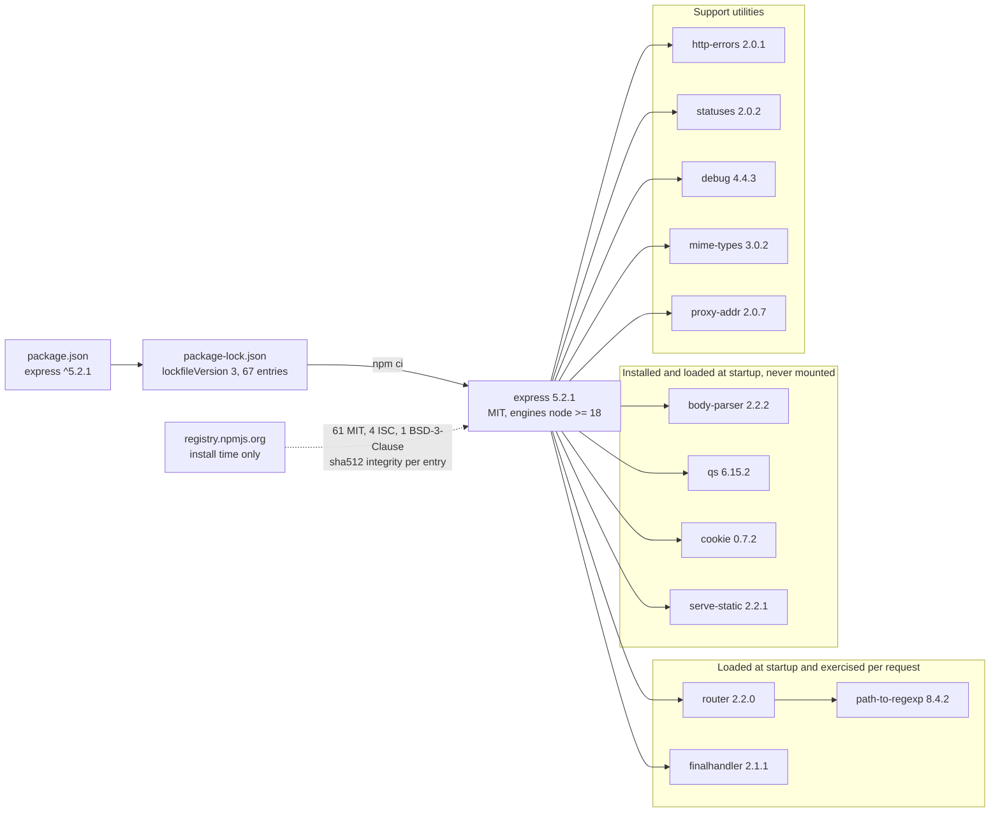

Express loads its dependencies eagerly rather than lazily, so the packages above are already in the process once `require('express')` returns: `lib/express.js:15` requires `body-parser`, `lib/express.js:79` requires `serve-static`, `lib/application.js` requires `finalhandler`, `router`, `debug` and `once`, `lib/utils.js:19–20` requires `proxy-addr` and `qs`, and `lib/request.js` requires `proxy-addr`, `accepts`, `type-is`, `fresh`, `parseurl` and others. Being loaded, however, is not the same as being exercised: no middleware is mounted, no query string is parsed (the `simple` parser uses Node's `querystring`, `lib/utils.js:164–173`), no view is rendered, and no request header is read by either handler.

### 3.3.3 Installed Inventory

The complete tree, in the alphabetical order the lockfile uses. "Express direct" marks the 28 packages `express@5.2.1` declares as its own dependencies; "deeper transitive" marks packages pulled in by those.

| Package | Version | Licence | Relationship |
|---------|---------|---------|--------------|
| `accepts` | 2.0.0 | MIT | Express direct |
| `body-parser` | 2.2.2 | MIT | Express direct |
| `bytes` | 3.1.2 | MIT | Deeper transitive |
| `call-bind-apply-helpers` | 1.0.2 | MIT | Deeper transitive |
| `call-bound` | 1.0.4 | MIT | Deeper transitive |
| `content-disposition` | 1.1.0 | MIT | Express direct |
| `content-type` | 1.0.5 | MIT | Express direct |
| `cookie` | 0.7.2 | MIT | Express direct |
| `cookie-signature` | 1.2.2 | MIT | Express direct |
| `debug` | 4.4.3 | MIT | Express direct |
| `depd` | 2.0.0 | MIT | Express direct |
| `dunder-proto` | 1.0.1 | MIT | Deeper transitive |
| `ee-first` | 1.1.1 | MIT | Deeper transitive |
| `encodeurl` | 2.0.0 | MIT | Express direct |
| `es-define-property` | 1.0.1 | MIT | Deeper transitive |
| `es-errors` | 1.3.0 | MIT | Deeper transitive |
| `es-object-atoms` | 1.1.2 | MIT | Deeper transitive |
| `escape-html` | 1.0.3 | MIT | Express direct |
| `etag` | 1.8.1 | MIT | Express direct |
| `express` | 5.2.1 | MIT | Project direct dependency |
| `finalhandler` | 2.1.1 | MIT | Express direct |
| `forwarded` | 0.2.0 | MIT | Deeper transitive |
| `fresh` | 2.0.0 | MIT | Express direct |
| `function-bind` | 1.1.2 | MIT | Deeper transitive |
| `get-intrinsic` | 1.3.0 | MIT | Deeper transitive |
| `get-proto` | 1.0.1 | MIT | Deeper transitive |
| `gopd` | 1.2.0 | MIT | Deeper transitive |
| `has-symbols` | 1.1.0 | MIT | Deeper transitive |
| `hasown` | 2.0.4 | MIT | Deeper transitive |
| `http-errors` | 2.0.1 | MIT | Express direct |
| `iconv-lite` | 0.7.2 | MIT | Deeper transitive |
| `inherits` | 2.0.4 | ISC | Deeper transitive |
| `ipaddr.js` | 1.9.1 | MIT | Deeper transitive |
| `is-promise` | 4.0.0 | MIT | Deeper transitive |
| `math-intrinsics` | 1.1.0 | MIT | Deeper transitive |
| `media-typer` | 1.1.0 | MIT | Deeper transitive |
| `merge-descriptors` | 2.0.0 | MIT | Express direct |
| `mime-db` | 1.54.0 | MIT | Deeper transitive |
| `mime-types` | 3.0.2 | MIT | Express direct |
| `ms` | 2.1.3 | MIT | Deeper transitive |
| `negotiator` | 1.0.0 | MIT | Deeper transitive |
| `object-inspect` | 1.13.4 | MIT | Deeper transitive |
| `on-finished` | 2.4.1 | MIT | Express direct |
| `once` | 1.4.0 | ISC | Express direct |
| `parseurl` | 1.3.3 | MIT | Express direct |
| `path-to-regexp` | 8.4.2 | MIT | Deeper transitive |
| `proxy-addr` | 2.0.7 | MIT | Express direct |
| `qs` | 6.15.2 | BSD-3-Clause | Express direct |
| `range-parser` | 1.2.1 | MIT | Express direct |
| `raw-body` | 3.0.2 | MIT | Deeper transitive |
| `router` | 2.2.0 | MIT | Express direct |
| `safer-buffer` | 2.1.2 | MIT | Deeper transitive |
| `send` | 1.2.1 | MIT | Express direct |
| `serve-static` | 2.2.1 | MIT | Express direct |
| `setprototypeof` | 1.2.0 | ISC | Deeper transitive |
| `side-channel` | 1.1.0 | MIT | Deeper transitive |
| `side-channel-list` | 1.0.1 | MIT | Deeper transitive |
| `side-channel-map` | 1.0.1 | MIT | Deeper transitive |
| `side-channel-weakmap` | 1.0.2 | MIT | Deeper transitive |
| `statuses` | 2.0.2 | MIT | Express direct |
| `toidentifier` | 1.0.1 | MIT | Deeper transitive |
| `type-is` | 2.1.0 | MIT | Express direct |
| `type-is/node_modules/content-type` | 2.0.0 | MIT | Deeper transitive (nested copy) |
| `unpipe` | 1.0.0 | MIT | Deeper transitive |
| `vary` | 1.1.2 | MIT | Express direct |
| `wrappy` | 1.0.2 | ISC | Deeper transitive |

| Licence | Packages | Notes |
|---------|----------|-------|
| MIT | 61 | Includes `express` and every package on the request path |
| ISC | 4 | `inherits@2.0.4`, `once@1.4.0`, `setprototypeof@1.2.0`, `wrappy@1.0.2` |
| BSD-3-Clause | 1 | `qs@6.15.2` |
| Copyleft (GPL, LGPL, AGPL, MPL) | 0 | No reciprocal or network-copyleft licence appears in the tree |

All three licences are permissive and impose no distribution obligation beyond attribution, which the installed `LICENSE` files in `node_modules/` satisfy. Because `node_modules/` is git-ignored, dependency licences are not shipped in the repository itself; they travel with any deployment that copies the installed tree.

### 3.3.4 Vulnerability Posture

`npm audit` against the installed tree at HEAD reports three advisories — one critical, one high and one moderate — all in transitive packages, and all reported as fixable. The counts returned by npm are `{ "info": 0, "low": 0, "moderate": 1, "high": 1, "critical": 1, "total": 3 }` across 66 installed packages.

| Package | Installed | Affected range | Severity | Advisory and effect | Fix |
|---------|-----------|----------------|----------|---------------------|-----|
| `proxy-addr` | 2.0.7 | 1.1.0 – 2.0.7 | Critical (CVSS 9.1) | `GHSA-jqcg-44mw-7w3h` — IP spoofing via an IPv4-mapped IPv6 trust subnet | Available |
| `body-parser` | 2.2.2 | 2.0.0 – 2.3.0 | High (CVSS 7.5) plus low (CVSS 3.7) | `GHSA-27r3-jxmh-p828` — denial of service via trailing bytes after a compressed request body; `GHSA-v422-hmwv-36x6` — an invalid `limit` value silently disables size enforcement | Available |
| `qs` | 6.15.2 | 2.2.5 – 6.15.3 | Moderate (CVSS 3.7 and 5.3) | `GHSA-x5fp-wj9c-mxmx` — array-limit bypass via bracket-key comma parsing; `GHSA-4mjr-xmp4-gh2g` — denial of service through attacker-controlled `isBuffer` | Available |

Reachability in this service is narrow, and the narrowness is a property of the application rather than of the packages:

- **`body-parser` is never mounted.** No `app.use` call exists in the repository, so no request body is parsed; the denial-of-service path requires body-parser to be installed as middleware.
- **`qs` is never asked to parse.** The configured query parser is `simple`, which resolves to Node's `querystring.parse`; the `extended` parser that calls `qs` is not selected, and no handler reads `req.query`.
- **`proxy-addr` evaluates no trust.** `app.set('trust proxy', false)` is the default, so `proxyaddr.compile([])` builds a function that trusts nothing, and no handler reads `req.ip`, `req.protocol` or `req.hostname`. The advisory's spoofing condition — a configured trust subnet accepting IPv4-mapped IPv6 addresses — therefore does not arise in this configuration.

Two records of the same fact must be kept side by side, because they disagree (FA3). `blitzy/documentation/Project Guide.md` §6/§8 records "0 npm vulnerabilities" across the 66-package tree, as cited in §2.1.3.7; that was a point-in-time result taken when the tree was validated. The audit run at HEAD on 2026-10-26 returns the three advisories above. Neither record contradicts the other about the tree itself — the installed versions are unchanged — but only the current audit describes the advisories disclosed since. Because no CI job and no dependency-update automation exist (§3.6.4), nothing re-runs that check.

### 3.3.5 Dependency Management Obligations

| Obligation | Current state | Consequence |
|------------|---------------|-------------|
| Reproducible installation | Satisfied — the lockfile pins all 66 packages with integrity digests and `npm ci` reproduces them | A fresh checkout behaves identically after install |
| Currency of the direct dependency | 5.2.1 installed against 5.3.0 on npm; the caret range permits the upgrade but the lockfile holds it back | Advisories fixed upstream remain present until the lockfile is regenerated and the tree re-verified |
| Advisory monitoring | Manual only — `npm audit` is not wired into any script, hook or pipeline | Disclosed advisories stay invisible unless someone runs the command |
| Integrity of installed artifacts | Satisfied by pinned `sha512` digests recorded in the lockfile | Tarball substitution is detectable at install time |
| Committed dependencies | Deliberately excluded — `.gitignore` names `node_modules/`, so the repository stays source-only at 20 tracked files | Installation is a prerequisite of running the service |
| Inventory visibility | Satisfied by the committed lockfile, which lists every package, version, licence and digest without shipping the code | Reviewers see the full footprint (0 → 66 packages) from the manifest and lockfile alone |
| Private-registry or authentication configuration | None exists; every package comes from the public registry | No credential or mirror is needed to install |


## 3.4 Third-Party Services

The service integrates with no third-party service at runtime. Its only external touchpoints are an install-time package fetch and one documentation hyperlink; the running process opens no outbound connection beyond the client's own loopback socket, and nothing outside the host can reach it (§1.2.1.3, §1.3.2.3).

### 3.4.1 Runtime Service Integrations — Verified Absent

| Service category | Status | Evidence |
|------------------|--------|----------|
| Cloud platform (AWS or any other) | Absent | No cloud SDK in the dependency tree; the tree is `express` and its closure only (§3.3.3); no credentials, region or endpoint configuration exists |
| Identity and authentication provider (Auth0 or other) | Absent | No identity library, no client ID, tenant, issuer or callback URL in any file; no request input is read, so no token or session could be validated (§2.4.4) |
| Application performance monitoring or tracing | Absent | No agent dependency and no instrumentation import; the service's entire runtime output is one startup line on standard output |
| Log aggregation or log shipping | Absent | No log shipper, no structured log format, no log destination configuration; `console.log` writes to the process's standard output (`server.js:27`) |
| Error tracking | Absent | No error-reporting client; errors are neither caught nor reported — the handlers cannot throw and no `error` or `clientError` listener exists (§2.1.3.2) |
| Metrics or health endpoints | Absent | The routing table holds exactly two `GET` paths; no `/health`, `/ready` or `/metrics` route is registered |
| Analytics, telemetry or feature flags | Absent | No beacon, SDK or flag client; the only metadata the service emits is the framework's own `X-Powered-By: Express` response header |
| Messaging, queues or event buses | Absent | No broker client (`kafka`, `amqp`, `rabbit`, `nats`, `grpc` and similar names appear nowhere in the lockfile); the process neither publishes nor subscribes |
| Outbound HTTP or API clients | Absent | No HTTP client package exists in the tree, and no handler performs I/O — both handlers set a status code, a content type and a fixed string and return |
| Email, SMS or payment providers | Absent | No such dependency and no such call site; the only data resembling contact information is the unused `phonenumber.csv` fixture |
| CDN, edge or reverse proxy | Absent | No proxy configuration, no asset pipeline and no cache-control headers; the listener binds loopback only and is not fronted by anything |
| Secret management or key vault | Absent | No secret reference of any kind, no `.env` file, and no `process.env` read anywhere in executable code |

### 3.4.2 Install-Time and Non-Runtime Touchpoints

| Touchpoint | When | Detail | Evidence |
|------------|------|--------|----------|
| Public npm registry (`registry.npmjs.org`) | Install time only | Resolves and downloads the 66 packages recorded in the lockfile, each verified against its pinned `sha512` digest. Once installed, no registry call is made | `package-lock.json` `resolved` and `integrity` fields |
| Express documentation site (`https://expressjs.com/`) | Never | A hyperlink in the README's prose naming the framework; not fetched by any code | `README.md` line 6 |
| Git remote (GitHub) | Development time only | Version control transport for the 20 tracked files; not part of the deployed service | `git remote -v`; `git ls-files` |

### 3.4.3 Monitoring and Observability Tooling

The service has no observability tooling, and the absence is structural rather than configured-away: there are no logs beyond startup, no metrics, no traces, no alerts and no dashboards. The single output is `Server running at http://127.0.0.1:3000/`, written by the listen callback after a successful bind (`server.js:26–28`). Because it is emitted only after the socket is bound, it doubles as the only readiness signal available to an operator or script. Anything that consumes it — a terminal, a file redirect, or a collector outside the repository — lies outside the system's scope; no such consumer is defined here (§2.4.5). The default-stack monitoring tools named in the platform template have no counterpart in this tree: no agent package is installed, and the only runtime telemetry is the readiness line above plus the `X-Powered-By` header on responses.

### 3.4.4 Identity, Secrets and Credential Handling

No authentication or authorisation service is integrated and no credential exists in the repository. There is no account, token, key, certificate or personal datum; the only string resembling contact data is the synthetic `+111111112xx` range in `phonenumber.csv`, which no code reads (§2.1.3.10). Access control is the loopback binding itself: any local process can reach the service, and nothing outside the host can. Consequently there is no secret-rotation, credential-leak or key-management surface to document — and equally, no facility to add one without first building a configuration layer that does not exist (§2.4.5).

### 3.4.5 Integration Requirements If a Service Were Added

The gaps below are consequences of the current stack, not current functionality, and they mirror the future-phase items recorded in §2.4.5:

| Requirement for any third-party service integration | Why it is missing today |
|-----------------------------------------------------|-------------------------|
| Configuration and secret injection | Hostname and port are `const` literals; no `process.env` read, no config module, no CLI arguments |
| An outbound client and its dependency surface | The tree contains no HTTP client; adding one grows the dependency graph, which the project's own deferred plan already treats as a review obligation (§3.3.5) |
| Error and failure handling for the integration | No `error` listener, no `try`/`catch`, no retry or timeout policy — F-101, F-103 and F-104 are unimplemented |
| Lifecycle hooks to release the connection | No `SIGTERM`/`SIGINT` handling and no cleanup hook — F-102 and F-106 are unimplemented; the hook location they would occupy is the comment placeholder in `Response.txt` §0.4 |
| Observability of the integration | No structured logging, metrics or health surface exists to report on it |
| Network reachability | The listener binds `127.0.0.1`; any service-to-service call would be outbound from a loopback-only process and any inbound call would require deployment changes outside this scope |


## 3.5 Databases and Storage

The service uses no database, no cache and no storage service. Both handlers write a fixed string to the response and nothing else, and no file is written at runtime. Persistence in this project is limited to the repository itself and the installed dependency tree.

### 3.5.1 Primary and Secondary Datastores — Verified Absent

| Store category | Status | Evidence |
|----------------|--------|----------|
| Relational database (PostgreSQL, MySQL, SQLite and others) | Absent | No driver or ORM package in the 66-package tree; no `.sql` file, schema or migration directory among the 20 tracked files; no connection string in any file |
| Document database (MongoDB and others) | Absent | A regex scan of `package-lock.json` for `mongo`, `mongoose`, `pg`, `postgres`, `mysql`, `sqlite`, `redis`, `ioredis`, `knex`, `sequelize`, `typeorm` and `prisma` returns zero matches |
| Key-value store or cache daemon (Redis, Memcached) | Absent | Same scan; no client library and no cache endpoint configuration |
| Search or analytics store (Elasticsearch, DynamoDB and others) | Absent | Same scan (`elastic`, `dynamodb`); no SDK dependency |
| Queue or message broker (Kafka, RabbitMQ, NATS and others) | Absent | Same scan (`kafka`, `amqp`, `rabbit`, `nats`, `grpc`); no producer or consumer code |
| Embedded or in-process store (LevelDB, SQLite binding) | Absent | No such dependency; no file-opening call exists in application code |

Two further proofs apply across the whole system: the complete installed tree is enumerated in §3.3.3 and contains no data-store client, and the complete `require()` surface outside `node_modules/` is four calls — `server.js:1` (`express`) and line 1 of each filename fixture (`http`) — none of which can open a data connection.

### 3.5.2 Data Persistence Strategy

There is no runtime persistence strategy because the service holds no mutable state. What persists between runs is entirely outside the process:

| Persisted artifact | Location | Role |
|--------------------|----------|------|
| Source, manifest and lockfile | The git repository (20 tracked files) | The system of record for behaviour and for dependency versions |
| Installed dependency tree | `node_modules/`, git-ignored by `.gitignore` | Reproducible install output, recreated by `npm ci`; never committed |
| Process state | Memory only | The Express application object, the two route registrations and the listening socket; discarded at exit |
| Response payloads | Not persisted | Both bodies are compile-time string literals in `server.js` |

No write path exists anywhere: application code imports no filesystem module, opens no file, and logs only to standard output. State across requests is not merely unused but impossible — the handlers accept `req` and never read it, so no request can influence a later response (§1.2.2.3). If a datastore were introduced, it would require a client dependency, a configuration layer for its endpoint, lifecycle hooks to release the connection at shutdown, and a test surface — none of which exists today (§3.4.5).

### 3.5.3 Caching

| Caching layer | Status | Detail |
|---------------|--------|--------|
| HTTP response caching | Absent | The handlers set only the status code, `Content-Type` and the body; no `Cache-Control`, `Expires`, `Last-Modified` or `Vary` header is ever written |
| Entity tags | Configured but unreachable | Express's default `etag` setting is `weak` (`node_modules/express/lib/application.js:95`), but the handlers call `res.end` rather than a response helper, so no validator is generated and conditional requests are never satisfied from cache |
| In-process cache or memoisation | Absent | No cache structure, no memoisation and no retained state; each request re-executes three statements |
| Shared cache (Redis, Memcached) | Absent | No client dependency (§3.5.1) |
| Edge or proxy cache | Absent | The listener binds loopback only and no proxy or CDN fronts it |

Caching is not merely unimplemented but unnecessary for the current contract: both bodies are constants compiled into the source, so there is no computation to cache and no data that can go stale.

### 3.5.4 Storage Services and Data at Rest

No storage service — object store, block volume, network share or managed file service — is referenced by any dependency, configuration or code path. Nothing is uploaded, downloaded or synchronised at runtime.

Data that exists at rest is confined to the repository, and none of it feeds the running service:

| File | Content | Consumed by the service |
|------|---------|-------------------------|
| `phonenumber.csv` | Header `message,phonenumber` plus 15 synthetic rows in the `+111111112xx` range | No — no code imports or reads it (F-010) |
| `README.md` | The published HTTP contract and run procedure | No — documentation only |
| `codebase_context (42).md`, `blitzy/documentation/*.md` (4 files) | Requirement note, build prompt, action plan, project guide and the superseded specification | No — documentation only |
| `Response.txt` | JSON envelope holding the unimplemented hardening plan | No — documentation only |
| `s1.png`, `20250304165759.mp4`, `tech_spec.pdf`, `defect_for_task_1.docx` | Unreferenced binary artifacts | No |
| `package.json`, `package-lock.json` | Dependency declaration and pinned resolution | Yes — read by the npm client at install time, never by the service at runtime |

Because the service consumes no stored data, it has no schema, no data model, no migration path, no backup or restore procedure, no retention policy and no disaster-recovery requirement. Its data-classification surface is minimal for the same reason: the only records in the repository are synthetic fixture rows, and the only runtime output is a public loopback address written to standard output. Introducing a datastore would consequently be a new capability rather than a change to an existing one — it would bring connection management, a configuration surface, credential handling and shutdown cleanup, none of which the current stack provides.


## 3.6 Development and Deployment

Development and deployment in this repository are one and the same act: install the dependencies, then run the single JavaScript file with the system Node.js runtime. No build system, container definition, pipeline or process manager exists to mediate between source and a running service.

### 3.6.1 Development Toolchain

| Tool category | Status | Evidence |
|---------------|--------|----------|
| Language runtime | Node.js — the only runtime required | `server.js` is executed directly by `node`; `README.md` documents `node server.js` |
| Package manager | npm — the only package-management tool | `package.json`, the committed `package-lock.json` (`lockfileVersion` 3), and `.gitignore`'s `node_modules/` entry; no Yarn or pnpm lockfile exists |
| Runtime and CLI versions observed in this environment | Node.js v22.23.3, npm 11.21.0 | `node -v`, `npm -v` |
| Build, bundling or transpilation tools | None | No bundler, transpiler, minifier or task runner dependency; no configuration file for any of them |
| Type checker | None | No TypeScript dependency, no `tsconfig.json`, no JSDoc-driven checking configuration |
| Linter or formatter | None | No ESLint, Prettier, Biome or EditorConfig configuration; the root holds only `.git` and `.gitignore` |
| Test framework and test files | None | No test dependency and no test file; the sole npm script is the unmodified npm-init placeholder |
| Commit hooks or local automation | None | No `husky`, `lint-staged`, or `.pre-commit-config.yaml`; no `.github/` directory |
| Editor or container tooling configuration | None | No `.editorconfig`, no `.dockerignore`, no `.nvmrc` or `.node-version` |

The only npm script is:

```json
"test": "echo \"Error: no test specified\" && exit 1"
```

It is the untouched `npm init` placeholder, so `npm test` fails by design and guards nothing. There is no `start`, `build`, `lint` or `dev` script; `npm start` nevertheless runs the service because npm falls back to its implicit default start command for a package whose root contains `server.js` — verified by launching it, which prints `> hello_world@1.0.0 start` / `> node server.js` followed by the expected `Server running at http://127.0.0.1:3000/`.

### 3.6.2 Build System and Dependency Installation

There is no compilation step, so the "build" is dependency installation and nothing else.

| Aspect | Detail |
|--------|--------|
| Build inputs | `server.js`, `package.json`, `package-lock.json` |
| Build command | `npm ci` (reproducible, deleted-and-reinstalled from the lockfile) or `npm install` (may resolve newer versions within the caret range) |
| Build outputs | `node_modules/` only — no `dist/`, `build/`, bundle or generated source; the deployed artifact is the source file itself |
| Ordering constraint | Installation must precede execution, because `server.js:1` requires `express` and `node_modules/` is git-ignored, hence absent from a fresh checkout |
| Determinism | Guaranteed by the lockfile: 66 packages with pinned versions and `sha512` digests (§3.3.2) |
| Known manifest inconsistency | `package.json` declares `"main": "index.js"`, and no `index.js` exists. Tools that resolve the package entry point therefore fail, while `node server.js` and the implicit `npm start` both work |
| Compilation artifacts to clean | None — there is no intermediate output, cache directory or generated code in the repository |

### 3.6.3 Containerisation

Containerisation is absent. No `Dockerfile`, `docker-compose.yml`, `.dockerignore`, image manifest or orchestration manifest (Kubernetes, ECS, Nomad) exists anywhere in the repository; the root directory contains only `.git` and `.gitignore` as hidden entries, and no container-related file is tracked. The Dockerfile and Kubernetes references that a reader may encounter are prose inside `blitzy/documentation/Technical Specifications.md` and `Response.txt` — the former records containerisation as verified absent for the superseded implementation, and the latter mentions Docker and Kubernetes only as illustrative sources of `SIGTERM` signals for an unimplemented shutdown feature. Consequences: the deployment target must supply a Node.js 18+ runtime itself; there is no declared base image, no image-build step, no registry, and no container-level health check; and the loopback binding means a containerised deployment would need its networking addressed before anything outside the container could reach the service.

### 3.6.4 CI/CD

No continuous-integration or continuous-delivery configuration exists: no `.github/workflows/` directory, no pipeline file for any CI provider, no build or deploy script, and no automated gate of any kind. The full commit history is 11 commits on a single branch (`blitzy-62d685d6-…`), and it contains content commits only — the dependency addition, the Express re-platform, `.gitignore`, the README, the strict-routing refinement, and the documentation set. No commit adds or has ever added a pipeline definition.

The practical effect is that every check this project has recorded was manual or transient:

- Contract verification was performed by hand — starting the process and issuing `curl` requests — not by a committed test (§2.1.3.4, §2.1.3.5).
- The strict-routing refinement came from a manual QA pass recorded as a commit message ("Enable strict routing so /good-evening/ returns 404 (QA Issue 1)"), not from an automated assertion.
- Dependency integrity is unmonitored: `npm audit` is not wired into any script or job, so the advisories described in §3.3.4 surfaced only when the command was run explicitly.
- A minimal regression suite (`node:test` with `supertest`, about 2.0 hours) is documented as an optional, out-of-scope enhancement in `blitzy/documentation/Project Guide.md` §2.3 and is not implemented.

### 3.6.5 Deployment Model and Prerequisites

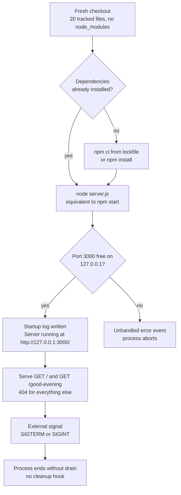

| Prerequisite | Requirement | Enforced by |
|--------------|-------------|-------------|
| Node.js runtime | 18 or newer | Express 5.2.1's `engines.node`; advisory only, since `package.json` declares no `engines` field and no `engine-strict` setting exists |
| npm CLI | 7 or newer, to read `lockfileVersion` 3 | The committed lockfile |
| Dependencies installed | `npm ci` or `npm install` before first start | `server.js:1`; `.gitignore` excludes `node_modules/` |
| Network address | The loopback interface available and TCP port 3000 free; a conflict is fatal, with no fallback port | `server.js` lines 3–4, 26; §2.4.1 |
| Configuration | None to supply — host and port are `const` literals and no environment variable, config file or CLI argument is read | `server.js` lines 3–4 |
| Termination | An operator or supervisor to signal the process; the service offers no shutdown path, and `SIGTERM` ends it with exit code 143 without draining | §2.1.3.2 |

| Deployment characteristic | State |
|---------------------------|-------|
| Topology | One host, one process, one listener on `127.0.0.1:3000` |
| Artifact deployed | The source tree plus the installed dependency tree; nothing is packaged or published |
| Process management | None — no supervisor, cluster, worker threads or restart policy; the process runs until signalled |
| Health and readiness | Only the startup line on standard output; no health or readiness endpoint |
| Transport security | Plain HTTP; no TLS listener, certificate or terminator |
| External reachability | None — loopback binding; making it reachable requires a reverse proxy or networking change outside this scope |
| Configuration and secrets | None — no environment variables, no config files, no credentials to inject |
| Observability at run time | One line at startup; no per-request logging, metrics or tracing |
| Rollback | Manual — redeploy the previous source revision and re-run `npm ci` |
| Scaling | Not supported as configured: the hardcoded loopback binding and fixed port prevent a second instance on the same host, and nothing allows an upstream balancer to reach the service (§2.4.3) |

### 3.6.6 Version Control and Repository Hygiene

| Aspect | Detail |
|--------|--------|
| Version control | Git, with a single branch and 11 commits; the working tree is clean at HEAD |
| Tracked files | 20 — `server.js`, the three filename fixtures, `package.json`, `package-lock.json`, `.gitignore`, `README.md`, `codebase_context (42).md`, `Response.txt`, `phonenumber.csv`, the four `blitzy/documentation/` Markdown files, and four binary artifacts |
| Ignore rules | `.gitignore` contains one line, `node_modules/`, so installed dependencies are never committed and the repository stays source-only |
| History shape | Discrete, reviewable commits for the delivered change: dependency declaration (`b9350e9`), Express re-platform (`0fdbfb6`), ignore rule (`fcbd326`), README contract (`59adfc5`), strict-routing refinement (`f2c2ca4`), then documentation commits |
| Remote | A GitHub repository, used for version-control transport only; no deployment automation is driven from it |
| Artefacts committed that the service never reads | The four binary files and `phonenumber.csv`; they inflate the checkout without affecting build or run |


## 3.7 References

- `server.js` — the service entry point: Express instantiation, `strict routing`, both route registrations, the `app.listen` bind to `127.0.0.1:3000`, and the single startup log line; established the CommonJS/JavaScript surface, the APIs used, and the absence of middleware, error handling, configuration reads and filesystem access
- `package.json` — package identity (`hello_world` 1.0.0, MIT), the single `dependencies.express ^5.2.1` entry, the placeholder `test` script, the absent `engines`/`type`/`devDependencies` fields, and the `main` entry pointing at a non-existent `index.js`
- `package-lock.json` — lockfile format version 3, the 67 `packages` entries, the root entry mirroring the manifest, the 66 installed packages with exact versions, `registry.npmjs.org` resolution URLs, `sha512` integrity digests, licence fields, `engines` floors and the nested `type-is/node_modules/content-type@2.0.0`
- `README.md` — the published HTTP contract (framework, dependency, both endpoints, 404 behaviour) and the documented run procedure
- `.gitignore` — the single `node_modules/` ignore rule that keeps the repository source-only
- `Test.test..js`, `!@#$%^&().js`, `QWYFFGHGHFDDJFDame_!@#$%^&(){}long_name_…_server.js` — the three byte-identical filename fixtures on Node's built-in `http`, and their divergence from the Express service
- `codebase_context (42).md` — the original Node.js tutorial request that fixed the language and runtime
- `Response.txt` — the JSON-wrapped, unimplemented hardening plan; its exclusion list (no new dependencies, no Express, no TypeScript) and its Docker/Kubernetes and signal-handling references
- `phonenumber.csv` — the orphan `message,phonenumber` fixture and the synthetic `+111111112xx` number range
- `blitzy/documentation/Agent Action Plan.md` — requirements FR-A to FR-D, the ruling that overrides the zero-dependency posture, the accepted fixture divergence, the Node 18+ baseline, and Express 5's reserved path characters
- `blitzy/documentation/Build Prompt.md` — the operator request that fixed Express as the framework
- `blitzy/documentation/Project Guide.md` — recorded validation results, the dependency-currency risk, the point-in-time "0 npm vulnerabilities" figure, the deferred strict-routing QA issue, and the optional enhancements (regression suite, `X-Powered-By` suppression, environment parameterisation)
- `blitzy/documentation/Technical Specifications.md` — the superseded native-`http` specification, its default-stack reconciliation notice, and its freshness disclaimer
- `blitzy/` and `blitzy/documentation/` — the documentation subtree and its four Markdown artifacts, containing no executable code
- `node_modules/` — the 65 top-level package directories plus the nested `type-is/node_modules/content-type`, establishing set-equality with the lockfile and the empty `.bin` directory
- `node_modules/express/package.json` — Express 5.2.1's version, MIT licence, `engines.node >= 18`, published file list, and its 28 direct dependencies with their ranges
- `node_modules/express/index.js` and `node_modules/express/lib/` (`application.js`, `express.js`, `request.js`, `response.js`, `utils.js`, `view.js`) — the framework defaults (`etag` weak, `query parser` simple, `trust proxy` false), the strict-routing pass-through to the router, the eager `require`s of `body-parser`, `serve-static`, `qs`, `proxy-addr`, `router` and `finalhandler`, the `querystring` resolution of the `simple` parser, and `compileTrust`'s handling of `false`
- `node_modules/express/lib/application.js`, `.../request.js`, `.../view.js` — the framework's internal use of Node built-ins (`node:http`, `node:net`, `node:fs`, `node:path`, `node:events`, `node:querystring`)
- Files inspected and confirmed absent: `Dockerfile`, `docker-compose.yml`, `.dockerignore`, `.github/`, `.gitlab-ci.yml`, `Jenkinsfile`, `Makefile`, `tsconfig.json`, `.eslintrc`, `.prettierrc`, `.editorconfig`, `.pre-commit-config.yaml`, `.nvmrc`, `.node-version`, `.tool-versions`, `.env`, `.npmrc`, `Procfile`, `ecosystem.config.js`, `serverless.yml`, and any `.tf` file
- Unreferenced binary artifacts present in the checkout: `s1.png`, `20250304165759.mp4`, `tech_spec.pdf`, `defect_for_task_1.docx`
- [web] npm registry metadata for `express` (`https://registry.npmjs.org/express`, `.../express/5.3.0`) — current `latest` 5.3.0, the separate `latest-4` tag at 4.22.3, and the `engines.node ">= 18"` declaration
- [web] Express release and blog sources (`https://github.com/expressjs/express/releases/tag/v5.3.0`, `.../v5.0.0`, `https://expressjs.com/en/blog/2024-10-15-v5-release`, `https://expressjs.com/en/blog/2025-03-31-v5-1-latest-release`, `https://expressjs.com/en/guide/migrating-5`, `https://deps.dev/npm/express/5.3.0`, `https://socket.dev/npm/package/express/overview/5.0.0`) — Express 5.3.0 published 2026-10-09, Express 5.0.0 released 2024-09-10 (with the project blog's one-day-earlier 2024-09-09 discrepancy), and the Node 18 minimum
- [web] Node.js release sources (`https://nodejs.org/en/about/previous-releases`, `https://nodejs.org/en/blog/release/v26.0.0`, `https://nodejs.org/en/blog/vulnerability/october-2026-security-releases`, `https://nodejs.org/en/blog/announcements/evolving-the-nodejs-release-schedule`, `https://nodejs.org/en/blog/announcements/node-18-eol-support`, `https://raw.githubusercontent.com/nodejs/Release/main/README.md`, `https://endoflife.date/nodejs`) — Node 26 as the Current line and its Active LTS date, Node 24 as the latest LTS, Node 22 in Maintenance LTS to 2027-04-30, and Node 18's end of life on 2025-04-30
- [web] GitHub Advisory Database entries surfaced by `npm audit` — `GHSA-jqcg-44mw-7w3h` (`proxy-addr`, critical, IP spoofing via IPv4-mapped IPv6 trust subnet), `GHSA-27r3-jxmh-p828` and `GHSA-v422-hmwv-36x6` (`body-parser`, high and low denial-of-service advisories), `GHSA-x5fp-wj9c-mxmx` and `GHSA-4mjr-xmp4-gh2g` (`qs`, moderate advisories) — the three findings, their severities, affected ranges and fix availability reported for the installed tree


# 4. Process Flowchart

## 4.1 System Workflows

### 4.1.1 Core Business Processes

`hao-backprop-test` executes exactly one process, and that process does three things: it **installs**, it **binds a loopback listener**, and it **answers two literal paths**. Nothing else in the repository executes: the three filename fixtures (`Test.test..js`, `!@#$%^&().js`, and the 199-character `QWYFFGHGHFDDJFDame_…_server.js`) are standalone scripts that the service never loads, `phonenumber.csv` is read by no code, and no executable file reads any other file — no `fs` usage and no local `require` exists in any of the four `.js` files outside `node_modules/`.

Every flow therefore belongs to one of four end-to-end journeys. Each row maps to the feature identifiers used throughout §2 and §3.

| # | Journey | Trigger | Features | Terminal condition |
|---|---------|---------|----------|--------------------|
| 1 | Dependency installation (install-time) | Fresh checkout on a host with npm 7+ and registry access | F-007 | `node_modules/` holds the 66 locked packages, or npm aborts non-zero and the service cannot start |
| 2 | Process start and bind | `node server.js`, or the implicit `npm start` | F-001, F-002, F-003 | One startup line on stdout with an idle event loop, or a silent zero-status exit |
| 3 | Request handling | Any HTTP request reaching `127.0.0.1:3000` | F-004, F-005, F-006 | A response is written and the socket returns to the keep-alive pool |
| 4 | Termination | `SIGTERM`/`SIGINT` from an operator, supervisor, or shell | F-002 (RQ-004) | The process ends through the runtime's default signal disposition |

The journeys are not business-domain workflows: both handlers return source literals and read no input, so no approval, pricing, fulfilment, or notification process exists to model. Actor inventory is correspondingly small — **operator** (or supervisor) at install and termination, **npm CLI** at install, **HTTP client** at serve time, and the **Node.js runtime plus Express** as the executing systems. The only user touchpoints in the running service are the two registered URLs and the single startup line.

#### 4.1.1.1 Journey 1 — Dependency installation (F-007)

1. The operator runs `npm ci` (reproducible, from the lockfile) or `npm install` (may resolve newer versions within the caret range) — the run procedure published in `README.md` §Running.
2. npm reads `package.json`, whose only dependency is `"express": "^5.2.1"` (lines 11–13).
3. npm resolves the tree through `package-lock.json` (`lockfileVersion` 3, 66 package entries, each with a `registry.npmjs.org` tarball URL and a `sha512-…` integrity digest).
4. Tarballs are fetched from the public registry, each verified against its recorded digest.
5. Extracted packages are written to `node_modules/`, which `.gitignore` excludes (single line `node_modules/`), so a checkout is source-only and installation is a precondition of execution.
6. npm exits; the "build" is complete, because there is no compilation, bundling, or transpilation step anywhere in the repository.

**Decision point.** `npm ci` honours the lockfile strictly, `npm install` may float within `^5.x`, so reproducibility rests on the lockfile rather than the manifest.

**Error path.** Without the installed tree, startup aborts at `server.js:1`: running the file in a directory with no `node_modules/` produced `Error: Cannot find module 'express'` (`code: 'MODULE_NOT_FOUND'`, `requireStack: ['…/server.js']`) on stderr, exit status `1`, and nothing on stdout. **Recovery:** re-run the install; no retry, mirror, or offline fallback is configured.

#### 4.1.1.2 Journey 2 — Process start and bind (F-001, F-002, F-003)

Execution is straight-line module evaluation followed by a single bind attempt. Order is significant at step 5.

1. `node server.js` begins; `npm start` reaches the same file because npm falls back to its implicit `node server.js` for a package whose root contains `server.js` (no `start` script is declared; `main` points at the non-existent `index.js`).
2. `const express = require('express')` (`server.js:1`) resolves the framework from `node_modules/`. Failure aborts here, before any output (see Journey 1's error path).
3. `hostname = '127.0.0.1'` and `port = 3000` are bound as module-level `const`s (lines 3–4). No `process.env` read, no config file, and no CLI argument is consulted anywhere in the code.
4. `const app = express()` (line 6) runs `app.init()` → `defaultConfiguration()`: the settings map is created and framework defaults are written — `x-powered-by` **enabled**, `etag` `weak`, `env` `development` (or `NODE_ENV` if set), `query parser` `simple`, `trust proxy` `false`.
5. `app.enable('strict routing')` (line 12) writes `strict routing = true` into the settings map. The router does not exist yet: `app.init` installs a lazy `router` getter that constructs `new Router({ caseSensitive: this.enabled('case sensitive routing'), strict: this.enabled('strict routing') })` **on first access**, and `app.get` is the first accessor. Enabling the setting after the first route registration is therefore ineffective — verified by probe: with the repository's ordering `GET /good-evening/` returns `404`, while enabling strict routing after registering `/` makes the same request return `200`.
6. `app.get('/', …)` (lines 14–18) triggers `lazyrouter()`: the Router is created with `strict: true`, `caseSensitive: false`, and layer L1 is registered for the literal path `/`.
7. `app.get('/good-evening', …)` (lines 20–24) registers layer L2 on the same router. The routing table is now closed: two literal `GET` paths.
8. `app.listen(port, hostname, callback)` (line 26) enters Express's `listen`, which creates the underlying Node `http.Server` over the application, wraps the callback with `once`, registers it as a **one-shot `error` listener** (`server.once('error', done)`), and calls `server.listen(...)`.
9. The runtime attempts to bind TCP `127.0.0.1:3000`.
10. **On success:** the `listening` event invokes the callback, which writes the single line `Server running at http://127.0.0.1:3000/` to stdout (line 27). The listener keeps the event loop alive and the process idles.
11. **On bind failure** (`EADDRINUSE`, `EACCES`): the error event is consumed by the one-shot callback registered in step 8. The callback takes no parameters, so it cannot observe the error; it prints the **same** banner and returns. With no further handles the event loop empties and the process exits with status `0` and no diagnostic — observed live: the callback was invoked with one argument `EADDRINUSE` and `this.listening === false`, then the process exited `0`.
12. The server object returned by `app.listen` is **discarded** — line 26 assigns it to nothing — so the application retains no handle through which `server.close()` could ever be called.

**Decision points.** Dependency resolution at step 2; router construction at step 5 (ordering-sensitive); bind outcome at step 9.

#### 4.1.1.3 Journey 3 — Request handling (F-004, F-005, F-006)

1. A client connects to `127.0.0.1:3000` over plain HTTP. No TLS, authentication, or client-address filtering applies: any local process can reach the listener, and loopback binding is the service's entire exposure boundary.
2. Node's HTTP parser reads the request. A syntactically invalid request line or header block raises `clientError`; the repository registers no listener for it, so the runtime's built-in handling answers `HTTP/1.1 400 Bad Request\r\nConnection: close\r\n\r\n` and closes that connection while the listener keeps serving — observed live, with nothing written to the application's stdout.
3. The `request` event hands `(req, res)` to `app.handle`: `X-Powered-By: Express` is set (because `x-powered-by` remains enabled), the request/response pair is cross-linked, and the Express `finalhandler` is prepared as the terminal callback.
4. The router dispatches. The query string is removed before matching (Express's `simple` query parser runs lazily and is never consulted), matching is case-insensitive because `case sensitive routing` is **not** enabled, and trailing slashes are significant because `strict routing` **is** enabled. Three outcomes follow:
   - **Registered `GET` path** — `/` (L1) or `/good-evening` (L2) → the handler runs. `HEAD` is answered by the same `GET` layer, so `HEAD /` returns `200` with no body.
   - **Framework-handled method** — `OPTIONS /` returns `200`, `Allow: GET, HEAD`, body `GET, HEAD`, without entering either handler.
   - **Everything else** — unmatched paths (`/nope`, `/hello`, `//`), trailing-slash variants (`/good-evening/`), and non-`GET`/`HEAD` methods on registered paths (`POST /`, `PUT /`) → fall through to step 8.
5. The matched handler executes three synchronous statements and returns: `res.statusCode = 200`, `res.setHeader('Content-Type', 'text/plain')`, `res.end(<literal>)`. `req` is accepted and never dereferenced; there is no branch, loop, I/O, or allocation of dynamic content, so the handler cannot fail for input-dependent reasons.
6. The runtime writes the response: status line, `Content-Type: text/plain`, `Content-Length` (14 for `Hello, World!\n`, 12 for `Good evening`), `Date`, `Connection: keep-alive`, `Keep-Alive: timeout=5`, and `X-Powered-By: Express`. No `ETag` and no `Cache-Control` are emitted, because `res.end` bypasses the `res.send` path where the `weak` ETag setting would apply.
7. The socket returns to the keep-alive pool for up to 5 seconds of idleness (the runtime's `keepAliveTimeout`), and a reused socket re-enters at step 2.
8. Unmatched requests are terminated by `finalhandler`: `404 Not Found` with Express's default HTML body `Cannot GET <path>`, plus `Content-Security-Policy: default-src 'none'`, `X-Content-Type-Options: nosniff`, and `Content-Type: text/html; charset=utf-8`. A plain not-found carries no error object, so nothing is logged.

**User touchpoints.** The HTTP client sees only these responses; the operator sees only the startup line. Every response advertises `X-Powered-By: Express`; no cookie, session, or credential is ever set.

#### 4.1.1.4 Journey 4 — Termination

No application shutdown path exists: a repository-wide search of every `.js` file finds no `process.on` registration, no `SIGTERM`/`SIGINT` handler, no `server.close()`, no `process.exit`, and no cleanup hook. Consequently:

- `SIGTERM` and `SIGINT` take the runtime's default disposition and end the process **immediately** — observed: `kill -TERM <pid>` produced exit status `143` (`128 + 15`) with no shutdown output beyond the startup line.
- In-flight responses are dropped, established keep-alive connections are reset, and no drain window exists, so container and orchestrator conventions that expect a bounded, clean exit cannot be honoured (F-102 remains proposed).
- Because the server object is discarded at `server.js:26` (Journey 2, step 12), `server.close()` is not reachable from the current code without first retaining the return value of `app.listen`.
- Unhandled failures inside the runtime's own machinery also end the process: an unhandled `error` event throws out of the event loop, which is exactly what the native-`http` fixtures do on a port conflict (unhandled `EADDRINUSE`, exit `1`, stack trace), in contrast to the silent zero-status exit of the Express implementation.

**Decision points.** None at runtime — termination is unconditional and unobserved by the application.

#### 4.1.1.5 Consolidated Decision Points

| Decision | Condition evaluated | Layers involved | Observed outcome |
|----------|--------------------|-----------------|------------------|
| Is the framework resolvable? | `require('express')` at `server.js:1` | Node module loader | `MODULE_NOT_FOUND` → exit `1`, no stdout (verified outside the checkout) |
| Is strict routing active at router construction? | `app.enable('strict routing')` before the first `app.get` | Express settings map → lazy Router getter | Only the repository's ordering makes `/good-evening/` a distinct path (verified both orderings) |
| Did the port bind? | `EADDRINUSE`/`EACCES` on `server.listen` | Node `http.Server`, Express `listen` wiring | Silently swallowed: banner printed, exit `0`, no diagnostic |
| Was the request syntactically valid HTTP? | HTTP parser | Node `http.Server` → `clientError` | Runtime default `400 Bad Request` + connection close; process survives |
| Which route matches? | Literal path equality (case-insensitive, strict trailing slash) + method `GET`/`HEAD` | Express `router` (`strict`/`caseSensitive` options) | L1, L2, `OPTIONS` responder, or `404` |
| Is the response cached or validated? | Not evaluated — `res.end` path | Express `response`, `etag` setting unused | No `ETag`, no `Cache-Control` |
| How does the process end? | External signal only | Node process signal disposition | Immediate exit, no drain (verified `143`) |

### 4.1.2 Integration Workflows

At run time the service integrates with **nothing**: it opens no outbound connection, holds no database session, publishes to no queue, and reads no file. The only cross-system flow in the repository is install-time, and the only interface the service exposes is its two literal HTTP paths. §4.3.1 and §4.3.2 treat the state and error consequences of that isolation.

#### 4.1.2.1 Data Flow Between Systems

| Integration | Direction | Payload | Protocol / contract | Authentication | Evidence |
|-------------|-----------|---------|---------------------|----------------|----------|
| npm CLI → public registry | Outbound, install-time only | Package tarballs requested by name, version, and tarball URL | HTTPS; `package-lock.json` records the resolution and `sha512-…` integrity digests | None (public registry) | `package-lock.json` (66 entries, `lockfileVersion` 3); verified by `npm pack express@5.2.1`, whose `lib/application.js` is byte-identical to the installed copy |
| HTTP client → listener | Inbound, run time | Request line and headers; the body is never read | HTTP/1.1 over loopback `127.0.0.1:3000` | None | `server.js:26`; live requests at HEAD |
| Listener → HTTP client | Outbound, run time | `text/plain` bodies `Hello, World!\n` (14 B) and `Good evening` (12 B), or the default `404` HTML | HTTP/1.1 | None | `server.js:14–24`; live responses |
| Application → stdout | Outbound, once per process | `Server running at http://127.0.0.1:3000/` | Attached standard-output stream | None | `server.js:27` |
| Signal channel → process | Inbound | `SIGTERM`/`SIGINT` | OS process signalling | Local process permission only | No handler present; exit `143` observed |

No data flows out of the service other than those two bodies, and no request-derived data is stored, forwarded, or logged: the handlers never read `req`.

#### 4.1.2.2 API Interactions

The published API surface is two literal `GET` paths, documented in `README.md` (lines 9–12) and implemented at `server.js:14–24`. Everything else is framework default behaviour.

- **Transport:** plain HTTP/1.1 on loopback, port 3000. No TLS listener, certificate, or terminator exists; nothing outside the host can reach the service without a proxy or networking change that is not part of this repository.
- **Methods:** `GET` and `HEAD` (answered from the `GET` registration) serve content; `OPTIONS` is answered by Express's built-in responder; `POST`, `PUT`, `DELETE`, and `PATCH` on a registered path return `404`.
- **Bodies and headers:** no request body is ever parsed — no parsing middleware is registered (no `app.use` exists in any `.js` file) and neither handler dereferences `req`. Content negotiation is absent: the response type is fixed at `text/plain` regardless of `Accept`, and no compression, range, or conditional-request handling is implemented.
- **Versioning and enumeration:** none. There is no API version prefix, no OpenAPI or machine-readable contract, and no discovery endpoint; `README.md` is the de facto contract (F-008).
- **Refusal behaviour:** an unregistered path is a refusal, not a fallback — the framework's `404` replaces the pre-migration route-agnostic greeting, which is the deliberate behaviour change recorded in `blitzy/documentation/Agent Action Plan.md` §0.4.2.

#### 4.1.2.3 Event Processing Flows

All events in the system are emitted by the Node.js `http.Server` or by the Express application. No event bus, message broker, custom `EventEmitter`, or listener registration in application code exists beyond what the framework wires itself.

| Event | Emitted by | Listener at HEAD | Effect |
|-------|-----------|------------------|--------|
| `listening` | Node `http.Server` after a successful bind | The `app.listen` callback (`server.js:26–28`) | Writes the single startup line; process begins serving |
| `error` | Node `http.Server` on bind failure | The same callback, registered by Express as a one-shot `error` listener (`express/lib/application.js:598–606`) | Banner printed, error discarded, process exits `0` — no diagnostic |
| `request` | Node `http.Server` per parsed request | Express `app.handle` | Router dispatch to L1, L2, the `OPTIONS` responder, or `finalhandler` |
| `clientError` | Node `http.Server` on a malformed request | **None** — the repository registers no listener (verified by text search) | Runtime default `400 Bad Request` and connection close; the process survives |
| `SIGTERM` / `SIGINT` | Operating system | **None** — no `process.on` exists | Immediate termination with no drain (exit `143` observed) |

The service is event-driven only in the framework sense: each request is handled synchronously to completion, with no timers, promises, streams, worker threads, or background tasks in application code.

#### 4.1.2.4 Batch Processing Sequences

No batch, scheduled, or asynchronous sequence exists. There is no job runner, cron entry, queue consumer, or `setInterval`/`setTimeout` in application code; no nightly or periodic reconciliation runs; and no build or CI pipeline produces artifacts, since development and deployment are the same act (`npm ci` then `node server.js`, §3.6).

Two repository artifacts resemble batch inputs but are consumed by nothing:

- `phonenumber.csv` (F-010) — a `message,phonenumber` header with 15 synthetic rows, imported by no code path. A repository-wide search finds no file-I/O call in any `.js` file, so no batch ingest or transformation of this data exists.
- The three filename fixtures (F-009) — runnable servers that are never invoked by the service. Each binds the **same** `127.0.0.1:3000` and answers **every** path and method, including `POST /` and `/deep/nested/path`, with `200` and `Hello, World!\n` (14 B, no `X-Powered-By` header, no `404` branch). Because the port is shared, a fixture and `server.js` cannot run concurrently: the fixture additionally crashes on `EADDRINUSE` with an unhandled `error` event (exit `1`, stack trace), while `server.js` exits silently with status `0`.

The only recurring activity in the system is therefore the per-request cycle of §4.1.1.3, repeated once per arriving request.


## 4.2 Flowchart Requirements

### 4.2.1 Per-Workflow Flowchart Elements

Every workflow diagram in §4.4 is built from the same notation, and each element below is traced to the observable behaviour it represents.

| Element | Notation used in §4.4 | Meaning in this system |
|---------|----------------------|------------------------|
| Terminal | Stadium node `(["..."])` or `([...])` | A start or end point: an operator command, a process start, a written response, or process death |
| Process step | Rectangle `["..."]` | A statement or framework action that executes without branching |
| Decision | Rhombus `{...}` | A condition the runtime or framework evaluates, always with labelled outgoing edges |
| System boundary | `subgraph` used as a swimlane | The owner of a step: operator host, npm CLI, registry, Node process, Express application, HTTP client |
| Error edge | Dashed or labelled edge to an error node | A path taken because a condition failed |
| Recovery edge | Edge back to a process step or to the operator | The manual remedy that re-enters the flow |
| Timing annotation | Label on the node or edge | A runtime default or a measured value governing that step |
| Requirement tag | Feature ID in the node label, e.g. `F-006` | The requirement of §2.2 the step satisfies |

The diagrams use Mermaid `flowchart`, `sequenceDiagram`, and `stateDiagram-v2` syntax; the high-level and per-journey flows carry swimlanes for the actors listed above, and every decision diamond is labelled with the condition actually evaluated by the code or the runtime.

#### 4.2.1.1 W1 — Dependency Installation (F-007)

| Element | Specification |
|---------|---------------|
| Start point | Operator shell in a fresh checkout: 20 tracked files, no `node_modules/` |
| End points (success) | `node_modules/` populated with the 66 locked packages; the install command exits `0` |
| End points (failure) | npm exits non-zero with the tree incomplete; the service cannot start |
| Process steps | (1) run `npm ci` or `npm install`; (2) read `package.json` (single dependency `express ^5.2.1`); (3) resolve the tree from `package-lock.json` (`lockfileVersion` 3, 66 entries); (4) fetch tarballs from `registry.npmjs.org`; (5) verify each against its recorded `sha512` integrity digest; (6) write `node_modules/`; (7) exit |
| Decision diamonds | **Is the lockfile honoured?** `npm ci` → exact tree, `npm install` → caret range may float within `^5.2.1`. **Is the tree complete?** A missing or partial tree makes step 2 of W2 fail with `MODULE_NOT_FOUND` |
| System boundaries (swimlanes) | Operator host · npm CLI · public registry · repository filesystem (`.gitignore` excludes `node_modules/`) |
| User touchpoints | The operator's install command and npm's own console output; no application output |
| Error states and recovery | Fetch failure, integrity mismatch, or unwritable target path aborts npm non-zero. Recovery is manual: re-run the install. No retry, back-off, mirror, or offline cache is configured by this repository |
| Timing and SLA | No timeout, budget, or SLA is declared. `blitzy/documentation/Project Guide.md` §3 records a completed install of the 66-package tree with `0 vulnerabilities` from `npm audit`; the value is a point-in-time observation, not a commitment |

#### 4.2.1.2 W2 — Process Start and Bind (F-001, F-002, F-003)

| Element | Specification |
|---------|---------------|
| Start point | `node server.js`, or `npm start` (npm's implicit default command for a package whose root contains `server.js`) |
| End points (success) | One line on stdout — `Server running at http://127.0.0.1:3000/` — with the event loop held open by the listener |
| End points (failure) | **Missing dependency:** `MODULE_NOT_FOUND` at `server.js:1`, exit `1`, nothing on stdout (verified). **Bind conflict:** banner printed, error discarded, exit `0`, no diagnostic (verified) |
| Process steps | (1) `require('express')` (`server.js:1`); (2) bind `hostname`/`port` constants (lines 3–4); (3) `express()` and `defaultConfiguration()` (line 6); (4) `app.enable('strict routing')` (line 12); (5) first `app.get` builds the Router with `strict: true`, `caseSensitive: false` (line 14); (6) second `app.get` (line 20); (7) `app.listen(port, hostname, callback)` creates the `http.Server`, wraps the callback with `once`, registers it as a one-shot `error` listener, and binds (line 26) |
| Decision diamonds | **Is `express` resolvable?** no → process aborts before any output. **Is the bind successful?** no → the one-shot error listener consumes the event and the process exits `0`. **Was strict routing enabled before the first route registration?** no → trailing-slash variants would match (the setting is captured when the Router is constructed) |
| System boundaries (swimlanes) | Operator/supervisor · Node.js module loader · Express application · Node `http.Server` · loopback network interface |
| User touchpoints | The single startup line; no readiness endpoint, health check, or version output exists |
| Error states and recovery | `EADDRINUSE`/`EACCES` are swallowed, so the failure is silent and the banner is misleading. Recovery is manual: free port 3000 or edit the `port` literal, as recorded in `blitzy/documentation/Project Guide.md` §9.7. F-101 proposes an `error` listener that logs and exits `1` |
| Timing and SLA | Bind happens during process start-up; no retry, back-off, or fallback port exists. `blitzy/documentation/Project Guide.md` §3 records 100 % startup success on a free port and a launch-to-banner interval under one second on this host |

#### 4.2.1.3 W3 — Request Handling (F-004, F-005, F-006)

| Element | Specification |
|---------|---------------|
| Start point | An accepted TCP connection on `127.0.0.1:3000` carrying bytes that may or may not parse as HTTP |
| End points | `200` with a 14-byte or 12-byte `text/plain` body; `200` with `Allow: GET, HEAD` for `OPTIONS`; `404` with Express's default HTML; `400 Bad Request` plus connection close for malformed input |
| Process steps | (1) parse the request; (2) `app.handle` sets `X-Powered-By: Express` and prepares `finalhandler`; (3) router strips the query string and matches the path case-insensitively with significant trailing slashes; (4) the matched handler assigns `statusCode`, sets `Content-Type`, and calls `res.end(<literal>)`; (5) the runtime writes headers and body, computing `Content-Length`; (6) the socket returns to the keep-alive pool |
| Decision diamonds | **Is the request syntactically valid HTTP?** no → runtime `400` and connection close, process survives. **Does the path match `/` or `/good-evening` exactly (ignoring case, trailing slash significant)?** **Is the method `GET` or `HEAD`?** **Is the method `OPTIONS`?** → framework responder. Otherwise → `404`. Each diamond is evaluated by the router, not by application code |
| System boundaries (swimlanes) | HTTP client · Node `http.Server`/socket · Express router · route handlers and `finalhandler` |
| User touchpoints | The two documented URLs of `README.md` (plus their `HEAD` and `OPTIONS` variants); every response carries the framework-disclosure header |
| Error states and recovery | Malformed request → runtime `400`, connection closed, nothing logged, no application recovery needed because the listener survives (verified). Handler exception → the handlers contain three non-throwing statements, so the state is unreachable; F-103 proposes a `try`/`catch` with a `headersSent` guard for future-proofing. Unmatched request → `404` refusal, logged nowhere |
| Timing and SLA | Runtime defaults govern pacing: `keepAliveTimeout` 5 000 ms (echoed as `Keep-Alive: timeout=5`), `headersTimeout` 60 000 ms, `requestTimeout` 300 000 ms, `server.timeout` 0 (disabled). Measured on this host: 50 sequential keep-alive `GET /` requests between 0.17 ms and 8.93 ms (median 0.46 ms), and 100 concurrent requests completed in 37 ms. No SLA, KPI, or alert threshold is defined (see §1.2.3.3); the figures in `Response.txt` §0.6 (under 50 ms, under 50 MB RSS, 100+ connections) were written for the superseded implementation and are not objectives of this build |

#### 4.2.1.4 W4 — Termination and Failure Paths

| Element | Specification |
|---------|---------------|
| Start point | An external signal, or the end of the failure paths of W1–W3 |
| End points | Process death with exit `143` on `SIGTERM` (observed), `130` on `SIGINT` by the same default disposition, `1` on an unhandled `error` event, or silently `0` on a swallowed bind failure |
| Process steps | None in application code: no `process.on` registration, no `server.close()`, no cleanup, no `process.exit` exists anywhere in the repository's JavaScript |
| Decision diamonds | **Is a signal handler registered?** no → default disposition applies immediately. **Is the listener reference retained?** no → the server object is discarded at `server.js:26`, so `server.close()` is not reachable without a code change |
| System boundaries (swimlanes) | Operator/supervisor · operating system · Node.js process |
| User touchpoints | None — the termination is unobserved by the application, which writes nothing on the way out |
| Error states and recovery | In-flight responses are dropped and keep-alive sockets are reset; recovery is a full restart. F-102 proposes `SIGTERM`/`SIGINT` handlers with a 10-second force-exit guard and exit `0` on a drained shutdown; F-104 proposes a `clientError` listener; F-106 proposes a cleanup hook inside the close callback |
| Timing and SLA | No drain window exists today; the only proposed bound anywhere in the repository is F-102's 10-second force-exit guard, which is not implemented |

#### 4.2.1.5 Diagram Coverage Matrix

| Required diagram (§4.4) | Workflows covered | Terminals | Decisions | Swimlanes | Error and recovery edges | Timing labels |
|-------------------------|-------------------|-----------|-----------|-----------|--------------------------|---------------|
| 4.4.1 High-level system workflow | W1–W4 in one view | Yes | Yes (4) | 5 | Yes | Yes (start-up and idle) |
| 4.4.2 Detailed process flows | W1, W2, W3 (root route, second route, routing refusal) | Yes | Yes (per flow) | Yes | Yes | Yes (parser, bind, keep-alive) |
| 4.4.3 Error handling flow | W2 bind conflict, W3 malformed input, W4 signals, F-101–F-106 proposals | Yes | Yes (3) | 4 | Yes, with explicit recovery edges | Yes (10-second guard as proposed) |
| 4.4.4 Integration sequence diagrams | W1 install-time, W3 request, W4 termination | Yes (messages) | No (alternate fragments) | Participants as lanes | Yes (`alt` fragments) | Yes |
| 4.4.5 State transition diagrams | Process/listener lifecycle and single-connection lifecycle | Initial and final states | Guarded transitions | Not applicable | Yes (failure transitions) | Yes (idle timeouts) |

### 4.2.2 Validation Rules

Every validation the system performs is performed **by the runtime or the framework**; the application itself validates nothing. The tables below state each rule, its enforcing layer, and the evidence, and they deliberately mark the rules that are unverifiable by automation because the repository ships no test suite.

#### 4.2.2.1 Business Rules at Each Step

| Step | Business rule | Source | Enforced by | Evidence at HEAD |
|------|---------------|--------|-------------|------------------|
| W1 install | Exactly one runtime dependency may be declared, at `^5.2.1` | F-007-RQ-001, FR-A | `package.json` `dependencies` block | One key, `express` |
| W1 install | The resolved tree must be pinned with registry URLs and `sha512` digests | F-007-RQ-002 | `package-lock.json` | `lockfileVersion` 3, 66 entries |
| W1 install | `node_modules/` must never be committed | F-007-RQ-004 | `.gitignore` | Single line `node_modules/` |
| W2 start | Installation must precede execution | F-007 business rule | Node module loader | `MODULE_NOT_FOUND` at `server.js:1` without the tree |
| W2 start | The listener binds loopback `127.0.0.1` only | F-002-RQ-001 | `server.js:3`, `app.listen` | Live binding on `127.0.0.1:3000`; no other interface referenced |
| W2 start | The port is `3000` with no fallback | F-002-RQ-002 | `server.js:4` | Port literal; a conflict is not retried or rerouted |
| W2 start | Exactly one startup line is written, on successful bind | F-003-RQ-001 | `console.log` in the listen callback | Verbatim line, one occurrence per launch |
| W2 start | Trailing slashes are significant | F-006-RQ-002 | `strict routing` captured by the Router | `/good-evening/` → `404`; ordering of `enable` before the first `app.get` is load-bearing |
| W3 request | Only the two literal paths serve content | F-006-RQ-001 | Router layer table | Repository search finds exactly `app.get('/')` and `app.get('/good-evening')` |
| W3 request | `GET /` returns byte-exact `Hello, World!` plus one `LF`, 14 B | F-004-RQ-001…003, FR-C | Handler literal and `res.end` | Live response, `Content-Length: 14` |
| W3 request | `GET /good-evening` returns byte-exact `Good evening`, 12 B, no trailing newline | F-005-RQ-001…003, FR-D | Handler literal and `res.end` | Live response, `Content-Length: 12` |
| W3 request | The root contract is byte-preserved from before the framework migration | FR-C, `Agent Action Plan.md` §0.1.2 | `Project Guide.md` §5 | Byte comparison recorded and re-verified |
| W3 request | Case-insensitive matching, query string ignored | F-006-RQ-005 | Express defaults | `GET /GOOD-EVENING` → `200`; `GET /?x=1` → `200` |
| W3 request | Non-`GET`/`HEAD` methods on registered paths are refused | F-006-RQ-004 | Router method matching | `POST /` and `PUT /` → `404`; `OPTIONS /` → `200` `Allow: GET, HEAD` |
| W3 request | No request input may influence the response | F-004-RQ-004, F-005 | Handler code | `req` is never dereferenced; responses are source literals |
| W4 terminate | Termination happens through the runtime's default disposition | F-002-RQ-004 | Absence of signal handlers | `SIGTERM` → exit `143`, no shutdown output |

#### 4.2.2.2 Data Validation Requirements

| Layer | What is validated | Rule | Evidence |
|-------|-------------------|------|----------|
| Node.js HTTP parser | The request line and header block | The message must be syntactically valid HTTP/1.1; otherwise `clientError` fires, the runtime answers `400 Bad Request`, and the connection closes | Observed: `INVALID HTTP\r\n\r\n` returned `HTTP/1.1 400 Bad Request` + `Connection: close`; the server kept serving |
| Express router | Path and method | Literal path equality (case-insensitive, trailing slash significant) and method `GET`/`HEAD`; anything else is refused | Full status matrix observed in §4.1.1.3 |
| Express `OPTIONS` responder | Presence of the method on a matched path | Framework-generated `Allow` header and body | `OPTIONS /` → `200`, `Allow: GET, HEAD`, body `GET, HEAD` |
| Route handlers | Nothing | No input is read, so no schema, type, range, or encoding validation exists; no parsing middleware is mounted, so a request body is never deserialized | No `app.use` in any `.js` file; no `req` dereference in `server.js:14–24` |
| Response construction | Body bytes | Acceptance is defined as byte equality, including the presence or absence of a trailing newline — asserted externally, never in code | `Project Guide.md` §3 records byte-level checks for 14 B and 12 B |
| Install workflow | Artifact integrity | Each locked package carries a `sha512` digest that npm verifies for the fetched tarball | `package-lock.json` entries |

There is no request-validation middleware, no schema library, no sanitisation step, and no rate limiting. The absence is consistent with the interface: neither handler reads a request value, so no injection or type-confusion surface exists inside the handlers themselves.

#### 4.2.2.3 Authorization Checkpoints

**None exist.** No authentication, authorization, session, cookie, token, API key, TLS client certificate, IP allow-list, or CSRF control is present anywhere in the repository, and the framework's cookie and session-adjacent dependencies (`cookie`, `cookie-signature`) are installed transitively but never mounted.

| Checkpoint that would normally apply | Status here | Consequence |
|--------------------------------------|-------------|-------------|
| Client authentication | Absent | Any local process that can reach `127.0.0.1:3000` receives both greetings |
| Authorization / role checks | Absent | There is no privileged operation, resource owner, or user identity to check |
| Transport encryption | Absent | Plain HTTP on the loopback interface; no TLS listener, certificate, or terminator |
| Network admission control | Absent by design of the bind, present by accident of topology | Loopback binding is the only access boundary; there is no proxy, allow-list, or firewall rule in the repository |
| Information disclosure control | Absent | Every response carries `X-Powered-By: Express`; suppression would require `app.disable('x-powered-by')`, which no file contains |

The security posture is therefore "reachable by anything on the host, and by nothing beyond it", which is sufficient for the integration-fixture purpose of the repository (`README.md`) and insufficient for any multi-tenant or network-exposed deployment; §1.3.2 records the hardening work that would be required.

#### 4.2.2.4 Regulatory and Compliance Checks

| Compliance area | Status | Evidence |
|-----------------|--------|----------|
| Regulatory control assertions in code | None | No compliance check, audit-log write, consent flag, or retention rule exists in any `.js` file |
| Personal data handling | No personal data crosses the service | Handlers read nothing; the only data artifact is `phonenumber.csv`, whose 15 rows are synthetic `+111111112xx` numbers with generic messages, read by no code (F-010) |
| Logging of client data | None possible | The single log line is a constant template of the bound host and port; no request data is ever written |
| Licence obligations | Recorded, inherited from the dependency tree | `express` and most transitives are MIT, `inherits`/`once`/`setprototypeof`/`wrappy` are ISC, `qs` is BSD-3-Clause; the project itself is MIT (`package.json`) |
| Supply-chain assurance | Point-in-time only | Pinned versions and `sha512` digests in the lockfile; `npm audit` reported `0 vulnerabilities` when run, and nothing wires that check into a script or pipeline (§3.6) |
| Change control | Manual | 11 commits on one branch, with no protected-branch rule, CI gate, or signed-commit requirement recorded in the repository |

No standard is claimed anywhere in the repository — no SOC 2, ISO 27001, GDPR, HIPAA, or PCI scope statement exists — so there is no external obligation for the flowcharts to reflect.

#### 4.2.2.5 Verification Coverage of These Rules

The validation rules above are enforced at run time but are **not covered by any automated test**: `package.json` declares only the npm-init placeholder `test` script, which prints `Error: no test specified` and exits `1` (verified), the repository contains no test file or framework, and no CI pipeline exists. The verification basis is therefore manual and reproducible rather than automated: launch `node server.js`, then issue requests and compare raw bytes — the method used for every observed value in this section, and the same method the repository's own validation ledger records (`blitzy/documentation/Project Guide.md` §3: 4/4 requirements delivered, 9/9 functional checks). Any change to `server.js` invalidates the observed values in §4.2.1 through §4.2.2, because the contract they describe lives in that single file.


## 4.3 Technical Implementation

### 4.3.1 State Management

The service is stateless in the application sense and stateful only in the framework and runtime sense. Two literal responses are produced from constants, so no request can change what any later request observes.

#### 4.3.1.1 State Inventory

| State | Location | Kind | Lifetime | Mutable at run time? | Evidence |
|-------|----------|------|----------|----------------------|----------|
| `hostname`, `port` | Module scope of `server.js` (lines 3–4) | `const` literals | Whole process | No | Read once for the bind and again for the startup message, so the logged URL cannot disagree with the bound address |
| `app` | Module scope of `server.js` (line 6) | Express application object | Whole process | Only during start-up | Created by `express()`; never exported, never reassigned |
| Express settings map | Internal to the application (`app.settings`) | Key/value configuration | Whole process | Written only at start-up | `strict routing` `true` (line 12), `x-powered-by` `true`, `etag` `weak`, `env` `development`, `query parser` `simple`, `trust proxy` `false`, `subdomain offset` `2` — all framework defaults except the first |
| Empty framework containers | `app.cache`, `app.engines`, `app.locals` created by `app.init` | Objects | Whole process | No writes occur | No view engine, template, or cached-render path is used anywhere |
| Router instance and route table | Retained in the application's closure via the lazy `router` getter | Two route layers plus Router options | Whole process, created on first `app.get` | No — the table is closed after line 20 | `strict: true`, `caseSensitive: false`, captured at construction; a later change to the setting would not affect matching |
| Server object | Returned by `app.listen` and **discarded** (`server.js:26`) | `http.Server` | Whole process | Not reachable from application code | No reference is retained, so `server.close()` cannot be called without a code change |
| Connection and socket state | Node's `http.Server` internals | Per-connection sockets, keep-alive pool | Per connection; idle sockets reaped after 5 s | Managed by the runtime | `Keep-Alive: timeout=5` on responses; `keepAliveTimeout` 5 000 ms |
| Per-request objects | `req`, `res`, and the `finalhandler` closure bound in `app.handle` | Per-request | One request | Yes, but only `res` is written | Created and discarded per request; `req` is never dereferenced |
| Module cache | Node's `require` cache | Loaded module registry | Whole process | No | `express` and its 65 transitives load once, at start-up |

There is **no** application state of any other kind: no counter, sequence, session, user context, job, or in-flight work item. No `let` or `var` binding is mutated at run time, no global is assigned, and nothing is exported.

#### 4.3.1.2 State Transitions

The complete life of a process is a one-way sequence with a single steady state:

| From | To | Guard / trigger | Notes |
|------|----|-----------------|-------|
| (not started) | Module evaluation | `node server.js` | `require('express')` may abort the sequence with `MODULE_NOT_FOUND`, exit `1` |
| Module evaluation | Application configured | `express()` (line 6) | Framework defaults written into the settings map |
| Application configured | Router built | First `app.get` (line 14) | The Router captures `strict`/`caseSensitive` at this instant — the ordering constraint of §4.1.1.2 |
| Router built | Server created | `app.listen` (line 26) | `http.createServer(app)`; the listen callback is wrapped with `once` and registered as a one-shot `error` listener |
| Server created | Listening / Serving | Successful bind to `127.0.0.1:3000` | Startup line written once; event loop held open by the listener |
| Server created | Terminated | `EADDRINUSE` / `EACCES` | The one-shot listener consumes the event; the process exits `0` with the banner already printed and no diagnostic |
| Serving | Serving (steady state) | Each request | Requests are handled synchronously and independently; no state carries between them |
| Serving | Terminated | `SIGTERM` / `SIGINT` | Default signal disposition: immediate exit (`143` observed), keep-alive sockets reset, in-flight responses dropped |

There is no `Closing`, `Draining`, or `Restarting` state, and none can be entered from the current code: no `server.close()` call exists and the server handle is not retained. The proposed graceful-shutdown feature (F-102) would add exactly those states, and F-106 a cleanup step inside the close callback.

#### 4.3.1.3 Data Persistence Points

| Point | Timing | Persisted artifact | Evidence |
|-------|--------|--------------------|----------|
| Dependency installation | Install-time (once per checkout) | `node_modules/` with the 66 locked packages, git-ignored | `.gitignore` single line `node_modules/`; `package-lock.json` pins the tree |
| Process start-up | Each launch | None | No file, database, or cache write occurs in any code path |
| Request handling | Per request | None | Both handlers assign a status code, set one header, and write a literal; no `fs` usage exists in any `.js` file |
| Termination | Process end | None | Nothing is flushed or checkpointed; no cleanup hook exists (F-106 proposed) |

State therefore lives **only** in process memory and dies with the process, which makes a restart lossless by construction: there is no state to lose, reconcile, or recover. The repository's only durable artifacts are source files, the two manifests, and the documentation set — none of which the running service writes.

#### 4.3.1.4 Caching Requirements

| Cache layer | Status | Detail |
|-------------|--------|--------|
| HTTP response cache directives | None emitted | No `Cache-Control`, `Expires`, `Age`, or `Vary` header appears in any response; the service expresses no caching policy |
| Validators | None emitted | No `ETag` and no `Last-Modified`; the `etag` setting is `weak` but never exercised, because both handlers call `res.end` rather than `res.send`, which bypasses the framework's entity-tag generation |
| Conditional requests | Not handled | No `If-None-Match`/`If-Modified-Since` path exists, so a validator can never produce `304`; no handler reads a request header |
| Application-level cache | Not implemented | No in-memory cache, memoisation, or warm-up; the responses are literals, so nothing is expensive enough to cache |
| Framework/runtime caches | Present, structural | The `require` module cache loads `express` and its transitives once at start-up, and the route table is built once; these are process-lifetime structures, not request caches |
| External caches | Outside the repository | npm maintains its own package cache for installs, and any proxy or client cache in front of the service would operate heuristically, since the service supplies no directives or validators |

No cache invalidation, expiry, or stampede control applies, because no cache within the system holds request-derived data.

#### 4.3.1.5 Transaction Boundaries

Neither a database nor a multi-step write exists, so there is no transactional storage to define. The three units of work that do exist are:

| Unit of work | Boundary | Atomicity | Evidence |
|--------------|----------|-----------|----------|
| One HTTP request | From the `request` event to the completion of `res.end` | The handler performs three synchronous statements with no I/O, no `await`, and no callbacks, so it cannot be interleaved with another request; the status, the header, and the body are written in one uninterrupted sequence | `server.js:14–24`; single-threaded event loop |
| Response writing | `res.statusCode` / `setHeader` / `end` | Once the response has been flushed, a second write is impossible — which is exactly the condition F-103's `headersSent` guard is designed to detect, for the exception path that does not occur today | `Response.txt` §0.4 Change #1 |
| Dependency installation | One npm command | The only multi-file write in the repository's life cycle; each package is resolved from a pinned lockfile entry and verified against a `sha512` digest, so a partial tree is detected on the next start-up as `MODULE_NOT_FOUND` | `package-lock.json`; observed abort at `server.js:1` without the tree |

No compensating action, rollback, or retry applies to any of them. A failed bind, a refused route, and a dropped connection all leave the process in exactly the state it was in before the attempt.

### 4.3.2 Error Handling

#### 4.3.2.1 Current Posture

The application contains **no error-handling code**. A text search of all four repository `.js` files for `.on(`, `process.on`, `try`, `catch`, `SIGTERM`, `SIGINT`, `clientError`, `uncaughtException`, `headersSent`, and `process.exit` returns zero matches. Every failure path below is therefore either the framework's default, the runtime's default, or absent altogether.

| # | Error source | Trigger | Mechanism at HEAD | Observed outcome | Recovery |
|---|--------------|---------|-------------------|------------------|----------|
| 1 | Unresolvable dependency | `require('express')` with no installed tree | Module loader throws at `server.js:1`; nothing registers `uncaughtException` | `Error: Cannot find module 'express'` (`MODULE_NOT_FOUND`) on stderr, **exit `1`**, no stdout (verified outside the checkout) | Manual: run `npm ci` / `npm install`, then restart |
| 2 | Bind conflict or permission failure | Port 3000 already bound (`EADDRINUSE`) or insufficient privilege (`EACCES`) | Express's `listen` wrapper registers the supplied callback with `server.once('error', done)`, so the callback *is* the error listener; it takes no parameters, cannot observe the error, and prints the startup banner | Startup banner printed, **no diagnostic**, **exit `0`** (verified: callback invoked with `EADDRINUSE`, `this.listening === false`) | Manual: free port 3000 or edit the port literal; F-101 proposes a real handler that logs and exits `1` |
| 3 | Unhandled `error` event (native-`http` fixtures) | Same bind conflict, but in `Test.test..js`, `!@#$%^&().js`, or the 199-character fixture | `server.listen(port, hostname, cb)` registers no `error` listener at all, so the event throws | `throw er; // Unhandled 'error' event` with the full `EADDRINUSE` stack, **exit `1`** (verified live) | Manual: free the port |
| 4 | Malformed HTTP request | Invalid request line or header block from a client | No `clientError` listener is registered, so the runtime's built-in handling applies | `HTTP/1.1 400 Bad Request` + `Connection: close`, connection closed, listener survives, **nothing logged** (verified with raw socket bytes) | None needed for the service; F-104 proposes an explicit listener on the same event |
| 5 | Route or method not matched | `/nope`, `/hello`, `//`, `/good-evening/`, `POST /`, `PUT /` | Express router falls through to `finalhandler` | `404 Not Found` with default HTML and restrictive security headers; no error object exists for a not-found, so `finalhandler` schedules no `onerror` call and **nothing is logged** | None — a refusal is the designed outcome (F-006) |
| 6 | Exception inside a route handler | Not reachable today: each handler is three non-throwing statements that read no input | Express 5 catches synchronous handler throws and forwards them to its default error handler; with no error middleware registered, the browser-style default response is produced and the error is written to stderr because `env` is `development` | Not exercised — no code path throws | F-103 proposes an explicit `try`/`catch` producing `500 Internal Server Error` only when `headersSent` is `false` |
| 7 | Response already committed | Not reachable: no streaming, no asynchronous write, no double `end` | — | Not applicable | F-103's `headersSent` guard is the designed protection for the future case |
| 8 | Process signal | `SIGTERM` from a supervisor or container stop, `SIGINT` from `Ctrl+C` | No `process.on` registration, so the runtime's default disposition applies | Immediate termination, **exit `143`** on `SIGTERM` (verified), `130` on `SIGINT`; no shutdown output; in-flight responses dropped; keep-alive sockets reset | Manual restart; F-102 proposes `server.close()` with a 10-second force-exit guard, and F-106 a cleanup hook |
| 9 | Exhausted resources (file descriptors, memory, event-loop saturation) | Host-level limits | No limit, back-pressure, or monitoring is configured, and no metric is emitted | Not exercised; the service would simply stop accepting connections | Manual: restart, then investigate host limits |

**Conflicting accounts of source #2.** The repository's documentation describes a bind conflict as fatal: `blitzy/documentation/Technical Specifications.md` §3.6.5 routes the `no` branch of its bind decision to an "Unhandled error event / process aborts" node, and `blitzy/documentation/Project Guide.md` §9.7 records `EADDRINUSE` as a reachable symptom. That description fits the native-`http` fixtures (row 3) but not `server.js`: the Express implementation swallows the error and exits silently with status `0` (row 2), because its startup callback is the listener that consumes the `error` event. Both behaviours are recorded here with their paths, and F-101's acceptance criterion (log an `already in use` line, exit `1`) is currently unmet for `server.js`.

#### 4.3.2.2 Retry Mechanisms

None exist. Specifically:

- **No bind retry and no fallback port.** `app.listen` is called once with the literal `3000`; a conflict ends the attempt rather than retrying or shifting ports (F-002-RQ-002).
- **No outbound retry.** The service makes no outbound calls, so no client retry, back-off, jitter, circuit breaker, or timeout configuration exists. The only network retry in the repository's life cycle is npm's own behaviour during installation, which this project does not configure.
- **No request retry or re-drive.** Requests are handled once, synchronously, with no queue, dead-letter path, or idempotency key.
- **The only effective retry is the operator's.** Restarting the process, or re-running the install after a failure, is the entire recovery mechanism; `blitzy/documentation/Project Guide.md` §9.7 documents it as such.

#### 4.3.2.3 Fallback Processes

None exist, and the design deliberately refuses rather than substitutes:

- **No greeting fallback.** An unregistered path receives `404`; the pre-migration behaviour of answering every request with `Hello, World!` was intentionally removed (`Agent Action Plan.md` §0.4.2), so a failed route match cannot degrade into a `200`.
- **No degraded mode.** There is no cached response, no static file served if a handler fails, and no secondary listener.
- **No supervisor-driven fallback.** The process has no health or readiness endpoint for an external watchdog to probe, and no restart policy of its own; the only readiness signal is the single startup line on stdout.
- **No dual-run or failover.** The hardcoded loopback bind and fixed port prevent a second instance on the same host (§3.6.5), so no active/standby arrangement is possible as configured.

#### 4.3.2.4 Error Notification Flows

| Channel | What it carries | When it fires | Evidence |
|---------|-----------------|---------------|----------|
| Standard output | `Server running at http://127.0.0.1:3000/` — once per process, from the listen callback | On every launch, including a launch whose bind failed | `server.js:27`; observed on both the successful and the conflict launch |
| Standard error | Runtime diagnostics only: uncaught `MODULE_NOT_FOUND`, unhandled `error` events, and — on the Express 5 error path — the framework's `logerror` output, which writes `err.stack` whenever `NODE_ENV` is not `test` | Only when the runtime or framework throws | Verified for rows 1 and 3 of the error table |
| Framework error logging | `finalhandler` schedules `onerror` (Express's `logerror`) via `setImmediate` only when an error object is supplied, which a plain not-found does not carry | Never on a `404`; only on a framework 5xx | `finalhandler/index.js` lines 100–120; observed: a 404 and a malformed request both produced no log line |
| Metrics, traces, alerts, log shippers | Nothing | Never — no instrumentation, agent, or exporter exists anywhere in the repository | No dependency or configuration file for any observability tool |
| Health and readiness probes | Nothing | Never — no health endpoint is registered | Repository search finds only the two `app.get` registrations |

Operationally, the service is effectively **silent**: successes are announced once at start-up, refusals and malformed requests are announced nowhere, and the most damaging start-up failure (a port conflict) is announced as a success. Observability of a running instance depends entirely on an operator tailing the process output, exactly as the repository's own guidance assumes (§3.6.5).

#### 4.3.2.5 Recovery Procedures

| Situation | Signal available | Procedure | Source |
|-----------|------------------|-----------|--------|
| Port 3000 already in use | Startup banner appears and the process exits `0`, or the fixtures print an `EADDRINUSE` stack | Free port 3000, or change the `port` literal and restart | `Project Guide.md` §9.7; verified |
| Dependencies missing after checkout | `MODULE_NOT_FOUND` at `server.js:1`, exit `1` | Run `npm ci` (reproducible) or `npm install`, then restart | `README.md` §Running; verified |
| Process stopped by a signal | Exit status `143` (`SIGTERM`) or `130` (`SIGINT`) | Restart the process; no drain occurs, so any request in flight at signal time must be re-issued | Verified |
| Requests refused with `404` | HTML body `Cannot GET <path>` | Correct the client's path, method, or trailing slash; the service is behaving as specified | F-006 |
| Malformed request closed with `400` | Runtime status line on the socket, no application log | Fix the client's request framing; nothing to recover on the server | Verified |
| Registry unreachable at install time | npm's own non-zero exit | Re-run the install when the registry is reachable; no mirror or offline fallback is configured | Journey 1 |

#### 4.3.2.6 Resilience Gap Inventory

The six gaps below are catalogued as the proposed features F-101–F-106 in §2.2.3 and remain unimplemented. Each targets a flow described in this section, and each must be re-derived before implementation: the originating plan (`Response.txt`) was written against the superseded `http.createServer` file and forbids the dependencies and routes this repository now has.

| Gap | Missing control today | Proposed feature | Flow it would change |
|-----|----------------------|------------------|----------------------|
| Bind failures are silent and misreported as success | `error` listener on the server returned by `app.listen` | F-101 — log, then exit `1` | §4.1.1.2 step 11; §4.4.3 |
| No drain on shutdown | `SIGTERM`/`SIGINT` handlers calling `server.close()` with a 10-second guard | F-102 (requires retaining the `app.listen` return value) | §4.1.1.4; §4.4.5 |
| Handler exceptions would take the default 500 path | `try`/`catch` with a `headersSent` guard | F-103 | §4.3.2.1 row 6 |
| Malformed requests are handled only by the runtime, silently | `clientError` listener writing a `400` status line | F-104 | §4.1.1.3 step 2; §4.4.3 |
| No guard against a falsy `req`/`res` | Early return on falsy arguments | F-105 | Both handlers |
| No release point for future resources | Cleanup hook inside the close callback | F-106 | §4.3.1.3 |


## 4.4 Required Diagrams

### 4.4.1 High-Level System Workflow

One view of the whole system: the install path that precedes every launch, the start-up path with its single bind decision, the steady-state request path, and the termination path. Each swimlane is the boundary of an actor or an executing system; every decision diamond is labelled with the condition the code or the runtime actually evaluates.

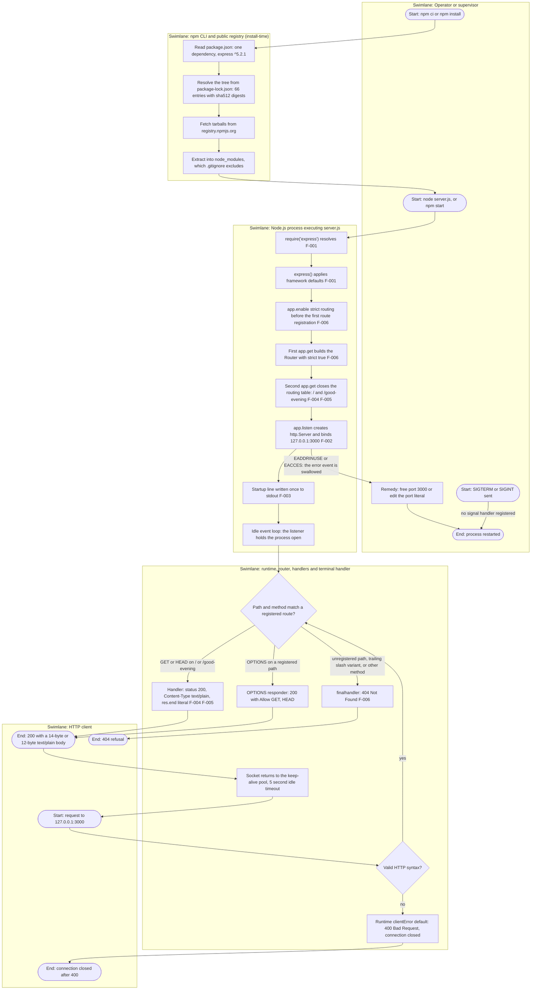

**Reading this diagram.** Solid edges are the normal path; the two failure edges are the silent bind conflict and the runtime-level `400`. The request path is a cycle: the keep-alive pool returns to the next request until the 5-second idle timeout closes the socket. Termination has no application involvement at all, because no signal handler exists. Timing is dominated by three runtime defaults — `keepAliveTimeout` 5 s, `headersTimeout` 60 s, `requestTimeout` 300 s — while the work per request is three synchronous statements.

### 4.4.2 Detailed Process Flows per Core Feature

#### 4.4.2.1 F-007 — Dependency Installation

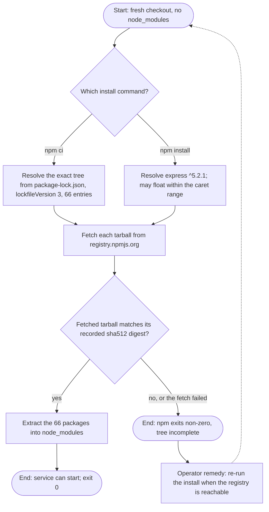

No build, compile, bundle, or transpile step follows; the install is the entire build (`README.md` §Running, §3.6.2).

#### 4.4.2.2 F-001, F-002, F-003 — Process Start, Bind, and Readiness

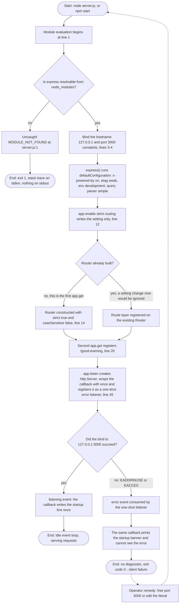

**Binding constraint.** The strict-routing setting is only effective because line 12 precedes the first `app.get` at line 14; the Router captures `strict` and `caseSensitive` when it is constructed. Enabling the setting after a route registration leaves `GET /good-evening/` answering `200`.

#### 4.4.2.3 F-004 — Root Greeting Request

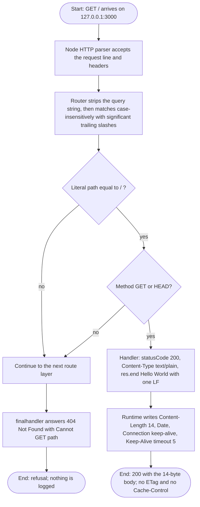

`HEAD /` takes the same path and returns `200` with the headers but no body. `GET /?x=1` and `GET /` are indistinguishable to the handler, which never reads the request.

#### 4.4.2.4 F-005 — Second Greeting Request

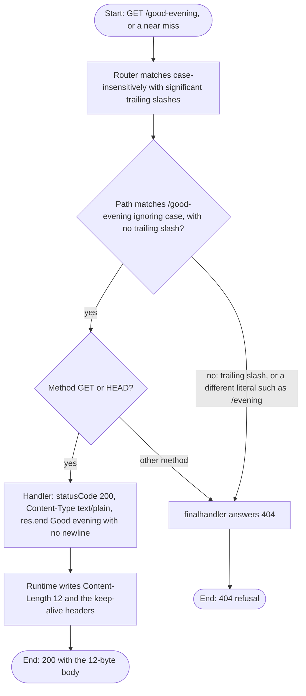

The trailing-slash distinction is the deliberate behaviour change recorded as QA Issue 1 (commit `f2c2ca4`); case-insensitive matching remains a framework default, so `GET /GOOD-EVENING` returns `200`.

#### 4.4.2.5 F-006 — Routing Decision and Refusal

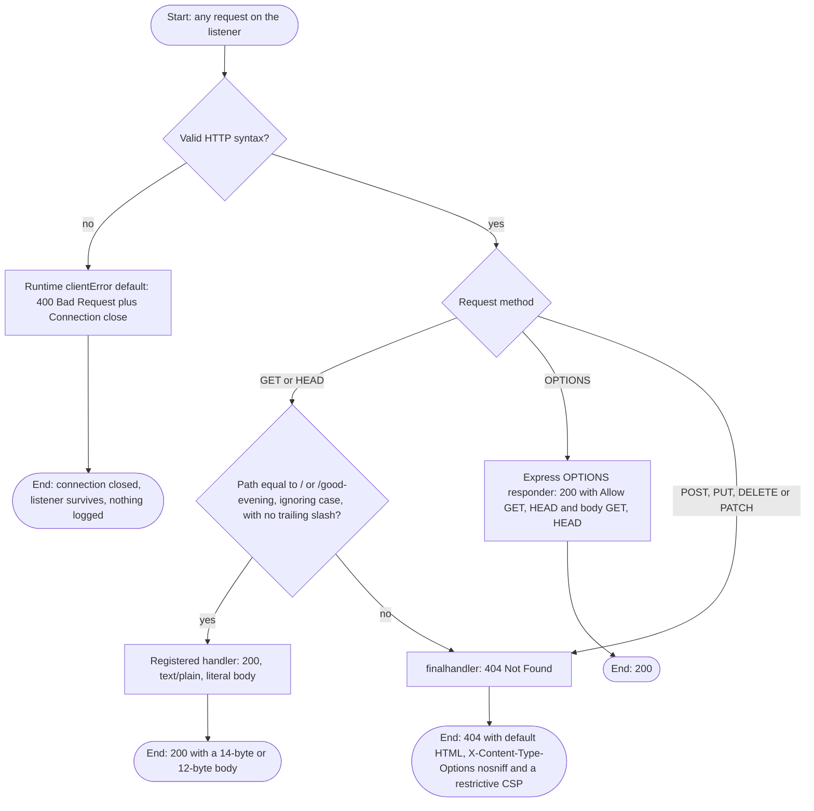

This is the closed route table: exactly two literal paths serve content, and everything else — including `//`, `/good-evening/`, `/hello`, and `POST /` — is refused rather than answered with a greeting.

#### 4.4.2.6 F-009 — Fixture Server Flow (Contrast)

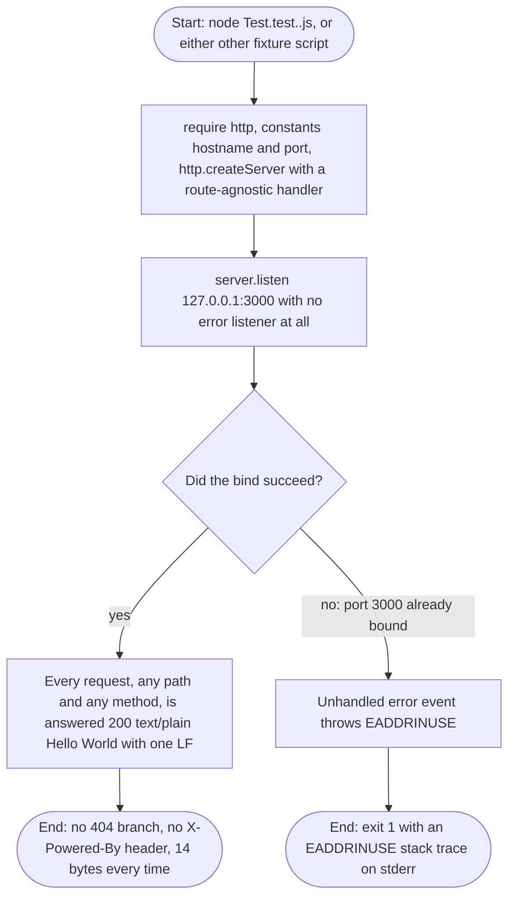

The fixtures share the port with the service and cannot run concurrently; their bind failure **crashes**, which is the behaviour the repository documentation attributes to `server.js` but which the Express implementation replaced with a silent exit (§4.3.2.1).

### 4.4.3 Error Handling Flowchart

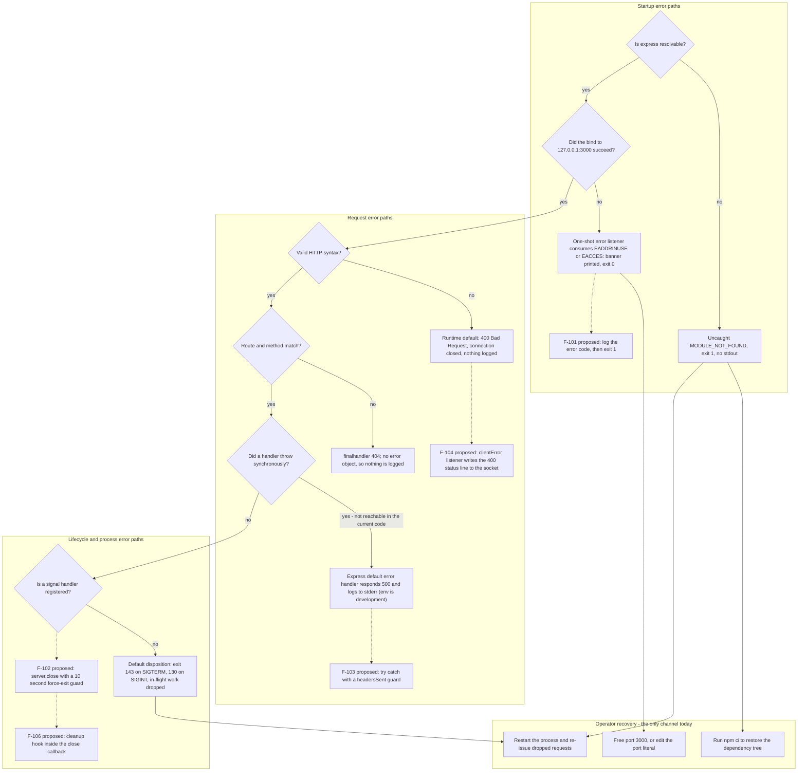

Solid edges are implemented behaviour; dashed edges are proposed remediation (F-101, F-103, F-104, F-102, F-106) that no code implements today. Every recovery edge ends in a manual operator action, because the service has no automatic recovery, retry, or drain path.

### 4.4.4 Integration Sequence Diagrams

#### 4.4.4.1 Request Path (F-004, F-005, F-006)

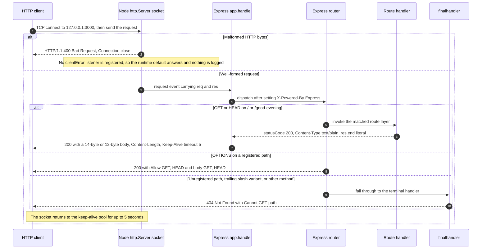

#### 4.4.4.2 Install-Time Data Flow (F-007)

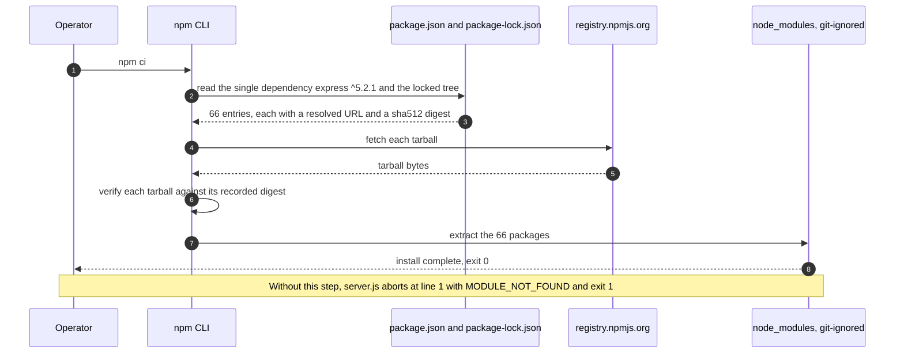

This is the only cross-system interaction in the repository, and it happens before the service ever runs; after installation the process makes no outbound connection.

#### 4.4.4.3 Termination Path (F-002, RQ-004)

```mermaid
sequenceDiagram
    autonumber
    participant Sup as Supervisor or operator
    participant OS as Operating system
    participant P as Node process
    participant C as HTTP client

    C->>P: request in flight
    Sup->>OS: stop the process
    OS->>P: SIGTERM
    Note over P: No process.on handler exists, so the runtime default disposition applies
    P--xC: connection dropped, response never completed
    OS-->>Sup: exit status 143
    Note over Sup,P: No drain, no cleanup, no shutdown log; F-102 and F-106 remain proposed
```

### 4.4.5 State Transition Diagrams

#### 4.4.5.1 Process and Listener Lifecycle

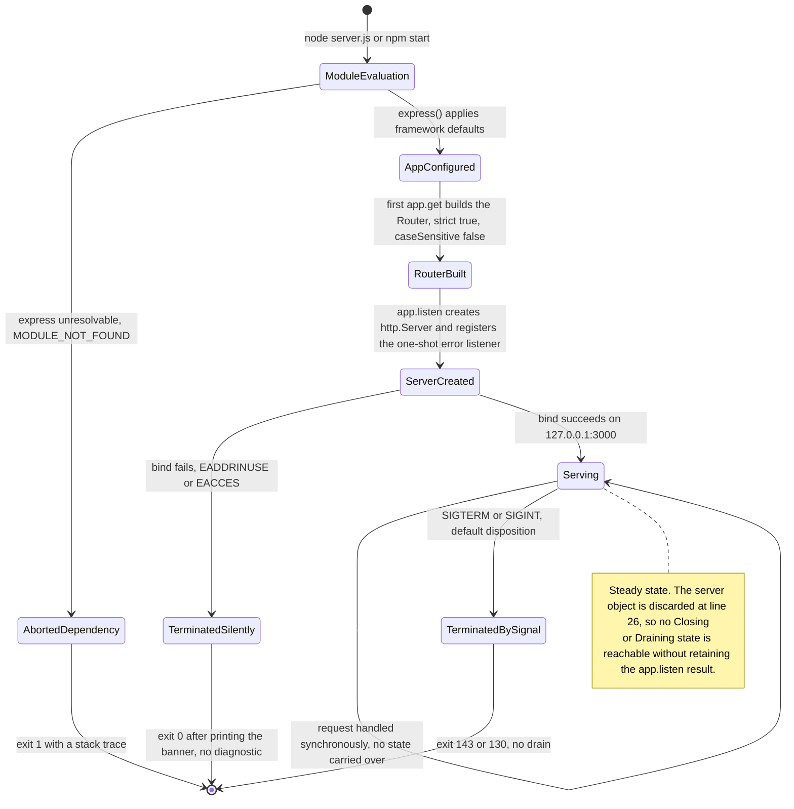

#### 4.4.5.2 Connection Lifecycle

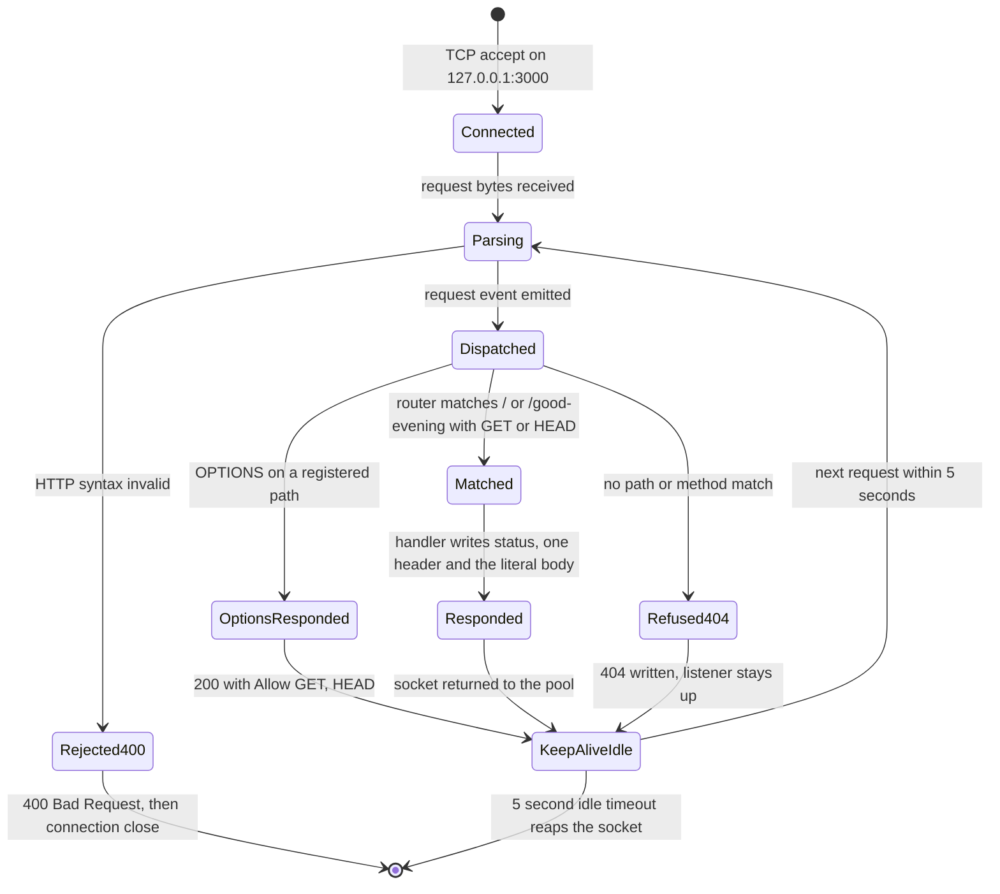

Neither diagram has a state that ends in a graceful close: the process states terminate only through a signal or a swallowed bind error, and the connection states terminate through the idle timeout, a protocol error, or the process dying.

#### 4.4.5.3 Diagram-to-Requirement Traceability

| Diagram | Features / requirements illustrated | Failure paths shown |
|---------|-------------------------------------|---------------------|
| 4.4.1 High-level system workflow | F-001 … F-007 | Silent bind conflict, runtime `400`, refusal, termination |
| 4.4.2.1 Dependency installation | F-007-RQ-001 … RQ-004, FR-A | Unreachable registry, digest mismatch |
| 4.4.2.2 Start, bind, readiness | F-001, F-002, F-003, F-006-RQ-002 | `MODULE_NOT_FOUND`, swallowed `EADDRINUSE`/`EACCES` |
| 4.4.2.3 Root greeting | F-004-RQ-001 … RQ-004, FR-C | Refusal for a non-matching path |
| 4.4.2.4 Second greeting | F-005-RQ-001 … RQ-004, FR-D | Trailing-slash and other-method refusal |
| 4.4.2.5 Routing decision | F-006-RQ-001 … RQ-005 | `400`, `404` |
| 4.4.2.6 Fixture flow | F-009-RQ-002, RQ-003 | Unhandled `error` event, exit `1` |
| 4.4.3 Error handling | F-101 … F-106 (proposed, unimplemented) | All of the above with recovery edges |
| 4.4.4.1 Request sequence | F-004, F-005, F-006 | Malformed request, unmatched route |
| 4.4.4.2 Install sequence | F-007 | Missing tree blocks start-up |
| 4.4.4.3 Termination sequence | F-002-RQ-004, F-102 (proposed) | Dropped in-flight request |
| 4.4.5.1 Process lifecycle | F-001, F-002, F-003 | Silent exit `0`, exit `143`/`130` |
| 4.4.5.2 Connection lifecycle | F-004, F-005, F-006 | `400`, `404`, idle timeout |


### 4.4.4 Integration Sequence Diagrams

#### 4.4.4.1 Request Path (F-004, F-005, F-006)


#### 4.4.4.2 Install-Time Data Flow (F-007)

```mermaid
sequenceDiagram
    autonumber
    participant O as Operator
    participant N as npm CLI
    participant M as package.json and package-lock.json
    participant G as registry.npmjs.org
    participant D as node_modules, git-ignored

    O->>N: npm ci
    N->>M: read the single dependency express ^5.2.1 and the locked tree
    M-->>N: 66 entries, each with a resolved URL and a sha512 digest
    N->>G: fetch each tarball
    G-->>N: tarball bytes
    N->>N: verify each tarball against its recorded digest
    N->>D: extract the 66 packages
    D-->>O: install complete, exit 0
    Note over O,D: Without this step server.js aborts at line 1 with MODULE_NOT_FOUND and exit 1
```

#### 4.4.4.3 Termination Path (F-002, RQ-004)

```mermaid
sequenceDiagram
    autonumber
    participant Sup as Supervisor or operator
    participant OS as Operating system
    participant P as Node process
    participant C as HTTP client

    C->>P: request in flight
    Sup->>OS: stop the process
    OS->>P: SIGTERM
    Note over P: No process.on handler exists, so the runtime default disposition applies
    P--xC: connection dropped, response never completed
    OS-->>Sup: exit status 143
    Note over Sup,P: No drain, no cleanup and no shutdown log, while F-102 and F-106 remain proposed
```


## 4.5 References

- `server.js` — the only runnable service: framework require, hostname/port constants, `express()` construction, `app.enable('strict routing')` before the first route registration, the two literal handlers, `app.listen` with its discarded return value, and the single startup log line.
- `README.md` — the published HTTP contract: both endpoints with status, content type and body, the `404` behaviour, the `express ^5.2.1` dependency, and the install-then-run procedure with the bound URL.
- `package.json` — the single `express ^5.2.1` dependency, the `main` field pointing at the absent `index.js`, and the placeholder `test` script that exits `1`.
- `package-lock.json` — `lockfileVersion` 3 with 66 package entries carrying registry URLs and `sha512` integrity digests; the basis of the install-time workflow.
- `.gitignore` — the single `node_modules/` entry that forces installation before execution.
- `Test.test..js`, `!@#$%^&().js`, `QWYFFGHGHFDDJFDame_!@#$%^&(){}long_name_…_server.js` — the three byte-identical native-`http` fixtures: route-agnostic `200` for every path and method, no `X-Powered-By`, and an unhandled `EADDRINUSE` crash on a port conflict.
- `phonenumber.csv` — the orphan `message,phonenumber` fixture read by no code, establishing the absence of any batch or ingest flow.
- `Response.txt` — the unimplemented hardening plan behind F-101–F-106 (server `error` handler, graceful shutdown with a 10-second guard, handler `try`/`catch` with a `headersSent` guard, `clientError` handler, `req`/`res` validation, cleanup hook).
- `codebase_context (42).md` — the original `/hello` requirement note behind F-201.
- `blitzy/documentation/Technical Specifications.md` — the feature catalogue and proposed hardening requirements (F-001–F-010, F-101–F-106, F-201) and the earlier bind-failure description reconciled in §4.3.2.1.
- `blitzy/documentation/Agent Action Plan.md` — requirements FR-A…FR-D, the routing behaviour change, and the scope rulings that govern the delivered workflows.
- `blitzy/documentation/Project Guide.md` — the validation ledger (requirement delivery, byte-exact checks, `EADDRINUSE` symptom and its manual remedy, QA Issue 1 for strict routing).
- `blitzy/documentation/Build Prompt.md` — the verbatim request that produced the two-endpoint service.
- `node_modules/express/lib/application.js` — the `app.listen` implementation that registers the listen callback with `server.once('error', done)`, the lazy `router` getter that captures `strict`/`caseSensitive` at first access, and `logerror`.
- `node_modules/router/lib/layer.js` — the `trailing: !opts.strict` path-matching option that gives strict routing its effect.
- `node_modules/finalhandler/index.js` — the default terminal handler: the `404` response construction and the `onerror` scheduling that explains why a plain not-found is never logged.
- `node_modules/` — the installed 66-package tree (express 5.2.1, router 2.2.0, finalhandler 2.1.1, send 1.2.1) that supplies every framework behaviour described here.
- `blitzy/documentation/` — the folder holding the repository's four documentation artifacts that supply the feature and requirement identifiers used throughout this section.
- [web] npm registry tarball `express@5.2.1` (fetched with `npm pack` and compared byte-for-byte) — confirmed that the one-shot `error` listener in `app.listen` is upstream framework behaviour rather than a local modification, which establishes the silent zero-status bind-failure path in §4.1.1.2 and §4.4.2.2.


# 5. System Architecture

## 5.1 High-Level Architecture

### 5.1.1 System Overview

**Architecture style.** `hao-backprop-test` is a **single-process, single-file, stateless, loopback-bound monolith with framework-mediated in-process layering**. Everything that executes lives in one Node.js process running one file (`server.js`, 29 lines); there is no second process, no worker, no database, no queue, no cache tier, and no outbound network call. The apparent layers — application, router, terminal handler, HTTP listener — exist only as objects inside that process: `server.js` creates an Express 5.2.1 application, the application delegates each request to `router@2.2.0`, the router falls through to `finalhandler@2.1.1` when no route matches, and the whole stack is wrapped in a Node `http.Server` created by `app.listen` (`node_modules/express/lib/application.js:598-606`).

**Rationale.** The style is dictated by the artifact's purpose rather than by engineering preference. `README.md` describes the repository as a "test project for backprop integration", so the workload must be small enough to read exhaustively and deterministic enough to assert on; and `blitzy/documentation/Build Prompt.md` requests only that Express be added to a Node.js tutorial server and that a second endpoint returning `Good evening` be added. The delivered shape follows from those two inputs:

- **Express replaced a route-agnostic catch-all, not a layered application.** The pre-change file answered *every* path with the same greeting; the change introduced a declarative two-entry routing table and Express's default `404`, which is the whole of the architectural shift (`blitzy/documentation/Agent Action Plan.md` FR-B, FR-C, FR-D).
- **The pipeline was left empty on purpose.** No `app.use` call exists in any `.js` file outside `node_modules/`, so the framework's middleware layer — including the parsing and static-serving packages installed as Express dependencies — never executes.
- **Configuration was expressed as code.** Host and port are module-level `const` literals (`server.js:3-4`); no `process.env` read, config file, or CLI argument exists anywhere in the repository.
- **Minimality was the acceptance criterion.** The recorded change set is five files — `server.js`, `package.json`, `package-lock.json`, `.gitignore`, `README.md` — with no refactoring of the existing greeting (`blitzy/documentation/Project Guide.md` §5).

**Key architectural principles and patterns.**

| Principle or pattern | How it appears | Evidence |
|----------------------|----------------|----------|
| One process, one executable module | All behaviour is `server.js`; the three other root scripts are standalone fixtures the service never loads | `server.js`; `Test.test..js`, `!@#$%^&().js`, the 199-character `QWYFFGHGH…_server.js` |
| Declarative routing table (table-driven dispatch) | Two literal `GET` registrations replace imperative request inspection; dispatch is the framework's | `server.js:14, 20`; `node_modules/router@2.2.0` |
| Empty middleware pipeline | The request path is application → router → handler or terminal handler, with nothing in between | absence of `app.use` repository-wide |
| Low-level response construction for byte control | Handlers use `res.statusCode` / `setHeader` / `res.end`, deliberately bypassing `res.send` and therefore content-type inference and ETag generation | `server.js:15-17, 21-23`; no `ETag` or `Cache-Control` observed on live responses |
| Refusal over fallback | An unregistered path is a `404`, never a substituted greeting — the previous catch-all behaviour was intentionally removed | live `404` for `/nope`, `/hello`, `//`, `/good-evening/`; `Agent Action Plan.md` §0.4.2 |
| Statelessness by construction | Both handlers ignore `req`, hold no state, and perform no I/O; no `let`/`var` binding is mutated at run time | `server.js:14-24`; state inventory in §4.3.1.1 |
| Configuration as compile-time constants | No configuration layer exists to misconfigure, and the logged URL cannot disagree with the bound address | `server.js:3-4, 27` |
| Reproducibility through lockfile pinning | 66 packages resolved from `registry.npmjs.org` with `sha512` integrity digests at `lockfileVersion` 3 | `package.json`; `package-lock.json` |
| Documentation as the published contract | `README.md` documents both endpoints, the `404` behaviour, the dependency, and the run procedure; no machine-readable contract exists | `README.md` lines 4-23 |
| Delegation to the platform for the rest | Failure, lifecycle, and observability behaviour is whatever the Node.js runtime and Express defaults provide, because no application code overrides them | §4.3.2; §5.4 |
| Out-of-band fixtures kept unshared | The native-`http` fixtures solve a different problem (pathological filenames) and were deliberately not re-platformed onto Express | `Agent Action Plan.md` §0.2.1, §0.6.2 |

**System boundaries and major interfaces.**

| Boundary | Direction | Interface and protocol | Notes |
|----------|-----------|------------------------|-------|
| Network | Inbound | HTTP/1.1 over loopback TCP `127.0.0.1:3000`; `GET /`, `GET /good-evening` (plus `HEAD` and `OPTIONS`) | Plain HTTP, no TLS, no authentication, no client filtering; reachable by any local process, unreachable from other hosts |
| Process control | Inbound | POSIX signals `SIGTERM` and `SIGINT` | No application handler exists, so the runtime's default disposition applies and the process ends without draining |
| Package supply | Inbound at install time, then in-process | npm resolution of `express` into `node_modules/`, followed by `require('express')` at start-up | Installation is a precondition of execution because `node_modules/` is git-ignored |
| Observability output | Outbound | One line on standard output per successfully started process | `Server running at http://127.0.0.1:3000/`; no per-request logging, metrics, or tracing |
| Filesystem | Inbound at start-up | Read-only module resolution and script loading by the Node module loader | No runtime file write occurs in any code path |
| Package registry | Outbound at install time only | HTTPS fetch of locked tarballs from `registry.npmjs.org` | Not a runtime dependency; once installed, the service makes no outbound connection |

*Explicitly outside the boundary:* no database or storage engine, no cache server, no message broker or event bus, no outbound HTTP client, no identity provider, no secrets manager, no TLS terminator or reverse proxy, no metrics or tracing backend, no administrative or health endpoint, and no second runtime instance (the hardcoded loopback address and port prevent one on the same host).

### 5.1.2 Core Components Table

Eight components make up the system: six that participate in its runtime or supply chain, and two that are carried in the repository without executing. The first table states each component's responsibility and dependencies; the second records its integration points and the considerations that constrain it. Component identifiers are local to this section and map to the feature identifiers used in §2 and §3.

| Component | Primary responsibility | Key dependencies | Integration points |
|-----------|------------------------|------------------|--------------------|
| C-1 Express application container — `server.js` | Own the two configuration literals, create the application, enable strict routing, register both routes, start the listener; the only executable application unit | `express@5.2.1` resolved from `node_modules/`; Node.js ≥ 18 runtime | Node `http.Server` (via `app.listen`), the framework router, the Express settings map, `console` on stdout |
| C-2 Route table and dispatch layer — `router@2.2.0` | Hold the two literal `GET` layers, match method and path, answer `OPTIONS` automatically, alias `HEAD` to `GET`, fall through when nothing matches | `path-to-regexp@8.4.2`; the application settings captured when the router is first constructed | Two `app.get` registrations (producer); `finalhandler` (fall-through); per-request `req`/`res` |
| C-3 Literal greeting handlers — `server.js:14-18, 20-24` | Produce the two byte-exact responses with three synchronous statements each, without reading any request input | None beyond the `res` object they write to; `req` is accepted and never dereferenced | Invoked by C-2; write to the Node `ServerResponse` owned by C-4 |
| C-4 Loopback HTTP listener and connection layer — Node `http.Server` | Bind `127.0.0.1:3000`, parse HTTP/1.1, emit `listening` / `request` / `error` / `clientError`, manage keep-alive sockets, write responses onto the wire | Node built-in `http`; Express's `app.listen` wiring; the host network stack | Inbound loopback clients; the application as request handler; the OS signal channel on termination |
| C-5 Terminal not-found and error responder — `finalhandler@2.1.1` and Express `logerror` | Synthesise the framework default `404`/`5xx` responses, attach restrictive security headers, and log only when an error object is supplied | `statuses@2.0.1`; Express `logerror` (`application.js:615`) | Installed as the terminal callback of `app.handle`; reached whenever C-2 does not respond |
| C-6 Dependency supply chain and lockfile — `package.json`, `package-lock.json`, `node_modules/` | Declare `express ^5.2.1`, pin the 66-package tree with integrity digests, and materialise the tree that `require` resolves at start-up | npm ≥ 7; the public npm registry at install time; a Node.js runtime satisfying `engines.node >= 18` | Install-time registry fetch; `require('express')` at start-up; `.gitignore` keeps the tree out of version control |
| C-7 Native-`http` fixture servers — three root scripts | Stand alone as filesystem/filename edge-case fixtures: route- and method-agnostic servers that answer every request with the greeting | Node built-in `http` only — no framework, no manifest entry | None with the service; they share the same loopback address and port, so a fixture and the service cannot run concurrently |
| C-8 Documentation, contract, and dormant data — `README.md`, `blitzy/documentation/*`, `Response.txt`, `codebase_context (42).md`, `phonenumber.csv`, binaries | Publish the HTTP contract, record requirement provenance, validation results, and an unimplemented hardening plan; carry unreferenced data and binary artifacts | None at run time; Markdown and Mermaid authoring tools only | None — read by humans, never by executing code (no file-I/O call exists in any repository `.js` file) |

| Component | Integration points | Critical considerations | Evidence |
|-----------|--------------------|-------------------------|----------|
| C-1 Express application container | `app.listen` (C-4); router construction (C-2); stdout | 29 lines, no exports, no configuration reads, no error handling; the server handle returned by `app.listen` is discarded, so `server.close()` is unreachable without a code change; `package.json#main` names an absent `index.js`, so the working entry point is `node server.js` | `server.js:1-28`; `package.json:5` |
| C-2 Route table and dispatch layer | Producer of C-3 dispatch; consumer of C-5 fall-through | Router options are frozen at first route registration, so `app.enable('strict routing')` must precede `app.get` — the ordering in `server.js` is load-bearing; matching is case-insensitive because `case sensitive routing` is never enabled; trailing slashes are significant; Express 5 reserves `( ) [ ] ? + & !` in future path patterns | `server.js:12, 14, 20`; `application.js:69-80`; live `/good-evening/` → `404`, `/GOOD-EVENING` → `200` |
| C-3 Literal greeting handlers | Called by C-2; write to C-4's response object | Bodies are the contract, including the trailing newline on `/` (14 bytes) and its deliberate absence on `/good-evening` (12 bytes); `res.end` bypasses `res.send`, so no ETag is emitted although the `etag` setting is `weak`; no branch exists that could fail | `server.js:14-24`; live byte counts |
| C-4 Loopback HTTP listener and connection layer | Inbound loopback clients; the application; the signal channel | The listener is created inside `app.listen` and its handle is not retained; keep-alive idle sockets are reaped after 5 s, with `headersTimeout` 60 s and `requestTimeout` 300 s; a malformed request is answered `400 Bad Request` by the runtime and never logged; no TLS, no drain, no readiness probe | `application.js:598-606`; live header and timeout observations |
| C-5 Terminal not-found and error responder | Reached from C-2 fall-through; writes to C-4 | Emits `Cannot <METHOD> <path>` as HTML with `Content-Security-Policy: default-src 'none'` and `X-Content-Type-Options: nosniff`; a plain not-found carries no error object, so nothing is logged; with `env` at `development`, a genuine 5xx also prints its stack to stderr | `node_modules/finalhandler/index.js`; live `404` bodies; `application.js:154-156, 615` |
| C-6 Dependency supply chain and lockfile | Install-time registry; start-up `require` | No `engines` field, so the Node.js ≥ 18 requirement is documented rather than enforced; the caret range permits upgrades the lockfile has not taken (5.3.0 is the current npm `latest`); 65 of the 66 packages never execute on the request path; a missing tree aborts start-up with `MODULE_NOT_FOUND` and exit `1` | `package.json`; `package-lock.json`; §3.2, §3.3 |
| C-7 Native-`http` fixture servers | Share loopback port 3000 with the service, exclusively | No longer byte-identical to `server.js` (they retain the native-`http` implementation), so they are not interchangeable with the service; they answer every path and method with `200` and no `X-Powered-By`; on a port conflict they crash loudly with an unhandled `EADDRINUSE` and exit `1`, unlike the service | `Test.test..js`, `!@#$%^&().js`, the 199-character fixture; §4.1.2.4 |
| C-8 Documentation, contract, and dormant data | None at run time | `blitzy/documentation/Technical Specifications.md` describes the superseded native-`http`, zero-dependency state and its §2.7.4 concedes that any change to `server.js` invalidates its criteria; `Project Guide.md` records zero audit findings at validation time while the current tree audits with three; `phonenumber.csv` (15 synthetic rows) is imported by no code | `README.md`; `blitzy/documentation/*`; `Response.txt`; `phonenumber.csv` |

### 5.1.3 Data Flow Description

Data flows in this system are short, single-hop, and entirely in memory. Two flows exist end to end: an **install-time supply flow** that happens once per checkout and a **request-time flow** that repeats per request. No other flow exists — there is no batch path, no scheduled job, no publish/subscribe channel, and no inter-service call.

**Primary flow 1 — install-time dependency supply (once per checkout).** npm reads `package.json`, whose only dependency is `express ^5.2.1`, resolves the tree through `package-lock.json` (66 entries at `lockfileVersion` 3), fetches each tarball from `registry.npmjs.org`, verifies it against the recorded `sha512` digest, and writes it into `node_modules/`, which `.gitignore` excludes. The flow terminates there: nothing is compiled, bundled, or published, so the "build" and the deployment artifact are the same source tree plus the installed dependency tree. The only repository file written by this flow is the dependency tree itself.

**Primary flow 2 — request/response handling (per request).** A loopback client connects to `127.0.0.1:3000`; Node's HTTP parser produces `(req, res)` and emits `request`; the handler registered by `app.listen` passes the pair to `app.handle`, which sets `X-Powered-By: Express` and installs `finalhandler` as the terminal callback; the router lowercases the request method, discards the query string, and compares the path against its two literal layers; the matched layer invokes one of the two handlers, which sets the status code, sets `Content-Type: text/plain`, and writes a fixed literal; the runtime writes status line, headers (including `Content-Length` 14 or 12, `Date`, and keep-alive directives) and body onto the socket; the socket returns to the keep-alive pool for up to five idle seconds. If nothing matches, the flow ends at `finalhandler`, which synthesises a `404 Not Found` HTML document and closes the transaction. No request-derived value is retained, logged, forwarded, or stored: the handlers never dereference `req`, so request data affects only the dispatch decision.

**Integration patterns and protocols.**

- **Synchronous in-process call chain.** `http.Server` → `app.handle` → `router` → handler or `finalhandler` is a sequence of ordinary function calls on the event loop, with no serialization, no message envelope, and no inter-process boundary to cross.
- **One protocol on the wire.** HTTP/1.1 in plaintext over loopback, with keep-alive enabled by the runtime (`Keep-Alive: timeout=5`). Request bodies are never read; responses are fixed-length rather than chunked or streamed; there is no compression, no content negotiation, and no conditional-request handling.
- **Event-driven at the runtime edge only.** The only events in play are the runtime's `listening`, `request`, `error`, and `clientError` and the operating system's `SIGTERM`/`SIGINT`. The application registers no listener of its own; Express registers a single one-shot `error` listener on the startup callback, which is why a bind conflict is consumed silently.
- **No integration middleware.** With no `app.use` call anywhere, there is no request parsing, no static serving, no cookie or session handling, and no CORS, compression, or logging middleware on the path. The packages Express installs for those purposes (`body-parser@2.2.2`, `qs@6.15.2`, `raw-body@3.0.2`, `iconv-lite@0.7.2`, `cookie@0.7.2`, `serve-static@2.2.1`, `send@1.2.1`, `mime-types@3.0.2`) never execute.
- **Transport encryption, retry, and back-off are all absent.** There is no TLS listener, no outbound client to configure a retry policy for, and no queue to buffer or re-drive a failed unit of work.

**Data transformation points.**

| # | Transformation | Performed by | Effect |
|---|----------------|--------------|--------|
| 1 | Bytes → parsed request | Node `http` parser inside `http.Server` | Produces `IncomingMessage` and `ServerResponse`; a syntactically invalid request line or header block raises `clientError` instead |
| 2 | Request object → dispatch decision | Express `app.handle` → `router@2.2.0` | Method lowercased (`HEAD` is aliased to `GET` when no `HEAD` layer exists), query string removed before matching, literal path compared case-insensitively with the trailing slash significant |
| 3 | Handler statements → response entities | The two greeting handlers | Status `200`, `Content-Type: text/plain`, and the literal body are written directly to the socket; no templating, escaping, or serialization step applies |
| 4 | Unmatched request → diagnostic document | `finalhandler@2.1.1` | Builds an HTML document from the method and the URL-encoded path (`Cannot GET /hello`), sets `Content-Length`, and adds `Content-Security-Policy: default-src 'none'`, `X-Content-Type-Options: nosniff`, and `Content-Type: text/html; charset=utf-8` |
| 5 | Method set → `Allow` list | `router@2.2.0` automatic `OPTIONS` responder | Collects the registered methods, sorts them, and answers `200` with `Allow: GET, HEAD` and a `GET, HEAD` body without entering either handler |
| 6 | Response entities → wire bytes | Node `http.Server` | Serialises the status line, the header block, and the body, adding `Date`, `Connection`, `Keep-Alive`, and the framework's `X-Powered-By` header |

Transformation stops there: no request field is validated, normalised, enriched, or persisted, and no response is compressed, signed, or cached, because no handler reads an input and no component writes to storage.

**Key data stores and caches.** There are none of either in the application sense. The only structures that hold data are process-lifetime and derived from the source:

| Structure | Kind | Lifetime | Contents |
|-----------|------|----------|----------|
| Node module cache | Runtime in-memory cache | Process | `express` and its 65 transitives, loaded once when `require` runs at start-up |
| Route table | In-memory data structure | Process, built on first `app.get` | Two literal `GET` layers plus the router's captured `strict`/`caseSensitive` options |
| Express settings and container objects | In-memory configuration | Process | `strict routing` (enabled by the code), plus framework defaults `x-powered-by`, `etag: weak`, `env`, query parser, and trust proxy; `app.cache`, `app.engines`, and `app.locals` are created empty and never written |
| Keep-alive socket pool | Runtime connection state | Per connection, idle up to 5 s | Idle sockets held for reuse; all reset when the process ends because no drain exists |
| npm package cache | External, on the developer machine | Across installs | Tarballs keyed by version and digest; the repository configures no custom cache path or offline mirror |

Because both responses are literals, nothing in the system is expensive enough to warrant a cache: there is no response cache, no application-level memoisation, no warm-up step, and no cache invalidation logic to design. The service emits no `Cache-Control`, `Expires`, `Age`, `Vary`, `ETag`, or `Last-Modified` header, and no conditional-request path exists, so a client or intermediary can only apply heuristic freshness rules of its own.

### 5.1.4 External Integration Points

The service integrates with nothing at run time. Its only runtime partner is the client on the same host, and the single cross-system flow in its life cycle is the install-time fetch from the public npm registry. The tables below therefore describe boundaries rather than negotiated integrations: for every entry, the "SLA Requirements" column records that no service-level commitment exists in the repository, together with what the system actually does.

| System name | Integration type | Data exchange pattern | Protocol / format |
|-------------|------------------|-----------------------|-------------------|
| Public npm registry (`registry.npmjs.org`) | Install-time, outbound, one-shot per install | Pull: request each locked package tarball by name and version, verify against the recorded integrity digest, extract into `node_modules/` | HTTPS; npm package metadata and gzipped tarballs with `sha512` integrity digests recorded in `package-lock.json` |
| Local loopback HTTP clients (`curl`, smoke tests, any local process) | Runtime, inbound request with outbound response | One request per transaction, synchronous; the request body is never read and the response body is a fixed literal (14 or 12 bytes) | HTTP/1.1 plaintext on `127.0.0.1:3000`; `text/plain` responses; `text/html; charset=utf-8` for framework refusals |
| Operator terminal or log consumer | Runtime, outbound, once per process | Fire-and-forget push of a single startup line | Attached standard-output stream carrying the text `Server running at http://127.0.0.1:3000/` |
| Operating-system process signal channel | Runtime, inbound | Edge-triggered signal, no acknowledgement, no drain | POSIX signals `SIGTERM` and `SIGINT`, handled by the runtime's default disposition |
| Node.js runtime and npm CLI | Platform dependency for the process's whole life cycle | In-process hosting of the application, plus a command-driven install or run invocation | Node.js runtime API (built-ins `http`, `console`, `process`, module loader) and the npm CLI reading `lockfileVersion` 3 |
| Local filesystem | Start-up, inbound, read-only | Module resolution and script loading before the listener binds; no write in any code path | POSIX file reads through the Node module loader |
| Git remote (GitHub) | Development-time, outbound on demand | Push and pull of source revisions only; no deployment automation is driven from it | Git transport over HTTPS or SSH |

| System name | SLA requirements | Failure behaviour observed |
|-------------|------------------|----------------------------|
| Public npm registry | None defined. Registry reachability is an unstated precondition of installation; no mirror, offline mode, custom registry, or retry policy is configured, and the repository contains no CI job that would surface a failure | A failed install exits non-zero and leaves the service unstartable; start-up then aborts at `server.js:1` with `MODULE_NOT_FOUND` and exit `1` |
| Local loopback HTTP clients | None defined. No documented latency, throughput, availability, or concurrency target exists; recorded measurements were 600 keep-alive requests over 100 sockets completing with 0 errors at 0.22 ms average latency on Node v22.23.3, and they are observations rather than commitments | No rate limit, quota, timeout configuration, or contract versioning applies. A client that malforms its request receives `400 Bad Request`; an unregistered path or method receives `404`; neither is logged |
| Operator terminal or log consumer | None defined. The line is unstructured, untimestamped, unlevelled, and emitted only after a successful bind; there is no access logging, log rotation, or retention | If the bind fails, the same success line is printed and the process then exits `0` with no diagnostic, so the log consumer sees a false success |
| Operating-system process signal channel | None defined. No shutdown deadline, drain window, or exit-code contract exists in the repository | `SIGTERM` ends the process with status `143` and `SIGINT` with `130`, immediately and without draining; in-flight responses are dropped and keep-alive sockets are reset |
| Node.js runtime and npm CLI | None committed. `express@5.2.1` declares `engines.node >= 18`, but `package.json` declares no `engines` field, so the requirement is advisory and never enforced at install time | An older runtime fails on `require('express')`; an npm older than 7 cannot read the committed lockfile. Validation ran on Node v22.23.3 with npm 11.21.0 |
| Local filesystem | None defined | A missing dependency tree, an unreadable script, or an inode/descriptor limit surfaces as a start-up exception or a runtime error with no application-level handling |
| Git remote (GitHub) | None defined | Availability affects only the development workflow; the running service neither reads nor writes the repository |


## 5.2 Component Details

### 5.2.1 Express Application Container (C-1)

`server.js` is the only application module in the repository and the container for every architectural decision the service makes. It declares two module-level constants, instantiates the Express application, enables one setting, registers two routes, and binds one listener; it exports nothing and is never imported. Because `package.json` declares `"main": "index.js"` and no such file exists, the only working entry point is `node server.js` (or the implicit `npm start`, which resolves to the same command).

| Aspect | Detail |
|--------|--------|
| Purpose and responsibilities | Hold the two configuration literals (`hostname = '127.0.0.1'`, `port = 3000`); create the application with `express()`; enable `strict routing` before any route is registered; register `GET /` and `GET /good-evening`; start the listener and print the single startup line from its callback |
| Technologies and frameworks | JavaScript with CommonJS `require` semantics; `express@5.2.1` as the sole dependency; Node.js ≥ 18 runtime; no transpilation, bundler, or type checking |
| Key interfaces and APIs | Inbound: process start (`node server.js`), no arguments, no environment input. Outbound: `express()` factory, `app.enable(setting)`, `app.get(path, handler)` twice, `app.listen(port, hostname, callback)`, `console.log`. Nothing is exported, and no module-level function exists for another module to call |
| Data persistence requirements | None. The module reads no file, holds no state beyond the framework objects created at start-up, and writes nothing to disk |
| Scaling considerations | The module is stateless and side-effect-free apart from the bind, so it would survive being run many times; what blocks horizontal scaling is not the module but its hardcoded loopback address and fixed port, which permit only one instance per host. Startup cost is a single `require` of the 66-package tree plus two route registrations |

Two ordering facts constrain this component. First, `app.enable('strict routing')` at line 12 must precede the first `app.get` at line 14, because the router captures the setting when it is constructed on first access (`node_modules/express/lib/application.js:69-80`); reversing the order makes `/good-evening/` match and return `200` instead of `404`. Second, the server object returned by `app.listen` is discarded, so no reference exists through which the listener could later be closed — a prerequisite any graceful-shutdown work would have to satisfy.

### 5.2.2 Route Table and Dispatch Layer (C-2)

Dispatch is entirely delegated to `router@2.2.0`, installed as a transitive dependency of Express. The application contributes two literal path registrations and nothing else; the router owns matching, the method-mapping rules, the automatic `OPTIONS` response, and the decision to fall through.

| Aspect | Detail |
|--------|--------|
| Purpose and responsibilities | Store the two `GET` layers, match an incoming method and path against them, answer `OPTIONS` without entering a handler, serve `HEAD` from the `GET` layer when no `HEAD` layer exists, and hand control back to the terminal callback when nothing matches |
| Technologies and frameworks | `router@2.2.0` with `path-to-regexp@8.4.2` for pattern compilation; router options `{ caseSensitive: app.enabled('case sensitive routing'), strict: app.enabled('strict routing') }` captured at construction; `layer.js` supplies `handleRequest`/`handleError`, and `route.js` performs method-to-layer matching |
| Key interfaces and APIs | Registration side: `app.get(path, handler)`, which builds the router lazily on first access. Runtime side: `router.handle(req, res, done)`, where `done` is the terminal callback supplied by `app.handle`. Matching behaviour: method lowercased, `HEAD` mapped to `GET` when no `HEAD` layer exists (`router/lib/route.js:112`), query string removed before comparison, case-insensitive path comparison, trailing slash significant while strict routing is on |
| Data persistence requirements | None. The route table lives in process memory and closes the moment the second registration returns; there is no serialized route definition, no configuration file, and no persistence of dispatch decisions |
| Scaling considerations | Dispatch is a linear scan of a two-entry table with no dynamic registration, so per-request cost is negligible and no locking or contention exists; any growth in the table would be bounded by Express 5's reserved path characters `( ) [ ] ? + & !`, which constrain how future routes may be written |

A synchronous exception thrown inside a matched layer is caught by `layer.js` and forwarded to the router's error path rather than escaping to the event loop, which is why an unexpected handler failure would produce a framework `500` instead of a process crash. No layer in this repository can throw: both handlers execute three non-throwing statements that read no input.

### 5.2.3 Literal Greeting Handlers (C-3)

The two handler callbacks constitute the system's entire business behaviour. They are grouped as one component because they are symmetric, share one construction pattern, and hold the same contract: each writes a fixed byte sequence and returns.

| Aspect | Detail |
|--------|--------|
| Purpose and responsibilities | Produce the root greeting `Hello, World!\n` (14 bytes) and the second greeting `Good evening` (12 bytes, no trailing newline) with status `200` and `Content-Type: text/plain` |
| Technologies and frameworks | Plain JavaScript arrow functions; the low-level Node `ServerResponse` API (`res.statusCode`, `res.setHeader`, `res.end`) instead of Express's `res.send`, deliberately, so that no response helper performs content-type inference, charset appending, or ETag computation |
| Key interfaces and APIs | Called by the route layer as `(req, res)`; `req` is accepted and never dereferenced; the observable interface is the HTTP response triple — status, `Content-Type` header, and exact body bytes — plus the `Content-Length` the runtime derives from the body |
| Data persistence requirements | None. The responses are source literals; nothing is read, computed, or stored, and the handlers are pure functions of the request in the trivial sense that their output does not depend on it |
| Scaling considerations | Three synchronous statements with no I/O and no allocation of dynamic content, so the handlers add no measurable cost per request; measured throughput of the whole stack was 600 keep-alive requests in 132 ms with zero errors. Nothing in the handlers limits concurrency, and nothing in them benefits from caching either |

Because `res.end` is used rather than `res.send`, the application's `etag` setting of `weak` is present but never exercised, and no response carries `ETag`, `Last-Modified`, or `Cache-Control`. The presence or absence of a trailing newline differs between the two routes by design, and that difference — 14 bytes versus 12 — is the contract most likely to be broken by a future edit.

### 5.2.4 Loopback HTTP Listener and Connection Layer (C-4)

The listener is a Node `http.Server` created inside Express's `listen` wrapper (`node_modules/express/lib/application.js:598-606`) and bound to `127.0.0.1:3000`. It owns everything below the application: socket acceptance, HTTP parsing, connection reuse, response serialisation, and the events on which the process's operational behaviour depends.

| Aspect | Detail |
|--------|--------|
| Purpose and responsibilities | Bind the loopback address and port, parse HTTP/1.1 request framing, emit `request` per parsed request, emit `error` on bind failure, emit `clientError` on malformed input, serialise responses onto the socket, and hold idle keep-alive connections |
| Technologies and frameworks | Node.js built-in `http` module on the host runtime (validated on Node v22.23.3); no TLS module, no proxy, no connection limiter, and no socket-level configuration from application code |
| Key interfaces and APIs | Bind interface `127.0.0.1:3000` over TCP; events `listening`, `request`, `error`, `clientError`; response control through `http.ServerResponse`; runtime socket defaults `keepAliveTimeout` 5 000 ms, `headersTimeout` 60 000 ms, `requestTimeout` 300 000 ms, `server.timeout` 0; lifecycle operations `listen`, `close`, and `address` available on the server object that the application discards |
| Data persistence requirements | None at rest; per-connection state is transient. Idle sockets persist for up to five seconds of reuse and are reset when the process ends, since no drain path exists |
| Scaling considerations | A single listener on one port with no clustering, worker threads, or child processes, so all requests are served by one event loop and one CPU core; the loopback bind and fixed port make a second instance on the same host impossible, and nothing publishes the service to a balancer. Capacity controls — rate limiting, maximum connections, back-pressure, queues — are entirely absent, so the listener accepts connections until the host runs out of descriptors |

Two runtime behaviours of this layer matter operationally and are invisible in the application source. A malformed request is answered `HTTP/1.1 400 Bad Request` with `Connection: close` by the runtime itself and is not logged, because no `clientError` listener is registered. And because Express registers the startup callback as a one-shot `error` listener, a bind conflict is consumed rather than thrown: the banner is printed, no diagnostic appears, and the process exits `0`.

### 5.2.5 Terminal Not-Found and Error Responder (C-5)

`finalhandler@2.1.1` is the framework's terminal component and the source of every response the two handlers do not produce. Express installs it in `app.handle` as the callback used when the router does not respond, so the application never sees refusals or unhandled errors.

| Aspect | Detail |
|--------|--------|
| Purpose and responsibilities | Terminate a request that no layer handled: produce `404 Not Found` when no error object is supplied, or an error status derived from the error or from `res.statusCode`; add restrictive security headers; schedule `logerror` only when an error object exists; destroy the socket when headers have already been sent |
| Technologies and frameworks | `finalhandler@2.1.1` with `statuses@2.0.1`; Express's own `logerror` (`lib/application.js:615`), which writes `err.stack` to standard error whenever the environment is not `test`; the environment is `development` because `NODE_ENV` is unset |
| Key interfaces and APIs | Created as `finalhandler(req, res, { env, onerror })` and invoked as a callback with an optional error; emits `Content-Type: text/html; charset=utf-8`, an accurate `Content-Length`, `Content-Security-Policy: default-src 'none'`, and `X-Content-Type-Options: nosniff`; body text for a refusal is `Cannot <METHOD> <path>` with the path URL-encoded |
| Data persistence requirements | None. Refusals are generated per request and never recorded: no refusal counter, no error log for a plain not-found, and no dead-letter or audit trail |
| Scaling considerations | The component is invoked only on unmatched or failing requests and performs a small string construction, so it adds no capacity burden; under a flood of unregistered paths it would answer each request with a fresh HTML document and write nothing to disk, which is a logging blind spot rather than a scaling limit |

The distinction between refusals and failures matters for observability: a `404` carries no error object, so `onerror` is not scheduled and nothing is logged; a genuine `5xx` is logged to standard error with a stack trace, but only when a handler actually throws — which no handler in this repository can do.

### 5.2.6 Dependency Supply Chain and Lockfile (C-6)

The dependency tree is a first-class architectural component here because it is 65 packages larger than the application and is the sole precondition for the process starting. `server.js:1` resolves `express` from `node_modules/`, which `.gitignore` excludes, so a checkout without an install cannot run.

| Aspect | Detail |
|--------|--------|
| Purpose and responsibilities | Declare exactly one dependency (`"express": "^5.2.1"` in `package.json`); pin the resolved tree of 66 packages with versions, registry URLs, and `sha512` integrity digests in `package-lock.json` at `lockfileVersion` 3; materialise that tree into `node_modules/` so `require` succeeds; supply the framework on which C-1, C-2, and C-5 all depend |
| Technologies and frameworks | npm ≥ 7 (required to read `lockfileVersion` 3); the public npm registry; Node.js ≥ 18, which `express@5.2.1` declares through `engines.node` and `package.json` does not enforce |
| Key interfaces and APIs | Manifest surface `dependencies.express`; install interface `npm ci` (lockfile-strict) or `npm install` (may float within `^5.x`); module resolution interface `require('express')` → factory function → `express();` the caret range is the interface through which an upgrade could enter, and only the lockfile guards against it |
| Data persistence requirements | The installed tree is the only durable artifact this system writes, once per checkout, to a git-ignored directory. Nothing at runtime reads or writes it again beyond module loading; a partially installed tree is detected on the next start-up as `MODULE_NOT_FOUND` |
| Scaling considerations | Installation cost is fixed and per-checkout, and the tree is identical on every host that installs from the lockfile, so the supply chain is reproducible but not elastic. Two currency risks attach to it: `5.3.0` is the current npm `latest` while the lockfile pins `5.2.1`, and the tree audits with three known advisories at the time of writing, of which the highest is a critical IP-spoofing advisory in `proxy-addr` — a package that never executes here, since `trust proxy` is `false` and no handler reads a client address |

### 5.2.7 Repository-Carried Non-Runtime Artifacts (C-7, C-8)

Two groups of files are tracked and architecturally relevant, yet are never executed or read by the running service. They are documented here because they define the fixture's purpose, hold the published contract, and are the most likely source of confusion for a reader of the repository.

| Aspect | Detail |
|--------|--------|
| Purpose and responsibilities | C-7 — three standalone servers (`Test.test..js`, `!@#$%^&().js`, and the 199-character `QWYFFGHGHFDDJFDame_!@#$%^&(){}long_name_…_server.js`) exercise filesystem and tooling handling of pathological filenames; each answers every path and method with `200` and `Hello, World!\n` and carries no framework header. C-8 — `README.md` publishes the HTTP contract; `blitzy/documentation/` holds the requirement provenance, validation ledger, and a prior specification; `Response.txt` proposes six unimplemented hardening features; `codebase_context (42).md` records the original `/hello` request; `phonenumber.csv` and four binary artifacts are dormant |
| Technologies and frameworks | C-7 uses only Node's built-in `http` module — no Express, no manifest entry, no shared code with the service. C-8 uses Markdown and Mermaid for authoring; no runtime technology applies |
| Key interfaces and APIs | C-7 exposes the same loopback address and port as the service, so the two are mutually exclusive on one host; their response contract differs (route- and method-agnostic `200`, no `X-Powered-By`), which makes them non-interchangeable with `server.js`. C-8 exposes human-readable documentation only — no machine-readable contract, no OpenAPI document, and no interface a tool could consume |
| Data persistence requirements | C-7 persists nothing; C-8 is static text. `phonenumber.csv` is a 16-line `message,phonenumber` fixture with 15 synthetic rows that no code path opens |
| Scaling considerations | Not applicable to either group: nothing in the request path depends on them, and their only cost is checkout size. The fixture scripts are nonetheless retained deliberately rather than deleted, which fixes their port conflict with the service as a permanent property of the repository |

The documentary artifacts are inconsistent with the running code in ways a reader must know: `blitzy/documentation/Technical Specifications.md` describes the superseded native-`http`, zero-dependency implementation and its §2.7.4 concedes that any change to `server.js` invalidates its acceptance criteria; `Project Guide.md` records zero audit findings at validation time whereas the current tree audits with three; and the fixtures are documented as byte-identical copies of `server.js` although they now differ from it.

### 5.2.8 Required Diagrams

#### 5.2.8.1 Component Interaction Diagram

```mermaid
flowchart TB
    Client["Loopback HTTP client<br/>curl / smoke test / local process"]

    subgraph Repository["Repository artifacts (carried, never executed by the service)"]
        Docs["README.md and blitzy documentation<br/>published contract and records"]
        Fixtures["Three native-http fixture scripts<br/>route-agnostic servers"]
        Data["phonenumber.csv and binary artifacts<br/>read by no code"]
    end

    subgraph Process["Single Node.js process started as node server.js"]
        App["C-1 Express application container<br/>configuration literals, app, routes, listen"]
        Router["C-2 Route table and dispatch<br/>router 2.2.0 with two literal GET layers"]
        Handlers["C-3 Literal greeting handlers<br/>200 text/plain 14 B and 12 B"]
        Terminal["C-5 Terminal responder<br/>finalhandler 2.1.1 default 404 and 5xx"]
        Listener["C-4 Loopback listener<br/>Node http.Server on 127.0.0.1:3000"]
        Stdout["Standard output<br/>one startup line"]
    end

    subgraph Supply["Install-time supply chain"]
        Manifest["package.json<br/>express ^5.2.1"]
        Lock["package-lock.json<br/>66 pinned packages"]
        Registry["Public npm registry"]
        Tree["node_modules<br/>git-ignored install tree"]
    end

    Client -->|"HTTP/1.1 request, plaintext"| Listener
    Listener -->|"request event"| App
    App --> Router
    Router -->|"literal path matched"| Handlers
    Router -->|"nothing matched"| Terminal
    Handlers -->|"response bytes"| Listener
    Terminal -->|"404 HTML document"| Listener
    Listener -->|"response"| Client
    App --> Stdout
    Manifest --> Registry
    Lock --> Registry
    Registry --> Tree
    Tree -.->|"require resolves express"| App
    Fixtures -.->|"share loopback port 3000, mutually exclusive"| Listener
    Docs -.->|"documents the running contract"| App
    Data -.->|"no consumer"| App
```

#### 5.2.8.2 Process and Listener State Transition Diagram

```mermaid
stateDiagram-v2
    [*] --> ModuleEvaluation
    ModuleEvaluation --> Configured: require('express') resolves
    ModuleEvaluation --> Failed: MODULE_NOT_FOUND, exit 1
    Configured --> RouterBuilt: first app.get builds the router
    RouterBuilt --> Binding: app.listen on 127.0.0.1:3000
    Binding --> Serving: listening event, banner printed
    Binding --> SilentExit: error event consumed by the one-shot listen callback
    SilentExit --> [*]: exit 0 with no diagnostic
    Serving --> Serving: request handled, 200 or 404 or 400
    Serving --> [*]: SIGTERM 143 or SIGINT 130, no drain
    Failed --> [*]
```

#### 5.2.8.3 Sequence Diagram — Matched Route Request

```mermaid
sequenceDiagram
    participant C as Loopback client
    participant N as Node http.Server C-4
    participant A as Express app.handle C-1
    participant R as router 2.2.0 C-2
    participant H as Greeting handler C-3
    C->>N: GET / HTTP/1.1 over loopback
    N->>A: request event with req and res
    A->>A: res.setHeader X-Powered-By Express
    A->>R: handle with the finalhandler closure as terminal
    R->>R: lowercase method, drop query string, match literal path
    R->>H: invoke the matched layer
    H->>H: res.statusCode 200 and Content-Type text/plain
    H-->>N: res.end with the 14-byte greeting
    N-->>C: 200 OK, Content-Length 14, keep-alive timeout 5
```

#### 5.2.8.4 Sequence Diagram — Unmatched Request and Malformed Request

```mermaid
sequenceDiagram
    participant C as Loopback client
    participant N as Node http.Server C-4
    participant A as Express app.handle C-1
    participant R as router 2.2.0 C-2
    participant F as finalhandler 2.1.1 C-5
    C->>N: GET /good-evening/ with strict routing enabled
    N->>A: request event
    A->>R: handle with the finalhandler closure as terminal
    R->>F: no layer matched, terminal invoked without an error object
    F->>F: build the Cannot GET document, set CSP and nosniff
    F-->>N: 404 Not Found with text/html charset utf-8
    N-->>C: 404 response, nothing logged
    Note over C,N: Malformed request bytes never reach the application
    C->>N: raw bytes INVALID HTTP
    N-->>C: 400 Bad Request and connection close, runtime default
```

#### 5.2.8.5 Sequence Diagram — Start-up and Bind Outcome

```mermaid
sequenceDiagram
    participant O as Operator shell
    participant P as Node process
    participant E as Express application C-1
    participant S as http.Server C-4
    O->>P: node server.js
    P->>E: require express, express, enable strict routing
    P->>E: app.get for both literal paths, router built with strict true
    P->>S: app.listen 3000 on 127.0.0.1 with the startup callback
    S->>S: attempt to bind 127.0.0.1:3000
    alt Bind succeeds
        S-->>E: listening event
        E-->>O: stdout banner Server running at http://127.0.0.1:3000/
    else Port already in use
        S-->>E: error event consumed by the one-shot listen callback
        E-->>O: the same banner is printed, then exit 0 with no diagnostic
    end
```


## 5.3 Technical Decisions

### 5.3.1 Architecture Style Decision — Single-Process, Single-File, Stateless Monolith

**Decision.** The service is one Node.js process running one CommonJS file that creates an Express application, registers two literal routes, and binds one loopback listener. No tier, service, worker, or module boundary exists inside it beyond the framework's own objects.

**Context.** `README.md` frames the repository as a "test project for backprop integration" and `blitzy/documentation/Build Prompt.md` asks only for Express and a second endpoint on an existing tutorial server; `blitzy/documentation/Agent Action Plan.md` §0.1.2 fixes "in-place implementation in the repository's flat, single-directory CommonJS single-file convention" as a binding constraint, and §0.7 requires the change to stay minimal.

**Alternatives considered.**

| Alternative | Why it was not taken |
|-------------|---------------------|
| Layered application with separate route, service, and controller modules | The recorded constraints require the flat single-file convention, and two literal responses have nothing to separate |
| Stateless serverless function | No provider account, no handler export, and no packaging or deployment artifact exists; nothing is exported by `server.js` |
| Multi-service or client/server split | The system has one capability and no independently scalable part |
| Containerised service with an orchestrator | No `Dockerfile`, compose file, or orchestration manifest exists; containerisation is recorded as verified absent in §3.6.3 |
| Keep the native-`http` implementation for the service | Explicit routing and a default `404` were the requested capability gain, and the fixture scripts already demonstrate the native alternative |

**Tradeoffs accepted.**

| Benefit realised | Cost accepted |
|------------------|---------------|
| The whole system is readable in 29 lines, so behaviour is auditable and deterministic — the property the fixture exists for | No separation of concerns, no dependency injection, and no seams for unit testing; anything added lands in the same file |
| No state, session, or persistence to migrate, reconcile, or recover; a restart is lossless by construction | Nothing can be remembered between requests: no counters, no rate-limit or audit state, no caching opportunities |
| Startup cost is a single `require` of the dependency tree plus two route registrations | One process on one core, with the loopback bind and fixed port blocking a second instance on the same host |

### 5.3.2 Framework Decision — Express 5.2.1 Rather Than Native `http`

**Decision.** Serve HTTP through `express@5.2.1`, declared as `"express": "^5.2.1"` in `package.json` and pinned with 65 transitive packages in `package-lock.json`.

**Context.** The choice was requested, not evaluated: `blitzy/documentation/Build Prompt.md` says "Could you add expressjs into the project", and FR-A in `blitzy/documentation/Agent Action Plan.md` §0.1.1 records adding and locking it. The repository's earlier zero-dependency posture belongs to the unimplemented hardening plan in `Response.txt`, whose constraints explicitly forbid adding a framework — a conflict resolved in favour of the user's explicit instruction (§0.1.2).

**Rationale.** Express earns its place by supplying exactly what the change needed and nothing that had to be configured: a declarative route table (`app.get`), a default `404` that replaces the previous catch-all behaviour, an automatic `OPTIONS` responder, `HEAD`-to-`GET` aliasing, and the terminal `finalhandler` — all reachable through five application-level API calls.

**Tradeoffs accepted.**

| Benefit realised | Cost accepted |
|------------------|---------------|
| Explicit routing with a refusal path replaces an unconditional greeting; unregistered paths and non-`GET` methods now receive `404` | The dependency surface grew from nothing to 66 packages for two literal routes, with three known audit advisories in the tree at the time of writing |
| Framework defaults cover method handling, refusals, and error termination without a line of code | Every response advertises `X-Powered-By: Express`, which the native implementation did not |
| A caret range plus a lockfile gives one-command reproducible installs | Express 5 raises the runtime floor to Node.js 18, and `package.json` declares no `engines` field to enforce it |
| Five framework calls keep the file at 29 lines | Router options are captured at first route registration, making the position of `app.enable('strict routing')` load-bearing and easy to break |

### 5.3.3 Communication Pattern Decision — Synchronous In-Process Request/Response over Plain HTTP/1.1 on Loopback

**Decision.** Every interaction is a synchronous, single-hop HTTP/1.1 request answered on the same loopback socket. There is no message broker, no publish/subscribe channel, no asynchronous callback chain, no streaming response, and no outbound call of any kind.

**Rationale.** The component chain — `http.Server` → `app.handle` → `router` → handler or `finalhandler` — is a sequence of ordinary function calls with no serialization boundary to design. Responses are fixed-length literals, the request body is never read, and keep-alive reuse is delegated to the runtime, so no framing decision, buffer management, or flow-control policy was required.

**Tradeoffs accepted.**

| Benefit realised | Cost accepted |
|------------------|---------------|
| Predictable, byte-exact responses and negligible latency: 600 keep-alive requests over 100 sockets completed with zero errors at 0.22 ms average | No back-pressure or queueing: the listener accepts connections until host descriptors run out, and there is no rate limiting or maximum-connection setting |
| Zero integration surface to break — no timeouts, retries, circuit breakers, or ordering concerns | Plaintext only: no TLS listener, certificate, or terminator exists, and loopback is the entire reachable scope |
| The runtime's HTTP parser handles malformed input with a `400` and keeps serving | Framing failures are invisible: no `clientError` listener exists, so malformed requests are answered but never logged |

### 5.3.4 Data Storage Decision — No Persistence Layer

**Decision.** The service has no database, no file store, no cache server, and no in-memory domain state. Nothing is written at any point of the process life cycle, and nothing but the dependency tree is written at install time.

**Rationale.** Both handlers return source literals and never dereference `req`, so there is no data to persist; the responses the fixture asserts on depend only on the path, which makes determinism a property of the design rather than a test outcome. A restart is therefore lossless by construction: there is no state to lose, reconcile, or recover.

**Alternatives considered.**

| Alternative | Why it was not taken |
|-------------|---------------------|
| File-backed data (for example, loading `phonenumber.csv`) | No code path opens any file; the CSV is an orphan fixture with 15 synthetic rows and no consumer |
| Embedded or external database | No driver appears in `package-lock.json`, no connection string or schema exists, and no handler reads input that could be stored |
| In-memory domain state (counters, sessions, caches of computed responses) | Nothing is expensive enough to store and no request carries identity; the two bodies are 14 and 12 bytes |

**Tradeoffs accepted:** no audit trail, no request history, no operational counters, and no way to observe usage from inside the process. The observable record of a running instance is exactly one stdout line per process.

### 5.3.5 Caching Strategy Justification — No Application Cache and No Response Validators

**Decision.** No caching layer, no memoisation, and no HTTP validators are implemented. Responses carry no `Cache-Control`, `Expires`, `Age`, `Vary`, `ETag`, or `Last-Modified`, and no handler reads a conditional-request header.

**Rationale.** The unit of work is three synchronous statements writing a constant, so there is nothing to amortise and no invalidation problem to solve. The absence of validators is a consequence of the response-construction choice as much as a decision in itself: because handlers call `res.end` rather than `res.send`, Express's `etag: weak` setting is never exercised, so no entity tag is produced even though the setting is present.

**What remains cached.** Only structural, runtime-owned caches exist, and none holds request-derived data:

| Structure | Owner | Purpose |
|-----------|-------|---------|
| Node module cache | Runtime | Holds `express` and its 65 transitives, loaded once at start-up |
| Route table | Application | Two literal layers in memory, built once on first `app.get` |
| Keep-alive socket pool | Runtime | Reuses idle connections for up to five seconds; reset on exit since no drain exists |
| npm package cache | Developer machine | Install-time reuse of tarballs keyed by version and digest; not configured by this repository |

**Tradeoffs accepted:** clients and intermediaries must apply their own heuristic freshness rules, since the service expresses no caching policy; each response is transferred in full with no `304` path, which is immaterial at 14 and 12 bytes. In exchange, the system has no cache-invalidation risk, no stale-response class of defect, and no cache tier to operate.

### 5.3.6 Security Mechanism Selection — Loopback Binding Instead of Authentication, Authorisation, or TLS

**Decision.** The only security control is the network boundary: the listener binds `127.0.0.1`, so the service is reachable by local processes and by nothing else. No authentication, authorisation, transport encryption, input validation, rate limiting, or header hardening is implemented.

**Rationale.** The artifact is a fixture observed from the same host, so no credential scheme, identity provider, or certificate has a consumer. The application also reads no request input at all — the handlers ignore `req`, and no parsing middleware is mounted — so the injection surface is minimal by omission rather than by validation.

| Control area | State at HEAD | Evidence |
|--------------|---------------|----------|
| Network exposure | Loopback only; any local process may connect, no remote host can | `server.js:3, 26`; live requests from localhost only |
| Authentication and authorisation | Absent — no account, token, role, or access-control concept exists | No auth dependency or handler logic anywhere in the repository |
| Transport encryption | Absent — plaintext HTTP/1.1, no TLS listener or certificate | No HTTPS module use; response headers show plain HTTP |
| Input validation | Absent — no request field is read, so nothing is validated, sanitised, or bounded | `server.js:14-24`; no parsing middleware mounted |
| Framework disclosure | `X-Powered-By: Express` on every response, including `404`s; `app.disable('x-powered-by')` is documented as an optional, unimplemented enhancement (~0.25 h) | live response headers; `blitzy/documentation/Project Guide.md` §2.3 |
| Refusal-response hygiene | Framework refusals do carry `Content-Security-Policy: default-src 'none'` and `X-Content-Type-Options: nosniff` | `node_modules/finalhandler/index.js`; live `404` headers |
| Supply-chain exposure | 66 packages guarded by pinned `sha512` digests; the tree also audits with one critical, one high, and one moderate advisory at the time of writing, all in packages that never execute here (`proxy-addr` is unreachable because `trust proxy` is `false`) | `package-lock.json`; `npm audit` findings; `application.js:95-99` |
| Secrets and sensitive data | None exist; the only log line carries a public loopback address | repository-wide search for credentials or configuration |

**Tradeoffs accepted:** the boundary is a deployment property rather than an application control, so exposing the service to a network would require TLS termination, authentication, authorisation, configuration, and observability work that does not exist today; and the framework identity is disclosed to every local client.

### 5.3.7 Configuration Decision — Compile-Time Constants Instead of an Environment Layer

**Decision.** Host and port are module-level `const` literals (`server.js:3-4`); no environment variable, configuration file, CLI argument, or secret-injection mechanism is read anywhere in executable code.

**Rationale.** The fixture must be reachable at one predictable address for the assertions around it to hold, and constant literals make the startup message provably consistent with the bound address, since both are derived from the same two bindings. There is nothing environment-specific to vary and nothing secret to inject.

**Tradeoffs accepted.**

| Benefit realised | Cost accepted |
|------------------|---------------|
| No configuration surface to misconfigure; no config file to validate; the logged URL cannot disagree with the bound address | A port conflict cannot be resolved without editing and redeploying the source; there is no fallback port and no way to shift the listener at run time |
| No secret handling, no `.env` parsing dependency, no configuration precedence rules | The service cannot run on a second host or a second instance on the same host, which is the binding constraint on horizontal scaling |
| Deployment prerequisites reduce to "install, then run" | The Node.js ≥ 18 requirement is documented rather than enforced, because `package.json` declares no `engines` field; environment-driven host/port parameterisation is a recorded but unimplemented enhancement (~1.0 h) |

### 5.3.8 Architecture Decision Records

The records below are derived from the decisions observable in the repository at HEAD; the "Status" column distinguishes decisions in force from decisions taken by omission and from documented but unimplemented work.

| ID | Decision | Status | Consequence |
|----|----------|--------|-------------|
| ADR-001 | Single process, single file, stateless service on the flat CommonJS convention | Accepted — implemented | Auditable in 29 lines; no testing seams and no state that survives a restart |
| ADR-002 | Express 5.2.1 as the HTTP framework instead of native `http` | Accepted — implemented | Explicit routing and a default `404`; 66-package dependency tree and `X-Powered-By` disclosure |
| ADR-003 | Two literal `GET` layers with `strict routing` enabled before the first registration | Accepted — implemented | Trailing-slash variants and unregistered paths are refused; the setting's position in the file is load-bearing |
| ADR-004 | Byte-exact bodies via `res.statusCode` / `setHeader` / `res.end` rather than `res.send` | Accepted — implemented | Exact 14-byte and 12-byte contracts; no content-type inference and no ETag, so the `weak` setting is inert |
| ADR-005 | Configuration as compile-time `const` literals | Accepted — implemented | No configuration layer to misconfigure; the port cannot be changed without a code edit |
| ADR-006 | No persistence of any kind | Accepted — implemented | Lossless restarts, no migration or recovery burden, and no audit trail or operational counters |
| ADR-007 | No application cache and no HTTP validators | Accepted — implemented | No invalidation risk; clients fall back to heuristic caching and always transfer the full body |
| ADR-008 | Loopback binding as the entire security boundary | Accepted — implemented | Reachable only from the local host; exposure to any network would require new controls |
| ADR-009 | No application error handling, no graceful shutdown, no signal handlers | Accepted by omission — tolerated, not endorsed | A bind conflict is swallowed with exit `0`; `SIGTERM`/`SIGINT` end the process without draining, and the discarded server handle blocks `server.close()` |
| ADR-010 | Lockfile-pinned dependency tree with no test, lint, build, CI, or container tooling | Accepted — implemented | Reproducible installs and no pipeline to maintain; contract verification stays manual and dependency advisories are unmonitored |
| ADR-011 | The three native-`http` fixtures remain unchanged on the service's address and port | Accepted — implemented | Filesystem edge cases stay covered; the fixtures are not interchangeable with the service and cannot run alongside it |
| ADR-012 | `README.md` is the published contract; no machine-readable interface description | Accepted — implemented | A human-readable contract with no drift detection; documentation must be revised with every contract change |

### 5.3.9 Required Diagrams

#### 5.3.9.1 Decision Tree — Request Serving, Framework, Routing, and Response Construction

```mermaid
flowchart TD
    Start{"How should HTTP requests be served?"}
    Start -->|"hand-rolled parsing"| Native["Native http module<br/>route- and method-agnostic"]
    Start -->|"declarative routing requested"| Framework{"Framework available on the runtime?"}
    Framework -->|"yes, Express 5 requires Node 18 or newer"| Express["express application<br/>ADR-002"]
    Framework -->|"no"| Native
    Express --> Routes{"Catch-all greeting or explicit route table?"}
    Routes -->|"explicit table"| Table["app.get per literal path<br/>ADR-003"]
    Routes -->|"catch-all"| Native
    Table --> Bodies{"How must response bodies be produced?"}
    Bodies -->|"byte-exact, no validator headers"| LowLevel["res.statusCode, setHeader, end<br/>ADR-004"]
    Bodies -->|"framework helpers"| Send["res.send adds inference<br/>and a weak ETag"]
    LowLevel --> Pipeline{"Is middleware required?"}
    Pipeline -->|"no request data is read"| None["Empty pipeline, no app.use"]
    Pipeline -->|"yes"| Use["app.use stack for parsing,<br/>static files or logging"]
```

#### 5.3.9.2 Decision Tree — Persistence, Caching, Configuration, and Security

```mermaid
flowchart TD
    Store{"Does any code path read or write data?"}
    Store -->|"no handler reads input"| NoStore["No persistence layer<br/>ADR-006"]
    Store -->|"yes, phonenumber.csv is present"| Unread["Dormant fixture, no code opens it"]
    NoStore --> Cache{"Is any response expensive to compute?"}
    Cache -->|"three literal statements"| NoCache["No application cache and<br/>no validators emitted, ADR-007"]
    Cache -->|"yes"| CacheImpl["In-memory or shared cache<br/>with an invalidation design"]
    NoCache --> Config{"Must host or port vary by environment?"}
    Config -->|"no, one fixed fixture contract"| Consts["const literals 127.0.0.1 and 3000<br/>ADR-005"]
    Config -->|"yes"| Env["process.env or a config file<br/>plus an engines pin"]
    Consts --> Security{"Which security control is required?"}
    Security -->|"local validation only"| Loopback["Loopback binding as the whole boundary<br/>no authN, authZ or TLS, ADR-008"]
    Security -->|"multi-host exposure"| Controls["TLS terminator, authentication,<br/>authorisation, X-Powered-By suppression"]
```

#### 5.3.9.3 Architecture Decision Record Status and Dependency Diagram

```mermaid
flowchart LR
    subgraph Accepted["Decisions in force at HEAD"]
        A1["ADR-001<br/>Single process, single file"]
        A2["ADR-002<br/>Express 5.2.1 as the framework"]
        A3["ADR-003<br/>Literal route table with strict routing"]
        A4["ADR-004<br/>Low-level res API for byte-exact bodies"]
        A5["ADR-005<br/>Compile-time configuration literals"]
        A6["ADR-006<br/>No persistence layer"]
        A7["ADR-007<br/>No cache and no validators"]
        A8["ADR-008<br/>Loopback binding as the security boundary"]
        A9["ADR-010<br/>Lockfile-pinned tree, no tooling pipeline"]
        A10["ADR-011<br/>Fixtures left on native http"]
        A11["ADR-012<br/>Documentation as the published contract"]
    end
    subgraph Deferred["Deferred decisions and tolerated risks"]
        D1["ADR-009<br/>No application error handling<br/>and no graceful shutdown"]
        D2["F-101 to F-106<br/>proposed hardening, unimplemented"]
        D3["Deferred enhancements<br/>test suite, X-Powered-By suppression,<br/>environment-driven configuration"]
    end
    A1 --> A2
    A2 --> A3
    A3 --> A4
    A1 --> A5
    A1 --> A6
    A6 --> A7
    A1 --> A8
    A2 --> A9
    A5 --> A10
    A4 --> A11
    A1 --> D1
    D1 --> D2
    A5 --> D3
    A8 --> D3
```


## 5.4 Cross-Cutting Concerns

### 5.4.1 Monitoring and Observability Approach

Observability in this system is a single unstructured line of text. The application contains one logging statement — `console.log` in the `app.listen` callback (`server.js:27`) — and no metric, trace, health, or readiness surface of any kind. There is no instrumentation agent, no exporter, and no monitoring dependency anywhere in the 66-package tree.

| Signal | Availability | Detail and evidence |
|--------|--------------|---------------------|
| Start-up confirmation | Yes | `Server running at http://127.0.0.1:3000/` on stdout, once per process, emitted only after a successful bind |
| Bind-failure alarm | Inverted — reports success | A port conflict prints the same banner and exits `0` with no diagnostic, because the startup callback is the one-shot `error` listener registered by `app.listen` |
| Per-request access log | No | After roughly 600 requests plus a malformed request, the process output still held exactly one line |
| Framework diagnostics | Off by default | With `DEBUG=*`, the framework emits 25 stderr lines, including `router dispatching GET /` per request and `finalhandler default 404` per refusal; nothing in the repository sets `DEBUG`, so this visibility is never enabled |
| Application error log | Partial | `MODULE_NOT_FOUND` on start-up and unhandled `error` events from the fixture scripts reach stderr; Express's `logerror` prints a stack only for a genuine `5xx`; a `404` and a `400` are logged nowhere |
| Metrics, traces, APM | No | No client library, agent, or exporter exists; no counter, gauge, or histogram is emitted |
| Health or readiness endpoint | No | Neither handler responds to a liveness or readiness probe; the only readiness signals are TCP acceptance on port 3000 and the banner |
| Dependency vulnerability monitoring | No | `npm audit` is not wired into a script, job, or pipeline, so the three advisories currently present in the tree surfaced only when the command was run by hand |
| Capacity and saturation signals | No | No resource metric, queue depth, connection count, or event-loop lag measurement is produced |

Because no introspection surface exists, an operator observes the service only from outside the process: tail the startup line, check the exit status (`0`, `143` for `SIGTERM`, `130` for `SIGINT`, `1` for an unresolvable dependency), inspect the listening socket with host tools, and issue requests to the two registered paths. The three recorded observability gaps — a silent bind failure (F-101), no shutdown logging (F-102), and no request-level visibility (F-104) — remain proposed and unimplemented in `Response.txt`.

### 5.4.2 Logging and Tracing Strategy

**Logging.** One statement, one line, one channel. `server.js:27` is the repository's only logging call, and no logging library is declared in `package.json` (`debug@4.4.3` arrives transitively with Express and stays silent unless `DEBUG` is set, which nothing in the repository does).

| Logging aspect | State at HEAD |
|----------------|---------------|
| Format and content | Unstructured single line carrying the loopback URL; no timestamp, level, severity, request identifier, host name, or duration |
| Channels | `stdout` for the startup line; `stderr` for runtime diagnostics (`MODULE_NOT_FOUND`, unhandled `error` events) and for Express's `logerror`, which writes `err.stack` whenever `env` is not `test` — and `env` is `development` |
| Levels and routing | None. No log level, filter, handler, or sink configuration exists; there is no library to configure |
| Request logging | None. Neither handler writes anything, and no middleware is mounted to write on their behalf |
| Refusal and client-error logging | None. A `404` carries no error object, so `finalhandler` schedules no `onerror` call; a malformed request is handled entirely by the Node HTTP parser |
| Retention and rotation | None. The process writes to whatever stream it was given; retention is entirely the operator's concern |
| Sensitive data | None logged, because no request data is ever read |

**Tracing.** There is no tracing strategy, and the architecture gives it nothing to trace: the system has no distributed components, no outbound call, no queue, and no asynchronous chain, so no correlation identifier, span, or propagation header is needed or present. A request's entire life is three synchronous statements on one event loop, and its only record is whatever the framework's disabled `DEBUG` output would have shown.

**Proposed but unimplemented.** No structured logging, request logging, or tracing work is recorded anywhere in the repository's plan; the only observability-adjacent proposals are F-101 (log a bind failure before exiting) and F-102 (log each shutdown phase).

### 5.4.3 Error Handling Patterns

The application contains no error-handling code: a text search of the four repository `.js` files for `.on(`, `process.on`, `try`, `catch`, `SIGTERM`, `SIGINT`, `clientError`, `uncaughtException`, `unhandledRejection`, `headersSent`, and `process.exit` returns zero matches. Every failure path is therefore the runtime's or the framework's default, and the architectural patterns actually in force are three: **fail fast on an unresolvable dependency**, **delegate everything else to the framework and runtime**, and **refuse rather than substitute**.

| Error class | Mechanism in force | Observable outcome | Owning layer |
|-------------|--------------------|--------------------|--------------|
| Dependency unresolved | Module loader throws at `server.js:1` | `Cannot find module 'express'` on stderr, exit `1`, no stdout | Node module loader — fail fast |
| Bind conflict or permission failure | Express registers the startup callback as a one-shot `error` listener | Banner printed, error discarded, exit `0`, no diagnostic | Framework wiring (`application.js:598-606`) — silent swallow |
| Malformed request | Runtime's built-in `clientError` handling, no listener registered | `400 Bad Request` plus `Connection: close`, connection dropped, nothing logged, listener survives | Node HTTP parser |
| Unmatched path, method, or trailing-slash variant | Router falls through to `finalhandler` | `404 Not Found` with `Cannot <METHOD> <path>` HTML, `Content-Security-Policy: default-src 'none'`, `X-Content-Type-Options: nosniff`; nothing logged | Framework (`finalhandler@2.1.1`) — refusal as designed behaviour |
| Synchronous exception in a handler | Router catches it and forwards to the terminal handler | `500` HTML response plus a stack on stderr via `logerror`; unreachable today because both handlers are literal writes | Framework — untested path |
| Failure after the response is committed | `finalhandler` destroys the socket when headers were already sent; unreachable today | No double-write error is possible | Framework — untested path |
| Process signal | Runtime default disposition, no handler registered | Immediate exit `143` (`SIGTERM`) or `130` (`SIGINT`); in-flight responses dropped, keep-alive sockets reset | Operating system and runtime |
| Resource exhaustion | No limit, guard, or metric | The listener accepts until host descriptors are exhausted; no back-pressure and no alarm | None |

**Patterns deliberately absent:** no `try`/`catch` anywhere, no Express error-handling middleware (no `app.use` of any kind), no `uncaughtException` or `unhandledRejection` registration, no retry or back-off policy, no fallback or degraded mode, no circuit breaker, no dead-letter path, no timeout configuration, and no cleanup hook at process end. Recovery is therefore procedural rather than automated: the operator notices, fixes the cause, and restarts (§5.4.6).

**Proposed remediation.** The six hardening features recorded in `Response.txt` — F-101 server `error` handler, F-102 graceful shutdown on `SIGTERM`/`SIGINT` with a 10-second force-exit guard, F-103 handler `try`/`catch` with a `headersSent` guard, F-104 `clientError` handler, F-105 `req`/`res` falsy guard, and F-106 resource-cleanup hook — are not implemented. They were written against the superseded native-`http` file and explicitly forbid adding a framework, adding routes, or editing the manifest, so they must be re-derived before implementation; F-102 additionally requires retaining the `app.listen` return value, which the current code discards.

### 5.4.4 Authentication and Authorization Framework

There is no authentication or authorization framework, and no application-level access control of any kind. No identity, credential, session, role, or permission concept exists in the code, and no library in the dependency tree implements one.

| Concern | State | Consequence |
|---------|-------|-------------|
| Identity and authentication | Absent — no credential is requested, validated, or issued | Every request is anonymous; the two routes are indistinguishable from the service's point of view |
| Authorization | Absent and not applicable — both paths are public and have identical posture | There is no protected resource, no role model, and no route guard to add one to |
| Session and cookie management | Absent — no cookie is set or read, and no session store exists | Responses carry no `Set-Cookie`; nothing is remembered between requests |
| Transport security | Absent — plaintext HTTP/1.1 with no TLS listener, certificate, or terminator | Credentials could not be protected even if they were introduced without transport work first |
| Access boundary actually enforced | The operating-system loopback binding to `127.0.0.1`, plus file-system and process permissions on the host | Any local process that can open a TCP connection is authorised; no remote host can reach the service |
| Framework and version disclosure | `X-Powered-By: Express` on every response; `app.disable('x-powered-by')` is documented as an optional, unimplemented enhancement (~0.25 h) | The stack identity is published to local clients |
| Supply-chain trust | The only other trust decision in the system: 66 packages pinned by `sha512` digests in the lockfile | Integrity is verifiable at install time, but no audit or advisory monitoring runs automatically |
| Secrets | None exist in the repository — no key, token, password, certificate, or `.env` file | Nothing to leak, and no mechanism to inject anything either |

The architectural position is therefore explicit: security is delegated to the network boundary, which makes the service safe only while it remains unreachable from other hosts. Any enterprise adoption would require authentication, authorization, and TLS work that has no counterpart in the repository today, along with the environment-driven configuration such a deployment needs.

### 5.4.5 Performance Requirements and Service-Level Objectives

No performance requirement, service-level objective, service-level indicator, alert threshold, or capacity target is defined anywhere in the repository — not in `package.json`, not in `README.md`, and not in the documentation set. `blitzy/documentation/Project Guide.md` records validation results rather than commitments, and the per-request figures in `Response.txt` §0.6 (under 50 ms response, under 50 MB RSS, 100+ concurrent connections) belong to the unimplemented hardened variant and are explicitly out of scope for the delivered service.

| Objective | Target | Status |
|-----------|--------|--------|
| Byte-exact contract fidelity for both routes | 100% (2 of 2) | Met — verified by byte comparison at HEAD |
| Determinism: identical response for a given path, method, and query | 100% | Met structurally — neither handler reads request input |
| Start-up success on a free port | 100% of launches, with the banner printed | Met — observed on every launch; a held port is the one exclusion, and it fails silently |
| Refusal of unregistered paths and methods | `404` for unknown paths, trailing-slash variants, and non-`GET` methods | Met — verified for `/nope`, `/hello`, `//`, `/good-evening/`, `POST /`, `PUT /` |
| End-to-end latency | No committed target | Observed: 600 keep-alive requests over 100 sockets completed with zero errors in 132 ms total, 0.22 ms average, on Node v22.23.3 over loopback |
| Resource footprint | No committed target | Observed: approximately 72 MB resident and 1.0 GB virtual for the idle process; the `Response.txt` aspirational figure of under 50 MB is not met |
| Recovery time after a signal | No committed target | Observed: immediate exit (`143`/`130`), with the port released at once |

**Architectural performance characteristics.** Two handlers of three synchronous statements, no I/O, no template rendering, no serialization, and no allocation of dynamic content mean the response cost is dominated by the HTTP stack and the loopback round trip. Three properties shape capacity: the single-threaded event loop bounds throughput to one core and gives no clustering or worker-thread path to scale out; keep-alive reuse (idle timeout 5 s, with `headersTimeout` 60 s and `requestTimeout` 300 s as runtime defaults) removes per-request handshake cost; and there are no tuning knobs in the code at all — no compression, no connection limit, no socket option, no timeout setting, so the only levers available are the Node runtime and the host. The system's scalability position is recorded in §2.4.3: horizontal scaling is blocked by the hardcoded loopback address and fixed port, and vertical scaling is bounded only by the runtime.

### 5.4.6 Disaster Recovery Procedures

There is no disaster-recovery architecture. The service has no replica, no failover target, no backup, no snapshot, no multi-region posture, no supervisor or restart policy, no health probe for an orchestrator to consult, and no automated rollback. What exists instead is a property that makes most of those concerns moot: the service holds no state, so recovery is always a restart, and there is nothing to reconcile, replay, or restore. Recovery of the *artifact* is `git` plus `npm ci`; recovery of the *service* is one command.

| Failure scenario | Impact | Recovery procedure | Notes |
|------------------|--------|--------------------|-------|
| Process killed or signalled (`SIGTERM`, `SIGINT`, crash) | Brief total unavailability; in-flight responses dropped, keep-alive sockets reset | Restart with `node server.js`; re-issue any request that was in flight | No drain exists, so a request in flight at signal time is lost; exit statuses are `143` and `130` |
| Port 3000 already held | Launch appears to succeed, then exits `0` with no diagnostic; the caller gets connection refusals | Free port 3000, or edit the `port` literal and restart; no fallback port exists | F-101 would make this failure diagnosable; F-102 requires the retained server handle |
| `node_modules/` missing, partial, or corrupt | Start-up aborts at `server.js:1` with `MODULE_NOT_FOUND`, exit `1` | `npm ci` from the committed lockfile, then restart | Requires npm ≥ 7 and a reachable registry; no mirror, offline mode, or vendored copy is configured |
| Host loss | Total outage; the service exists nowhere else | Provision a host with Node.js ≥ 18, clone the repository, `npm ci`, `node server.js` | No backup or failover exists; recovery time is provisioning plus install time |
| Registry unreachable during recovery | A new host cannot be prepared | Retry once the registry is reachable; running instances are unaffected | Existing installs keep serving, since the registry is not a runtime dependency |
| Contract drift from an unintended edit | Wrong body, wrong path, or a changed status served silently | Detect by manual `curl` and byte comparison; correct the source and restart | No automated regression suite exists, so detection depends on the operator |
| Dependency advisory or compromise | Unknown exposure until someone audits; three advisories are present today, all in packages off the request path | Re-lock and reinstall; roll back with `git revert` plus `npm ci` | No monitoring is wired into any job, and no rollback automation exists |
| Configuration or secret loss | Not applicable | — | Nothing is configured and no secret exists, so none of these can be lost |

The single point of failure is the single process: there is no bulkhead, retry, fallback, or graceful-degradation path, and the readiness signals an orchestrator would need — a health endpoint and a bounded, drained shutdown — do not exist. Recovery objectives in the conventional sense (RTO, RPO) are therefore not measurable for this system: there is no data to lose, and availability depends entirely on how quickly an operator or supervisor restarts the process.

### 5.4.7 Required Diagrams

#### 5.4.7.1 Error Handling Flow — Start-up and Dependency Errors

```mermaid
flowchart TD
    StartNode["Operator runs node server.js"] --> Resolve{"require express resolves?"}
    Resolve -->|"no"| ModErr["MODULE_NOT_FOUND on stderr<br/>exit 1, nothing on stdout"]
    Resolve -->|"yes"| Config["express, enable strict routing,<br/>two app.get registrations"]
    Config --> Bind{"Bind 127.0.0.1 port 3000"}
    Bind -->|"listening event"| Banner["stdout banner printed,<br/>serving begins"]
    Bind -->|"error event, EADDRINUSE or EACCES"| Swallow["One-shot listen callback consumes the error,<br/>banner printed anyway, exit 0, no diagnostic"]
    ModErr --> Recover1["Manual recovery: npm ci or npm install,<br/>then restart"]
    Swallow --> Recover2["Manual recovery: free port 3000 or edit the port literal<br/>F-101 proposes logging the error and exiting 1"]
```

#### 5.4.7.2 Error Handling Flow — Request-Time Errors and Refusals

```mermaid
flowchart TD
    Req["Request arrives on loopback"] --> Parser{"HTTP parser accepts the bytes?"}
    Parser -->|"no, clientError"| BadReq["Runtime answers 400 Bad Request and closes the socket,<br/>nothing logged. F-104 proposes an explicit clientError listener"]
    Parser -->|"yes"| Handle["app.handle sets X-Powered-By,<br/>router dispatch begins"]
    Handle --> Match{"Literal path and method match?"}
    Match -->|"GET or HEAD on a registered path"| Handler["Greeting handler writes 200 text/plain,<br/>14 bytes or 12 bytes"]
    Match -->|"OPTIONS"| Options["Router answers 200 with Allow GET, HEAD<br/>and a GET, HEAD body"]
    Match -->|"anything else"| NotFound["finalhandler answers 404 with Cannot METHOD path,<br/>CSP default-src none, nosniff, nothing logged"]
    Handler --> Throw{"Synchronous exception thrown?"}
    Throw -->|"no, both handlers are literal writes"| Done["Response written, socket returns to the keep-alive pool"]
    Throw -->|"yes, the router forwards it"| Default500["finalhandler returns 500 HTML and logerror<br/>prints the stack to stderr because env is development"]
    Default500 --> Harden["F-103 proposes try/catch with a headersSent guard"]
```

#### 5.4.7.3 Error Handling Flow — Termination and the Proposed Hardening Path

```mermaid
flowchart TD
    Signal{"Termination trigger"} -->|"SIGTERM from a supervisor"| Exit143["Immediate exit 143, no drain,<br/>in-flight responses dropped"]
    Signal -->|"SIGINT from the terminal"| Exit130["Immediate exit 130, no drain"]
    Signal -->|"unhandled error event in a native-http fixture"| Crash["Process aborts, exit 1 with a stack trace"]
    Signal -->|"none, steady state"| Steady["Serving until an external signal arrives"]
    Exit143 --> Proposed["F-102 proposes SIGTERM and SIGINT handlers calling server.close<br/>with a 10 second force-exit guard"]
    Exit130 --> Proposed
    Proposed --> Needs["Requires retaining the app.listen return value,<br/>which is discarded today"]
    Proposed --> Cleanup["F-106 proposes a resource-cleanup hook<br/>inside the close callback"]
```


## 5.5 References

Every statement in this section rests on the artifacts below, all inspected at HEAD (`fdeac01`). Paths are repository-root-relative.

**Application and manifest sources**

- `server.js` — the only application module: configuration literals (lines 3–4), `express()` (line 6), `app.enable('strict routing')` (line 12), the root and second greeting routes (lines 14–24), and the listener with its startup log (lines 26–28); source of the architecture's shape, the ordering constraint, and the discarded server handle.
- `package.json` — package identity `hello_world` 1.0.0, MIT, `main: "index.js"` (absent), placeholder `test` script that exits 1, and the single dependency `express ^5.2.1`.
- `package-lock.json` — `lockfileVersion` 3 with 66 package entries, registry URLs, and `sha512` integrity digests; establishes the dependency graph, versions, and licenses.
- `.gitignore` — the single line `node_modules/`, which makes installation a precondition of execution.
- `README.md` — the published HTTP contract (both routes, the `404` behaviour, `express ^5.2.1`) and the run procedure `npm install` / `node server.js` at `http://127.0.0.1:3000/`.
- `codebase_context (42).md` — the original 133-character request for a single `/hello` endpoint returning "Hello world", the origin of the unimplemented F-201 capability.

**Framework internals consulted (installed tree)**

- `node_modules/express/lib/application.js` — `listen` wrapping with the one-shot `error` listener (lines 598–606), `app.handle` and its `finalhandler` installation (lines 145–160), the lazy `router` getter that captures strict/case-sensitive options (lines 69–80), `defaultConfiguration` defaults (lines 88–107), and `logerror` (line 615).
- `node_modules/express/lib/express.js` — `createApplication()`: the callable application, the mixed-in application prototype, and the attached request/response prototypes.
- `node_modules/express/index.js`, `node_modules/express/lib/request.js`, `node_modules/express/lib/response.js`, `node_modules/express/lib/utils.js`, `node_modules/express/lib/view.js` — module layout of the framework package.
- `node_modules/express/package.json` — version 5.2.1, `engines.node >= 18`, MIT, published files, and 28 direct dependencies.
- `node_modules/router/index.js` — router construction and dispatch, plus the automatic `OPTIONS` responder that builds the sorted `Allow` header.
- `node_modules/router/lib/route.js` — method matching, including the `HEAD`-to-`GET` aliasing used for `HEAD /`.
- `node_modules/router/lib/layer.js` — `handleRequest`, where a synchronous handler throw is caught and forwarded to the error path.
- `node_modules/finalhandler/index.js` — the terminal handler: not-found versus error status selection, the `Cannot <METHOD> <path>` document, and the `Content-Security-Policy` plus `X-Content-Type-Options` headers it sets.
- `node_modules/debug/package.json` — `debug@4.4.3`, the transitive namespace logger that produced the 25 `express:application`, `router`, and `finalhandler` lines observed under `DEBUG=*`.
- Dependency packages whose versions are cited: `node_modules/path-to-regexp/`, `node_modules/statuses/`, `node_modules/body-parser/`, `node_modules/qs/`, `node_modules/raw-body/`, `node_modules/iconv-lite/`, `node_modules/cookie/`, `node_modules/serve-static/`, `node_modules/send/`, `node_modules/mime-types/`, `node_modules/proxy-addr/`.
- `node_modules/` — the installed 66-package tree, git-ignored and reproducible from the lockfile.

**Repository-carried fixtures and dormant artifacts**

- `Test.test..js`, `!@#$%^&().js`, `QWYFFGHGHFDDJFDame_!@#$%^&(){}long_name_…_server.js` — three 14-line, byte-identical native-`http` fixture servers (md5 `05576d40ab8d9f141d1073f784b26e1b`) that answer every path and method with the greeting on the service's own loopback port.
- `phonenumber.csv` — a 16-line `message,phonenumber` fixture with 15 synthetic rows, imported by no code path.
- `Response.txt` — the JSON-wrapped action plan proposing the unimplemented hardening features F-101 to F-106 against the superseded native-`http` implementation, including the constraints that conflict with the delivered change.
- `tech_spec.pdf`, `20250304165759.mp4`, `s1.png`, `defect_for_task_1.docx` — tracked binary artifacts that no code path reads.

**Documentation set**

- `blitzy/documentation/Build Prompt.md` — the verbatim request to add Express and a second endpoint returning `Good evening`.
- `blitzy/documentation/Agent Action Plan.md` — requirements FR-A to FR-D, the single-file in-place constraint, the ruling that the user's instruction overrides the zero-dependency posture, the behavioural change for unregistered paths, the out-of-scope list, and the Express 5 path-character research.
- `blitzy/documentation/Project Guide.md` — the validation ledger (4/4 requirements, 15/15 checks, five-file change set), runtime validation results, and the deferred enhancements (test suite ~2.0 h, `X-Powered-By` suppression ~0.25 h, environment-driven host/port ~1.0 h).
- `blitzy/documentation/Technical Specifications.md` — the prior-generation specification of the superseded native-`http` state, including its freshness concession that any change to `server.js` invalidates its criteria and its catalogue of F-101 to F-106 as unimplemented.
- `blitzy/documentation/` — the documentation folder as a whole; Markdown only, no executable code.

**External sources**

- [web] npm registry metadata for the `express` package — confirms 5.3.0 as the `latest` tag published 2026-10-09, 4.22.3 as `latest-4`, 5.2.1 as a published 5.x release (2025-12-01), and the README statement that Node.js 18 or higher is required: `https://registry.npmjs.org/express`.
- [web] Express version-support page — confirms the v5.x minimum Node.js version of 18 and that only the latest version of a major line is supported: `https://expressjs.com/en/support`.
- [web] Node.js Release Working Group schedule and `nodejs.org` releases — confirm Node.js 26 as Current, 24 "Krypton" as the LTS line, 22 "Jod" in maintenance, and 18 "Hydrogen" end-of-life since 2025-04-30, which is the line named by Express's minimum: `https://raw.githubusercontent.com/nodejs/Release/main/README.md`, `https://nodejs.org/en/about/previous-releases`.

**Cross-referenced sections of this specification** (retrieved for terminology and identifier alignment, not as evidence about the code): §1.2 System Overview, §2.4 Implementation Considerations, §3.2 Frameworks and Libraries, §3.6 Development and Deployment, §4.1 System Workflows, §4.3 Technical Implementation.


# 6. SYSTEM COMPONENTS DESIGN

## 6.1 Core Services Architecture

### 6.1.1 Applicability Determination

**Core Services Architecture is not applicable for this system.**

`hao-backprop-test` is a single-process, single-file, stateless monolith whose entire executable surface is one 29-line CommonJS file, `server.js`, hosting an Express 5.2.1 application on two literal `GET` routes bound to `127.0.0.1:3000`. The file exports nothing, is imported by nothing, spawns no second process, holds no data, and makes no outbound connection; the three other JavaScript files at the repository root are standalone native-`http` fixtures that the service never loads. Everything a Core Services Architecture section normally describes — service boundaries, inter-service communication, service discovery, load balancing, circuit breaking, retries and fallbacks, auto-scaling, fault tolerance, failover and degradation policy — has no counterpart in this system, because there is no second deployable unit for any of them to relate to.

The section is therefore written as an applicability determination plus a topic-by-topic disposition: §6.1.2 through §6.1.4 record each area the section prompt names as **verified absent**, with the source-level and runtime evidence that fixes the verdict, and §6.1.5 supplies the diagrams the prompt requires, drawn to show the boundary that contains the whole system rather than an empty distributed topology.

| Section prompt topic | Determination | Primary evidence |
|----------------------|---------------|------------------|
| Service components | Not applicable — one process, one module, no peers | `server.js:1-28`; §5.1.2; §6.1.2 |
| Scalability design | Not supported — fixed loopback binding, no scaling mechanism | `server.js:3-4, 26`; §2.4.3; §6.1.3 |
| Resilience patterns | Absent — no handler, supervisor, replica or recovery path | §5.4.3; §5.4.6; §6.1.4 |
| Required diagrams | Supplied as boundary, null-topology and convergence views | §6.1.5 |

#### 6.1.1.1 Basis of the Determination

Five independently verified facts carry the verdict; each is restated here with the evidence it rests on, because the same reasoning recurs in the sub-sections that follow.

1. **One deployable unit, and no internal module boundary.** The only runtime component is `server.js`, which contains two configuration literals, one framework setting, two route registrations and one listener (`server.js:3-28`). It declares no `module.exports` and no internal `require` of repository code, so it cannot be imported, composed or split without rewriting it. Its `package.json#main` points at an `index.js` that does not exist, leaving `node server.js` as the only working entry point.
2. **No second process, worker or supervisor.** A repository-wide text search of every tracked file for `cluster`, `worker_threads`, `fork(`, `pm2`, `systemd`, `nodemon`, `docker`, `kubernetes`, `helm` and `autoscal` returns matches only inside documentation prose; no `Dockerfile`, compose file, orchestration manifest, CI pipeline, process-supervision unit or environment file is tracked at all. The Node process reports a constant seven threads — the JavaScript thread plus the runtime's helper pool — and all requests are served by one event loop (§5.2.4).
3. **No external dependency to communicate with, discover or circuit-break.** The application imports exactly one module, `express`, and performs no outbound call: `fetch`, `axios`, `http.request`, database drivers, cache clients and broker clients are all absent, and the process makes no network connection after installation. §5.1.4 enumerates the integration categories and records each as absent; §5.4.3 records that no retry, back-off, circuit-breaker, dead-letter or fallback pattern exists.
4. **Network reachability is confined to one loopback socket.** The listener binds the literal `'127.0.0.1'` on the literal `3000` (`server.js:3-4, 26-28`), so no remote client and no upstream balancer can reach the service, and the single address is hardcoded rather than discovered. The port is exclusive: a second Express instance launched against the held port prints the startup banner and exits `0` with no diagnostic, and the native-`http` fixture dies on an unhandled `EADDRINUSE` with exit `1`.
5. **There is no state to replicate, rebalance or recover.** Both handlers ignore `req` and write fixed literals, no file is read or written at runtime, and no cache, session store or database exists (§5.2.3, §5.4.6). The only durable write in the system's life cycle is the 66-package dependency tree installed once per checkout into the git-ignored `node_modules/`.

#### 6.1.1.2 Repository Role Context

`README.md` states the project's purpose in two lines: `hao-backprop-test`, a "test project for backprop integration" with an HTTP server built on Express and two documented endpoints. That stated role explains the architecture rather than merely describing it: a fixture intended to be read exhaustively, installed from a lockfile, started by hand and exercised with `curl` needs no service topology, and every capability that would create one was explicitly excluded from the delivered work — testing, linting, CI/CD and containerisation, plus authentication, TLS, configuration files, environment-variable support and persistence (`blitzy/documentation/Agent Action Plan.md` §0.6.2). The unimplemented hardening plan recorded in `Response.txt` §0.5 extends the same list of prohibitions to clustering, load balancing, health-check endpoints, metrics collection, database connections and HTTPS/TLS. The one recorded measurement set is a deployment model, not an SLA: §3.6.5 documents manual start as the deployment procedure, and §5.4.5 records that no performance objective, capacity target or alert threshold exists anywhere in the repository.

#### 6.1.1.3 Determinants That Would Otherwise Have Created a Core Services Architecture

The absence is deliberate at every point where a distributed shape could have entered. The two manifests, the published contract and the hardening plan each constrain the surface:

| Determinant | State in this repository | Evidence |
|-------------|--------------------------|----------|
| Deployment unit | One process, one file, one listener; deployment is `npm ci` followed by `node server.js` | `README.md:14-23`; §3.6.5 |
| Dependency graph | One declared dependency (`express ^5.2.1`) expanding to 66 installed packages, all of them framework internals off the request path | `package.json:11-13`; `package-lock.json`; §5.2.6 |
| Configuration | Host and port are `const` literals; no `process.env` read, no config file, no CLI argument, no `.env` | `server.js:3-4`; §2.4.1 |
| Persistence and messaging | No database, cache, queue or broker client; `phonenumber.csv` is imported by no code | §5.2.7; §5.4.6 |
| Planned hardening | F-101–F-106 improve error visibility and shutdown hygiene only; the plan forbids adding dependencies, routes or manifest changes | `Response.txt` §0.5, §0.7 |

#### 6.1.1.4 Conflict With the Repository's Earlier Verdict

The repository already carries a Core Services Architecture section of its own — `blitzy/documentation/Technical Specifications.md` lines 2781-3113 — which reaches the same "Not Applicable" verdict, and the conclusion is upheld here. Its supporting basis, however, describes a state the repository has since left: that document characterises the system as a 15-line, route-agnostic native-`http` server with **zero** npm dependencies and an empty lockfile (its §6.1.1, §6.1.2), whereas the current tree runs Express 5.2.1 over a 66-package dependency tree, registers two routes with strict path matching, and answers an unregistered path with the framework's `404` rather than the legacy catch-all greeting.

Two of its specific claims are contradicted by observed behaviour, and the observed behaviour governs this specification:

| Claim in `blitzy/documentation/Technical Specifications.md` §6.1 | Observed at HEAD |
|-----------------------------------------------------------------|------------------|
| Zero dependencies; lockfile holds only the root self-reference | `package.json` declares `express ^5.2.1`; 66 packages are installed and 66 non-root entries are locked |
| An unhandled `clientError` produces a "connection-level crash" | The runtime answers `HTTP/1.1 400 Bad Request` with `Connection: close`; the process survives and nothing is logged |
| Handler exception crashes the process | The framework's router catches a thrown layer error and routes it to the terminal responder; no handler in this repository can throw (§5.2.2, §5.4.3) |

That document's own §2.7.4 concedes the point of divergence, noting that any modification to `server.js` invalidates its acceptance criteria. The verdict survives the re-platform because the reasons for it do not depend on the framework: the system still consists of one process, one file, one loopback listener, no peers and no state.

#### 6.1.1.5 How Each Required Area Is Documented

| Required area | Treatment in this section |
|---------------|---------------------------|
| Service components | §6.1.2 — boundaries and responsibilities, inter-service communication, discovery, load balancing, circuit breaker, retry and fallback, each recorded as absent with its evidence |
| Scalability design | §6.1.3 — horizontal and vertical scaling disposition, auto-scaling triggers, resource allocation, performance optimisation, capacity planning |
| Resilience patterns | §6.1.4 — fault tolerance, disaster recovery, data redundancy, failover configuration, service degradation policy |
| Required diagrams | §6.1.5 — service interaction, scalability architecture, and resilience-pattern diagrams, each labelled and captioned |
| Forward view | §6.1.6 — the conditions that would make this section applicable, and the status of the proposed hardening work |


### 6.1.2 Service Components

The system has no service components in the architectural sense: there is no independently deployable unit, no process boundary between capabilities, and no addressable peer. What it does have is a set of in-process components inside one Node.js process, catalogued as C-1 through C-8 in §5.1.2 and detailed in §5.2.1 through §5.2.7. They are restated here only to show what each would have been if the system had been decomposed, and why none of them qualifies as a service.

| In-process component | Responsibility | Why it is not a service |
|----------------------|----------------|-------------------------|
| Express application container (`server.js`) | Holds the two configuration literals, creates the app, enables strict routing, registers both routes, starts the listener | One file, no exports, no internal callers; the whole application |
| Route table and dispatch (`router@2.2.0`) | Matches method and path against two literal layers; answers `OPTIONS`; falls through on no match | A library inside the same process, not an addressable unit |
| Greeting handlers (`server.js:14-24`) | Write the two fixed responses | Functions, not deployables; no I/O, no state |
| Loopback listener (Node `http.Server`) | Binds `127.0.0.1:3000`, parses HTTP/1.1, serialises responses | The process's single listening socket |
| Terminal responder (`finalhandler@2.1.1`) | Synthesises default `404`/`5xx` responses | Framework terminal callback, invoked in-process |
| Dependency supply chain (`package.json`, lockfile, `node_modules/`) | Declares, pins and materialises the 66-package tree | Build-time input, not a runtime service |
| Fixture scripts and documentation | Standalone native-`http` servers and Markdown artifacts | Never loaded or called by the service |

#### 6.1.2.1 Service Boundaries and Responsibilities

Exactly one runtime boundary exists — a single Node.js process on a single host — and it is the thinnest boundary the architecture can express. No capability is allocated to a module of its own, because no second module of repository code exists: `server.js` contains the configuration, the routing table, both handlers and the listener, and exports none of them.

| Boundary dimension | Realization | Evidence |
|--------------------|-------------|----------|
| Process | One Node.js process, 7 threads, one event loop | `server.js`; process inspection at HEAD; §5.2.4 |
| Network | One loopback TCP listener, `127.0.0.1:3000`, plaintext HTTP/1.1 | `server.js:3-4, 26-28`; live responses |
| Module | None — no `module.exports`, no internal `require`, `package.json#main` names an absent `index.js` | `server.js`; `package.json:5` |
| Data domain | None — no write path, no store, no cache, no session | §5.2.3; §5.4.6 |
| Responsibility allocation | Four responsibilities in one file: configuration, route registration, response construction, process lifecycle | `server.js:3-28` |

The consequence for this section is direct: a responsibility cannot be relocated, versioned, scaled or failed over independently, because nothing in the system is independent of anything else. Startup order is the only ordering constraint the code expresses, and it is inside the file — `app.enable('strict routing')` must precede the first `app.get`, because the router captures the setting when it is first constructed (§5.2.1).

#### 6.1.2.2 Inter-Service Communication Patterns

There is no inter-service communication, in either direction. The only communication in the system is an inbound HTTP/1.1 request from a client on the same host, answered by a synchronous in-process call chain: `http.Server` → `app.handle` → `router` → one of the two handlers, or the terminal responder when nothing matches (§5.1.3).

| Communication pattern | State | Evidence |
|-----------------------|-------|----------|
| Inbound transport | HTTP/1.1 plaintext over loopback TCP, keep-alive, request body never read | live responses; §5.1.4 |
| Outbound transport | None — no `fetch`, `axios`, `http.request`, broker or database client anywhere in application code | repository-wide search of all tracked files |
| Inter-process communication | None — no socket pair, pipe, shared memory, RPC or message bus | no second process exists |
| Asynchronous messaging | None — no producer, consumer, topic or queue | §5.4.3 |
| Streaming or server-sent events | None — responses are fixed-length 14-byte and 12-byte literals | live `Content-Length` values |
| In-process call chain | Synchronous function calls on one event loop; no serialization and no envelope | §5.1.3 |

Two framework-mediated behaviours are the closest thing the system has to a protocol contract between layers, and both are internal: the router lowers the request method, aliases `HEAD` to the `GET` layer, drops the query string before matching, and answers `OPTIONS` itself; and a synchronous exception thrown in a matched layer is caught by the router and forwarded to the terminal responder rather than escaping to the event loop (§5.2.2). Neither constitutes communication between services, because no second service exists to receive anything.

#### 6.1.2.3 Service Discovery Mechanisms

Discovery is not merely absent; it is unnecessary, because exactly one address is ever used and it is compiled into the file.

| Aspect | State | Evidence |
|--------|-------|----------|
| Address source | `const hostname = '127.0.0.1'` and `const port = 3000`, read once at listen time | `server.js:3-4, 26` |
| Registry, DNS or mesh lookup | None — no resolver, no registry client, no sidecar, no service-mesh dependency | repository-wide search; `package-lock.json` |
| Published location | `README.md` documents `http://127.0.0.1:3000/`; the startup banner repeats it | `README.md:12, 23`; `server.js:27` |
| Client coupling | Callers must know the literal address and port out of band; nothing advertises or resolves it | `README.md:9-12` |

The operational effect is a fixed, private locator with no indirection: changing the port means editing a source literal and restarting, since no environment variable, configuration file or command-line argument is consulted anywhere in executable code (§2.4.1). Nothing in the system could consume a discovery result even if one were published.

#### 6.1.2.4 Load Balancing Strategy

No load balancer, proxy or upstream of any kind exists, and the binding makes one impossible without a code change: only a local process can reach a listener bound to `127.0.0.1`, so there is no traffic path for a balancer to distribute, and no second instance for it to target. The port is exclusive, which was confirmed by launching a competing process against the held port: the second Express instance printed the startup banner and exited `0` with no diagnostic, and the native-`http` fixture aborted with an unhandled `EADDRINUSE` and exit `1`.

| Balancing concern | State | Evidence |
|-------------------|-------|----------|
| Balancer or reverse proxy | None — no proxy configuration, no upstream group, no TLS terminator | §3.6.5; §5.1.4 |
| Instance multiplicity | Not possible on one host — literal loopback address and fixed port | `server.js:3-4`; §2.4.3 |
| Socket sharing across processes | Not configured — no `SO_REUSEPORT`, no `cluster` module | `server.js`; §5.2.4 |
| Distribution policy | None — one process serves every request it accepts | §5.2.4 |

Load balancing is therefore not a deferred decision but a structurally unavailable one. Making it possible would first require parameterising the bind address and port so that several instances could coexist, and second exposing them behind a listener that remote clients can reach — neither of which is in scope (§2.4.3, §6.1.6).

#### 6.1.2.5 Circuit Breaker Patterns

No circuit breaker exists, and none has a subject. The pattern protects a caller from a failing downstream dependency by tripping after repeated failures; this system has no downstream dependency of any kind — no HTTP client, no database driver, no cache client, no broker client — so no call can fail slowly, fail repeatedly, or be short-circuited. The application's entire request path is three synchronous statements that cannot throw and that touch no external resource (§5.2.3, §5.4.3). The nearest available analogue, the framework's response to an exception thrown inside a route layer, is a single framework `500` handled in-process by the terminal responder, with no threshold, sampling, state machine or half-open probe.

#### 6.1.2.6 Retry and Fallback Mechanisms

Neither exists at any layer: not in the application, not in the framework wiring, and not around the process. The single point where a conventional implementation would apply a retry — failing to bind the port — has no retry, no alternate port and no diagnostic, because `app.listen` registers the startup callback as a one-shot `error` listener (`node_modules/express/lib/application.js:598-606`) whose body is a success log:

```javascript
// server.js:26-28 — the returned server handle is discarded and the
// callback doubles as the one-shot error listener registered by app.listen
app.listen(port, hostname, () => {
  console.log(`Server running at http://${hostname}:${port}/`);
});
```

| Mechanism | State | Evidence |
|-----------|-------|----------|
| Bind retry or alternate port | None — a held port prints the banner, discards the error and exits `0` | `application.js:598-606`; observed launch |
| Request-level retry or back-off | None — no client, no policy, no timer in application code | §5.4.3 |
| Fallback response path | None — the only outcomes are the two literals, `404`, or a framework `500` | §5.2.5; §5.4.7 |
| Recovery procedure | Manual: free the port, then restart; no supervisor restarts the process | §5.4.6; `Response.txt` §0.5 |

The absence is consequential in one specific way: the silent `exit 0` makes a bind failure indistinguishable from a successful short-lived run to any supervisor, script or operator that consults only the exit status and standard output — a defect the unimplemented feature F-101 was written to correct (`Response.txt` §0.4, Change #2).


### 6.1.3 Scalability Design

No scaling mechanism exists in this system, and none is planned: the repository contains no process supervisor, no cluster module, no worker threads, no container or orchestration manifest, no pipeline, and no metric or health surface a scaler could act on. That disposition is recorded in §2.4.3 as a property of the architecture rather than a backlog item, and §3.6.5 lists scaling as "not supported as configured". The sub-sections below state, for each scaling concern the section prompt names, what exists, what does not, and which of those facts is a limit rather than a choice.

#### 6.1.3.1 Horizontal and Vertical Scaling

| Dimension | Disposition | Evidence |
|-----------|-------------|----------|
| Horizontal scaling | Not possible as configured — literal loopback address and fixed port admit one instance per host | `server.js:3-4, 26`; observed launch conflict; §2.4.3 |
| Vertical scaling | Bounded by the Node.js runtime alone; the application adds no resident state beyond the loaded dependency tree | §5.2.4; measured process footprint |
| Concurrency model | One event loop serving synchronous, non-blocking handlers; no `async`, `await`, `Promise`, timer, stream or worker construct in application code | `server.js`; search of all application files |
| Instance interchangeability | Would hold if the address were parameterised — both handlers read no input and hold no state | `server.js:14-24`; §5.2.3 |

The horizontal limit is operational, not theoretical, and it fails in a way that is easy to misread: launching a second instance against the held port prints `Server running at http://127.0.0.1:3000/` and exits `0`, because the startup callback doubles as the one-shot `error` listener registered by `app.listen` (§5.2.4), while the native-`http` fixture fails loudly with an unhandled `EADDRINUSE` and exit `1`. The only scaling axis that responds at all is vertical, and it is limited by the fact that the workload is already a single-threaded literal write: a 16-core host contributes nothing to throughput, since nothing in the request path parallelises. Measured on this checkout, one process absorbed 2,000 requests at 100-way client parallelism in 1.718 s with zero errors, and 200 concurrently held sockets each received `200 OK` (200 of 200 responses, 0.021 s for the response phase).

#### 6.1.3.2 Auto-Scaling Triggers and Resource Allocation

There are no triggers, no rules and no controller, because there is no scaling mechanism to govern and no signal to drive one: the service exposes no health or readiness endpoint, emits no metric, and publishes no resource statistic (§5.4.1). The readiness evidence an orchestrator would need reduces to accepting a TCP connection on port 3000 or printing the banner — and a port conflict prints that banner too (§5.4.6).

| Concern | State | Evidence |
|---------|-------|----------|
| Auto-scaling triggers and rules | None — no supervisor, sidecar, orchestrator or autoscaler; no metric to trigger on | §5.4.1; §5.4.6 |
| Health/readiness surface | None — no liveness or readiness route; nothing distinguishes healthy from serving nothing | §5.4.1; §5.4.5 |
| Resource allocation | None — no image, no CPU or memory request or limit, no cgroup, no cpuset | §3.6.3; §2.4.5 |
| Runtime version constraint | Node.js ≥ 18 required by Express, but not enforced: `package.json` declares no `engines` field | `package.json`; §2.4.1 |
| Admission control | None — no rate limit, no request quota, no `maxConnections`, no queue and no back-pressure | §5.2.4; §2.4.3 |

The practical consequence is that the process scales by exhaustion rather than by policy. It holds no resource budget of its own: an idle instance was measured at 63.1 MB resident and, after 2,000 requests plus 200 held connections, at 103.5 MB, with a constant thread count of seven throughout. With no admission control and no timeout configured in application code, the listener accepts until the host runs out of descriptors, and nothing reports the approach (§5.2.4).

#### 6.1.3.3 Performance Optimisation Techniques

The performance posture is not the result of tuning but of subtraction: responses are source literals, the middleware pipeline is empty, and nothing between the socket and the response allocates or computes per-request content.

| Technique | How it is realised | Evidence |
|-----------|--------------------|----------|
| Fixed-literal responses | Three synchronous statements per handler using the low-level `res.statusCode` / `res.setHeader` / `res.end` API; no templating, serialisation or computation | `server.js:15-17, 21-23`; §5.2.3 |
| Empty middleware pipeline | No `app.use` call exists in any application file, so request parsers, static serving, cookie handling and compression never execute | repository-wide search; §5.1.3 |
| No content negotiation or caching work | `res.end` bypasses `res.send`, so no content-type inference, charset appending or ETag computation occurs; no `Cache-Control`, `ETag` or `Last-Modified` is emitted | live response headers |
| Connection reuse | Keep-alive is enabled by the runtime and idle sockets are held for 5 s (`keepAliveTimeout`), with `headersTimeout` 60 s and `requestTimeout` 300 s as runtime defaults | §5.2.4; runtime inspection |
| Trivial dispatch cost | A linear scan of a two-entry route table, with no dynamic registration and no contention | §5.2.2 |
| Absent by design | No compression, no cache layer, no connection pool, no warm-up, no socket-level tuning, and no timeout knob exposed to the operator | §5.3 records that no caching tier exists |

Measured end-to-end behaviour follows from those properties: 2,000 requests at 100-way parallelism completed in 1.718 s wall-clock with zero errors, and an earlier 300-request run at 30-way parallelism completed in 0.255 s, on the same loopback interface and Node v22.23.3 runtime. Because the handlers perform no work and read no input, request cost is dominated by the HTTP stack and the loopback round trip, which means the optimisation ceiling has already been reached for this contract — there is no application-level cost left to remove (§5.4.5).

#### 6.1.3.4 Capacity Planning Guidelines

No capacity commitment exists to plan against. The repository defines no performance requirement, service-level objective, alert threshold or concurrency target in any file, and §5.4.5 records that position explicitly. The figures that circulate in the project's own remediation note — under 50 ms response time, under 50 MB resident memory, 100 or more concurrent connections — were written for the unimplemented hardened variant of the superseded implementation and are not commitments of this build (`Response.txt` §0.6; §2.4.2).

| Capacity aspect | Committed target | Observed at HEAD |
|-----------------|------------------|------------------|
| Request latency | None defined | Single-digit milliseconds over loopback; 2,000 requests in 1.718 s under 100-way load |
| Throughput | None defined | Approximately 1,160 requests per second wall-clock on a 16-core host, from one core |
| Concurrent connections | None defined | 200 simultaneously held sockets, each answered `200 OK` |
| Resident memory | None defined; the aspirational 50 MB figure is not met | 63.1 MB idle, rising to 103.5 MB after load |

The guidelines that can be stated from evidence are therefore constraints rather than budgets. One instance per host, because the address and port are literals and a second launch fails silently. One event loop per instance, so throughput is single-core bound and adding cores to the host changes nothing. Loopback only, so capacity is local to the machine that runs the process and cannot be borrowed from another host without first changing the bind address. Recovery is a restart, not a scale event: because the service holds no state, freeing the port and re-running `node server.js` restores full capacity immediately (§5.4.6). Any capacity plan that assumes horizontal headroom, a balancer or a scaling policy would require the architectural changes catalogued in §6.1.6.


### 6.1.4 Resilience Patterns

Resilience is not designed in this system; it is inherited from the runtime and the framework and stops where their defaults stop. A text search of all four application JavaScript files for `try`, `catch`, `.on(`, `process.on`, `process.exit`, `SIGTERM`, `SIGINT`, `clientError`, `uncaughtException`, `unhandledRejection` and `headersSent` returns zero matches, and no `app.use` call exists anywhere, so no error-handling middleware is mounted. §5.4.3 states the position canonically — the application has no error-handling paths — and the failure classification below records what actually happens in each case, distinguishing framework defaults from absent mechanisms.

#### 6.1.4.1 Fault Tolerance Mechanisms

| Mechanism | State | Behaviour when the condition occurs |
|-----------|-------|-------------------------------------|
| Dependency resolution guard | Absent, but fail-fast by construction | `require('express')` throws at `server.js:1`; `MODULE_NOT_FOUND` on stderr, exit `1`, no banner |
| Server `error` event handler | Absent — the startup callback is the one-shot listener | A held port prints the banner, discards the error and exits `0` with no diagnostic |
| Request-handler exception protection | Absent — no `try`/`catch`, no `app.use` error middleware | Router catches a thrown layer error and passes it to the terminal responder, which returns `500` HTML and logs a stack; unreachable today (§5.2.2) |
| `clientError` handler | Absent — runtime default applies | Malformed bytes are answered `HTTP/1.1 400 Bad Request` with `Connection: close`; the process survives and nothing is logged |
| Input validation of `req`/`res` | Not applicable — neither handler dereferences `req` | No request-derived value can influence execution |
| Uncaught-exception / rejection handler | Absent | No `uncaughtException` or `unhandledRejection` listener exists; nothing is intercepted |
| Timeouts and limits | Absent in application code | No request timeout, no connection cap, no rate limit; only the runtime's keep-alive (5 s), header (60 s) and request (300 s) defaults apply |
| Health or readiness probe | Absent | No liveness or readiness route exists; TCP acceptance and the banner are the only signals |
| Restart policy or supervisor | Absent | Nothing restarts the process; recovery is manual (§5.4.6) |

Three tolerance properties do hold, and they are properties of the framework and runtime rather than of the application: an unresolvable dependency fails fast and loudly; a genuinely thrown handler error becomes a bounded `500` rather than a process crash; and an unmatched path is refused with `404` rather than answered with a substitute response (§5.2.5, §5.4.3). The net effect is a system that neither degrades nor self-heals: it either serves correctly or stops.

#### 6.1.4.2 Disaster Recovery Procedures

There is no disaster-recovery architecture — no supervisor or restart policy, no replica, no failover host, no backup or snapshot, no rolling-restart strategy, no automated rollback and no health probe for an orchestrator to consult (§5.4.6). What the system has instead is statelessness, which reduces recovery to a restart: because no request-derived value is retained and nothing is written at runtime, there is nothing to reconcile, replay or restore after a failure.

| Failure scenario | Impact | Recovery procedure |
|------------------|--------|--------------------|
| Process killed or signalled | Immediate loss of service; in-flight responses dropped; keep-alive sockets reset | Restart with `node server.js` after freeing the port; exit status was `143` (`SIGTERM`) or `130` (`SIGINT`) |
| Port 3000 already held | The launch appears successful and exits `0`; waiting clients get connection refusals | Free port 3000 or change the `port` literal and restart; no fallback port selection exists |
| `node_modules/` missing or corrupt | Start-up aborts at `server.js:1` with `MODULE_NOT_FOUND`, exit `1` | `npm ci` from the committed lockfile, then restart |
| Host loss | Total outage; no instance exists anywhere else | Provision a host with Node.js ≥ 18, clone the repository, `npm ci`, `node server.js` |
| Unintended contract drift | A wrong body, path or status is served silently | Detect by manual `curl` and byte comparison; correct the source and restart |
| Dependency advisory in the tree | Unknown exposure until someone audits; no monitoring runs automatically | Re-lock and reinstall; roll back with `git revert` followed by `npm ci` |

Recovery objectives are not measurable for this system in the conventional sense: there is no data to lose, so recovery point is not applicable, and availability is determined entirely by how quickly an operator or an external supervisor restarts the process. The single point of failure is the single process, and nothing in the repository mitigates it.

#### 6.1.4.3 Data Redundancy Approach

No data is processed, so there is nothing to replicate, mirror or restore. The handlers are pure functions of nothing: they read no request input and hold no state between requests (§5.2.3). No runtime file write exists in any code path, no `fs` module is imported, and the two data-carrying artifacts in the repository — `phonenumber.csv` with 15 synthetic rows and the binary documents and media files — are opened by no code (§5.2.7).

| Data class | Location and lifetime | Redundancy posture |
|------------|-----------------------|--------------------|
| Business or request data | None — no store, no cache, no session, no log of request content | Not applicable; nothing to replicate |
| Response payloads | Source literals in `server.js`, recreated per process | Recovered by restarting; identical on every instance |
| Dependency tree | `node_modules/`, git-ignored, written once per checkout | Reproducible from `package-lock.json` (66 pinned entries with `sha512` digests) resolved from the public npm registry |
| Source and fixtures | Tracked files in the Git repository | Replicated only by whatever remote the operator configures; the running service neither reads nor writes them |

The only durable artifact the system produces is its installed dependency tree, and its redundancy is supply-chain redundancy rather than data redundancy: the lockfile pins versions and integrity digests so the same tree can be reconstituted on any host, but nothing runs automatically to verify, back up or re-materialise it.

#### 6.1.4.4 Failover Configurations

No failover path exists. There is one process, on one host, with one listening socket, and no standby, no secondary host, no DNS indirection, no virtual address and no balancer that could redirect traffic (§5.4.6). The one way the system could conceivably have provided a local fallback — the three native-`http` fixture scripts — cannot serve as a substitute, because they bind the same exclusive loopback port and answer a different contract: a route- and method-agnostic `200` with `Hello, World!\n` and no `X-Powered-By` header, whereas the service registers two routes, returns `404` for everything else and identifies itself as Express.

| Failover element | State | Evidence |
|------------------|-------|----------|
| Secondary instance | Not possible on the same host — fixed loopback address and port | `server.js:3-4`; observed silent exit `0` on a held port |
| Standby host or replica | None | §5.4.6 |
| Traffic redirection (DNS, VIP, balancer) | None — unreachable from other hosts by construction | §5.1.4; §2.4.3 |
| Automated promotion or health-gated switch | None — no health endpoint and no controller exists | §5.4.1; §5.4.6 |
| Fixture as substitute process | Not interchangeable — same port, divergent contract | fixture sources; §5.2.7 |

#### 6.1.4.5 Service Degradation Policies

The system has no degraded mode. Degradation requires an alternative path to serve from — a cache to answer with, a queue to buffer work, a read-only mode to fall back to, or a load-shedding rule to apply — and none of those exists: there is no cache at any tier, no queue, no persistence layer, no rate limiting and no connection limit (§5.3, §5.4.3). Every failure resolves to one of three outcomes: a correct response, a refusal, or termination.

| Failure class | Mechanism in force | Observable outcome |
|---------------|--------------------|---------------------|
| Unregistered path, method or trailing-slash variant | Framework terminal responder (`finalhandler@2.1.1`) | `404 Not Found` with `Cannot <METHOD> <path>` HTML; nothing logged |
| Malformed HTTP request | Node HTTP parser default path | `400 Bad Request` with `Connection: close`; process survives; nothing logged |
| Exception thrown inside a route layer | Router error path into the terminal responder | `500` HTML plus a stack on stderr; unreachable, since no handler can throw |
| Port already in use at start-up | One-shot `error` listener registered by `app.listen` | Banner printed, error discarded, exit `0` — a false success |
| `SIGTERM` or `SIGINT` | Runtime default disposition; no drain and no cleanup hook | Immediate exit `143` or `130`; in-flight responses dropped; the port is released at once |
| Resource exhaustion (descriptors) | No limit, no guard, no metric | The listener accepts until the host runs out of descriptors; no alarm is raised |

Graceful shutdown — the one degradation policy a reviewer would look for first — is absent, and it cannot be added by configuration: `app.listen` returns the `http.Server`, and `server.js:26` discards it, so no reference exists through which `server.close()` could drain connections without a source change (§5.2.1, §5.4.3). The features that would supply these policies on paper, F-102 (SIGTERM/SIGINT shutdown with a 10-second force-exit guard) and F-106 (a resource-cleanup hook), remain unimplemented and were written against the superseded native-`http` file, so they must be re-derived before they can be applied (`Response.txt` §0.4; §5.4.3). For an orchestrator, the practical meaning is that a rolling update would terminate the process at the first signal with no readiness gate and no drain, and that a port conflict would be indistinguishable from a healthy, short-lived start.


### 6.1.5 Service Interaction, Scalability and Resilience Diagrams

The three diagrams the section prompt requires are supplied below as boundary, null-topology and convergence views. They are not substitutes for diagrams that could not be drawn: they show, explicitly, the single boundary that contains the entire system and the absent edges that a service-interaction, scalability or resilience diagram would otherwise depict.

#### 6.1.5.1 Service Interaction Diagram — One Process, No Peers

This diagram shows every component that can receive or produce a request, and the empty space where peer services, downstream dependencies and platform services would appear. The only edges that carry traffic terminate on the loopback listener; the dashed edge marks the absence of any outbound call.

```mermaid
flowchart LR
    Client["Loopback HTTP client<br/>curl, smoke test, local process"]

    subgraph Host["Single host"]
        subgraph Proc["Single Node.js process, started as node server.js"]
            App["Express application container<br/>server.js: two literals, strict routing,<br/>two route registrations, app.listen"]
            Router["Route dispatch<br/>router 2.2.0, two literal GET layers"]
            Handlers["Greeting handlers<br/>200 text/plain, 14 B and 12 B"]
            Terminal["Terminal responder<br/>finalhandler 2.1.1, 404 and 500"]
            Listener["Loopback listener<br/>Node http.Server on 127.0.0.1:3000"]
        end
        Stdout["Standard output<br/>one startup line"]
    end

    subgraph Absent["No peer, no downstream, no platform service"]
        NoPeer["No second instance or standby<br/>No load balancer or reverse proxy<br/>No service registry, DNS or mesh<br/>No database, cache, queue or broker<br/>No outbound HTTP client or external API<br/>No metrics, tracing or APM backend"]
    end

    Client -->|"HTTP/1.1 request, plaintext, keep-alive"| Listener
    Listener -->|"request event"| App
    App --> Router
    Router -->|"literal path matched"| Handlers
    Router -->|"nothing matched"| Terminal
    Handlers -->|"response bytes"| Listener
    Terminal -->|"404 or 500 document"| Listener
    Listener -->|"response"| Client
    App --> Stdout
    App -.->|"no outbound call exists in any code path"| NoPeer
```

#### 6.1.5.2 Scalability Architecture — Current Topology and the Absent Scaling Path

The upper subgraph is the implemented topology, annotated with measured single-process capacity. The middle subgraph lists the scaling mechanisms that do not exist, and the lower subgraph states what would have to be built before any of them could function; the arrows are prerequisites, not planned work.

```mermaid
flowchart TB
    subgraph CurrentTopology["Current topology — implemented"]
        Solo["One Node.js process on one host<br/>bound to 127.0.0.1:3000<br/>one event loop, one core<br/>measured 2000 requests at 100-way<br/>parallelism in 1.718 s, zero errors"]
    end

    subgraph ScalingAbsent["Scaling mechanisms — absent"]
        LB["Upstream load balancer<br/>or reverse proxy"]
        ClusterNode["cluster module, worker<br/>threads or child processes"]
        OrchestratorNode["Container or orchestrator<br/>no Dockerfile, manifest or pipeline"]
        AutoNode["Autoscaler or scaling policy<br/>no metric, no health endpoint"]
        SupervisorNode["Process supervisor<br/>or restart policy"]
    end

    subgraph Prerequisites["What scaling would require first"]
        Param["Parameterise host and port so<br/>two instances can coexist"]
        Expose["Bind a reachable address and<br/>front it with a balancer"]
        Signals["Publish health and metrics so a<br/>scaler has a trigger"]
        Drain["Retain the server handle to<br/>drain connections on shutdown"]
    end

    Solo -.->|"no scaling path exists"| LB
    LB --> Param
    ClusterNode --> Param
    OrchestratorNode --> Expose
    AutoNode --> Signals
    SupervisorNode --> Drain
```

#### 6.1.5.3 Resilience Pattern Implementation — Convergence to Termination and Manual Restart

Every failure class in this system resolves to one of three outcomes: the process survives because the runtime handled the condition, the process exits silently while reporting success, or the process dies without draining. No path reaches a retry, a fallback, a degraded mode or an automated restart, which is why the diagram converges on manual recovery.

```mermaid
flowchart TD
    StartNode(["Failure or refusal event"]) --> Classify{"Failure class?"}
    Classify -->|"Port 3000 already held at start-up"| BindNode["app.listen one-shot error listener<br/>consumes EADDRINUSE"]
    Classify -->|"SIGTERM or SIGINT received"| SignalNode["Runtime default disposition<br/>no handler registered"]
    Classify -->|"Malformed HTTP bytes"| BadNode["Node HTTP parser default<br/>answers 400 Bad Request and closes"]
    Classify -->|"Unregistered path or method"| RefuseNode["finalhandler refusal<br/>404 HTML, nothing logged"]
    Classify -->|"Exception thrown in a route layer"| ThrowNode["Router error path<br/>500 HTML plus stack on stderr"]
    BindNode --> FalseSuccess(["Banner printed, exit 0<br/>false success, no diagnostic"])
    SignalNode --> NoDrain(["Exit 143 or 130<br/>in-flight requests dropped, no drain"])
    BadNode --> Survive(["Process survives,<br/>listener continues serving"])
    RefuseNode --> Survive
    ThrowNode --> Survive
    FalseSuccess --> Manual(["Manual recovery is the only path"])
    NoDrain --> Manual
    Manual --> RestartNode["Free the port, then run node server.js<br/>no supervisor, no replica, no failover"]
    RestartNode --> Restored(["Service restored<br/>no store, cache or session to reconcile"])

    subgraph AbsentPatterns["Absent patterns"]
        NoRetry["No retry or back-off"]
        NoCircuit["No circuit breaker to trip"]
        NoFallback["No fallback response or alternate port"]
        NoProbe["No health or readiness probe"]
        NoShutdown["No graceful shutdown or cleanup hook"]
        NoCatch["No uncaughtException or unhandledRejection handler"]
    end

    AbsentPatterns -.->|"documented but unimplemented:<br/>F-101 through F-106"| Manual
```

The three diagrams together state the architectural position in one view: a request crosses exactly one boundary, capacity cannot leave one core or one host, and no failure has a recovery path that does not pass through an operator.


### 6.1.6 Forward-Looking Considerations

Two classes of change could alter this section: the hardening work already written down but not implemented, and a scope expansion that would create the distributed shape this section currently rules out. The first is bounded and does not move the verdict; the second would.

#### 6.1.6.1 Proposed Hardening Preserves the Monolithic Shape

The six hardening features recorded in `Response.txt` §0.4 improve failure visibility and shutdown hygiene inside the same single process. None introduces a service boundary, an addressable peer, a registry, a balancer, a retry policy or a scaling mechanism, so the determination in §6.1.1 survives them unchanged. They also cannot be applied as written: they were authored against the superseded 15-line native-`http` file and their scope rules forbid the framework, routes and manifest changes that the delivered implementation already made (`Response.txt` §0.5; §2.4.5).

| Feature | What it would add | Effect on this section |
|---------|-------------------|------------------------|
| F-101 server `error` handler | Logs `EADDRINUSE`/`EACCES` and exits `1` instead of exiting `0` silently | Makes a launch failure diagnosable; removes the false-success path in §6.1.4.5 |
| F-102 graceful shutdown | `SIGTERM`/`SIGINT` handlers calling `server.close()` with a 10-second force-exit guard | Introduces a bounded drain, the first degradation policy in §6.1.4.5; requires retaining the `app.listen` handle that `server.js:26` discards |
| F-103 handler exception protection | `try`/`catch` with a `headersSent` guard in the handlers | Makes the framework's existing `500` path explicit; no new component |
| F-104 `clientError` handler | Explicit `400` response for malformed requests | Preserves the runtime behaviour already observed; adds a log line |
| F-105 request/response validation | Falsy checks on `req`/`res` | Defensive only; neither object is dereferenced today |
| F-106 resource cleanup hook | A cleanup point inside the shutdown callback | A placeholder, since the application owns no external resource and performs no file I/O |

#### 6.1.6.2 Conditions That Would Make This Section Applicable

The section becomes applicable only if the project's scope is expanded to permit one or more of the following. Each entry names what the change would require and which sub-section it would activate; none of them is on the current roadmap, and the delivered work explicitly excluded testing, CI/CD, containerisation, configuration externalisation, TLS, authentication and persistence (`blitzy/documentation/Agent Action Plan.md` §0.6.2).

| Trigger | What would be required | Sub-section activated |
|---------|------------------------|-----------------------|
| Multi-process execution | `cluster`, worker threads or child processes, plus a supervisor and a port-sharing strategy; clustering was excluded from the hardening scope as well | §6.1.2, §6.1.3 |
| External network exposure | Binding a non-loopback interface, a TLS terminator or reverse proxy, and an access-control decision at the new boundary | §6.1.2, §6.1.4 |
| Decomposition into modules | Extracting handlers, routing or configuration into separate files that import one another, and defining their contracts and lifecycle | §6.1.2 |
| Downstream service dependency | Introducing an HTTP client, database driver, cache client or broker client, with its own timeouts, retry policy and failure budget | §6.1.2, §6.1.4 |
| State or session retention | Introducing a store, session or cache, and with it replication, backup and recovery objectives | §6.1.4 |
| Automated scaling | Health and readiness endpoints, emitted metrics, a scaling controller and externalised host/port configuration | §6.1.3 |
| Deployment beyond a developer host | A container image, orchestrator manifest and pipeline, which would also supply restart policy and lifecycle signals | §6.1.3, §6.1.4 |

#### 6.1.6.3 Recorded Enhancements That Touch These Topics

Three deferred items are recorded in `blitzy/documentation/Project Guide.md` §2.3 as outside the delivered work, and one of them is the first prerequisite for any scaling discussion: parameterising host and port through environment variables (about 1.0 h), which would remove the single-instance-per-host constraint that §6.1.3.1 and §6.1.2.4 identify as the binding limit. The other two — a minimal regression suite with `node:test` and `supertest` (about 2.0 h) and suppression of the `X-Powered-By` header (about 0.25 h) — touch maintainability and disclosure respectively and change nothing in this section. None of the three is implemented, and the hardening initiative F-101–F-106 remains a separate, unauthorised workstream. Until one of the triggers in §6.1.6.2 is introduced by an explicit scope expansion, the determination recorded in §6.1.1 stands.


### 6.1.7 References

#### 6.1.7.1 Files Examined

- `server.js` — the entire executable surface: CommonJS, one `require`, two configuration literals, `app.enable('strict routing')`, the two route registrations, and the `app.listen` call whose return value is discarded
- `package.json` — sole dependency `express ^5.2.1`, `main` naming an absent `index.js`, placeholder `test` script, no `engines` field
- `package-lock.json` — `lockfileVersion` 3, 66 non-root entries with pinned versions, registry URLs and `sha512` integrity digests
- `.gitignore` — one line, `node_modules/`, so the installed tree is never tracked
- `README.md` — published contract: dependency, both endpoints, `404` behaviour, run steps, and the loopback address the service binds
- `Response.txt` — the unimplemented hardening plan: six production-readiness gaps, `gracefulShutdown` design, aspirational performance figures in §0.6, and the §0.5 exclusion list naming clustering, load balancing, health endpoints, metrics, database connections, HTTPS/TLS and configuration management
- `Test.test..js`, `!@#$%^&().js`, `QWYFFGHGHFDDJFDame_!@#$%^&(){}long_name…_server.js` — three 14-line native-`http` fixtures bound to the same loopback address and port, route- and method-agnostic, and divergent from the service contract
- `phonenumber.csv` — 15 synthetic rows under `message,phonenumber`, opened by no code path
- `codebase_context (42).md` — the original requirement note asking for a `/hello` endpoint, which no longer matches the delivered routes
- `node_modules/express/lib/application.js` lines 598-606 — `app.listen`: creates the `http.Server`, wraps the last argument with `once()`, registers it as a one-shot `error` listener, and returns a handle the application discards
- `blitzy/documentation/Agent Action Plan.md` — repository inventory, integration-point discovery, and the §0.6.2 exclusion list (testing, linting, CI/CD, containerisation, TLS, configuration, persistence)
- `blitzy/documentation/Project Guide.md` — completion record, 15-of-15 validation results, risk register listing the absent error handling, graceful shutdown and health endpoint, and the §2.3 deferred enhancements including host/port parameterisation
- `blitzy/documentation/Technical Specifications.md` — the repository's earlier specification; §6.1 reaches the same "not applicable" verdict on a superseded zero-dependency basis, §2.7.4 concedes that any change to `server.js` invalidates its criteria, and its §2.3.7 surface-immutability constraint preserves the monolithic posture
- `tech_spec.pdf` — examined and set aside: a 68-page specification for a different project (`existing_project_2511_lakshya_github_5`) and therefore not evidence about this system
- `defect_for_task_1.docx` — examined and set aside: an unrelated defect list with no bearing on this system's architecture

#### 6.1.7.2 Folders Examined

- Repository root (depth 0) — flat: ten first-order files plus `blitzy/`; no `src/`, `services/`, `lib/`, `config/`, `Dockerfile`, compose file, orchestration manifest, pipeline directory or environment file; `.git` and `.gitignore` are the only hidden entries
- `node_modules/` — 66 installed packages (Express 5.2.1, `router@2.2.0`, `finalhandler@2.1.1`, `send@1.2.1`, `serve-static@2.2.1`, `debug@4.4.3` and their transitive dependencies), one of them nested at `type-is/node_modules/content-type`
- `blitzy/` and `blitzy/documentation/` — four Markdown artifacts (an empty `Build Prompt.md`, `Agent Action Plan.md`, `Project Guide.md`, `Technical Specifications.md`) and no executable code

#### 6.1.7.3 Specification Sections Consulted

- §2.4 Implementation Considerations — technical constraints, performance requirements, scalability considerations and maintenance requirements restated in §6.1.3
- §3.6 Development and Deployment — toolchain, build, containerisation and CI/CD state, and the deployment model and prerequisites that supply the "one process, one host, one listener" facts
- §5.1 High-Level Architecture — architecture style and rationale, the C-1 to C-8 component catalogue, data-flow description, and the external integration points recorded as absent
- §5.2 Component Details — per-component responsibilities, interfaces and scaling considerations for the application container, route dispatch, handlers, listener, terminal responder and supply chain
- §5.4 Cross-Cutting Concerns — observability surface, error-handling patterns, performance requirements, disaster-recovery procedures and the required error-handling flow diagrams

#### 6.1.7.4 Runtime Evidence

No external or web source was consulted for this section; every claim rests on repository contents or on behaviour observed at HEAD. Measurements quoted in §6.1.2 through §6.1.5 were taken by launching `node server.js` on Node v22.23.3 with npm 11.21.0 on a 16-CPU Linux host, issuing requests over loopback, and inspecting the process, and by re-launching the service and the native-`http` fixtures against a held port to record their respective failure modes.


## 6.2 Database Design

### 6.2.1 Applicability Determination

**Database Design is not applicable to this system.**

`hao-backprop-test` is a single-process, single-file, stateless Node.js HTTP server. Its entire executable surface is `server.js` — 29 lines, 870 bytes — consisting of one `require` of `express` (`server.js:1`), two configuration literals (`server.js:3-4`), three framework statements (`express()` at line 6, `app.enable('strict routing')` at line 12, `app.listen` at line 26) and two route registrations whose handlers write fixed string literals (`server.js:14-24`). The file exports nothing, holds no state between requests, reads no request input, opens no file and connects to no datastore. The three other JavaScript files at the repository root (`Test.test..js`, `!@#$%^&().js` and the 170-character-named `…_server.js`) are byte-identical native-`http` fixtures (md5 `05576d40ab8d9f141d1073f784b26e1b`) that the service never loads.

Because no business data is processed and no data is persisted, none of this section's subject matter has a counterpart in the system: there are no entities to model, no relations to index or partition, no store to replicate or back up, no data lifecycle to migrate, archive or retain, and no database tier to tune. This section therefore states the determination, records the evidence that fixes it, and then disposes of each area the section prompt names — §6.2.2 through §6.2.5 record every required topic as **verified absent**, and §6.2.6 supplies the required diagrams as null-topology views that show the absent tiers rather than an empty schema.

| Required topic cluster | Determination | Documented in |
|------------------------|---------------|---------------|
| Schema design — entity relationships, data models, indexing, partitioning, replication, backup | Not applicable — no datastore, no schema, no records | §6.2.2 |
| Data management — migrations, versioning, archival, storage and retrieval, caching | Not applicable at the data tier; repository and dependency versioning are the only versioning | §6.2.3 |
| Compliance — retention, backup and fault tolerance, privacy, audit, access control | Not applicable — no record is created, retained or disclosed at runtime | §6.2.4 |
| Performance optimization — query optimization, caching, pooling, read/write splitting, batching | No data tier exists to optimize; the request path performs no I/O beyond the socket | §6.2.5 |
| Required diagrams — schema, data flow, replication architecture | Supplied as null-topology diagrams with the persistence and replication tiers marked absent | §6.2.6 |

#### 6.2.1.1 Basis of the Determination

Five independently verified facts carry the verdict. Each is restated with the evidence it rests on, because the same reasoning recurs in the sub-sections that follow.

1. **No datastore client exists in the declared or installed dependency graph.** `package.json:11-13` declares exactly one dependency, `express ^5.2.1`; the root `""` entry of `package-lock.json` mirrors that single declaration, and the 66 non-root package entries that follow are the Express 5.2.1 closure (accepts, body-parser, cookie, cookie-signature, qs, router, send, serve-static and their transitive dependencies). A case-insensitive scan of `package-lock.json` for `sequelize`, `mongoose`, `mongodb`, `postgres`, `pg`, `mysql`, `mariadb`, `sqlite`, `mssql`, `cassandra`, `redis`, `memcached`, `prisma`, `knex`, `typeorm`, `level`, `rocksdb`, `aws-sdk`, `database` and `pool` returns zero matches, and the installed `node_modules/` tree matches the lockfile entry for entry.
2. **The complete `require()` surface outside `node_modules/` is four calls, none capable of opening a data connection.** `server.js:1` requires `express`; line 1 of each of the three fixtures requires the built-in `http`.
3. **No storage, filesystem or configuration API is used by any repository file.** A repository-wide scan of every `.js` file returns no `require('fs'|'path'|'net'|'dns'|'cluster'|'worker_threads'|'child_process'|'https'|'crypto')`, no `readFile`, `writeFile` or `createReadStream`, no `fetch`, `axios`, `XMLHttpRequest` or client storage API, and no `process.env` read. No DSN, connection string or credential literal appears in any of the 19 tracked files.
4. **No state is retained between requests, and none is handed to a client.** Both handlers ignore `req` entirely. Measured at HEAD on Node v22.23.3, a request to `GET /` carrying `Cookie: session=abc; user=1`, `Authorization: Bearer x` and the query string `?q=1` returned the same `HTTP/1.1 200 OK`, `Content-Type: text/plain`, `Content-Length: 14`, body `Hello, World!\n` as an anonymous request, and no response in the probe carried `Set-Cookie`, `Cache-Control`, `ETag`, `Last-Modified` or `Vary`. The process's only resident state — the Express application object, its two route layers and the listening socket — is discarded at exit (`server.js:6-28`).
5. **No schema, migration, index, backup or configuration artifact exists in the tree.** The repository holds no `.sql` file, no `migrations/`, `db/`, `models/`, `schema/`, `seeds/` or `prisma/` directory, no `.env`, compose file, orchestration manifest, infrastructure template or backup job. The only tracked non-source data file, `phonenumber.csv` (621 bytes: header `message,phonenumber` plus 15 synthetic rows), is read by no code — its name appears only in documentation prose. The Git history holds 11 commits and records no file deletion (`git log --diff-filter=D` is empty), so no removed schema or migration artifact exists in history either.

#### 6.2.1.2 What Persists, and What Does Not

Nothing about this system is stored at runtime, but the repository itself does persist artifacts. The table separates the two, because the distinction is the whole of the data story here.

| Artifact | Where it lives | Runtime role |
|----------|----------------|--------------|
| `server.js` | Git-tracked file, 870 bytes | The entire service; reads no input and writes two literal responses |
| `package.json`, `package-lock.json` | Git-tracked manifests | Read by the npm client at install time only, never by the running process |
| `node_modules/` | Working tree, git-ignored by `.gitignore` | Loaded into memory at `require` time; nothing is written back to it |
| `phonenumber.csv` | Git-tracked fixture, 621 bytes | None — no executable code path opens or parses it |
| Request and response data | Nowhere | Never stored: no file write, no cache, no session store, no request log |
| Process state | Memory only | The Express app object, two route layers and one listening socket; gone at exit |

#### 6.2.1.3 Determinants That Would Otherwise Have Created a Database Design

Every point at which persistence could have entered the design was closed deliberately, and each closure is visible in the tree. The manifests, the published contract and the repository's own requirement notes and remediation plans all constrain the surface in the same direction.

| Determinant | State in this repository | Evidence |
|-------------|--------------------------|----------|
| Storage dependency | One declared dependency, none of it data-tier; 66 installed packages, all framework internals | `package.json:11-13`; `package-lock.json`; §3.5.1 |
| Configuration surface | Host and port are `const` literals; no `process.env` read, no config file, no CLI argument, no `.env` | `server.js:3-4`; §2.4.1 |
| File I/O | No filesystem module imported anywhere; the only output is a single startup line on standard output | repository-wide scan; §3.5.4 |
| Data fixture | `phonenumber.csv` is present but referenced by no code, so it defines no runtime model | `phonenumber.csv`; §3.5.4 |
| Request-derived state | Handlers accept `req` and never read it; response bodies are compile-time literals | `server.js:14-24`; §5.2.3 |
| Planned hardening | F-101–F-106 improve error visibility and shutdown hygiene only, and forbid adding dependencies; the plan records "No database in use" and a placeholder cleanup comment for future use | `Response.txt` §0.4, §0.5 |

#### 6.2.1.4 Conflict With the Repository's Earlier Verdict

The repository already carries a `6.2 Database Design` section of its own — `blitzy/documentation/Technical Specifications.md` lines 3114-3450 — which reaches the same "not applicable" verdict, and that verdict is upheld here. Its supporting basis, however, describes a state the repository has since left: that document characterises the system as a 15-line, native-`http` server with **zero** npm dependencies and a lockfile holding only a root self-reference (its §6.2.1, §6.2.1.1), whereas the tree at HEAD runs Express 5.2.1 over a 66-package dependency tree with two registered routes.

Every storage-specific claim in that earlier section that does not depend on the framework was re-verified independently against the current tree and holds: no driver import, no connection string, no `fs` usage, `phonenumber.csv` unloaded, no caching tier at any level, no audit record, and no data-tier access control. What no longer holds is the frame around them — the zero-dependency posture and the single-`require` source that its §6.2.1.1 and §6.2.1.2 rest on. The verdict survives the re-platform because its reasons do not depend on the framework: the system still processes no business data, persists nothing and owns no store.

Two artifacts in the root were examined and set aside as evidence about this system: `tech_spec.pdf` is a 68-page specification for a different project (`existing_project_2511_lakshya_github_5`, dated 2025-11-25) per §6.1.7.1, and `defect_for_task_1.docx` carries 115 characters of unrelated defect text with no occurrence of `database`, `persist`, `storage`, `cache`, `migration`, `SQL` or `schema`.


### 6.2.2 Schema Design

Each schema-design concern the section prompt names is addressed below in turn. All six resolve to **verified absent** for the same reason: the system defines no persisted data, so there is no schema on which an entity, index, partition, replica or backup could be defined. The evidence for each is recorded separately so a reviewer can see that the absence is a property of the code rather than an omission from the design.

#### 6.2.2.1 Entity Relationships

No entity, table, collection or document exists anywhere in the system, and therefore no relationship between entities exists either. The request path constructs no domain object and no transfer object: the handlers at `server.js:14-24` receive `req` and never read it — no header, no query parameter, no path segment, no body — and write one of two compile-time literals. Nothing in the application opens a file, so the one data-bearing artifact in the tree cannot become an entity either: `phonenumber.csv` is byte-present but code-absent, referenced only by documentation prose (§3.5.4, §6.2.1.1).

| Schema concept | Disposition | Evidence |
|----------------|-------------|----------|
| Logical data model | None — no entity or attribute is defined in any file | `server.js:14-24`; `.gitignore`; §3.5.2 |
| Physical data model | None — no table, collection, document or column definition exists | `package.json:11-13`; `package-lock.json`; §3.5.1 |
| Entity-relationship diagram | Empty — no entity to draw and no relationship to join two | `phonenumber.csv`; §6.2.6.2 |
| Data dictionary | None — no field is declared, typed or documented as data | `server.js`; §3.5.4 |
| Primary, foreign or unique keys | None — no relation exists to key | `phonenumber.csv`; §6.2.2.3 |

The only column-shaped contract in the repository is the orphan fixture's header row, and it participates in no read, write or validation operation:

| Fixture | Fields (from the header row) | Rows | Consumed by |
|---------|------------------------------|------|-------------|
| `phonenumber.csv` | `message`, `phonenumber` | 15 synthetic rows | No code path — the name appears only in prose |

Because the fixture is loaded by nothing, treating it as the system's data model would misstate the system: removing it changes neither startup nor any response.

#### 6.2.2.2 Data Models and Structures

The structures the system actually holds are all transient and all defined in source, not in storage. They are catalogued here because they are the only "models" the system has.

| Structure | Definition site | Lifetime |
|-----------|-----------------|----------|
| Configuration constants | `hostname = '127.0.0.1'`, `port = 3000` (`server.js:3-4`) | Read once at listen time, held for the process's life |
| Application container | `const app = express()` with `strict routing` enabled (`server.js:6, 12`) | In-memory for the process's life; discarded at exit |
| Route table | Two literal `GET` layers, `/` and `/good-evening` (`server.js:14, 20`) | Registered once at startup; a fixed lookup structure (§6.1.2.2) |
| Response payloads | `'Hello, World!\n'` (14 bytes) and `'Good evening'` (12 bytes) | Compile-time literals; recreated per response, never stored |
| Listening socket | `app.listen(port, hostname, callback)` (`server.js:26-28`) | The process's single TCP endpoint on `127.0.0.1:3000` |
| Dependency tree | `node_modules/`, 66 packages resolved from `package-lock.json` | Materialised once per checkout; loaded at `require` time |

There is no record type, no aggregate, no entity identifier, no timestamp field and no schema version field, because no structure outlives the process. The nearest thing to a persisted record set — the 15 fixture rows — is inert: no statement in any repository file reads `message` or `phonenumber`.

#### 6.2.2.3 Indexing Strategy

No index exists, in any form, at any tier. Indexes accelerate lookups against stored relations; this system stores no relations and issues no lookup. What the runtime does hold is one small lookup structure — the two-layer route table — and it is matched by literal path equality under the `strict routing` setting, so its cost is a scan of two entries rather than a tree traversal (§6.1.3.3).

| Index class | Disposition | Evidence |
|-------------|-------------|----------|
| Primary key / clustered index | None — no relation to key | §6.2.2.1 |
| Secondary, composite, unique or covering index | None — no columns and no query planner | `package-lock.json`; §3.5.1 |
| Full-text, spatial or inverted index | None — no text corpus or geometry is stored | `server.js`; §3.5.4 |
| Application-side lookup structure | The fixed two-entry route table, matched on literal path | `server.js:12-24`; §6.1.3.3 |

Nor are any constraints declared or enforced: there is no primary, foreign, unique, check or not-null constraint anywhere, no referential-integrity rule and no cascade behaviour, because no relation exists to carry one. The constraints the repository does carry are build- and contract-level rather than database-level, and they are the only integrity mechanisms in the project:

| Constraint | Where declared | What it enforces |
|------------|----------------|------------------|
| Dependency range | `package.json:12` — `"express": "^5.2.1"` | Any 5.x release at or above 5.2.1, below 6.0.0 |
| Pinned resolution | `package-lock.json` — exact `version`, registry `resolved` URL, `sha512` `integrity` per package | That `npm ci` reproduces the same 66-package tree byte for byte |
| Node.js baseline | Not declared — `package.json` has no `engines` field | Nothing; Express requires Node.js ≥ 18 but the requirement is unenforced (§2.4.1) |
| CSV column contract | `phonenumber.csv` header row `message,phonenumber` | Nothing at runtime — no code validates or reads it |

#### 6.2.2.4 Partitioning Approach

Partitioning is not applicable: horizontal, vertical, range, list and hash partitioning all distribute rows or documents across storage units, and this system has no rows and no documents to distribute. The only partition-like divisions that exist are infrastructural rather than data-tier — one process per host, one event loop per process, and one git-ignored `node_modules/` tree per checkout — and each is a constraint rather than a distribution strategy: the literal loopback bind at `server.js:3-4` admits one instance per host (§6.1.3.1), and the single-threaded synchronous handler gives no reason to spread work across units (§6.1.3.4).

| Partitioning technique | Disposition | Evidence |
|------------------------|-------------|----------|
| Horizontal partitioning or sharding | Not applicable — no dataset to shard | `server.js:3-4`; §6.1.3.1 |
| Vertical or column partitioning | Not applicable — no relation with columns to split | §6.2.2.1 |
| Range, list or hash partitioning | Not applicable — no key space exists | `phonenumber.csv`; §6.2.2.3 |
| Deployment-tier partition (shard per host) | Not possible as configured — fixed loopback address and fixed port | `server.js:3-4, 26`; §6.1.2.4 |

#### 6.2.2.5 Replication Configuration

No replication is configured, and none is possible: replication requires mutable state to propagate, and the system retains none. Both handlers are pure functions of nothing — they read no request input and hold no state between requests — so no replica could diverge from a primary, and no primary exists to diverge from.

| Replication concern | Status | Evidence |
|---------------------|--------|----------|
| Synchronous or asynchronous primary–replica | Not applicable — no primary, no replica, no change stream | `server.js:14-24`; §5.4.6 |
| Multi-primary / active–active topology | Not applicable — no shared state to converge | §6.2.1.1 |
| Quorum or consensus replication (Raft, Paxos) | Not applicable — nothing to agree on | `package-lock.json`; §3.5.1 |
| Logical, streaming or change-data-capture replication | Not applicable — no source of changes exists | §6.2.4.4 |
| Read-replica fan-out | Not applicable — no read workload against a datastore | §6.2.5.4 |

The only reproducibility mechanism in the project is supply-chain rather than data replication: the lockfile pins each of the 66 packages to an exact version and a `sha512` integrity digest, so `npm ci` reconstitutes an identical dependency tree on any host (§6.1.4.3). Nothing runs automatically to verify or refresh it, and it reproduces code, not state.

#### 6.2.2.6 Backup Architecture

No backup architecture exists, because no backup target exists. There is no data volume, no snapshot job, no dump schedule, no offsite copy, no transaction log and no restore procedure in the repository — no `.sh`, `.yml`, `.yaml`, `.toml`, `.ini` or `.conf` file is tracked at all. Recovery in this system is reproduction rather than restoration: because the service owns no state, the procedure is to re-obtain the source, reinstall the pinned tree and start the process.

| Backup concern | Status | Evidence |
|----------------|--------|----------|
| Full or incremental backup job | None — no scheduler, no script, no backup destination | repository file inventory; §3.5.4 |
| Point-in-time recovery | Not applicable — no transaction log or write-ahead log | `server.js`; §3.5.4 |
| Offsite / cross-region copy | None — no storage service, SDK or credential exists | `package-lock.json`; §3.5.1 |
| Backup verification or restore drill | None — no backup artifact to verify | `.gitignore`; §6.2.3.3 |
| Recovery point objective (RPO) | Not defined — no state to lose between backups | §6.2.4.1 |
| Recovery time objective (RTO) | Not defined — recovery is a manual restart after `npm ci` (§6.1.4.2) | §3.6.5 |

What does survive a total host loss is the source and its manifest, held in Git (HEAD `fdeac01`), plus the public npm registry that serves the pinned packages; neither is a database backup, and both are external to the running system.


### 6.2.3 Data Management

No data lifecycle exists in this system, so the management procedures that normally accompany one have no subject. Each concern is nevertheless recorded below, together with the mechanism that actually governs the analogous change in this repository — source edits, dependency installs and Git history — so that the absence is documented rather than assumed.

#### 6.2.3.1 Migration Procedures

There are no migration procedures, because there is no schema to migrate and no data to move. The repository contains no `migrations/`, `db/`, `models/`, `schema/`, `seeds/` or `prisma/` directory, no migration script, no schema-version ledger (no `__migrations` table or equivalent) and no migration tooling in `package.json#scripts` — whose only entry is the unmodified `npm init` placeholder, `echo "Error: no test specified" && exit 1` (`package.json:7`). Schema evolution cannot occur where no schema is defined.

The changes the project does undergo have their own procedures, none of which touches a datastore:

| Change type | Actual procedure | Evidence |
|-------------|------------------|----------|
| Response body, route or configuration | Edit the literal in `server.js`, restart the process; recovery if wrong is `git revert` plus restart | `server.js:3-24`; §6.1.6.2 |
| Dependency addition or upgrade | Edit `package.json#dependencies`, run `npm install` to regenerate the lockfile, reinstall, restart | `package.json:11-13`; §3.6 |
| Fixture data | Edit `phonenumber.csv` directly; no schema check, no loader and no consumer exists | `phonenumber.csv`; §6.2.2.1 |
| Runtime state | No procedure — no state is written, so there is nothing to migrate or roll forward | `server.js:14-24`; §6.2.1.2 |

#### 6.2.3.2 Versioning Strategy

No schema or data versioning exists: there is no schema version table, no embedded `version` column on any record, no migration history and no snapshot lineage. The versioning artifacts the repository does hold are all release- or build-level, and none of them is asserted at runtime.

| Versioning layer | Mechanism | Runtime effect |
|------------------|-----------|----------------|
| Application release | `"version": "1.0.0"` (`package.json:3`) | None — no endpoint, header or log line reports it |
| Change history | Git: 11 commits from `2c280c5 Initial commit` to `fdeac01 Adding Blitzy Build Prompt` | None — the service reads no repository metadata |
| Dependency declaration | Semver range `^5.2.1` (`package.json:12`) | Resolved at install time only |
| Dependency resolution | `lockfileVersion` 3 with exact `version` and `sha512` `integrity` per entry in `package-lock.json` | Pins the 66-package tree that `npm ci` reproduces |
| Data or schema | None — no versioned data artifact exists | Not applicable |

The only version identity the service exposes over the wire is the framework's own: `X-Powered-By: Express`, emitted because `node_modules/express/lib/application.js:94` enables it by default and nothing in the application disables it. It identifies the framework, not the release.

#### 6.2.3.3 Archival Policies

No archival policy exists, because no data accumulates to be aged out. Archival moves records from a primary store to a secondary store once an age or access threshold is crossed; this system has no primary store, no record with a time dimension and no threshold to enforce. Requests are not journalled, responses are not retained and the only durable write in the system's life cycle is the dependency install into the git-ignored `node_modules/` (§6.1.4.3).

| Archival concern | Status | Evidence |
|------------------|--------|----------|
| Age- or access-based tiering | Not applicable — no records carry a timestamp | `server.js`; `phonenumber.csv` |
| Cold or object archive target | None — no storage service, SDK or credential in the tree | `package-lock.json`; §3.5.4 |
| Purge or lifecycle rule | None — nothing is written, so nothing needs expiring | §6.2.4.1 |
| Change history retention | Git history only, 11 commits, no pruning or expiry rule | `git log`; `.gitignore` |

Binary artifacts in the repository root — `20250304165759.mp4`, `s1.png`, `tech_spec.pdf` and `defect_for_task_1.docx` — are unreferenced ballast rather than archived data: no code path opens them, and none of them describes this system's storage behaviour (§6.1.7.1).

#### 6.2.3.4 Data Storage and Retrieval Mechanisms

There is no storage tier to describe, and retrieval is a compile-time constant returned over the socket. The complete mechanism is three synchronous statements per handler using the low-level response API — set the status code, set `Content-Type`, write the literal with `res.end` (`server.js:15-17, 21-23`).

| Storage class | Mechanism in this system | Evidence |
|---------------|--------------------------|----------|
| Persistent datastore | None — no driver, no connection string, no query | `package.json:11-13`; `package-lock.json` |
| File-backed storage | None — no `fs` usage in any repository file; the fixture is unread | repository-wide scan; §3.5.4 |
| Session or cookie state | None — the `cookie@0.7.2` and `cookie-signature@1.2.2` packages are present in the dependency closure but no middleware or handler writes a cookie | `package-lock.json`; runtime probe |
| In-memory cache | None — no cache structure and no retained state between requests | §6.2.3.5 |
| Response retrieval path | Literal lookup in a two-entry route table, then a fixed 14-byte or 12-byte body | `server.js:12-24`; §6.1.3.3 |

Measured at HEAD on Node v22.23.3, the retrieval contract is exactly as compiled: `GET /` answers `HTTP/1.1 200 OK` with `Content-Type: text/plain`, `Content-Length: 14` and `Hello, World!\n`; `GET /good-evening` answers `200` with `Content-Length: 12` and `Good evening`; an unregistered path or a method with no layer (`POST /`) answers `404` from the framework's terminal responder. No response carries `Set-Cookie`, `Cache-Control`, `ETag`, `Last-Modified` or `Vary`, and the process emits no per-request line on standard output — the only log entry in the entire run is the startup banner `Server running at http://127.0.0.1:3000/` (`server.js:27`).

#### 6.2.3.5 Caching Policies

No caching policy exists at any tier, and none is needed: both response bodies are string literals compiled into the source, so there is no computation to amortize and no value that can become stale.

| Caching tier | Status | Evidence |
|--------------|--------|----------|
| HTTP response caching | Absent — no `Cache-Control`, `Expires`, `Last-Modified` or `Vary` header is ever written | `server.js:14-24`; runtime probe |
| Entity-tag validators | Configured but unreachable — Express defaults to `etag: 'weak'`, yet the handlers call `res.end`, so no validator is generated and no conditional request is served from cache | `node_modules/express/lib/application.js:95`; §3.5.3 |
| In-process cache or memoisation | Absent — no cache structure, no memoisation, no shared state between requests | `server.js`; §6.2.1.2 |
| Distributed cache (Redis, Memcached) | Absent — no client in the 66-package closure | `package-lock.json`; §3.5.1 |
| Edge, proxy or client cache | Absent — the listener binds loopback only and ships no static asset | `server.js:3, 26`; §3.5.3 |

Because nothing is stored, there is also no cache-invalidation problem to solve: no write path exists that could make a cached value wrong, and the only bytes that could be cached are the two constants themselves.


### 6.2.4 Compliance Considerations

No record subject to a regulatory, contractual or internal obligation is created, held or disclosed by this system, so the compliance concerns the section prompt names have no operative surface. Each is recorded below with the evidence that fixes its disposition, distinguishing a control that is absent because nothing requires it from one that is absent and would matter if a datastore were introduced.

#### 6.2.4.1 Data Retention Rules

No retention rule exists, and none is required, because no data is retained. The system creates no record of a request: it logs nothing per request, stores no response, keeps no session and writes no file, so there is no retention period to define, no purge schedule to run and no disposal evidence to produce. The single line the process ever emits — the startup banner at `server.js:27` — is an operational diagnostic on standard output, not a retained record.

| Data class at issue | Retained at runtime? | Where a retention rule would live |
|---------------------|----------------------|-----------------------------------|
| Request content (headers, path, query, body, client address) | No — never read, never logged, never stored | Not applicable; no record is created (§6.2.4.4) |
| Response content | No — compile-time literals, recreated per response | Not applicable; nothing is persisted (§6.2.3.4) |
| User, account or session data | No — no identity, no session, no cookie emitted | Not applicable; `cookie@0.7.2` is present and unused (§6.2.3.4) |
| Fixture rows (`phonenumber.csv`) | Held in the repository as a checked-in file, read by no code | No policy file exists; retention is whatever the Git repository keeps |

For repository content, retention is a property of version control rather than of a data policy: the fixture and source files persist because they are committed, and the history of 11 commits (`2c280c5` through `fdeac01`) is the only lifecycle record. Nothing expires, and nothing purges.

#### 6.2.4.2 Backup and Fault Tolerance Policies

No backup policy and no fault-tolerance policy exists. There is no process supervisor, restart policy, replica, standby, health probe, drain hook or backup job in the tree, and no error-handling code in any application file — a text search of all four application JavaScript files for `try`, `catch`, `.on(`, `process.on`, `process.exit`, `SIGTERM`, `SIGINT`, `clientError`, `uncaughtException` and `unhandledRejection` returns zero matches (§6.1.4). Recovery and tolerance therefore reduce to what the runtime and framework do by default.

| Failure class | Mechanism in force | Effect on stored data |
|---------------|--------------------|-----------------------|
| Process killed or signalled | Runtime default disposition — no drain, no cleanup hook | None: no state exists to lose or reconcile (§6.2.2.5) |
| Port 3000 already held | The one-shot `error` listener registered by `app.listen` prints the banner and exits `0` (§6.1.4.5) | None — no data path is involved |
| Malformed HTTP request | Node HTTP parser default; answers `400 Bad Request` and closes | None — nothing is parsed or stored |
| Unregistered path or method | Framework terminal responder returns `404` | None |
| `node_modules/` missing or corrupt | Startup aborts at `server.js:1` with `MODULE_NOT_FOUND`, exit `1` | None — reinstalled with `npm ci` from the lockfile |
| Host loss | Total outage; no instance elsewhere | None — source and lockfile live in Git and on the registry |

No recovery point objective or recovery time objective is defined anywhere in the repository, and neither is measurable for this system in the conventional sense: there is no stored state, so recovery point is not applicable, and recovery time is whatever it takes an operator to free the port, run `npm ci` if needed, and re-run `node server.js` (§6.1.4.2).

#### 6.2.4.3 Privacy Controls

No personal data is processed, so no privacy control is exercised — but the disposition rests on more than the absence of a schema. The handlers ignore `req` entirely, so no header, path, query parameter, cookie or request body can influence execution or be recorded; the process makes no outbound connection, so no data can be forwarded anywhere; and nothing is written at rest, so no encryption-at-rest control has a subject. The one PII-shaped artifact in the tree is the orphan fixture, whose values are synthetic numbers in the `+111111112xx` range and which no code opens (`phonenumber.csv`; §3.5.4).

| Privacy control | Status | Evidence |
|-----------------|--------|----------|
| Data minimization | Achieved by construction — no field is collected, since request data is never read | `server.js:14-24`; §2.4.1 |
| Encryption at rest | Not applicable — no data is persisted at any tier | §6.2.3.4 |
| Encryption in transit | Absent — plaintext HTTP/1.1 over loopback; no TLS terminator or certificate | `server.js:26`; §3.5.1 |
| Subject access, erasure or portability workflow | Not applicable — no subject data is captured, so no record could be exported or deleted | §6.2.4.1 |
| Log scrubbing or redaction | Not applicable — no per-request log exists to scrub | runtime probe; §6.2.4.4 |
| Network exposure limit | The sole control: the listener binds `'127.0.0.1'` (`server.js:3, 26`), so only processes on the same host can reach it | `server.js:3`; §6.1.2.3 |

#### 6.2.4.4 Audit Mechanisms

No audit mechanism exists. The system produces no auditable event: no data is created, modified or deleted by a request, so there is nothing for an audit trail to record. There is no audit log, no append-only journal, no change-data-capture stream, no transaction log, no database activity monitor and no user attribution, because there is no user identity and no authenticated actor.

| Audit primitive | Status | Evidence |
|-----------------|--------|----------|
| Per-request or access log | None — a full run emits only the startup banner on standard output | `server.js:27`; runtime probe |
| Audit log, ledger or event journal | None — no logging library, no log sink, no file append | `package.json:11-13`; §6.2.3.4 |
| Change data capture | None — no data changes occur and no store exists to capture from | §6.2.2.1 |
| Actor or action attribution | None — no authentication, no session, no client identifier is retained | `server.js:14-24` |
| Tamper-evident or timestamped record | None — the single stdout line is neither timestamped by the application nor persisted | `server.js:27` |

The only change history associated with the system is the Git commit log, which records source edits rather than runtime activity, and the only runtime disclosure is the framework's `X-Powered-By: Express` header (`node_modules/express/lib/application.js:94`) — an information disclosure, not an audit record.

#### 6.2.4.5 Access Controls

No database-level access control exists, and no application-level access control either. There is no role model, grant, row-level security policy, column encryption or masking rule, because no datastore exists to which any of them could attach. There is equally no authentication or authorization logic in the application: no authentication, session or token library appears among the 66 installed packages, no middleware is mounted (no `app.use` call exists in any application file), and both routes are reachable by any local client.

| Access-control layer | Status | Evidence |
|----------------------|--------|----------|
| Database roles, grants, row-level security | Not applicable — no database | `package.json:11-13`; §3.5.1 |
| Application authentication or authorization | Absent — no auth library in the dependency closure, no credential check in either handler | `package-lock.json`; `server.js:14-24` |
| Network access control | Loopback-only binding, `'127.0.0.1'` on port `3000` — the sole mechanism limiting who may connect | `server.js:3-4, 26` |
| Secret or credential management | Absent — no `.env` file, no `process.env` read, no credential literal in any tracked file | repository-wide scan |
| Supply-chain access control | `npm ci` resolves the pinned tree from the public registry; the lockfile's per-package `sha512` `integrity` digests are the only tamper check | `package-lock.json`; `.gitignore` |

The practical boundary is therefore the operating system, not the application: file-system permissions decide who may read `server.js`, `package.json` and the lockfile, host firewalling decides whether anything else on the machine can reach port 3000, and the loopback bind decides that nothing off the host can. Introducing a datastore would not extend this posture — it would create the project's first credential, first connection string and first access-control decision (§6.2.1.3).


### 6.2.5 Performance Optimization

The performance techniques this section normally documents are all techniques for a data tier, and no data tier exists. The disposition below records each one as absent, together with the performance properties the system actually has — which come from subtraction rather than tuning: the handlers read no input, allocate no per-request object graph, issue no query and perform no I/O beyond writing a fixed byte string to an already-open socket.

#### 6.2.5.1 Query Optimization Patterns

No query optimization pattern exists, because no query is ever issued. There is no query language in use, no client library, no prepared-statement cache, no query planner to influence, no statistics to collect and no `EXPLAIN` output to tune against; the request path contains no `SELECT`, `INSERT`, `UPDATE`, `DELETE`, aggregation or join, and no repository file contains an SQL-like statement at all. The lookup that does occur per request — matching the request path against a two-entry route table under `strict routing` — is a literal comparison of at most two candidates, which §6.1.3.3 records as trivial dispatch cost.

| Optimization concern | Status | Evidence |
|----------------------|--------|----------|
| Query planning, statistics or hint tuning | Not applicable — no query planner or client exists | `package.json:11-13`; §3.5.1 |
| Prepared statements or statement reuse | Not applicable — no statement is ever prepared | `server.js:14-24` |
| Index-driven access paths | Not applicable — no index exists (§6.2.2.3) | `package-lock.json`; §6.2.2.3 |
| Result-set shaping (projection, pagination) | Not applicable — no result set exists | `server.js:14-24` |
| Application-side lookup cost | Fixed scan of two literal route entries | `server.js:12-24`; §6.1.3.3 |

#### 6.2.5.2 Caching Strategy

There is no caching strategy, and no caching opportunity: both response bodies are constants compiled into the source, so there is no computation to cache, no I/O to amortize and no value that can go stale (§6.2.3.5). The tiers a caching strategy would populate are all absent — in-process, distributed, HTTP, proxy and client — and the framework's one relevant default, `etag: 'weak'` at `node_modules/express/lib/application.js:95`, is configured but unreachable because the handlers call `res.end` rather than a response helper, so no validator is ever generated and no conditional request can be answered from cache.

| Caching decision | Disposition | Evidence |
|------------------|-------------|----------|
| Application-level result cache | Not applicable — the "result" is a source literal | `server.js:15-17, 21-23` |
| Distributed cache tier | Absent — no client in the 66-package closure | `package-lock.json`; §3.5.1 |
| HTTP validator or freshness header | Absent — no `ETag`, `Cache-Control`, `Expires`, `Last-Modified` or `Vary` is emitted | runtime probe; §3.5.3 |
| Cache invalidation policy | Not applicable — no write path exists that could make a cached value wrong | §6.2.2.1 |
| Cost of the work being cached | Negligible — three synchronous statements and a constant-body write per request | `server.js:14-24`; §6.1.3.3 |

#### 6.2.5.3 Connection Pooling

No connection pool exists, because the system holds no outbound connection: there is no database client, no cache client, no broker client and no HTTP client in the application or in its dependency closure, so there is nothing to pool. The only connections involved are inbound client sockets to the single listener, and those are owned and managed by the Node.js HTTP runtime rather than by application code — the application never touches a socket, a pool size, a queue or a timeout.

| Pooling concern | Status | Evidence |
|-----------------|--------|----------|
| Outbound connection pool (database or cache) | Not applicable — no client exists to pool | `package-lock.json`; §3.5.1 |
| Pool sizing, warm-up or exhaustion policy | Absent — nothing to size; no `maxConnections`, backlog or rate limit is configured | `server.js:26-28`; §6.1.3.2 |
| Inbound connection reuse | Runtime-managed keep-alive, observed as `Keep-Alive: timeout=5`; idle sockets are held for 5 s, with 60 s header and 300 s request defaults, none of them set by the application | runtime probe; §6.1.3.3 |
| Lifecycle cleanup on shutdown | Absent — no drain hook and no cleanup function exists | §6.2.4.2 |

#### 6.2.5.4 Read/Write Splitting

Read/write splitting is not applicable: there is no primary to write to, no replica to read from and no read or write traffic against any datastore. The service's entire output is a TCP write of 14 or 12 bytes to the requesting socket, measured at HEAD as `Content-Length: 14` for `GET /` and `Content-Length: 12` for `GET /good-evening`. Nothing in the request path distinguishes a read from a write, and no routing, replica-selection or consistency-lag concern can arise where no datastore is contacted.

| Splitting concern | Status | Evidence |
|-------------------|--------|----------|
| Primary endpoint for writes | Not applicable — no write path exists | `server.js:14-24`; §6.2.3.4 |
| Replica selection for reads | Not applicable — no replica and no read model | §6.2.2.5 |
| Consistency or lag management | Not applicable — no replicated state exists | §6.2.2.5 |
| Load-based routing between nodes | Absent — one process serves every request it accepts | §6.1.2.4 |

#### 6.2.5.5 Batch Processing Approach

No batch processing exists at any layer. There is no bulk insert, no batching middleware, no buffer-and-flush queue, no ETL job, no scheduled task and no broker consumer that could amortize per-row overhead, because the system submits no row and processes one request as one synchronous response. Message batching is likewise absent: no producer or consumer, no topic and no queue appears anywhere in the tree (§5.4.3).

| Batch concern | Status | Evidence |
|---------------|--------|----------|
| Bulk or multi-row write path | Not applicable — no write path exists | `server.js:14-24` |
| Request/response batching | Absent — one response per request, written on the same event-loop tick | `server.js:14-24`; §6.1.3.1 |
| Scheduled or background jobs | Absent — no scheduler, no worker thread, no child process | repository-wide scan; §6.1.3.2 |
| Queue or broker consumer | Absent — no messaging client in the dependency closure | `package-lock.json`; §5.4.3 |

Since the handlers perform no work and read no input, the observed cost of a request is dominated by the HTTP stack and the loopback round trip, and the optimisation ceiling for the current contract has already been reached — there is no application-level cost left to remove (§6.1.3.3, §6.1.3.4).


### 6.2.6 Data-Related Diagrams

The section prompt requires database schema diagrams, data flow diagrams and replication architecture diagrams. Because the system has no persistence components, the diagrams are supplied as null-topology views: they show the boundary that contains the whole system and mark the absent tiers explicitly, so a reader sees which edges do not exist rather than an empty frame. The style follows the pattern established in §6.1.5.

#### 6.2.6.1 Database Schema Diagram — the Only Column Declaration and the Empty Entity Model

The repository's sole column declaration is the header row of the orphan fixture. It is reproduced below as a schema view, with the crucial qualification the diagram cannot express on its own: **there are no relationships, no keys and no consumers.** No code path opens the file, so this is a data definition that the system never reads — it is present in the tree, absent from the runtime. Every other entity a schema diagram would carry — request, user, session, message, audit record — is undefined because no such record is ever constructed.

```mermaid
erDiagram
    PHONENUMBER_FIXTURE {
        string message "conversational text, 15 sample rows"
        string phonenumber "synthetic numbers +111111112xx"
    }
```

The diagram is deliberately single-entity with no relationship connectors, because the schema of this system is empty:

| Schema element | Count in this system | Evidence |
|----------------|----------------------|----------|
| Entities with a runtime role | 0 — no executable code opens a data store | `server.js:14-24`; §6.2.2.1 |
| Attributes declared anywhere | 2 — both in the fixture header, both unread | `phonenumber.csv` |
| Keys, indexes or constraints | 0 — no relation exists to carry one | §6.2.2.3 |
| Relationships between entities | 0 — nothing to relate and no consumer to relate them for | `phonenumber.csv`; §6.2.3.4 |

#### 6.2.6.2 Data Flow Diagram — No Persistence Tier

The solid edges are the only data movement the system performs: a request arrives on the loopback socket, is dispatched in-process to one of two literal handlers, and a constant byte string returns by the same path. Every dashed edge marks a data operation that does not exist — no read and no write to any store, cache, file or queue. No arrow reaches the absent-tier subgraph, because no code path in the repository does.

```mermaid
flowchart LR
    Client["Loopback HTTP client<br/>curl, smoke test, local process"]

    subgraph Host["Single host"]
        subgraph Proc["Single Node.js process, started as node server.js"]
            Listener["Listener<br/>Node http.Server on 127.0.0.1:3000"]
            App["Express 5.2.1 application<br/>server.js: two literals, strict routing"]
            Router["Route dispatch<br/>router 2.2.0, two literal GET layers"]
            Handlers["Greeting handlers<br/>200 text/plain, 14 B and 12 B"]
            Terminal["Terminal responder<br/>finalhandler 2.1.1, 404"]
        end
        Stdout["Standard output<br/>one startup line, no per-request log"]
    end

    subgraph AbsentTier["Persistence tier — verified absent"]
        NoDB[("No database<br/>no driver, no connection string")]
        NoCache[("No cache<br/>no client, no cache header")]
        NoFile[("No file storage<br/>no fs usage, fixture unread")]
        NoQueue[("No queue or broker<br/>no producer, no consumer")]
        NoSession[("No session store<br/>no Set-Cookie ever emitted")]
    end

    Client -->|"HTTP/1.1 request, plaintext, body never read"| Listener
    Listener -->|"request event"| App
    App --> Router
    Router -->|"literal path and method matched"| Handlers
    Router -->|"nothing matched"| Terminal
    Handlers -->|"response bytes"| Listener
    Terminal -->|"404 document"| Listener
    Listener -->|"HTTP/1.1 response"| Client
    App --> Stdout
    Handlers -.->|"no read, no write"| NoDB
    Handlers -.->|"no lookup"| NoCache
    Handlers -.->|"no read, no write"| NoFile
    Handlers -.->|"no publish, no consume"| NoQueue
    Handlers -.->|"no read, no write"| NoSession
```

#### 6.2.6.3 Replication and Backup Architecture — Null Topology

The upper subgraph is the implemented topology: one process, one host, no resident state. The middle subgraph lists the replication and backup primitives that do not exist anywhere in the tree; the dashed edge records that there is no state for any of them to carry. The lower subgraph is the one mechanism in the project that does reproduce something across machines — the pinned dependency tree — and it reproduces code, not data.

```mermaid
flowchart TB
    subgraph Implemented["Implemented topology"]
        Solo["One process on one host<br/>bound to 127.0.0.1:3000<br/>no resident state, no write path"]
    end

    subgraph AbsentTier["Replication and backup tier — verified absent"]
        NoPrimary["No primary datastore"]
        NoReplica["No replica, secondary or read-only copy"]
        NoStandby["No standby host or failover target"]
        NoBackup["No snapshot, dump or backup job"]
        NoLog["No write-ahead or transaction log"]
        NoPITR["No restore or point-in-time procedure"]
    end

    subgraph Reproducible["The only reproducible artifact — supply chain, not data"]
        GitRepo["Git repository<br/>19 tracked files at HEAD fdeac01"]
        Lockfile["package-lock.json<br/>66 exact versions with sha512 digests"]
        Registry["Public npm registry"]
        Tree["node_modules/<br/>git-ignored, recreated by npm ci"]
    end

    Solo -.->|"no state exists to replicate, fail over or restore"| NoPrimary
    Solo -.->|"no change stream"| NoReplica
    Solo -.->|"no data to recover on a second host"| NoStandby
    NoPrimary --> NoReplica
    NoReplica --> NoStandby
    NoPrimary --> NoBackup
    NoPrimary --> NoLog
    NoLog --> NoPITR
    GitRepo --> Lockfile
    Lockfile --> Registry
    Registry --> Tree
    Tree -.->|"reinstalls the codebase, not any data"| Solo
```

Taken together, the three diagrams state the position in one view: no request is ever stored, the only schema declaration in the tree is unread, and the system's sole cross-machine reproduction path rebuilds code rather than data.


### 6.2.7 References

#### 6.2.7.1 Files Examined

- `server.js` — the entire executable surface: `require('express')` at line 1, the `hostname`/`port` literals at lines 3-4, `app.enable('strict routing')` at line 12, the two literal `GET` handlers at lines 14-24, and the `app.listen` call and startup banner at lines 26-28; establishes that no request input is read and no state is retained
- `package.json` — sole dependency `express ^5.2.1` in `dependencies`, release version `1.0.0`, absent `engines` field, and the placeholder `test` script `echo "Error: no test specified" && exit 1`; establishes the dependency surface and the absence of migration tooling
- `package-lock.json` — `lockfileVersion` 3, a root `""` self-reference mirroring `package.json`, and 66 non-root package entries with exact versions, registry URLs and `sha512` integrity digests; establishes that no database, cache, ORM or broker client is present in the resolved tree
- `.gitignore` — one line, `node_modules/`; establishes that the installed tree is never tracked
- `README.md` — the published contract: the Express dependency, both endpoints with status, content type and body, `404` for any other path, `npm install` plus `node server.js`, and the loopback address
- `phonenumber.csv` — 621 bytes: header `message,phonenumber` plus 15 synthetic rows in the `+111111112xx` range; the only column declaration in the repository and the sole evidence for the schema diagram in §6.2.6.1
- `Response.txt` — the unimplemented remediation transcript for the superseded native-`http` server; records the exclusion list naming database connections, clustering, load balancing, health endpoints, HTTPS/TLS and configuration management, states "No database in use", and adds only a placeholder cleanup comment for future database connections
- `Test.test..js`, `!@#$%^&().js`, `QWYFFGHGHFDDJFDame_!@#$%^&(){}long_name…_server.js` — three byte-identical (md5 `05576d40ab8d9f141d1073f784b26e1b`) 14-line native-`http` fixtures bound to `127.0.0.1:3000`; establishes that the third `http` requirement and the three fixture scripts touch no stored data
- `codebase_context (42).md` — the 133-character requirement note asking for a `/hello` endpoint, which no longer matches the delivered routes
- `blitzy/documentation/Technical Specifications.md` — the repository's earlier specification; its `## 3.7 DATABASES AND STORAGE` (lines 1408-1440) and its own `## 6.2 Database Design` (lines 3114-3450) reach the same not-applicable verdict on the superseded zero-dependency basis discussed in §6.2.1.4, and its §2.2.6 records `phonenumber.csv` as an orphan fixture
- `blitzy/documentation/Agent Action Plan.md` — records "Database models / migrations: None exist; none required" and "Database / schema updates: Not applicable", and lists persistence among the excluded work
- `blitzy/documentation/Project Guide.md` — records that no database, cache or message-queue service is required and lists the deferred enhancements
- `node_modules/express/lib/application.js` — lines 94, 95 and 99: `x-powered-by` enabled, `etag` set to `'weak'`, `trust proxy` set to `false`; establishes the two framework defaults cited in §6.2.3.4, §6.2.3.5 and §6.2.4.4
- `tech_spec.pdf` — examined and set aside: a 68-page specification for a different project (`existing_project_2511_lakshya_github_5`, dated 2025-11-25), therefore not evidence about this system
- `defect_for_task_1.docx` — examined and set aside: 115 characters of unrelated defect text with zero occurrences of `database`, `persist`, `storage`, `cache`, `migration`, `SQL` or `schema`
- `20250304165759.mp4`, `s1.png` — unreferenced root artifacts; no code path opens either, and neither is a data store

#### 6.2.7.2 Folders Examined

- Repository root (depth 0) — flat: 15 tracked files at the root out of 19 tracked in total, plus `blitzy/`; no `migrations/`, `db/`, `models/`, `schema/`, `seeds/` or `prisma/` directory, and no `.sql`, `.env`, `.yml`, `.yaml`, `.toml`, `.ini`, `.conf` or `.sh` file anywhere in the tree
- `node_modules/` — 66 installed packages, the complete Express 5.2.1 closure (`express@5.2.1`, `router@2.2.0`, `finalhandler@2.1.1`, `send@1.2.1`, `serve-static@2.2.1`, `body-parser@2.2.2`, `cookie@0.7.2`, `cookie-signature@1.2.2`, `etag@1.8.1`, `qs@6.15.2` and their transitive dependencies); contains no data-store, cache, queue, ORM or authentication client
- `blitzy/` and `blitzy/documentation/` — four Markdown artifacts (`Build Prompt.md`, `Agent Action Plan.md`, `Project Guide.md`, `Technical Specifications.md`) and no executable code

#### 6.2.7.3 Specification Sections Consulted

- §3.5 Databases and Storage — the canonical verified-absence tables for store categories, the data-at-rest inventory, and the caching disposition restated in §6.2.2 through §6.2.5
- §6.1 Core Services Architecture — §6.1.1.4 records the divergence from the repository's earlier verdict, §6.1.2.4 and §6.1.3 record the single-instance and dispatch facts cited in §6.2.2.4 and §6.2.5.1, and §6.1.4 supplies the failure and recovery behaviour cited in §6.2.4.2
- §2.4.1 and §2.4.3 — configuration and scalability constraints: the absence of `process.env`, configuration files and command-line arguments, and the one-instance-per-host limit
- §3.6 — development and deployment: the install procedure that materialises `node_modules/` and the manual deployment model
- §5.2.3, §5.2.7, §5.4.6 — statelessness of the handlers, the orphan fixture's status and the disaster-recovery position restated in §6.2.2 and §6.2.4
- §5.4.3 — the absence of error-handling middleware and of messaging patterns cited in §6.2.5.5

#### 6.2.7.4 Runtime Evidence

No web source was consulted for this section; every claim rests on repository contents or on behaviour observed at HEAD. The runtime facts quoted in §6.2.1.1, §6.2.3.4, §6.2.3.5 and §6.2.5 were obtained by launching `node server.js` on Node v22.23.3 with the repository as checked out at `fdeac01`, issuing over loopback both an anonymous `GET /` and a `GET /?q=1` carrying `Cookie: session=abc; user=1` and `Authorization: Bearer x`, then reading the response headers and body with `curl` and the process's standard output. The same run confirmed `GET /good-evening`, the `404` for an unregistered path and for `POST /`, the absence of any per-request log line, and the absence of `Set-Cookie`, `Cache-Control`, `ETag`, `Last-Modified` and `Vary` headers. Dependency facts were read from `package-lock.json` and the installed `node_modules/` listing, and the document inventory from `git ls-files` and `git log`.


## 6.3 Integration Architecture

### 6.3.1 Applicability Determination

**Integration Architecture is not applicable for this system.**

`hao-backprop-test` requires no integration with any external system or service. Its entire executable surface is one 29-line CommonJS file, `server.js` (870 bytes, md5 `a423b6d4dc1c3156d7abc84f…`), which creates an Express 5.2.1 application, enables strict routing, registers two literal `GET` routes and listens on `127.0.0.1:3000`. The process opens no outbound connection, holds no credential, reads no configuration and speaks to no broker, queue, database or third-party API. The complete `require()` surface outside `node_modules/` is four calls — `require('express')` at `server.js:1` and `require('http')` at line 1 of each of the three native-`http` fixture scripts — and none of them can open a connection to another system.

What the system does have is exactly one interface that a second party crosses: an **inbound** plaintext HTTP/1.1 contract on the loopback adapter, consumed by a client that lives outside this repository. That interface is the whole of the system's integration surface, so it is documented here in §6.3.2 (design of the contract), §6.3.3 (the in-process events that drive it), §6.3.4 (the external systems that do not exist around it) and §6.3.5 (the required diagrams, drawn as boundary views). Every outbound integration category the section prompt names — third-party APIs, identity providers, message brokers, stream processors, batch platforms, API gateways, legacy interfaces, observability backends and cloud services — is **verified absent** with the source-level and runtime evidence recorded below.

This treatment mirrors the precedent set by §6.1 ("Core Services Architecture is not applicable for this system") and §6.2 ("Database Design is not applicable to this system").

| Required topic cluster | Determination | Documented in |
|-----------------------|---------------|---------------|
| API design — protocol, authentication, authorization, rate limiting, versioning, documentation standards | No external API is designed or published; the single inbound contract exists and is documented | §6.3.2 |
| Message processing — event patterns, queues, streams, batch flows, error strategy | Not applicable — no message processing surface of any kind; the only events are the in-process HTTP lifecycle events | §6.3.3 |
| External systems — third-party patterns, legacy interfaces, gateway, service contracts | Not applicable — no external service edge exists in either direction | §6.3.4 |
| Required diagrams — integration flow, API architecture, message flow, key-flow sequence | Supplied as boundary and null-topology views that mark the absent edges explicitly | §6.3.5 |

#### 6.3.1.1 Basis of the Determination

Six independently verified facts carry the verdict. Each is stated with the evidence it rests on, because the same reasoning recurs in the sub-sections that follow.

1. **No outbound client exists in code, in the manifest or in the installed tree.** `package.json:11-13` declares exactly one dependency, `express ^5.2.1`; the lockfile's root `""` entry mirrors that single declaration and its 66 non-root entries are the Express 5.2.1 closure (`router@2.2.0`, `finalhandler@2.1.1`, `send@1.2.1`, `serve-static@2.2.1`, `qs@6.15.2`, `cookie@0.7.2` and their transitive dependencies). No HTTP client, database driver, cache client, broker client, authentication library, limiter or observability agent appears in the lockfile. A 55-pattern scan of every tracked file for outbound-client, auth, rate-limit, queue, broker, streaming, gateway, versioning, API-documentation and telemetry terms (`fetch(`, `axios`, `http.request`, `axios`, `kafka`, `amqp`, `redis`, `jsonwebtoken`, `express-rate-limit`, `helmet`, `cors`, `swagger`, `openapi`, `process.env`, `prometheus`, `sentry` and the rest) returns **zero matches in application code**; the only occurrences anywhere in the repository are in the Blitzy prose artifacts under `blitzy/documentation/` and `Response.txt`.
2. **No handler performs any I/O.** Each route body is three synchronous statements using the low-level response API — set `res.statusCode`, set `Content-Type`, write a fixed literal with `res.end` (`server.js:15-17, 21-23`). Neither handler dereferences `req`: no header, path segment, query parameter, cookie or body is read, so no request-derived value could be forwarded to another system.
3. **No configuration or credential surface exists to parameterise an integration.** Host and port are `const` literals (`server.js:3-4`); there is no `process.env` read, no `.env` file, no configuration file, no command-line argument parsing, and no secret, token, client ID, issuer, endpoint or connection string anywhere in the 19 tracked files. `blitzy/documentation/Project Guide.md` Appendix E records the environment-variable inventory as `none`.
4. **Reachability is confined to one host, in one direction.** The listener binds the literal `'127.0.0.1'` (`server.js:3, 26`), so nothing off the machine can reach the service and the service cannot be fronted by a gateway, proxy or load balancer on another host. `README.md:12, 23` publishes the same loopback address to its consumers.
5. **No messaging, streaming, scheduling or batch construct exists.** There is no producer, consumer, topic, queue, stream processor, scheduler, worker thread or child process anywhere in the repository; no `EventEmitter` subscription is written in application code (`EventEmitter` appears zero times), and no `app.use` call exists, so no middleware — body parser, cookie parser, limiter, CORS handler or logger — is mounted on the request path.
6. **The two artifacts that look like integrations are not ones.** The three byte-identical native-`http` fixtures (`Test.test..js`, `!@#$%^&().js` and the 170-character-named `…_server.js`, all md5 `05576d40ab8d9f141d1073f784b26e1b`) are never loaded by the service and bind the same exclusive loopback port; `phonenumber.csv` (621 bytes, header `message,phonenumber` plus 15 synthetic rows) is opened by no code path. Neither creates an edge to another system.

The system's only external touchpoints are therefore non-runtime ones: the public npm registry is contacted at install time to resolve and download the 66 pinned packages, and `README.md:6` hyperlinks the Express documentation site, which no code fetches. Both are catalogued in §3.4.

#### 6.3.1.2 The One Integration Interface That Exists

The system is a producer of responses to an inbound request, and that is the only boundary in the architecture. It is worth stating precisely, because it is the reason the API-design topics in §6.3.2 are documented rather than only dismissed: the contract has a defined shape, and a client outside the repository depends on it.

| Interface property | Value | Evidence |
|--------------------|-------|----------|
| Direction | Inbound only — the service is a producer, never a consumer | `server.js:14-24`; repository-wide scan |
| Transport and address | Plaintext HTTP/1.1 over TCP on `127.0.0.1:3000`, loopback only | `server.js:3-4, 26-28`; `README.md:23` |
| Contract published | Two `GET` paths documented with status, content type and body, plus the `404` rule for everything else | `README.md:9-12` |
| Consumer | An out-of-repository client: a shell `curl` call, a smoke test, or the "backprop" tooling named at `README.md:2` | `README.md:1-2, 18-21` |

Nothing in the repository defines that consumer, negotiates with it, authenticates it or meters it: there is no consumer contract, no SLA, no schema the client must satisfy, and no request validation on the server side. The interface is one-directional and stateless in both senses — the server keeps nothing between requests, and the client is expected to know the literal address and the two paths out of band.

#### 6.3.1.3 Repository Role Context

`README.md:1-2` states the project's purpose in two lines: `hao-backprop-test`, a "test project for backprop integration", served by an Express HTTP server. That phrasing names an external development context that consumes the repository as a fixture — it does **not** describe an integration the application performs. The distinction matters for this section: the repository is an artifact built to be read, installed, started and exercised, and a fixture of that kind needs a stable inbound contract rather than a topology. The one column-shaped data file in the tree, `phonenumber.csv`, is the clearest illustration of the fixture posture — it belongs to the surrounding test context and is referenced by no executable path.

The delivered scope reinforces the same reading. `blitzy/documentation/Agent Action Plan.md` §0.6.2 excludes testing, linting, CI/CD, containerisation, authentication, TLS, configuration files, environment-variable support, logging libraries and persistence from the work, and `Response.txt` §0.5 extends the prohibition list to clustering, load balancing, health-check endpoints, metrics collection, database connections and HTTPS/TLS. No integration capability was deferred by oversight; each was ruled out in writing.

#### 6.3.1.4 Determinants That Would Otherwise Have Created an Integration Architecture

Each determinant through which an integration edge could have entered the design is closed in the tree, and the closure is visible rather than assumed.

| Determinant | State in this repository | Evidence |
|-------------|--------------------------|----------|
| Outbound client and its dependency surface | None — no HTTP, broker, cache or database client in the manifest, the lockfile or any call site | `package.json:11-13`; `package-lock.json`; 55-pattern scan |
| Configuration and secret injection | Absent — `const` literals for host and port; no env var, config file, CLI argument or secret | `server.js:3-4`; Project Guide Appendix E |
| Deployment and network placement | One process on one host, loopback-bound; no image, manifest, proxy or ingress configuration is tracked | `server.js:26-28`; `git ls-files` |
| Inbound contract surface | Two literal `GET` paths with fixed bodies; no dynamic route, parameter, body parser or content negotiation | `server.js:12-24`; `README.md:9-12` |
| Observability of any integration | Absent — the process's total runtime output is one startup line on standard output | `server.js:27`; observed run |
| Planned hardening | F-101–F-106 improve error visibility and shutdown hygiene only, and explicitly forbid new routes, dependencies and TLS | `Response.txt` §0.4, §0.5, §0.7 |

#### 6.3.1.5 Conflict With the Repository's Earlier Verdict

The repository already carries a `## 6.3 Integration Architecture` of its own — `blitzy/documentation/Technical Specifications.md` lines 3501-4030 — which reaches the same "not applicable" verdict, and the verdict is upheld here. Its reasoning, however, describes a state the repository has since left: that document characterises the system as a 15-line, route-agnostic native-`http` server with **zero** npm dependencies and an empty lockfile (its §6.3.1.1, §6.3.1.3). Five of its load-bearing claims are contradicted by the tree and the behaviour at HEAD, and the observed state governs this specification.

| Claim in the earlier §6.3 | Observed at HEAD |
|---------------------------|------------------|
| "Zero npm dependencies"; the lockfile holds only the root self-reference | `package.json:12` declares `express: "^5.2.1"`; the lockfile pins 66 non-root packages, and 66 are installed |
| "No API contract published"; the README is two lines | `README.md:9-12` documents both paths with status, content type and body plus the `404` rule; `server.js:14-24` registers two literal paths |
| "Method- and route-agnostic handler" that answers every request | Only `GET /` and `GET /good-evening` return content; `GET /unknown`, `POST /` and `GET /good-evening/` return `404`; `OPTIONS /` is answered `200` with `Allow: GET, HEAD` |
| An unhandled `clientError` produces a "connection-level crash" | A malformed request line is answered `HTTP/1.1 400 Bad Request` with `Connection: close`; the process survives and nothing is logged |
| A thrown handler exception crashes the process | The router catches a synchronous layer error and hands it to the terminal responder (`finalhandler@2.1.1`); no handler in this repository can throw |
| No framework identity on the wire | Every response carries `X-Powered-By: Express`, emitted because `application.js:94` enables the setting by default and nothing disables it |

What survives the re-platform is the substance of the verdict: the system still has no outbound edge, no peer, no store, no credential, no message processing and no gateway. What changes is the frame — the current service is a framework-hosted application with a registered, strict, case-insensitive route table and a published two-endpoint contract, and it is that contract, not a route-agnostic catch-all, that §6.3.2 documents.

#### 6.3.1.6 Conditions That Would Make This Section Applicable

The section becomes applicable when the repository gains an edge to something outside itself. The conditions are listed so that a reviewer can recognise one if it appears; none is implemented, requested or scheduled.

| Trigger | What it would require first | Sub-sections activated |
|---------|----------------------------|------------------------|
| An outbound dependency (API, database, cache, broker) | A client dependency, a credential or endpoint configuration, a timeout and retry policy, and a shutdown hook to release the connection | §6.3.3, §6.3.4 |
| A published or versioned API contract | A version prefix or negotiation scheme, a machine-readable description, and a compatibility policy | §6.3.2 |
| A second party's traffic across a trust boundary | Binding a non-loopback interface, a TLS terminator or gateway, and an access-control decision at that boundary | §6.3.2, §6.3.4 |
| Asynchronous or scheduled work | A broker or scheduler client plus producer/consumer code, error routing and dead-letter handling | §6.3.3 |
| Observability consumed outside the process | A metrics, tracing or log-shipping agent and a health or readiness surface | §6.3.4 |

Until one of those exists, the determination recorded here stands: the system integrates with nothing, and the only interface to document is the one it serves.


### 6.3.2 API Design

There is no designed, published, versioned API for another system to integrate against — no OpenAPI document, no version scheme, no authentication scheme, no limiter and no gateway sits in front of the service. There is, however, a real inbound contract with a fixed shape that an out-of-repository client depends on, and this sub-section documents it and then disposes of each API-design topic the section prompt names.

#### 6.3.2.1 Protocol Specification

The wire protocol is plaintext HTTP/1.1 over a TCP connection accepted on the loopback adapter. There is no TLS, no HTTP/2 or HTTP/3 negotiation, no ALPN, no compression and no content negotiation: the Node.js HTTP stack parses the request line and headers into `IncomingMessage`, Express dispatches it through `app.handle`, and the handler writes a fixed body with the low-level response API (`server.js:14-24`).

| Protocol attribute | Specification | Evidence |
|--------------------|---------------|----------|
| Transport | HTTP/1.1 over TCP; plaintext, no TLS terminator or certificate | `server.js:26`; observed probe; §3.4 |
| Listener | `127.0.0.1:3000`, literal values, one socket | `server.js:3-4, 26-28` |
| Methods served | `GET` registered; `HEAD` aliased to the `GET` layer; `OPTIONS` answered by the router; other methods fall through to `404` | `server.js:14, 20`; observed `HEAD /`, `OPTIONS /`, `POST /` |
| Path matching | Strict routing — a trailing slash is a distinct path; case-insensitive by default | `server.js:12`; `application.js:75-76`; observed `GET /good-evening/` → `404`, `GET /Good-Evening` → `200` |
| Request input consumed | None — no body parser is mounted, the query string is never read, and neither handler dereferences `req` | no `app.use` call exists; `server.js:14-24` |
| Connection behaviour | Keep-alive with a 5 s idle timeout; runtime-default 60 s header and 300 s request timeouts | observed `Keep-Alive: timeout=5`; §6.1.2.4 |
| Caching headers | None emitted — `res.end` bypasses the response helpers, so no `ETag`, `Cache-Control`, `Last-Modified` or `Vary` is produced even though `etag: 'weak'` is configured by default | observed headers; `application.js:95` |

Two framework behaviours complete the protocol contract. Every response carries `X-Powered-By: Express`, because the default configuration enables it and nothing in the application disables it (`application.js:94, 160`); and any unmatched method or path is answered by the terminal responder `finalhandler@2.1.1`, which synthesises an HTML document with `Content-Security-Policy: default-src 'none'` and `X-Content-Type-Options: nosniff` (`finalhandler/index.js:107, 267-268`).

#### 6.3.2.2 Inbound API Surface

The registered surface is the whole API. The remaining rows are framework-generated outcomes, included because a client observes them.

| Route | Status | Content-Type | Body |
|-------|--------|--------------|------|
| `GET /` | `200 OK` | `text/plain` | `Hello, World!` followed by a newline (14 bytes) |
| `GET /good-evening` | `200 OK` | `text/plain` | `Good evening`, no trailing newline (12 bytes) |
| `HEAD /` | `200 OK` | `text/plain` | None — headers only, no body |
| `OPTIONS /` | `200 OK` | `text/plain` | `GET, HEAD`, with an `Allow` header of the same value (9 bytes) |
| Any other path or method | `404 Not Found` | `text/html; charset=utf-8` | HTML document containing `Cannot <METHOD> <path>` |

Contract details a consumer must honour, all verified over loopback: the two bodies differ in a trailing newline, which makes them distinct byte sequences; `GET /good-evening/` returns `404` rather than the greeting, so callers must use the exact path; the client address is the literal loopback address, so the consumer must run on the same host; and a `200` carries no caching or validation header, so a client cannot revalidate a response.

#### 6.3.2.3 Authentication Methods

No authentication mechanism exists at any layer, and none is reachable by configuration: no middleware is mounted, so there is no pipeline stage in which credentials could be inspected, and no authentication library appears in the 66-package dependency tree.

| Mechanism | Disposition | Evidence |
|-----------|-------------|----------|
| HTTP Basic, Digest or Bearer | Absent — no header inspection of any kind | observed probe; `server.js:14-24` |
| API key or custom token header | Absent — no key literal, no comparison in code | repository-wide scan; §6.3.1.1 |
| Session cookie or signed cookie | Absent — `cookie@0.7.2` and `cookie-signature@1.2.2` are present only as Express transitives; no handler reads or writes a cookie | `package-lock.json`; observed absence of `Set-Cookie` |
| Mutual TLS or client certificate | Not possible as bound — the listener is a plaintext loopback socket with no TLS layer | `server.js:26`; §3.4 |
| OAuth 2.0, OIDC or SAML | Absent — no identity library, no issuer, client ID or callback URL in any file | `package-lock.json`; repository-wide scan |

A request carrying `Authorization: Bearer x`, `Cookie: session=abc; user=1` and `X-Api-Key: k` returns exactly the same `200 OK`, `Content-Type: text/plain`, `Content-Length: 14` and `Hello, World!\n` body as an anonymous request, confirming that the identity-bearing headers do not influence execution or appear in any output. The only access control in force is the operating system's: any local process may connect, and nothing off the host can.

#### 6.3.2.4 Authorization Framework

There is no authorization decision to make and no framework in which to make it: no role or permission model, no attribute source, no access-control list, no policy engine dependency, no route guard and no per-route restriction. Both routes are registered on the same application with identical handling, and the handlers perform the same three statements regardless of who calls them (`server.js:14-24`). Because no caller identity is established (§6.3.2.3) and no resource is owned by anyone, the concepts an authorization framework expresses — subject, resource, action, decision — have no counterpart in the system. The network boundary documented in §6.3.2.3 remains the only control.

#### 6.3.2.5 Rate Limiting Strategy

No rate limiting, throttling, quota or surge protection exists. There is no limiter package in the dependency tree, no middleware through which a limiter could run (no `app.use` call exists), no counter store for a distributed limit to share, and no `maxConnections`, backlog or timeout setting in application code.

| Limiting concern | Disposition | Evidence |
|------------------|-------------|----------|
| Per-client or per-key limits | Absent — client identity is neither read nor retained | `server.js:14-24`; observed probe |
| Token-bucket, leaky-bucket or fixed window | Absent — no limiter implementation or library | `package-lock.json`; repository-wide scan |
| Concurrency or connection cap | Absent — the listener accepts until host resources are exhausted | `server.js:26-28`; §6.1.3.2 |
| Back-pressure or queueing | Absent — requests are served synchronously on the event loop with no admission control | `server.js:14-24`; §6.1.3.4 |

The practical ceiling is therefore the runtime's, not a policy's: one event loop serves every accepted connection. Measured at HEAD, one process absorbed 2,000 requests at 100-way client parallelism in 1.718 s with zero errors, and 200 simultaneously held sockets each received `200 OK` (§6.1.3.4).

#### 6.3.2.6 Versioning Approach

No versioning scheme is applied to the interface: no `/v1/` prefix on either path, no version header on requests or responses, no media-type or `Accept`-based negotiation, no deprecation policy, no sunset header and no compatibility guarantee published anywhere. `Content-Type` is the fixed literal `text/plain` (no `charset`, no vendor media type), so a client cannot request an alternative representation.

| Versioning mechanism | Disposition | Evidence |
|----------------------|-------------|----------|
| URI-path version prefix | Absent — both registered paths are unversioned literals | `server.js:14, 20` |
| Header or media-type versioning | Absent — no request header is read, and response headers are fixed | observed headers; `server.js:15-17, 21-23` |
| Release version exposed at runtime | Absent — `"version": "1.0.0"` in `package.json:3` is never asserted in a response, header or log line | `package.json`; observed run |
| Deprecation or compatibility policy | None published — `README.md:9-12` states the current contract only | `README.md` |

The only wire-visible version identity is the framework's own `X-Powered-By: Express`, which names the framework and not the release. Contract evolution is therefore managed out of band, through source edits and Git history — 11 commits to HEAD `fdeac01`, of which `0fdbfb6` (re-platform onto Express with the `/good-evening` route) is the one change to the interface. That change was backward compatible for `GET /`, whose body was preserved byte-exact, but not for unmatched paths, which moved from the previous catch-all greeting to `404 Not Found`; the repository records this as a deliberate behavioural consequence of introducing explicit routing (`blitzy/documentation/Agent Action Plan.md` §0.4.2).

#### 6.3.2.7 Documentation Standards

`README.md` is the only document that describes the interface, and it does so in hand-written Markdown: the **HTTP Server** section names the framework and dependency, lists both endpoints with status, content type and body, and states that any other path returns `404 Not Found`; the **Running** section gives the install and start commands and the loopback address (`README.md:4-23`).

| Documentation artifact | Disposition | Evidence |
|------------------------|-------------|----------|
| OpenAPI / Swagger description | Absent — no `openapi.yaml`, `swagger.json` or equivalent descriptor | repository-wide scan |
| AsyncAPI, RAML, API Blueprint or GraphQL SDL | Absent — no descriptor and no asynchronous or GraphQL surface exists | repository-wide scan; §6.3.3 |
| Generated API reference | Absent — no documentation generator, no doc script in `package.json#scripts` | `package.json:6-8` |
| Inline API documentation | Only explanatory prose comments (for example the strict-routing note at `server.js:8-11`); no JSDoc/TSDoc tags, since the file exposes no callable interface | `server.js`; repository-wide scan |

What a consumer gets instead of a machine-readable contract is the README plus the route table itself. Neither the manifest nor the lockfile publishes repository, homepage or bug-tracker metadata, and no contract test exists to hold the documented shape in place: the `test` script is the unmodified `npm init` placeholder, `echo "Error: no test specified" && exit 1` (`package.json:7`), and the README's own smoke steps — `curl` against the two paths and an unregistered path — are the verification of record (`README.md:18-23`).


### 6.3.3 Message Processing

The system processes no messages. There is no producer, no consumer, no topic, no queue, no stream and no batch job anywhere in the repository, and no asynchronous surface of any kind is exposed to a client. What does exist is an event-driven runtime: the Node.js HTTP server emits lifecycle events, Express registers a request listener on it, and those events are the only ones the application participates in. This sub-section documents that in-process event model, then records each message-processing area the section prompt names as verified absent, together with the failure behaviour that stands in for an integration error-handling strategy.

#### 6.3.3.1 Event Processing Patterns

The application subscribes to two runtime events and no others. `app.listen` calls `http.createServer(this)` and passes the Express application as the `'request'` listener (`application.js:598-599`), so every accepted request is dispatched to `app.handle` and then through the two-entry route table. The callback supplied at `server.js:27` receives the `'listening'` event and writes the startup banner; `app.listen` wraps that same callback with `once()` before registering it, which makes it serve double duty as the server's one-shot `'error'` listener (`application.js:602-603`).

| Event or signal | Source | Subscribed in this repository? | Outcome on emission |
|-----------------|--------|-------------------------------|---------------------|
| `'request'` | `http.Server` via `app.listen` | Yes — the application is the listener | Request dispatched through the route table; a fixed response is written |
| `'listening'` | `http.Server` | Yes — the `server.js:27` callback | One banner line on standard output: `Server running at http://127.0.0.1:3000/` |
| `'error'` | `http.Server` | Only implicitly, as the one-shot listener `app.listen` registers | A failed bind runs the success-logging callback: the banner is printed, the error is discarded, and the process exits `0` |
| `'clientError'` | `http.Server` | No — runtime default applies | Malformed bytes are answered `HTTP/1.1 400 Bad Request` with `Connection: close`; the process survives and nothing is logged |
| `'close'` | `http.Server` | No — `server.close()` is never called | Never reached; `server.js:26` discards the handle returned by `app.listen` |
| `SIGTERM` | `process` | No | Immediate exit `143`; in-flight responses dropped, no drain, no cleanup |
| `SIGINT` | `process` | No | Immediate exit `130`; same absence of drain and cleanup |
| `'uncaughtException'`, `'unhandledRejection'` | `process` | No | No listener exists; nothing is intercepted |

Two consequences follow, both verified on this checkout. First, a bind failure is indistinguishable from a healthy short run to anything that reads only the exit status and standard output: a second instance launched against the held port printed `Server running at http://127.0.0.1:3000/` and exited `0` with no diagnostic on either stream, while the first instance kept serving `200 OK`. Second, no application code emits or listens for domain events: there is no event bus, no publish/subscribe call, no webhook dispatch, no custom `EventEmitter` and no callback registration outside the two above. The application has no `module.exports`, so no second module could subscribe to anything either.

#### 6.3.3.2 Message Queue Architecture

No message queue, broker or event bus is integrated, and none can be without adding a dependency the project does not have. There is no broker client package (`kafka`, `amqp`, `rabbit`, `nats`, `mqtt`, `sqs`, `bull`, `agenda` — zero occurrences across all tracked files and none in the lockfile), no topic or exchange naming, no producer or consumer code, no dead-letter destination and no delivery guarantee to state.

| Queue concern | Disposition | Evidence |
|---------------|-------------|----------|
| Broker or event bus integration | Absent — no client library and no connection configuration | `package-lock.json`; repository-wide scan |
| Producer or consumer implementation | Absent — no publish, subscribe, emit or poll call exists | `server.js`; repository-wide scan |
| Topic, exchange, partition or consumer group | Absent — no naming, no offsets, no ordering rule | repository-wide scan |
| Delivery semantics, redelivery, dead-lettering | Not applicable — no message is ever enqueued | §6.3.3.5 |

The only queue-like structure in the running system is the operating system's accept backlog for the single listening socket, which the application neither sizes, monitors nor drains; it is a kernel facility, not an application queue, and it disappears the moment the socket closes.

#### 6.3.3.3 Stream Processing Design

No stream processing exists. The application never imports the Node.js `stream` module, never pipes, never writes incrementally and never holds a long-lived response: each handler calls `res.end` with a fixed string, so every response is a single fixed-length write (14 bytes, 12 bytes, or 9 bytes for the router's `OPTIONS` body). There is no Server-Sent Events endpoint, no `text/event-stream` content type, no WebSocket upgrade, no chunked transfer encoding observed, and no long-polling behaviour.

| Stream concept | Disposition | Evidence |
|----------------|-------------|----------|
| Stream processor (Kafka Streams, Flink, Spark Streaming) | Absent — no client library or runtime | `package-lock.json`; repository-wide scan |
| Node.js `stream` use, pipes or incremental writes | Absent — one `res.end` per response with a fixed body | `server.js:14-24`; observed `Content-Length` values |
| Server-Sent Events or WebSocket surface | Absent — no route, no upgrade handling, no protocol library | repository-wide scan; route table holds two `GET` paths |
| Windowing, watermarks, checkpoints, back-pressure | Not applicable — no unbounded data flow exists | §6.3.3.2 |

The nearest behaviour to streaming the framework provides — `send` and `serve-static` in the dependency closure, which can stream a file body — is unreachable here, because no static file is served and no handler uses a response helper.

#### 6.3.3.4 Batch Processing Flows

No batch surface exists. There is no scheduler, no cron entry, no worker thread, no child process and no background job, and the interface offers no way to submit work in bulk: the request body is never read, so a `POST` with a payload is refused with `404` by the router before any handler sees it. Each request is handled synchronously as its own response on the event loop.

| Batch concern | Disposition | Evidence |
|---------------|-------------|----------|
| Scheduled jobs (cron, `node-cron`, Agenda, Bull) | Absent — no scheduler dependency and no timer construct in application code | `package-lock.json`; `server.js` |
| Worker threads, child processes or clustering | Absent — one process, one event loop, seven runtime threads | `server.js`; §6.1.3.2 |
| Bulk or multi-record endpoints | Absent — no `POST` layer is registered and no request body is parsed | `server.js:14-24`; observed `POST /` → `404` |
| File-driven intake or ETL | Absent — no file is opened at runtime; `phonenumber.csv` is unreferenced by code | §6.2.2.1 |

The repository's own hardening plan keeps it that way: the proposed features F-101–F-106 add error visibility and shutdown hygiene only, and they forbid new routes, new dependencies and asynchronous machinery (`Response.txt` §0.5).

#### 6.3.3.5 Error Handling Strategy

Because nothing is enqueued, published, streamed or fetched, the conventional integration-error primitives have no subject. There is no outbound call to retry, no slow dependency to circuit-break, no message to dead-letter, no mutation to make idempotent, no alternative response path to fall back to, and no notification channel — no webhook, e-mail, alert or error-tracking client exists, and no error is logged anywhere.

| Integration-error primitive | Disposition | Evidence |
|-----------------------------|-------------|----------|
| Retry, back-off, timeout policy | Absent — no outbound call exists to retry or time out | `server.js:14-24`; repository-wide scan |
| Circuit breaker, bulkhead, rate guard | Absent — no downstream dependency to isolate | §6.3.2.5; §6.1.2.5 |
| Dead-letter queue or poison-message handling | Not applicable — no message processing | §6.3.3.2 |
| Fallback or degraded response path | Absent — one response path per route; the only outcomes are the two literals, `404`, or a framework `500` | `server.js:14-24`; `finalhandler@2.1.1` |
| Error notification, logging or error tracking | Absent — a full run writes one line, the startup banner | `server.js:27`; observed run |

What replaces that strategy is the runtime's default handling of each failure class, all observed at HEAD:

| Failure class | Mechanism in force | Observable outcome |
|---------------|--------------------|--------------------|
| Unregistered path, method or trailing-slash variant | Router falls through to `finalhandler@2.1.1` | `404 Not Found` with an HTML `Cannot <METHOD> <path>` document; nothing logged |
| Malformed HTTP request bytes | Node.js HTTP parser default path | `HTTP/1.1 400 Bad Request` with `Connection: close`; process survives; nothing logged |
| Exception thrown inside a route layer | Router error path into `finalhandler` | `500` HTML plus a stack on standard error; unreachable today, since no handler can throw |
| Port already in use at startup | One-shot `'error'` listener registered by `app.listen` | Banner printed, error discarded, exit `0` — a false success with no diagnostic |
| `SIGTERM` or `SIGINT` | Runtime default disposition; no handler registered | Exit `143` or `130` with no drain and no cleanup hook |
| `node_modules/` missing or corrupt | `require('express')` at `server.js:1` throws | `MODULE_NOT_FOUND` on standard error, exit `1`, no banner |

The integration-relevant reading of this table is that the system neither degrades nor compensates: it answers correctly, refuses, or stops. A client integrating against it receives no retry hint, no error code beyond the HTTP status, and no diagnostic it could act on, and an operator watching standard output learns nothing about failures — including the bind failure that most resembles a successful start.


### 6.3.4 External Systems

No external system is integrated with this application, in either direction. The service calls nothing and nothing calls it from off the host: no outbound request is made by any code path, no third-party service is contacted at runtime, and the only non-runtime touchpoints are the npm registry consulted at install time and the Express documentation hyperlink in `README.md:6`, which no code fetches. §3.4 inventories those absences by service category; this sub-section documents the integration **patterns**, interfaces and contracts the section prompt names, and closes with the repository artifacts that most resemble an integration without being one.

#### 6.3.4.1 Third-Party Integration Patterns

No third-party integration pattern is implemented — not an outbound call, not an inbound callback, not a scheduled exchange, not a sidecar. Every integration category the section prompt implies is verified absent against the same evidence: the dependency tree holds 66 packages, all of them Express internals, and a 55-pattern scan of every tracked file finds no client, credential, endpoint or protocol library in application code.

| Integration category | Disposition | Evidence |
|----------------------|-------------|----------|
| External REST, GraphQL or gRPC APIs | Absent — no HTTP client package and no call site | `package-lock.json`; repository-wide scan |
| Identity providers (OAuth, OIDC, SAML, Auth0) | Absent — no auth library, no issuer or client ID in any file | §6.3.2.3; §3.4.1 |
| Message brokers and queues (Kafka, RabbitMQ, SQS, Pub/Sub) | Absent — no broker client; no publish or subscribe call | §6.3.3.2; §3.4.1 |
| E-mail, SMS or payment providers | Absent — no such dependency and no call site; the only contact-like data is the unread `phonenumber.csv` | §6.3.4.6 |
| CDN, edge or asset providers | Absent — the service ships no static asset and no cache header | `server.js:14-24`; §3.4.1 |
| Webhook senders or receivers | Absent — no inbound callback route and no outbound notification | route table holds two `GET` paths; §6.3.3.5 |
| Cloud-service SDKs (AWS, GCP, Azure) | Absent — no SDK in the tree, no credential, region or endpoint setting | `package-lock.json`; §3.4.1 |
| Error tracking or feature-flag services | Absent — no agent dependency and no instrumentation import | repository-wide scan; §3.4.3 |

The pattern the system uses in place of any integration is a compile-time literal: each handler writes its own body and returns, performs no I/O beyond the socket write, and derives nothing from the request. The framework's dependency closure does supply primitives that would normally belong to an integration layer — `cookie@0.7.2` and `cookie-signature@1.2.2` for cookie handling, `qs@6.15.2` for query parsing, `proxy-addr@2.0.7` for client-address resolution, `etag@1.8.1` and `fresh@2.0.0` for validation — but none of them executes on the request path here: no middleware is mounted, so the request is never parsed, and `proxy-addr` is inert because `trust proxy` defaults to `false` (`application.js:99`).

#### 6.3.4.2 Legacy System Interfaces

No interface of any era exists, legacy or modern. There is no SOAP or XML-RPC client, no flat-file exchange, no FTP/SFTP/SCP job, no mainframe or message-broker bridge, no database link or stored-procedure callout, and no adapter module — the repository contains no `.yml`, `.yaml`, `.xml`, `.sql`, `.ini`, `.conf` or `.sh` file at all, so no bridge configuration could be lurking in one.

| Legacy-interface category | Disposition | Evidence |
|---------------------------|-------------|----------|
| SOAP, XML-RPC or CORBA clients | Absent — no protocol library and no descriptor | repository-wide scan; `package-lock.json` |
| Flat-file or file-drop exchange (FTP, SFTP, SCP) | Absent — no transport library, no watched directory, no file read | `server.js`; §6.2.2.1 |
| Mainframe, MQ or EDI bridging adapters | Absent — no broker client and no adapter module | §6.3.3.2; `git ls-files` |
| Stored procedures, DB links or driver callouts | Absent — no driver in the tree and no connection string in any file | `package-lock.json`; §6.2.1.1 |

The three native-`http` scripts at the repository root (`Test.test..js`, `!@#$%^&().js` and the 170-character-named `…_server.js`) are the closest thing to a second interface in the tree, and they are not one: the service never loads them, they bind the same exclusive loopback port, and they answer any method and any path with `Hello, World!\n` and no `X-Powered-By` header, so they neither extend nor interoperate with the registered contract of §6.3.2.2.

#### 6.3.4.3 API Gateway Configuration

There is no API gateway, reverse proxy, ingress controller, sidecar or TLS terminator associated with the service, and no configuration file in which one could be described. The loopback binding removes the architectural surface a gateway needs: an edge component can only front a listener that remote traffic can reach, and `server.js:3` fixes the address to `'127.0.0.1'`.

| Gateway or proxy concern | Disposition | Evidence |
|--------------------------|-------------|----------|
| API gateway (Kong, Apigee, AWS API Gateway) | Absent — no configuration, no credential, no published route definition | `git ls-files`; §6.3.2.7 |
| Reverse proxy or TLS terminator (NGINX, HAProxy, Envoy) | Absent — loopback bind precludes an upstream proxy, and no certificate exists | `server.js:3, 26`; §3.4.1 |
| Ingress controller or service-mesh sidecar | Absent — no orchestrator manifest, no mesh dependency, one process | `server.js`; §6.1.2 |
| Edge concerns the gateway would own (rate limiting, auth, routing rules) | Unimplemented at every tier — no limiter, no authentication, two literal routes | §6.3.2.3; §6.3.2.5 |

Introducing a gateway would therefore be a scope change rather than a configuration change: it would require binding a reachable interface, publishing a route definition, and deciding an access-control policy at the new boundary. The repository's own deferred-enhancement list records the prerequisite first — parameterising host and port through environment variables — as unimplemented work outside the delivered scope (`blitzy/documentation/Project Guide.md` §2.3). Until then the two endpoints are reachable only from the host that runs the process, and the only metadata a caller learns about the implementation is the framework's `X-Powered-By: Express` header, whose suppression is likewise recorded as a deferred enhancement.

#### 6.3.4.4 External Service Contracts

There is no external service contract in either direction: no upstream consumer has a negotiated agreement, no downstream provider is invoked, and no machine-readable interface description exists for a third party to build against. The one contract that does exist is internal to the repository's own test context — the two-endpoint inbound contract published in `README.md:9-12` and enforced by the route table.

| Contract element | Disposition | Evidence |
|------------------|-------------|----------|
| Upstream consumer agreement (SLA, SLO, support terms) | None — no consumer contract is published, and the only consumer is out-of-repository tooling named by `README.md:2` | `README.md`; §6.3.1.2 |
| Downstream provider agreement | None — no downstream service is called | `server.js`; §6.3.4.1 |
| Schema registry or formal message contract (Avro, Protobuf, JSON Schema) | Absent — no schema file, no serialised payload type; the bodies are plain text literals | `server.js:14-24` |
| Contract testing or consumer-driven verification | Absent — no test runner is configured and the `test` script is the `npm init` placeholder that always fails | `package.json:6-8` |

Nor is there a performance commitment attached to the interface. The repository defines no latency objective, throughput target, availability figure or error budget, and the figures that circulate in its remediation note — under 50 ms per request, under 50 MB resident, 100 or more concurrent connections — were written for the superseded native-`http` variant and are not commitments of this build (§6.1.3.4). Measured at HEAD, the interface is fast but unbounded in any contractual sense: 2,000 requests at 100-way client parallelism completed in 1.718 s from one process, with no admission control limiting what arrives next.

#### 6.3.4.5 Observability Backends and Cloud Services

No observability backend and no cloud service is integrated. The process's total runtime output is the single startup line at `server.js:27`, which no collector consumes, and the only metadata it emits over the wire is the framework header `X-Powered-By: Express`.

| Backend category | Disposition | Evidence |
|------------------|-------------|----------|
| APM and distributed tracing (Datadog, New Relic, OpenTelemetry, X-Ray) | Absent — no agent dependency, no instrumentation import, no exporter configuration | `package-lock.json`; repository-wide scan |
| Log aggregation or shipping (Splunk, ELK, Datadog Logs) | Absent — `console.log` writes to standard output and no destination is configured | `server.js:27`; §3.4.3 |
| Metrics platforms and health probes (Prometheus, StatsD, `/health`, `/ready`) | Absent — no metric is emitted and no health route is registered | `server.js:12-24`; §6.1.4.1 |
| Cloud compute, storage or managed databases (AWS, GCP, Azure) | Absent — no SDK, no credential, no region or endpoint setting, no infrastructure template | `package-lock.json`; `git ls-files` |

Nothing in the system is deployable to a cloud platform as it stands: there is no container image, orchestration manifest, environment file or pipeline in the tree, and the loopback binding would have to change before a platform could route traffic to it. The one readiness signal available to an operator is the startup banner, and §6.3.3.1 records the caveat that a bind failure prints it too.

#### 6.3.4.6 Artifacts That Resemble Integrations

Several tracked artifacts share a vocabulary with integration work — a data fixture that looks like an SMS feed, scripts that look like alternate servers, a remediation transcript about production hardening — and none of them is an interface. Recording why each is not keeps the boundary of this section unambiguous.

| Artifact | What it resembles | Why it is not an integration |
|----------|-------------------|------------------------------|
| `phonenumber.csv` | An SMS or messaging provider extract — header `message,phonenumber` plus 15 rows of synthetic `+111111112xx` numbers | No code path opens or parses it; it is a fixture for the surrounding test context, referenced only in prose |
| `Test.test..js`, `!@#$%^&().js`, `…_server.js` | Alternate server entry points | Never loaded by the service; byte-identical to each other (md5 `05576d40ab8d9f141d1073f784b26e1b`), they bind the same exclusive port and answer a different contract, so they are neither peers nor fallbacks |
| `Response.txt` | A production-readiness specification, including a graceful-shutdown design and performance targets | A remediation transcript for the superseded native-`http` server; its features F-101–F-106 are unimplemented, and its scope rules forbid the framework, TLS and route changes already delivered |
| `codebase_context (42).md` | A requirement naming an integration endpoint (`/hello`) | A 133-character note that no longer matches the delivered routes; no code or consumer implements it |
| `tech_spec.pdf`, `defect_for_task_1.docx`, `s1.png`, `20250304165759.mp4` | Project deliverables | Unreferenced by any code path: the PDF is a documentation specification for a different, TypeScript-based server project (created 2025-11-25), and the DOCX holds 111 characters of unrelated defect text |

Taken together, the disposition of this sub-section is that the system has one interface — inbound, plaintext, loopback, unauthenticated and unversioned — and no counterpart system at all. Every capability that would create one is either absent from the tree or ruled out in writing by the repository's own scope decisions (`blitzy/documentation/Agent Action Plan.md` §0.6.2; `Response.txt` §0.5).


### 6.3.5 Required Integration Diagrams

The section prompt requires integration flow, API architecture and message flow diagrams, plus sequence diagrams for key flows. Because the system has no external integration, the first three are drawn as **boundary and null-topology views**: each shows the boundary that contains the whole system, the one edge that carries traffic, and the absent edges marked explicitly, so a reader sees which connections do not exist rather than an empty frame. The sequence diagrams record the two flows a client can actually drive, and the refusal path that answers everything else. The style follows §6.1.5 and §6.2.6.

#### 6.3.5.1 Integration Flow Diagram

The only live edge crosses one boundary — out of the client process, into the loopback listener, and back. Every other edge is absent: there is no peer service, no downstream dependency, no platform service and no second instance. Dashed edges terminate on the named category that does not exist, not on a placeholder.

```mermaid
flowchart LR
    Client["Loopback HTTP client<br/>curl, smoke test, local tooling"]

    subgraph Host["Single host"]
        subgraph Proc["Single Node.js process, started as node server.js"]
            Listener["Loopback listener<br/>Node http.Server on 127.0.0.1:3000"]
            App["Express 5.2.1 application<br/>server.js: two literals, strict routing"]
            RouterNode["Route dispatch<br/>router 2.2.0, two literal GET layers"]
            Handlers["Greeting handlers<br/>200 text/plain, 14 B and 12 B"]
            Terminal["Terminal responder<br/>finalhandler 2.1.1, 404 and 500"]
        end
        Stdout["Standard output<br/>one startup line, no per-request log"]
    end

    subgraph AbsentEdges["Integration edges that do not exist"]
        NoApi["No outbound REST, GraphQL or gRPC client"]
        NoIdentity["No identity provider<br/>OAuth, OIDC, SAML, API keys"]
        NoBroker["No broker, queue or event bus"]
        NoStore["No database, cache or session store"]
        NoGateway["No gateway, proxy, ingress or mesh"]
        NoObservability["No APM, metrics, tracing or log shipping"]
        NoCloud["No cloud-service SDK or credential"]
    end

    Client -->|"HTTP/1.1 plaintext, keep-alive"| Listener
    Listener -->|"request event"| App
    App --> RouterNode
    RouterNode -->|"literal path matched"| Handlers
    RouterNode -->|"nothing matched"| Terminal
    Handlers -->|"response bytes"| Listener
    Terminal -->|"404 or 500 document"| Listener
    Listener -->|"response"| Client
    App -->|"banner on bind"| Stdout
    App -.->|"no outbound call in any code path"| NoApi
    App -.->|"no credential is read or held"| NoIdentity
    Handlers -.->|"no publish or subscribe call"| NoBroker
    Handlers -.->|"no read, no write"| NoStore
    Listener -.->|"loopback bind precludes an upstream"| NoGateway
    App -.->|"no agent is installed"| NoObservability
    App -.->|"no SDK and no region setting"| NoCloud
```

#### 6.3.5.2 API Architecture Diagram

The upper path is the implemented request path: parser, dispatch, literal match, three-statement handler or terminal refusal. The lower band names the layers that a populated API architecture would hold in front of it and that no call in this repository mounts — the reason every API-design topic in §6.3.2 resolves to absent while the contract itself remains real and published.

```mermaid
flowchart TB
    Caller["Loopback client on the same host"]

    subgraph Contract["Published inbound contract (README.md:9-12)"]
        RespRoot["GET / : 200 text/plain<br/>Hello, World! with newline, 14 B"]
        RespEvening["GET /good-evening : 200 text/plain<br/>Good evening, 12 B"]
        Resp404["Any other path or method : 404<br/>HTML Cannot METHOD path"]
    end

    subgraph Stack["Implemented request path"]
        Parser["Node HTTP parser<br/>request line and headers"]
        Handle["app.handle<br/>Express dispatch"]
        RouterNode["router 2.2.0<br/>strict and case-insensitive match"]
        HandlerNode["Literal handler<br/>statusCode, setHeader, end"]
        Final["finalhandler 2.1.1<br/>default 404 and 500"]
    end

    subgraph AbsentLayers["Layers that exist nowhere in this deployment"]
        NoAuthn["No authentication layer"]
        NoAuthz["No authorization layer"]
        NoLimiter["No rate limiter or quota"]
        NoVersioning["No version negotiation"]
        NoMiddleware["No body parser, CORS or logger middleware"]
    end

    Caller -->|"HTTP/1.1 request"| Parser
    Parser --> Handle
    Handle --> RouterNode
    RouterNode -->|"GET / or GET /good-evening"| HandlerNode
    RouterNode -->|"no layer matched"| Final
    HandlerNode --> RespRoot
    HandlerNode --> RespEvening
    Final --> Resp404
    RespRoot -->|"200 with Content-Length 14"| Caller
    RespEvening -->|"200 with Content-Length 12"| Caller
    Resp404 -->|"404 with CSP and nosniff headers"| Caller
    Parser -.->|"credential headers are never read"| NoAuthn
    RouterNode -.->|"no guard is registered"| NoAuthz
    Handle -.->|"no limiter is mounted"| NoLimiter
    RouterNode -.->|"both paths are unversioned literals"| NoVersioning
    Parser -.->|"no app.use call exists"| NoMiddleware
```

#### 6.3.5.3 Message Flow Diagram

This diagram follows the events the process actually emits, from bind to response, and shows what happens when each event has no handling code — a held port that reports success, and an accepted request that leaves no trace. The dashed band is the messaging tier that does not exist: nothing in the flow reaches a producer, a queue or a consumer.

```mermaid
flowchart TD
    StartNode(["Process start: node server.js"]) --> BindNode{"Loopback socket binds on 127.0.0.1:3000?"}
    BindNode -->|"bound"| ListeningEvent["listening event fires<br/>banner printed to standard output"]
    BindNode -->|"port already held"| FalseSuccess["One-shot error listener registered by app.listen<br/>consumes EADDRINUSE"]
    ListeningEvent --> RequestEvent["request event fires<br/>the application is the listener"]
    RequestEvent --> Dispatch["app.handle dispatch"]
    Dispatch --> MatchNode{"Literal path matched?"}
    MatchNode -->|"GET / or GET /good-evening"| HandlerMsg["Handler writes a fixed literal<br/>statusCode, Content-Type, res.end"]
    MatchNode -->|"anything else"| RefuseMsg["finalhandler refusal<br/>404 HTML, nothing logged"]
    HandlerMsg --> ResponseBytes["Fixed-length response bytes on the accepted socket"]
    RefuseMsg --> ResponseBytes
    ResponseBytes --> ShutdownPath(["No drain, no cleanup hook and no graceful shutdown exist"])
    FalseSuccess --> ManualPath["Banner printed, error discarded, exit 0"]
    ManualPath --> OperatorRecovery["Operator frees the port and re-runs the process"]
    ShutdownPath --> OperatorRecovery

    subgraph AbsentMessaging["Messaging tier that does not exist"]
        NoProducer["No producer or publisher"]
        NoQueueNode["No queue, topic or consumer group"]
        NoDeadLetter["No dead-letter destination or redelivery"]
        NoStreamNode["No stream, SSE or WebSocket surface"]
        NoBatchNode["No scheduler, worker thread or batch job"]
        NoNotification["No webhook, e-mail or alert egress"]
    end

    HandlerMsg -.->|"no publish call exists"| NoProducer
    NoProducer -.-> NoQueueNode
    NoQueueNode -.-> NoDeadLetter
    HandlerMsg -.->|"one response per request"| NoStreamNode
    HandlerMsg -.->|"synchronous handling only"| NoBatchNode
    RefuseMsg -.->|"no alert is raised"| NoNotification
```

#### 6.3.5.4 Sequence Diagrams for the Key Flows

Two flows can occur, and both are shown. The first is the successful request a client drives against either registered path; the second covers the refusal path and the failure behaviour that stands in for error handling. In both, the notes mark the checkpoints a conventional integration would place — authentication, authorization, rate limiting, versioning, error routing — none of which exists.

**Key flow 1 — a registered route is served**

```mermaid
sequenceDiagram
    autonumber
    actor Client as Loopback HTTP client
    participant Socket as TCP socket on 127.0.0.1:3000
    participant Parser as Node HTTP parser
    participant App as Express application (server.js)
    participant RouterNode as router 2.2.0
    participant Handler as Literal handler

    Client->>Socket: TCP connect, plaintext, no TLS handshake
    Client->>Parser: GET /good-evening HTTP/1.1
    Parser->>App: request event with IncomingMessage
    Note over App: No credential header is read. No authorization,<br/>rate-limit or version check runs. The body is never parsed.
    App->>RouterNode: dispatch with method and path
    RouterNode->>RouterNode: strict, case-insensitive literal match
    RouterNode->>Handler: matched layer for /good-evening
    Handler->>Handler: res.statusCode = 200
    Handler->>Handler: res.setHeader('Content-Type', 'text/plain')
    Handler->>Handler: res.end('Good evening')
    Handler-->>Client: HTTP/1.1 200 OK, Content-Type text/plain, Content-Length 12
    Note over Client,Socket: The response carries X-Powered-By: Express<br/>and no caching or validation header.
```

**Key flow 2 — an unmatched request is refused, and a malformed one is rejected</**> — the only two outcomes left once no route matches, and both end without logging, notification or retry.

```mermaid
sequenceDiagram
    autonumber
    actor Client as Loopback HTTP client
    participant RouterNode as router 2.2.0
    participant Final as finalhandler 2.1.1
    participant Runtime as Node.js runtime

    Client->>RouterNode: POST / with a body that is never read
    RouterNode->>Final: no layer matched, no error raised
    Final-->>Client: 404 Not Found, Cannot POST / as HTML
    Note over Final: Nothing is logged, no metric or trace is emitted,<br/>and no alert reaches any backend.
    Client->>Runtime: malformed request line
    Runtime-->>Client: HTTP/1.1 400 Bad Request with Connection: close
    Note over Runtime: The process survives and the listener keeps serving.<br/>No retry, fallback, notification or dead-letter path exists.
```

The four views together state the position in one line each: traffic crosses exactly one boundary and always inward; the contract is two unversioned, unauthenticated literal paths served through an empty middleware pipeline; the only events in play are the runtime's own, and a bind failure reports success; and every failure resolves to a refusal or a termination with no operator-facing diagnostic.


### 6.3.6 References

#### 6.3.6.1 Files Examined

- `server.js` — the entire executable surface: `require('express')` at line 1; the `hostname`/`port` literals at lines 3-4; `express()` at line 6; `app.enable('strict routing')` at line 12; the two literal `GET` handlers at lines 14-24 with their byte-exact bodies; and `app.listen` at lines 26-28 with the startup banner. Establishes the published route table, the absence of middleware, error handling and outbound calls, and the discarded server handle
- `README.md` — the only contract document: the framework and dependency note at lines 6-7, both endpoints with status, content type and body at lines 9-12, the `404` rule at line 12, and the loopback address at lines 21-23; line 2 supplies the "backprop integration" naming discussed in §6.3.1.3
- `package.json` — sole dependency `express: "^5.2.1"` in `dependencies` (lines 11-13), release `version` `1.0.0`, `main` naming an absent `index.js`, the placeholder `test` script at lines 6-8, and no `engines` or metadata fields
- `package-lock.json` — `lockfileVersion` 3, name `hello_world`, a root `""` entry mirroring the manifest, and 66 non-root entries with exact versions, registry URLs and `sha512` integrity digests; establishes that no HTTP client, broker client, driver, auth library or limiter exists in the resolved tree
- `.gitignore` — one line, `node_modules/`; establishes that the installed tree is untracked and therefore reproducible from the lockfile alone
- `Test.test..js`, `!@#$%^&().js`, `QWYFFGHGHFDDJFDame_!@#$%^&(){}long_name…_server.js` — three byte-identical native-`http` servers (md5 `05576d40ab8d9f141d1073f784b26e1b`, 342 bytes each) bound to the same loopback address and port, answering any method and path with `Hello, World!\n`; establishes that they are neither loaded by the service nor interchangeable with its contract
- `phonenumber.csv` — 621 bytes, header `message,phonenumber` plus 15 synthetic `+111111112xx` rows; establishes the only contact-shaped data in the repository and that no code path reads it
- `codebase_context (42).md` — the 133-character requirement note asking for a `/hello` endpoint, which no longer matches the delivered routes
- `Response.txt` — the remediation transcript for the superseded native-`http` server: the six unimplemented production-readiness features F-101–F-106 in §0.4, the §0.5 exclusion list naming clustering, load balancing, health endpoints, metrics, database connections, HTTPS/TLS and configuration management, and the aspirational performance figures in §0.6
- `blitzy/documentation/Agent Action Plan.md` — §0.3.1 dependency inventory, §0.4 Integration Analysis (code touchpoints and behavioural notes, including the `X-Powered-By` addition and the switch from a route-agnostic handler to explicit routing with `404`), and §0.6.2 listing the work excluded from scope (testing, linting, CI/CD, containerisation, authentication, TLS, configuration and environment-variable support, logging libraries, persistence)
- `blitzy/documentation/Project Guide.md` — the validation record, Appendix D technology versions, Appendix E recording the environment-variable inventory as `none`, and §2.3 listing the unimplemented enhancements (host/port parameterisation, `X-Powered-By` suppression, a regression suite, the F-101–F-106 hardening)
- `blitzy/documentation/Build Prompt.md` — the operator prompt that established the feature intent (add Express, add a second endpoint returning `Good evening`, keep the existing greeting)
- `blitzy/documentation/Technical Specifications.md` — the repository's earlier specification; its `## 6.3 Integration Architecture` (lines 3501-4030) reaches the same not-applicable verdict on the superseded zero-dependency, route-agnostic basis discussed in §6.3.1.5, its `## 3.6.1` records the external-service absences restated in §6.3.4, and its `### 4.4`, `### 5.1.4` and `### 5.4.4` record the same findings for workflows, integration points and authentication
- `node_modules/express/lib/application.js` — `defaultConfiguration` at lines 90-99 (enabling `x-powered-by`, setting `etag: 'weak'`, `query parser: 'simple'`, `subdomain offset: 2`, `trust proxy: false`), the `X-Powered-By` emission at line 160, the router construction with `caseSensitive` and `strict` at lines 75-76, and `app.listen` at lines 598-606 registering the caller's callback as a one-shot `error` listener and returning the handle the application discards
- `node_modules/express/lib/express.js` — the export surface at lines 62-81, showing that `json`, `raw`, `text`, `urlencoded`, `static` and `Router` are available but unmounted, since no `app.use` call exists in the repository
- `node_modules/router/lib/layer.js` — the `opts.strict` handling at lines 86-89 that makes `GET /good-evening/` a distinct path from `GET /good-evening`
- `node_modules/finalhandler/index.js` — the default refusal document: the `Cannot <METHOD> <path>` message built at line 107 and the `Content-Security-Policy` and `X-Content-Type-Options` headers set at lines 267-268
- `tech_spec.pdf` — examined and set aside: a documentation-objective specification for a different, TypeScript-based server project (PDF creation date 2025-11-25), therefore not evidence about this system
- `defect_for_task_1.docx` — examined and set aside: 111 characters of unrelated defect text with no bearing on this system's interfaces
- `s1.png`, `20250304165759.mp4` — examined and set aside: unreferenced binary artifacts opened by no code path

#### 6.3.6.2 Folders Examined

- Repository root (depth 0) — flat: 19 tracked files at HEAD `fdeac01` including four Blitzy artifacts under `blitzy/`, and no `src/`, `routes/`, `api/`, `config/`, `Dockerfile`, compose file, orchestration manifest, pipeline directory, `.env` file or descriptor file (no `openapi.yaml`, `swagger.json`, `.proto`, `.wsdl`, `.sql` or `.yaml`)
- `node_modules/` — 66 installed packages (65 top-level plus one nested at `type-is/node_modules/content-type`), the complete Express 5.2.1 closure; contains no client, broker, driver, auth, limiter or observability package, so the absence of an integration surface is verifiable from the installed tree as well as from `package.json`
- `blitzy/` and `blitzy/documentation/` — the documentation subtree: four Markdown artifacts (`Build Prompt.md`, `Agent Action Plan.md`, `Project Guide.md`, `Technical Specifications.md`) and no executable code

#### 6.3.6.3 Specification Sections Consulted

- §3.4 Third-Party Services — the categorical inventory of absent runtime service integrations, the two non-runtime touchpoints (the npm registry used at install time and the Express documentation hyperlink at `README.md:6`), the observability-tooling disposition and the integration-requirement gaps, all cross-referenced rather than restated in §6.3.4
- §6.1 Core Services Architecture — §6.1.2 for the component catalogue and the loopback listener, §6.1.2.4 and §6.1.2.5 for the absent balancer and circuit breaker, §6.1.3.2 and §6.1.3.4 for the absent admission control, concurrency and capacity figures, §6.1.4.1 for the failure-class behaviour, and §6.1.5 for the diagram style followed in §6.3.5
- §6.2 Database Design — §6.2.1.1 for the absence of store clients and connection strings, §6.2.2.1 and §6.2.6.1 for the unread `phonenumber.csv` fixture, and §6.2.6 for the null-topology presentation reused in §6.3.5
- §1.3 Scope and §2.4 Implementation Considerations — the recorded exclusions (testing, CI/CD, containerisation, TLS, authentication, configuration externalisation and persistence) cited in §6.3.1.3 and §6.3.1.4

#### 6.3.6.4 Runtime Evidence

No web source was consulted for this section; every claim rests on repository contents or on behaviour observed at HEAD. The service was launched with `node server.js` on Node v22.23.3 over a loopback connection, and the following were recorded directly from responses: `GET /` returning `200 OK` with `Content-Type: text/plain`, `Content-Length: 14`, `X-Powered-By: Express`, `Connection: keep-alive` and `Keep-Alive: timeout=5`, body `Hello, World!\n`; `GET /good-evening` returning `200` with `Content-Length: 12` and body `Good evening`; `GET /good-evening/`, `GET /unknown` and `POST /` returning `404` with an HTML `Cannot <METHOD> <path>` document and the `Content-Security-Policy` and `X-Content-Type-Options` headers; `OPTIONS /` returning `200` with `Allow: GET, HEAD` and the body `GET, HEAD`; `HEAD /` returning `200` headers with no body; `GET /Good-Evening` returning `200` with the `Good evening` body, confirming case-insensitive matching; `GET /?q=1` returning the same 14-byte greeting, confirming the query string is ignored; and a request carrying `Authorization: Bearer x`, `Cookie: session=abc; user=1` and `X-Api-Key: k` returning the identical 200 response with no `Set-Cookie`. No response carried `Cache-Control`, `ETag`, `Last-Modified` or `Vary`. A malformed request line was answered `HTTP/1.1 400 Bad Request` with `Connection: close` while the process continued serving. A second instance launched against the held port printed the startup banner and exited `0` with nothing on standard error, while the first instance kept answering `200 OK`. `SIGTERM` produced exit `143` and `SIGINT` exit `130`, each with only the startup banner on standard output and no drain or cleanup output. Throughout, standard output contained no per-request line, and dependency facts were read from `package-lock.json` and the installed `node_modules/` listing.


## 6.4 Security Architecture

### 6.4.1 Applicability Determination

**Detailed Security Architecture is not applicable for this system.**

`hao-backprop-test` is a single-process, single-file, stateless HTTP server. Its entire executable surface is `server.js` — 29 lines of CommonJS holding one `require` of `express` (line 1), two configuration literals (lines 3-4), one framework setting (line 12), two route registrations whose handlers write fixed string literals (lines 14-24) and one listener that binds the literal loopback address (lines 26-28). The system has no identity model, no credential surface, no authorization decision to make, no persistence, no secret, no configuration layer and no outbound connection. The three other JavaScript files at the repository root are byte-identical native-`http` fixtures that the service never loads.

What the system does have is exactly one security control: a **loopback-only network binding** (`'127.0.0.1'` on port `3000`), which acts as an implicit security boundary by precluding remote connectivity at the operating-system networking layer. That single control, and a set of standard practices that follow from the system's minimal construction, are the whole of the security posture; every conventional security primitive is **verified absent** below, each with the source-level or runtime evidence that fixes its disposition, and §6.4.6 carries the consolidated control matrix. Section §5.4.4 states the architecture's canonical position: there is no authentication or authorization framework, access control is delegated entirely to the network boundary, and the service is "safe only while it remains unreachable from other hosts."

| Required topic cluster | Determination | Documented in |
|------------------------|---------------|---------------|
| Authentication Framework — identity, MFA, session, token, password | Not applicable — verified absent, no credential surface exists | §6.4.2 |
| Authorization System — RBAC, permissions, resource authorization, enforcement points, audit | Not applicable — verified absent, no protected resource exists | §6.4.3 |
| Data Protection — encryption, key management, masking, secure communication, compliance controls | Not applicable — no data is captured, persisted or transmitted off-host | §6.4.4 |
| Required diagrams — authentication flow, authorization flow, security zones | Supplied as null-topology and boundary views that mark each absent stage | §6.4.5 |
| Standard practices followed instead | Recorded as an explicit policy register with its enforcement point for each rule | §6.4.7 |

#### 6.4.1.1 Basis of the Determination

Eight independently verified facts carry the verdict. Each is stated with the evidence it rests on, because the same reasoning recurs in the sub-sections that follow.

1. **Loopback-only binding is the sole security control.** The listener address is the hardcoded literal `'127.0.0.1'` (`server.js:3`, used at line 26). The listening socket was confirmed in the host's TCP table as exactly one entry in state `0A` (LISTEN) with local address `0100007F:0BB8` — `127.0.0.1:3000`, with no wildcard binding — and a request to the machine's non-loopback address `10.11.0.44:3000` was refused at the transport layer (`curl` exit 7) while `127.0.0.1:3000` answered `200 OK`.
2. **No identity, session or cryptographic library exists in the resolved dependency tree.** `package.json:11-13` declares exactly one dependency, `express ^5.2.1`; the 66 package entries in `package-lock.json` are the Express 5.2.1 closure alone (`router`, `finalhandler`, `send`, `serve-static`, `body-parser`, `cookie`, `cookie-signature`, `qs`, `proxy-addr`, `etag`, `fresh`, `mime-types` and their transitive dependencies). A name scan of all 66 resolves no `bcrypt`, `argon2`, `jsonwebtoken`, `jose`, `jws`, `passport`, `oauth`, `openid`, `saml`, `helmet`, `csurf`, `express-session`, `express-rate-limit`, `node-forge`, `crypto-js`, `keytar`, `dotenv`, `joi`, `validator` or logging/auditing package. The only dependency with a security rationale in its name is `safer-buffer`, a `Buffer`-constructor compatibility shim.
3. **No security construct appears in any repository code.** A case-insensitive keyword scan of all four application JavaScript files for `auth`, `authentication`, `authorization`, `session`, `token`, `jwt`, `cookie`, `password`, `bcrypt`, `hash`, `crypto`, `encrypt`, `tls`, `ssl`, `https`, `helmet`, `cors`, `csrf`, `rate-limit`, `secret`, `credential`, `role`, `permission`, `audit`, `sanitize` and `nonce` returns **zero matches**, as does a scan for the mechanics those features would need: `app.use`, `app.set`, `app.disable`, `process.env`, `req.`, `res.cookie`, `crypto`, `https`, `fs.`, `eval(` and `exec(`.
4. **No credential, secret or key material exists in the repository.** All 19 tracked files were scanned for private-key headers, cloud access-key identifiers, provider tokens and API-key literals: zero matches. No `.env` file, `.pem`, `.key`, `.crt`, `.cer` or `.p12` exists anywhere in the tree, and no `process.env` read appears in executable code, so there is neither a secret to protect nor a mechanism to inject one (§3.4.4).
5. **Transport is plaintext HTTP/1.1 with no TLS layer.** The application never imports `https`, holds no certificate, and creates its listener through Express's `app.listen`, which constructs a `http.Server` (`node_modules/express/lib/application.js:598-599`). Responses carry no `Strict-Transport-Security` header, and no TLS-terminating proxy, gateway or ingress is configured anywhere in the repository.
6. **No request input is read, so no request-derived value can reach a security decision or a sink.** The token `req.` appears zero times in application code; both handlers receive `req` and never dereference it. Measured at HEAD, a request carrying `Authorization: Bearer x`, `Cookie: session=abc; user=1`, `X-Api-Key: k` and `X-Forwarded-For: 203.0.113.7` returned a response byte-identical to an anonymous request — `200 OK`, `Content-Type: text/plain`, `Content-Length: 14`, body `Hello, World!\n` — with no `Set-Cookie` and no other change.
7. **No served response carries a security header, and the only framework metadata emitted is the framework's own name.** Both registered routes set exactly one header besides the status line — `Content-Type: text/plain` (`server.js:16, 22`) — and Express adds `X-Powered-By: Express` because `x-powered-by` is enabled by default (`node_modules/express/lib/application.js:94`) and nothing in the application disables it. The framework's own refusal documents for `404` and `500` do carry `Content-Security-Policy: default-src 'none'` and `X-Content-Type-Options: nosniff` (`node_modules/finalhandler/index.js:267-268`), but a successful response carries neither.
8. **No data subject to a compliance obligation is captured, stored, logged or disclosed.** Nothing is persisted, no per-request record is written, and the single line the process emits is the startup banner (`server.js:27`). The only contact-shaped artifact in the tree, `phonenumber.csv`, holds 15 synthetic rows in the `+111111112xx` range under the header `message,phonenumber` and is read by no code path (§6.2.4.3, §3.4.4).

#### 6.4.1.2 The Single Control in Force, and Its Limits

Because the loopback binding is the entirety of the access-control decision, it is worth stating precisely what it does and does not do. It is a network-layer restriction applied by the kernel to a single TCP socket; it is not an identity check, not an authentication step and not an application-level authorization decision, and it is not configurable at runtime.

| Property of the control | Realisation in this system | Evidence |
|-------------------------|----------------------------|----------|
| Mechanism | Kernel-level bind restriction to the loopback interface | `server.js:3, 26`; TCP table showing `0100007F:0BB8` only |
| Coverage | Every request to either route; no per-path or per-method variation | `server.js:14-24`; responses for both routes |
| Effect | Remote hosts cannot establish a connection; the control cannot be bypassed by request content | Refused connection to the non-loopback address |
| Cost | Zero code, zero configuration, zero runtime overhead | `server.js` contains no access-control logic |

Two limits follow, and both are architectural rather than fixable by configuration. First, the control is *coarse*: any process able to open a TCP connection on the same host is fully authorised for both routes, so its strength reduces to the host's own process isolation, file-system permissions and firewall policy — properties the repository neither configures nor can observe. Second, the control is *all-or-nothing*: parameterising the bind address (a deferred enhancement recorded in `blitzy/documentation/Project Guide.md` §2.3) would remove the only control in existence without adding a replacement, and the repository's hardening plan forbids the compensating work — it rules out adding HTTPS/TLS, authentication or authorization (`Response.txt` §0.5). Section §5.4.4 records the same conclusion in one line: any enterprise deployment would require authentication, authorization and transport-security work that "has no counterpart in the repository today."

#### 6.4.1.3 Repository Role Context

`README.md:1-2` states the project's purpose in two lines: `hao-backprop-test`, a "test project for backprop integration", served by an Express HTTP server with two documented endpoints. That stated role explains the security posture rather than merely describing it: a fixture built to be read exhaustively, installed from a lockfile, started by hand and exercised with `curl` on the machine that runs it requires no identity model, because every plausible caller is the operator. The exclusion lists written into the project's own artifacts confirm the reading — the delivered work explicitly excluded authentication, TLS, configuration files and environment-variable support (`blitzy/documentation/Agent Action Plan.md` §0.6.2), and the unimplemented hardening plan extends the same prohibitions to HTTPS/TLS, authentication, authorization, request-parsing middleware, clustering and database connections (`Response.txt` §0.5). No security capability was omitted by oversight; each was ruled out in writing, and each exclusion is the reason the corresponding sub-section below resolves to "verified absent" rather than to a partial implementation.

#### 6.4.1.4 Conflict With the Repository's Earlier Verdict

The repository already carries a `## 6.4 Security Architecture` of its own — `blitzy/documentation/Technical Specifications.md` lines 4040-4584 — which reaches the same "not applicable" verdict and states the same loopback rationale. The verdict is upheld here; its supporting basis, however, describes a state the repository has since left, and three of its load-bearing claims are contradicted by the tree and by observed behaviour at HEAD. Where the two documents disagree, the observed state governs this specification.

| Claim in the earlier §6.4 | Observed at HEAD |
|---------------------------|------------------|
| The entire executable surface is a "15-line `server.js` using only the built-in `http` core module" | `server.js` is 29 lines and `require`s `express` at line 1; the framework hosts the two routes |
| "`package.json` declares no `dependencies`"; the lockfile holds only a root self-reference | `package.json:12` declares `express: "^5.2.1"`; the lockfile pins 66 non-root packages, all with `sha512` integrity digests, and 66 are installed |
| "No transitive vulnerabilities possible" — no package tree to scan | 66 packages are installed, and `npm audit` at HEAD reports three advisories, one critical, in that tree (§6.4.6.5) |

Four of its security-relevant claims were re-verified independently against the current tree and hold unchanged: no authentication subsystem of any kind exists; no authorization, role or permission logic exists; the bind address is the literal loopback address with no TLS layer; and no secret, credential, `.env` file or `process.env` read exists anywhere in the repository. The verdict survives the re-platform because its reasons do not depend on the framework — the system still has no identity, no authorization decision, no protected resource and no remote reachability. What changes is the frame: the service now runs inside a framework that supplies defaults of its own (`X-Powered-By`, `trust proxy: false`, a `simple` query parser, framework-generated refusal documents), and those defaults are documented as controls or as disclosures in §6.4.6 rather than being invisible.

#### 6.4.1.5 How Each Required Area Is Documented

| Required area | Treatment in this section |
|---------------|---------------------------|
| Authentication Framework | §6.4.2 — identity management, multi-factor authentication, session management, token handling and password policies, each dispositioned against source-level and runtime evidence |
| Authorization System | §6.4.3 — role-based access control, permission management, resource authorization, policy enforcement points and audit logging, including the enforcement points that do exist |
| Data Protection | §6.4.4 — encryption standards, key management, data masking rules, secure communication and data-protection compliance controls, plus an information-disclosure register |
| Required diagrams | §6.4.5 — authentication flow, authorization flow and security-zone diagrams in Mermaid.js, drawn as boundary and null-topology views |
| Security controls and policies | §6.4.6 — the consolidated control matrix (implemented controls, absent controls, coverage by layer, and the dependency-vulnerability register); §6.4.7 — the standard security practices that are followed instead, as a policy register with an enforcement point for each |
| Compliance | §6.4.8 — regulatory applicability, repository-level compliance posture and the triggers that would reopen the scope |
| Forward view | §6.4.9 — the recorded but unimplemented enhancements, and the conditions that would make this section applicable |


### 6.4.2 Authentication Framework — Verified Absent

The system implements no authentication framework of any kind, at any layer, and none is reachable by configuration. Section §5.4.4 states the disposition canonically — no identity, credential, session, role or permission concept exists in the code, and no library in the dependency tree implements one — and §6.3.2.3 records the same finding for the inbound interface. This sub-section extends that position to each authentication topic the section prompt names, with the evidence that fixes it, so that a reviewer can see the absence is a property of the code and the dependency tree rather than an omission from the design.

The one measurement that covers the whole topic is a credentialed request. At HEAD, `GET /` sent with `Authorization: Bearer x`, `Cookie: session=abc; user=1` and `X-Api-Key: k` returned `HTTP/1.1 200 OK` with `Content-Type: text/plain`, `Content-Length: 14`, body `Hello, World!\n`, no `Set-Cookie`, and a header set identical to the response to an anonymous request. A credential-bearing request is therefore indistinguishable from an anonymous one in both directions: nothing is inspected, nothing is answered differently, and nothing is remembered.

| Authentication capability | Disposition | Evidence |
|---------------------------|-------------|----------|
| Credential intake (header, cookie, body, query) | Absent — no request input is read | `req.` occurs zero times in application code; identical responses for credentialed and anonymous probes |
| Credential verification | Absent — no comparison, no hash, no provider call exists | Repository-wide keyword scan; no outbound call in any code path (§6.3.1.1) |
| Identity issuance or federation | Absent — nothing is issued, asserted or verified | No identity library in the 66-package tree; no issuer, client ID or callback URL in any file |
| MFA, session and token primitives | Absent — no second factor, no session object, no token format | §6.4.2.2 through §6.4.2.4 below |

#### 6.4.2.1 Identity Management

No identity model exists. The handlers construct no principal, read no actor, and retain no identifier: they receive `req` and write a fixed literal, so there is no point in the request path at which an identity could be established, carried or discarded. There is no user store, no service-account registry, no machine-identity model, no client-certificate trust store and no federated-identity configuration, and the repository contains none of the artifacts such a model would need — no user fixture that code reads, no role or tenant column, no `.env` or configuration file to name an identity provider, and no database in which a subject record could live (§6.2.4.5).

| Identity concern | Disposition | Evidence |
|------------------|-------------|----------|
| User or subject identifier | None — no principal is constructed or retained | `server.js:14-24`; no `req.` dereference |
| Identity store or directory | None — no store of any kind exists | `package.json:11-13`; no datastore client in the lockfile (§6.2.1.1) |
| Service, machine or workload identity | None — no service-account, token or certificate model | No secret, key or certificate file in the tree; no credential literal in any file |
| Identity provider integration (OAuth, OIDC, SAML, Auth0, Okta, Entra ID, Cognito, Keycloak) | None — no client library and no provider metadata | Name scan of all 66 resolved packages; repository-wide keyword scan |

The only identifier-shaped data anywhere in the repository is the unread `phonenumber.csv` fixture, whose 15 rows pair conversational text with synthetic numbers in the `+111111112xx` range. It is not an identity source: no code path opens it, and its presence changes neither startup nor any response (`phonenumber.csv`; §6.2.4.3).

#### 6.4.2.2 Multi-Factor Authentication

Multi-factor authentication is not applicable because no first factor exists. MFA extends a primary credential with a second verification method; with no credential intake, no verification step and no enrolment surface, there is nothing for a second factor to extend. The repository contains no TOTP/HOTP implementation or library, no WebAuthn/FIDO2 relying party, no SMS or e-mail one-time-code path (and no SMS or mail provider dependency, so `phonenumber.csv` implies no messaging capability), no push-notification factor, and no hardware-token enrolment or recovery flow.

| MFA element | Disposition | Evidence |
|-------------|-------------|----------|
| Something the user knows (password, PIN) | Absent — no credential is collected or verified | §6.4.2.5; credentialed probe answered identically |
| Something the user has (token, phone, device) | Absent — no enrolment, binding or challenge exists | No OTP or WebAuthn library in the dependency tree; no route for enrolment |
| Something the user is (biometric) | Absent — no biometric surface and no device trust | No client, no UI and no assertion consumed by either handler |
| Factor policy (required, step-up, recovery) | Not applicable — no factor exists to require | `server.js:14-24`; no configuration layer exists (§2.4.1) |

#### 6.4.2.3 Session Management

No session lifecycle exists. The handlers are stateless and synchronous: each request is two or three statements ending in `res.end`, no state survives the response, and no per-caller object is created, stored or looked up. The system sets no session cookie — `Set-Cookie` was absent from every response observed at HEAD, including the credential-bearing probe — reads no `Cookie` request header, and operates no session store of any kind, so there is nothing to expire, rotate, invalidate or fixate.

Two packages capable of cookie handling are present in the dependency closure — `cookie@0.7.2` and `cookie-signature@1.2.2` — and both are inert here for a structural reason: Express exposes its cookie, session and body-parsing capabilities as middleware that must be mounted with `app.use`, and no `app.use` call exists anywhere in application code. The same applies to `body-parser` and `raw-body`, which are loaded at `require` time by `node_modules/express/lib/express.js:15` but never enter the request path, because no parser middleware is registered.

| Session primitive | Disposition | Evidence |
|-------------------|-------------|----------|
| Session creation and identifier | None — no session object exists and no identifier is generated | `server.js:14-24`; no `res.cookie` call; no `Set-Cookie` observed |
| Cookie handling (set, read, sign, verify) | Present in the dependency closure, unmounted and never executed | `cookie@0.7.2`, `cookie-signature@1.2.2` in the lockfile; zero `app.use` calls |
| Server-side session store | None — no store, no cache, no datastore | `package.json:11-13`; §6.2.2.1 |
| Expiry, rotation, logout, fixation defence | Not applicable — no session exists to expire or fix | §6.4.2.3 above; `server.js:14-24` |

#### 6.4.2.4 Token Handling

No token is issued, accepted, parsed, validated or logged. The system has no token format (no JWT, no opaque reference, no signed assertion), no signing or verification key, no audience or issuer expectation, no expiry or revocation list, and no place in the code where a token would be read — no `Authorization` header is inspected, and no token library appears among the 66 resolved packages. The `Authorization: Bearer x` header sent in the credentialed probe was ignored in the strongest sense available: it neither changed the response nor produced any log entry, error or downstream effect.

| Token concern | Disposition | Evidence |
|---------------|-------------|----------|
| Token issuance, format and claims | None — no token is created and no claim model exists | No `jsonwebtoken`, `jose`, `jws` or `jwa` in the lockfile; no route that could return one |
| Token acceptance or validation | None — no header is read; no parser, key or introspection call exists | `req.` occurs zero times; credentialed probe returned the standard `200` |
| Signing and verification keys | None — no key material of any kind in the tree | 19 tracked files scanned for key headers, tokens and key files: zero matches |
| Revocation, expiry and replay handling | Not applicable — no token exists to revoke or replay | §6.4.2.4 above; no session or state is retained |

#### 6.4.2.5 Password Policies

No password policy exists, and none can be enforced, because the system holds no credential store in which a password could be kept or compared. There is no password field, no registration or password-change route, no login route, no complexity, length, rotation, lockout or history rule, and no account-recovery flow. The repository also contains no password-hashing capability: no `bcrypt`, `argon2`, `scrypt` or `pbkdf2` wrapper appears among the resolved packages, and neither the Node.js built-in `crypto` module nor any hash helper is imported by any repository file. Nothing hashed, salted or encoded appears anywhere in the 19 tracked files.

| Password-policy concern | Disposition | Evidence |
|-------------------------|-------------|----------|
| Credential store and comparison | None — no store, no comparison, no credential field | `server.js`; no datastore and no auth library in the tree |
| Hashing and salting at rest | Not applicable — nothing is stored; no hashing library is present or imported | `crypto` not imported by any file; no `bcrypt`/`argon2` in the lockfile |
| Complexity, rotation, lockout, history | None — no policy file, no configuration layer and no enforcement point | `package.json#scripts` holds only the `npm init` placeholder; no config file exists (§2.4.1) |
| Recovery and reset flows | None — no account concept exists to recover | §6.4.2.1; no route beyond the two literal `GET` paths |

The practical consequence for a reviewer is that the repository is not a system with *weak* authentication controls; it is a system with *no* authentication surface, which is a materially different finding for any risk assessment: there is no credential to steal, phish, replay or brute-force within the application, and equally no mechanism to add access control to the service without first introducing an identity model, a credential store, a transport-security layer and an authorization decision — none of which exists today (§6.4.9.4).


### 6.4.3 Authorization System — Verified Absent

No authorization system exists, and one is not merely unimplemented but structurally unavailable: authorization expresses a decision about a subject, a resource and an action, and this system has no subject (no identity is established, §6.4.2.1), no protected resource (both routes return the same public literals to every caller) and no action beyond reading two constants. Section §5.4.4 records the disposition — access control is delegated entirely to the network boundary, so "any local process that can open a TCP connection is authorised" and no remote host is reachable — and §6.3.2.4 reaches the same conclusion for the inbound interface. This sub-section dispositions each authorization topic the section prompt names, and then documents the enforcement points that *do* act on a request, because those are the only barriers between a caller and a response.

| Authorization capability | Disposition | Evidence |
|--------------------------|-------------|----------|
| Subject, resource and action model | Absent — no principal, no owner and no operation is modelled | `server.js:14-24`; no `req.` dereference in either handler |
| Role, permission or policy store | Absent — no policy file, no database, no configuration layer | `package.json:11-13`; §2.4.1; §6.2.4.5 |
| Enforcement point in the pipeline | Absent — no middleware is mounted, so no stage exists for a check | Zero `app.use` calls in application code; §6.4.3.4 |
| Authorization audit trail | Absent — no decision is recorded because no decision is taken | §6.4.3.5; §5.4.2 |

#### 6.4.3.1 Role-Based Access Control

There is no role model: no role, group, tenant, scope, claim or permission identifier is defined, assigned, resolved or checked anywhere in the repository. Both routes are registered on the same application object with identical handling (`server.js:14-24`), so there are no role-gated paths to distinguish, and there is no caller attribute an RBAC engine could evaluate — the handler never reads a header, a query parameter, a path segment or a cookie. The scans that establish the absence are direct: `role`, `permission`, `scope` and `tenant` return zero matches in all four application JavaScript files; every occurrence of those words in the repository is prose inside the Blitzy artifacts under `blitzy/documentation/` and `Response.txt`.

| RBAC element | Disposition | Evidence |
|--------------|-------------|----------|
| Role or permission definition | None — no role is named or described in executable code | Keyword scan of all four `.js` files: zero matches |
| Role assignment to a subject | None — no subject exists to assign a role to | `server.js:14-24`; §6.4.2.1 |
| Role resolution at request time | None — nothing is resolved, cached or looked up | No middleware, no store, no `req.` dereference |
| Role-gated route or method | None — both routes have identical posture | `server.js:14, 20`; identical `200` responses verified |

#### 6.4.3.2 Permission Management

No permission is defined, granted, inherited, revoked, delegated or reviewed, and no administrative surface exists through which any of those operations could occur: the repository has no administrative route, no management endpoint, no policy endpoint, no user interface and no CLI. Permission management also presumes a configuration or store that can hold grants — and this system has neither, since host and port are the only configuration values and they are `const` literals with no configuration file, no `process.env` read and no command-line argument parsing (§2.4.1). The dependency tree reinforces the point: `casl`, `casbin`, `oso`, `accesscontrol` and comparable policy libraries are absent from all 66 resolved packages.

| Permission-management activity | Disposition | Evidence |
|--------------------------------|-------------|----------|
| Grant creation or change | None — no administrative route, store or interface exists | `server.js:12-24`; route table holds two `GET` paths |
| Effective-permission evaluation | None — no evaluator, no policy and no attributes | No policy library in the lockfile; no `app.use` pipeline |
| Delegation, inheritance, review | Not applicable — no grant exists to delegate or review | §6.4.3.2 above; §5.4.4 |
| Permission configuration source | None — no config file, `.env`, CLI argument or database | `server.js:3-4`; §3.4.5 |

#### 6.4.3.3 Resource Authorization

No resource is owned, protected or selectively exposed. The two registered routes are public in the strongest sense: they read no input, return the same two compile-time literals to every caller, and make no decision that depends on who is asking or what is being asked for. Object-level authorization has no subject matter here either, because there is no object: no route carries a path parameter, no identifier is accepted, no record is looked up, and no response body is derived from a stored entity — so there is no insecure-direct-object-reference surface, no horizontal or vertical privilege boundary to test, and no ownership check that could be missing. The response bodies are `'Hello, World!\n'` (14 bytes) and `'Good evening'` (12 bytes), both literals in the source (`server.js:15-17, 21-23`).

| Resource-authorization concern | Disposition | Evidence |
|--------------------------------|-------------|----------|
| Protected resource or scope | None — no resource exists that could be gated | `server.js:14-24`; §6.2.2.1 |
| Object-level check (ownership, tenancy) | Not applicable — no object identifier is accepted | No path parameter registered; `req.` never dereferenced |
| Exposure policy per route | Uniform and unconditional — both routes answer every caller identically | Identical `200` for anonymous and credentialed probes |
| Data-exposure surface to abuse | Static literals only — no stored, computed or user-derived content | `server.js:15-17, 21-23`; §6.3.2.2 |

#### 6.4.3.4 Policy Enforcement Points

The system has no policy enforcement point in the application layer, because it has no policy and no middleware pipeline: no `app.use` call exists in any application file, so a request passes from the TCP socket to a route handler without traversing a single application-controlled check. It does, however, have four enforcement points that act on a request and are worth documenting precisely, because together they are the only barriers between a caller and a response — three of them supplied by the runtime and one by the framework's router.

| Enforcement point | What it enforces | Observed behaviour |
|-------------------|------------------|--------------------|
| Kernel loopback bind | Reachability — only processes on the same host may connect | Non-loopback address refused at the transport layer; sole socket is `127.0.0.1:3000` |
| Node.js HTTP parser | Message well-formedness and header-size limits | Malformed request line answered `HTTP/1.1 400 Bad Request` with `Connection: close`; a 20 KiB header block answered `431 Request Header Fields Too Large` while 15 KiB was accepted |
| Framework router (`router@2.2.0`) | Path and method match, under `strict routing` | Only `GET /` and `GET /good-evening` return content; `GET /good-evening/` and `POST /` fall through to `404`; `OPTIONS /` is answered `200` with `Allow: GET, HEAD` |
| Framework terminal responder (`finalhandler@2.1.1`) | Refusal document generation | `404`/`500` documents carry `Content-Security-Policy: default-src 'none'` and `X-Content-Type-Options: nosniff` |

Two properties of that table matter for a security review. First, every one of these points is *content-blind*: none inspects a credential, a role or an attribute, because none of those exists to inspect. Second, the parser and header-limit behaviour is a runtime default rather than a project decision — nothing in the repository sets a timeout, a connection cap or a size limit — so it moves with the Node.js version rather than with the code. A fifth control that a reviewer might expect is absent by default: Express's `trust proxy` setting is `false` (`node_modules/express/lib/application.js:99`), so the framework does not honour `X-Forwarded-For` or `X-Forwarded-Proto`, and a client cannot spoof its own address to the `req.ip` getter through those headers (`node_modules/express/lib/request.js:284-290, 327-330`). Nothing reads that getter either.

#### 6.4.3.5 Audit Logging

No audit logging exists, at any layer. The process writes exactly one line in its lifetime — the startup banner produced by the listener callback (`server.js:27`) — and that line is an operational diagnostic rather than an audit record: it has no timestamp, no severity, no actor, no action, no outcome and no correlation identifier, and it is emitted once rather than per event. Nothing is logged for a request that is served, a path that is refused, a malformed message that is rejected or a handled `500`; the framework's `logerror` path writes a stack to standard error only for a genuine server-error response, and the router's `DEBUG` output, which would name each dispatch and refusal, is never enabled because nothing in the repository sets `DEBUG` (§5.4.1, §5.4.2). No audit, ledger, journaling, tamper-evident or log-shipping library appears among the 66 resolved packages, and no log destination, retention rule or rotation policy is configured anywhere.

| Audit element | Disposition | Evidence |
|---------------|-------------|----------|
| Security-event log (access, denial, auth) | None — no per-request or per-decision record exists | Observed output after a served request, a `404`, a `400` and a `431`: the banner alone |
| Actor and action attribution | None — no identity is established, so no actor could be recorded | §6.4.2.1; `server.js:14-24` |
| Log integrity, retention and rotation | None — no sink, no retention rule, no rotation, no write to a file | `package.json:11-13`; no `fs` usage in any repository file |
| Alerting on security-relevant events | None — no metric, alert or error-tracking client exists | §5.4.1; §3.4.1 |

The practical consequence is that the system cannot answer any audit question a reviewer would ask — who called, when, from where, and whether the call was permitted — and it cannot detect abuse of the one control it has. Because the loopback binding authorises every local process, unauthorised local access would leave no trace in the application at all; the only evidence would come from host-level tooling outside the repository, which the project neither configures nor documents (§6.4.7).


### 6.4.4 Data Protection

Data protection has no subject in this system: no business data is captured, no record is persisted, no response is derived from stored content, and no bytes leave the host. What the sub-section can document, therefore, is the disposition of each data-protection concern against the evidence, and the one class of finding that is real rather than hypothetical — **information disclosure on the wire**, where the framework's own defaults reveal implementation detail to any caller that can reach the listener. Section §6.2.4.3 records the privacy side of the same position (no data is processed, nothing is written at rest, so no encryption-at-rest control has a subject), and §3.4.4 records that no credential or secret exists to manage.

| Data-protection concern | Disposition | Evidence |
|-------------------------|-------------|----------|
| Data at rest | None exists — no write path, no store, no file output | No `fs` usage in any repository file; the only runtime output is a stdout line (§6.2.3.4) |
| Data in transit | Plaintext HTTP/1.1 over loopback only; no TLS, no certificate, no terminator | `server.js:26`; observed `HTTP/1.1` responses on `127.0.0.1:3000` |
| Cryptographic material | None — no key, secret, certificate or keystore in the tree | 19 tracked files scanned for key material and secret-shaped strings: zero matches |
| Control that does apply | The loopback bind keeps every byte on the host's kernel | Refused connection to the non-loopback address (§6.4.1.1) |

#### 6.4.4.1 Encryption Standards

No encryption standard is applied, in transit or at rest, because nothing is stored and no connection leaves the host. The repository imports no cryptographic module: `crypto`, `tls`, `https` and `node:crypto` appear zero times across all four application JavaScript files, and no encryption, hashing, signing or key-derivation library appears among the 66 resolved packages — the only cryptography-adjacent artifact in the entire checkout is the `safer-buffer` compatibility shim, which performs no cryptographic work. The runtime does make cryptographic primitives available (Node.js ships `crypto` and `https` in the standard library), and Express can be fronted by a TLS server, but neither capability is invoked by any code path: the listener is an `http.Server` created by `app.listen` (`node_modules/express/lib/application.js:598-599`), and every response observed at HEAD was served as cleartext `HTTP/1.1`.

| Encryption concern | Disposition | Evidence |
|--------------------|-------------|----------|
| Transport encryption (TLS/HTTPS) | Absent — cleartext HTTP/1.1; no certificate, no HSTS header, no TLS terminator | `server.js:26`; observed cleartext responses; no `Strict-Transport-Security` |
| Encryption at rest | Not applicable — no data is written anywhere | §6.2.3.4; no `fs` usage in any repository file |
| Hashing or signing of any value | None — no hash, MAC or signature is computed | `crypto` not imported; no hashing library in the dependency tree |
| Cryptographic primitive availability | Present in the Node.js runtime but unused by the application | No `crypto`/`https` import in `server.js` or the three fixtures |

#### 6.4.4.2 Key Management

There is no key management, because there is no key. The repository holds no certificate, private key, symmetric secret, API token, database credential, signing key or keystore file — the tree contains no `.pem`, `.key`, `.crt`, `.cer`, `.p12` or `.env` file, no `process.env` read in executable code, and no secret-shaped string in any of the 19 tracked files. There is likewise no secrets manager, key vault, KMS client or hardware-security-module integration among the 66 resolved packages, and no rotation, revocation, expiry or escrow procedure to document, nor any configuration layer through which a secret could be injected (§3.4.4).

The only cryptographic material anywhere in the project is a set of integrity digests, and the distinction matters: `package-lock.json` pins each of the 66 packages to an exact version, a registry URL and a `sha512` integrity value, which is a *tamper check on downloaded code*, not a protection for data or a credential. It is verified by the npm client at install time and serves no role at runtime; nothing in the repository runs an audit or verification job to consume it automatically (§6.4.6.5).

| Key-management concern | Disposition | Evidence |
|------------------------|-------------|----------|
| Key, certificate or secret storage | None — no such artifact exists in the tree | File-pattern scan of the whole checkout; secret-shaped-string scan of all tracked files |
| Secret injection and configuration | None — no `.env`, no config file, no `process.env` read, no CLI argument | `server.js:3-4`; §2.4.1; §3.4.5 |
| Rotation, revocation, expiry and escrow | Not applicable — no key exists to rotate or revoke | §6.4.4.2 above |
| Integrity material actually present | 66 `sha512` package digests in the lockfile, verified at install time only | `package-lock.json`; §3.4.2 |

#### 6.4.4.3 Data Masking Rules

No masking rule is required or implemented, because the system neither captures nor emits data that could be sensitive. Neither handler reads a request field, nothing is logged per request, no response body is derived from an input or a record, and no data file is opened at runtime — so there is no field that could carry personal, financial or health data into a log, a response or storage in the first place. Masking, tokenisation and redaction are controls applied to data *in flow* or *at rest*; here the flow carries two compile-time literals and the store is empty.

The one artifact that would fall under a masking rule if the system ever touched it is the orphan fixture `phonenumber.csv`, which pairs conversational message text with 15 telephone numbers in the synthetic `+111111112xx` range (`phonenumber.csv`; §6.2.4.3). It is a genuine PII *shape* without being a PII *source*: no executable code path opens, parses, serves or logs it, and the numbers are non-routable test values. The rules below are stated anyway, because a reviewer needs to know what would have to become true for masking to matter, and because the first row — log hygiene — is the one rule this system currently satisfies only by accident of never logging.

| Masking or redaction rule | Would apply to | Current enforcement |
|---------------------------|----------------|---------------------|
| Never write request-derived values to a log | Headers, cookies, query strings, bodies, client address | Satisfied trivially — no per-request logging exists and no request field is read (§5.4.2) |
| Mask or omit telephone numbers in output | `phonenumber.csv` `phonenumber` column, if it were ever served or logged | Not applicable today — the fixture is unread by any code path (§6.2.4.3) |
| Omit internals from error responses | Framework error documents and stack traces | **Not satisfied** — with `NODE_ENV` unset the framework returns a full stack in the response body (§6.4.4.5) |
| Mask secrets or credentials in output | Any credential, key or token | Satisfied trivially — no secret exists in the repository (§6.4.4.2) |

#### 6.4.4.4 Secure Communication

Communication is not secured at the transport layer: the listener speaks plaintext HTTP/1.1 over TCP on the loopback interface, with no TLS handshake, no certificate, no cipher negotiation, no mutual authentication and no `Strict-Transport-Security` header. The architectural justification recorded in §5.4.4 and §6.4.1.2 is that the loopback binding substitutes for transport security by construction — traffic never crosses a network medium, so the threats TLS addresses (passive interception and man-in-the-middle on a shared path) have no path to occur on. That reasoning holds only while the address remains loopback, which is why §6.4.1.2 treats re-binding as the trigger that would remove the system's only control.

Two framework defaults shape the rest of the wire behaviour. `trust proxy` is `false` (`node_modules/express/lib/application.js:99`), so the framework does not trust `X-Forwarded-For` or `X-Forwarded-Proto` and a client cannot influence `req.ip` or `req.protocol` through headers — a safe default that happens to be irrelevant here, since no handler reads either. And no permissive cross-origin policy exists: an `Origin` header on a request produces no `Access-Control-Allow-Origin`, `Access-Control-Allow-Credentials` or `Access-Control-Allow-Headers` in the response, and no `Vary` header is emitted, so no origin is granted read access to a response. Because no cookie is ever set and no route changes state, the classic cross-site request-forgery preconditions are absent as well.

| Secure-communication element | Disposition | Evidence |
|-------------------------------|-------------|----------|
| Transport security (TLS, ciphers, certificates) | Absent — cleartext HTTP/1.1 on loopback only | `server.js:26`; observed responses |
| Substituting control | Kernel-level loopback restriction keeping all traffic on-host | TCP table entry `0100007F:0BB8`; refused remote connection |
| Proxy and forwarded-header trust | Not trusted — `trust proxy` is `false`; forwarded headers ignored | `node_modules/express/lib/application.js:99`; `request.js:284-290, 327-330` |
| Cross-origin and state-changing exposure | No CORS grant, no cookie, no `POST` route, no state to change | `Origin` probe returned no `Access-Control-*` headers; `POST /` → `404` |

#### 6.4.4.5 Information Disclosure Register

The only concrete data-protection finding in this system is disclosure of implementation detail, and all of it is produced by framework defaults that the application neither sets nor disables. The most significant entry is the error path: with `NODE_ENV` unset, Express reports its environment as `development` (`app.get('env')` was observed as `development`) and its default error handler returns a `500` document containing the exception message and a full stack trace with absolute filesystem paths — measured at 1,568 bytes in development against 148 bytes for the same failure with `NODE_ENV=production`, where the stack is suppressed in the body but still written to standard error. No handler in this repository can throw, so that path is currently unreachable through the two registered routes; it is nonetheless an inherited default whose exposure depends on an environment variable the project never sets.

| Disclosure | What a caller learns | Severity in this deployment |
|------------|----------------------|------------------------------|
| `X-Powered-By: Express` on every response, including `404`s | The framework identity, and by inference its default behaviours and typical misconfigurations | Low — no version is disclosed; reachable only from the host |
| Framework `500` body containing a stack and absolute paths when `NODE_ENV` is unset | Internal file layout and call structure, if a throwing route is ever added | Low today (unreachable — the handlers cannot throw); would rise if routes were added |
| `404` body echoing the requested method and path | Confirmation of the exact method and path the caller supplied | Informational — the caller already supplied both |
| `OPTIONS /` answering `Allow: GET, HEAD` | The methods the router understands for that path | Informational — the same methods are documented in `README.md:9-12` |
| Absence of security headers on `200` responses | Nothing directly — but no `X-Content-Type-Options: nosniff` accompanies a `text/plain` body | Negligible — the bodies are static literals and no caller-controlled content is reflected |
| `Date`, `Connection: keep-alive`, `Keep-Alive: timeout=5` | Server clock and connection policy | Negligible — runtime defaults, no application state behind them |

The framework's own refusal documents behave better than its served responses: `404` and `500` documents carry `Content-Security-Policy: default-src 'none'` and `X-Content-Type-Options: nosniff` from `finalhandler` (`node_modules/finalhandler/index.js:267-268`), so the one response class a caller can provoke without credentials is also the better-hardened one. That inversion — hardened error documents, unadorned success documents — is a direct consequence of the handlers using the low-level `res.statusCode`/`res.setHeader`/`res.end` API (`server.js:15-17, 21-23`) instead of a response helper: nothing in the application writes a security header, so the headers a caller sees come from whichever layer generated the response.


### 6.4.5 Required Security Diagrams

The section prompt requires authentication flow, authorization flow and security zone diagrams. Because the system has no authentication framework, no authorization system and no network edge, the first two are drawn as **null-flow views** — each shows the path a request actually takes, marks the checkpoints a conventional implementation would place on that path, and states that none of them exists — and the third is a **zone-boundary view** showing the single zone the system occupies and the boundary that excludes every other one. The style follows §6.1.5, §6.2.6 and §6.3.5.

| Required diagram | What it shows | Where it terminates |
|------------------|---------------|---------------------|
| Authentication flow | The request path with every authentication stage marked absent; anonymous and credentialed callers converge | A single identical `200 OK` for all admitted callers |
| Authorization flow | The four enforcement points that do act, and the absent policy enforcement point | An unconditional allow for any caller the kernel admits |
| Security zone | The one zone the system occupies, its boundary, and the zones with no realisation | A single loopback zone with no path from the off-host network |

#### 6.4.5.1 Authentication Flow Diagram

Every admitted caller converges on the same response. The path on the left is what happens; the dashed edges on the right terminate on the authentication stages that do not exist anywhere in the repository, which is why the two branches of the credential decision are the same branch.

```mermaid
flowchart TD
    ClientNode(["Caller opens a TCP connection to 127.0.0.1:3000"]) --> Reach{"Kernel loopback bind admits the peer?"}
    Reach -->|"off-host peer"| Refused(["Transport-level refusal, no HTTP response is produced"])
    Reach -->|"on-host peer"| ParserNode{"HTTP message well formed?"}
    ParserNode -->|"no"| BadReq(["400 Bad Request then Connection: close"])
    ParserNode -->|"yes"| CredCheck{"Credential intake stage present?"}
    CredCheck -->|"no such stage exists in the pipeline"| ProbeNode["Authorization, Cookie and X-Api-Key headers are never read"]
    ProbeNode --> Match{"Literal path matched under strict routing?"}
    Match -->|"GET / or GET /good-evening"| Identical200(["200 OK, text/plain, identical bytes for every caller"])
    Match -->|"any other path or method"| NotFound(["404 Not Found from the terminal responder"])

    subgraph AbsentAuthn["Authentication stages with no realisation"]
        NoIntake["No credential intake: no header, cookie or body is read"]
        NoVerify["No verification: no hash, comparison or provider call"]
        NoSession["No session: no Set-Cookie, no store, no expiry"]
        NoToken["No token: nothing issued, parsed, validated or revoked"]
        NoMFA["No second factor: no factor, enrolment, recovery or step-up"]
    end

    CredCheck -.->|"documented as absent"| NoIntake
    NoIntake --> NoVerify
    NoVerify --> NoSession
    NoSession --> NoToken
    NoToken --> NoMFA
```

The measured behaviour matches the diagram exactly: a request carrying `Authorization: Bearer x`, `Cookie: session=abc; user=1` and `X-Api-Key: k` produced `HTTP/1.1 200 OK`, `Content-Type: text/plain`, `Content-Length: 14`, body `Hello, World!\n` and no `Set-Cookie` — byte-identical to the anonymous request, with nothing written to standard output.

#### 6.4.5.2 Authorization Flow Diagram

This diagram follows the four enforcement points that do act on a request and shows that none of them evaluates a policy: three are runtime or framework decisions about reachability, well-formedness and path matching, and the fourth is the handler writing a constant. The dashed edges terminate on the authorization decisions that have no realisation.

```mermaid
flowchart TD
    RequestNode(["HTTP request arrives on the loopback socket"]) --> PEP1{"Enforcement point 1: kernel loopback bind"}
    PEP1 -->|"peer is off-host"| Deny1(["Connection refused before any application code runs"])
    PEP1 -->|"peer is on-host"| PEP2{"Enforcement point 2: Node HTTP parser limits"}
    PEP2 -->|"malformed request line"| Deny2(["400 Bad Request, socket closed, nothing logged"])
    PEP2 -->|"header block over 16 KiB"| Deny3(["431 Request Header Fields Too Large, nothing logged"])
    PEP2 -->|"accepted"| PEP3{"Enforcement point 3: router literal path and method match"}
    PEP3 -->|"no layer matched, including POST and trailing slash"| Deny4(["404 document with CSP default-src none and nosniff"])
    PEP3 -->|"GET / or GET /good-evening"| PEP4["Enforcement point 4: handler writes a fixed literal"]
    PEP4 --> Allow(["Admitted caller receives the response unconditionally"])

    subgraph AbsentAuthz["Authorization decisions with no realisation"]
        NoPEP["No application policy enforcement point: no app.use pipeline exists"]
        NoSubject["No subject, role, scope or permission is resolved"]
        NoObject["No resource owner and no object identifier is evaluated"]
        NoAuditNode["No allowed or denied decision is recorded anywhere"]
    end

    Allow -.->|"no policy was evaluated on this path"| NoPEP
    NoPEP --> NoSubject
    NoSubject --> NoObject
    NoObject --> NoAuditNode
```

The security-relevant reading is the last row: the only barrier between an admitted caller and a response is path equality against two literals. There is no decision to deny, so there is no denial to log, and the enforcement points that refuse a request (`400`, `431`, `404`) do so without leaving any record (§6.4.3.5).

#### 6.4.5.3 Security Zone Diagram

The system occupies exactly one zone. Zone 1 is everything off the host, which has no authenticated or unauthenticated path in; Zone 2 is the single host and the single process within it, whose only boundary is the kernel's loopback interface. Multi-zone topologies — DMZ, transport-security termination tier, identity zone, data zone, administrative zone, inspection tier — have no realisation here, and the dashed edges record that each of them is absent rather than merely unpopulated.

```mermaid
flowchart TB
    subgraph OffHostZone["Zone 1 — off-host network, no path to the service"]
        OtherHosts["Any other host on the local network or the internet"]
        NoEdge["No DMZ, no gateway, no ingress, no TLS termination point"]
    end

    subgraph HostZone["Zone 2 — one host, one Node.js process"]
        KernelNode["Kernel loopback interface: the only boundary traffic reaches"]
        ListenerNode["Listener on 127.0.0.1:3000, plaintext HTTP/1.1"]
        AppNode["Express 5.2.1 application in server.js"]
        HandlerNode["Two literal GET handlers, fixed 14-byte and 12-byte bodies"]
        TerminalNode["Terminal responder: 404 and 500 documents with CSP and nosniff"]
        LocalCallers["Any local process on the same host"]
    end

    subgraph AbsentZones["Zones with no realisation in this architecture"]
        NoIdentityZone["No identity zone: no provider, directory or federation"]
        NoDataZone["No data zone: no database, cache, queue or store"]
        NoAdminZone["No administrative or bastion zone: no management surface"]
        NoInspectionZone["No WAF, IDS, rate limiter or audit collector"]
    end

    OtherHosts -->|"refused at the transport layer, no response"| KernelNode
    LocalCallers -->|"admitted with no identity check"| KernelNode
    KernelNode --> ListenerNode
    ListenerNode --> AppNode
    AppNode --> HandlerNode
    AppNode --> TerminalNode
    KernelNode -.->|"no further zone boundary is crossed"| NoIdentityZone
    AppNode -.->|"no edge leaves the process"| NoDataZone
    AppNode -.->|"no management route exists"| NoAdminZone
    ListenerNode -.->|"no inspection of traffic occurs"| NoInspectionZone
```

Read together, the three diagrams make the section's position concrete: a request crosses exactly one boundary, that boundary is decided by the kernel rather than by the application, every admitted caller is treated identically, and the only zone in which the system operates is the one its own host defines.


### 6.4.6 Security Control Matrix

The matrices below consolidate the security posture into the form a reviewer needs: what is implemented, what is absent, how coverage distributes across the layers of the stack, and which live advisories affect the dependency tree. The disposition of every control rests on the evidence cited in the preceding sub-sections; nothing here introduces a control that has not been observed at HEAD or a gap that has not been verified against the source.

#### 6.4.6.1 Implemented Security Controls

Ten controls are in force. Eight of them are properties of the runtime, the framework or the operating system rather than of any deliberate security work by the project — which is the honest characterisation of the posture: the system is secure to the extent that it is small, unreachable and default-configured.

| Control in force | How it is realised | Evidence |
|------------------|--------------------|----------|
| Loopback-only network exposure | Hardcoded literal `'127.0.0.1'` bound by the single listener | `server.js:3, 26`; sole socket `127.0.0.1:3000`; remote connection refused |
| Host-level access mediation | Only processes on the same host can connect; OS file permissions and host firewall decide the rest | `server.js:3`; §6.4.1.2 |
| No credential or secret surface | No key, certificate, `.env` file, `process.env` read or secret-shaped string exists | Scan of all 19 tracked files: zero matches (§6.4.4.2) |
| No request input consumption | Neither handler dereferences `req`; no body parser is mounted | `req.` occurs zero times; no `app.use` call exists |
| Static, non-reflective responses | Both bodies are compile-time literals written with `res.end` | `server.js:15-17, 21-23`; `Content-Length` 14 and 12 |
| Message well-formedness enforcement | Node.js HTTP parser rejects malformed requests and over-sized header blocks | `400` with `Connection: close`; `431` above 16 KiB, accepted at 15 KiB |
| Path and method restriction | Router matches two literal paths under `strict routing`; everything else falls through | `server.js:12, 14, 20`; `POST /` and trailing-slash variants answered `404` |
| Refusal documents carry security headers | `finalhandler` sets `Content-Security-Policy: default-src 'none'` and `X-Content-Type-Options: nosniff` | `finalhandler/index.js:267-268`; observed on `404` and `500` |
| Forwarded-header trust disabled | Express default `trust proxy: false`, so `X-Forwarded-*` cannot influence `req.ip` or `req.protocol` | `application.js:99`; `request.js:284-290, 327-330` |
| Dependency integrity pinning | 66 packages pinned to exact versions with `sha512` digests, verified at install time | `package-lock.json`; `node_modules/` git-ignored by `.gitignore` |

#### 6.4.6.2 Absent Security Controls

Each row states a standard control family, its disposition here, and the consequence a risk assessment should record. "Not applicable" means the control has no subject matter in this system; "absent" means the control would have a subject matter if the system were used beyond a fixture, and the gap is therefore a precondition for any wider use.

| Control family | Disposition | Consequence in this deployment |
|----------------|-------------|-------------------------------|
| Authentication (any scheme) | Absent — no credential is requested, read or verified | Every request is anonymous; access decisions are made entirely by the kernel bind |
| Authorization (RBAC, ABAC, ACL, policy engine) | Absent — no subject, role, permission or policy exists | Any admitted caller may reach both routes; no per-route or per-caller restriction is possible |
| Session and cookie management | Absent — no cookie is set or read; no session store exists | Nothing is remembered between requests; no session fixation or hijack surface exists either |
| Transport encryption (TLS, HSTS, certificates) | Absent — cleartext HTTP/1.1 on loopback only | Confidentiality rests solely on traffic never leaving the host |
| Secret management, key management, KMS | Absent — no secret exists and no injection path exists | None required today; any future credential would need a configuration layer first |
| Cryptographic hashing or signing | Absent — no hash or signature is computed | No credential store exists that would require hashing |
| Security headers on served responses | Absent — a `200` carries only `Content-Type` and the framework's `X-Powered-By` | No CSP, HSTS, nosniff, frame or referrer policy accompanies served content |
| Framework fingerprint suppression | Absent — `X-Powered-By: Express` on every response; disabling it is a recorded but unimplemented enhancement | The framework identity is disclosed to any local caller |
| Error hygiene (stack suppression) | Absent — a framework `500` includes a stack and absolute paths unless `NODE_ENV=production`; the project never sets it | Information disclosure, currently unreachable because no handler can throw (§6.4.4.5) |
| Rate limiting, quotas, admission control | Absent — no limiter package, no middleware stage, no connection cap | The listener accepts until host resources are exhausted (§6.1.3.2) |
| Audit logging and security monitoring | Absent — no per-request record, no alert, no metric, no log shipping | Abuse of the loopback boundary would leave no application-level trace (§6.4.3.5) |
| Dependency vulnerability monitoring | Absent — `npm audit` is not wired into any script or job | Three advisories currently sit in the tree unnoticed by the build (§6.4.6.5) |
| CSRF and clickjacking defences | Not applicable — no state-changing route, no cookie, no rendered HTML from the application | No precondition exists for either attack class |
| Input validation and sanitisation | Not applicable — no input is read, so no parsing sink exists | Absence of a sink rather than absence of a control |

#### 6.4.6.3 Coverage by Layer

Coverage is thin and uneven, and the pattern explains the whole posture: the network layer is fully restricted, the runtime supplies defaults the project never had to write, and the application layer contributes no security decision at all.

| Layer | Control in force | Principal gap |
|-------|------------------|---------------|
| Network | Loopback bind on a single socket; no other listener and no outbound connection | No TLS, no gateway, no inspection, no per-client restriction |
| Host | Operating-system process isolation, file permissions and any host firewall the operator maintains | Nothing in the repository configures or verifies these |
| Runtime (Node.js) | HTTP parser validation, 16 KiB header limit, keep-alive, header and request timeouts | No application-set timeout, connection cap or back-pressure |
| Framework (Express 5.2.1) | Strict literal routing, `trust proxy` disabled, hardened refusal documents | `X-Powered-By` enabled, default error document leaks a stack when `NODE_ENV` is unset |
| Application | None — no authentication, authorization, validation or logging code exists | Every control expectation lands on the layers above |
| Supply chain | Pinned versions and `sha512` digests; `node_modules/` untracked | Advisory monitoring absent; three live advisories in the tree |
| Data | Not applicable — no data is captured, stored or transmitted off-host | Would need encryption, access control and retention work the moment data existed |

#### 6.4.6.4 Attack-Surface Summary

The surface that a caller or an operator can influence is small enough to enumerate exhaustively, which is itself the system's strongest security property.

| Surface | Reachable by | Current treatment |
|---------|--------------|-------------------|
| Two literal `GET` routes on `127.0.0.1:3000` | Any process on the host | Uniform, anonymous, unconditional access to two fixed literals |
| Request path and method | Any process on the host | Literal match under strict routing, case-insensitive; all other paths and methods refused `404` |
| Request headers | Any process on the host | Header block capped at the runtime's 16 KiB limit; no header is read by application code |
| Request body | Any process on the host | Never read — no parser middleware is mounted and no non-`GET` route is registered |
| Process lifecycle signals | Operator or supervisor | No handler registered; `SIGTERM`/`SIGINT` cause immediate exit with no drain (§6.1.4.5) |
| Dependency tree | Operator at install time | Pinned by version and `sha512` digest; advisories unmanaged (§6.4.6.5) |
| Source and lockfile | Anyone with file-system or Git access | Protected by host and version-control permissions only; no signing or release-verification step exists |

#### 6.4.6.5 Dependency Vulnerability Register

The dependency tree is the one place where the system's security posture has changed since the project's own validation record was written, and it is worth recording precisely. The delivered work introduced the project's first npm dependency (`express ^5.2.1`), expanding the install to 66 packages — every one of them, directly or transitively, code that runs with the process's privileges. Running `npm audit` against the tree at HEAD reports **three advisories: one critical, one high and one moderate**, all transitive, all with a fix available, across 66 production dependencies. The repository's own validation record states the opposite result — `blitzy/documentation/Project Guide.md` §1.2 and §5 record "`npm audit` → 0 vulnerabilities" and §6 records dependency vulnerability risk as passing — which was true when it was written: advisory data changes over time, and nothing in the repository re-runs the audit, so the tree drifted out of its validated state without any signal.

| Package and version | Advisory (severity) | Effect if reached | Reachability in this deployment |
|---------------------|---------------------|-------------------|---------------------------------|
| `proxy-addr@2.0.7` | GHSA-jqcg-44mw-7w3h (critical) | IP spoofing via an IPv4-mapped IPv6 trust subnet, corrupting the resolved client address | Not reachable — `trust proxy` is `false`, so the trust function rejects every address and header values are never trusted; no handler reads `req.ip`; single-host loopback traffic |
| `body-parser@2.2.2` | GHSA-27r3-jxmh-p828 (high) | Denial of service through trailing bytes after a compressed request body | Not reachable — Express loads the module at `require` time but mounts no parser middleware, no route accepts a body, and no compression middleware is installed |
| `body-parser@2.2.2` | GHSA-v422-hmwv-36x6 (low) | An invalid `limit` value silently disables body-size enforcement | Not reachable — no parser is configured and no size limit is set by this application |
| `qs@6.15.2` | GHSA-4mjr-xmp4-gh2g (moderate) | Denial of service through an attacker-controlled `isBuffer` value | Not reachable — the framework's query parser is `simple` (Node.js `querystring`), so `qs` parses nothing, and no handler reads `req.query` |
| `qs@6.15.2` | GHSA-x5fp-wj9c-mxmx (moderate) | Array-limit bypass via bracket-key comma parsing | Not reachable — same reason: extended query parsing is never configured or invoked |

Three facts complete the picture. All three affected packages are **transitive**, arriving through Express rather than being chosen by the project, and all three sit **off the request path**, since the middleware that would invoke them is never mounted; the audit reports the same conclusion structurally by grouping all three under the critical advisory's dependency chain. All three offer a **fix** (`fixAvailable: true`), which at the time of measurement resolved to a newer lockfile entry rather than to a downgrade. And the mechanism that would have surfaced the change is missing: `package.json#scripts` holds only the unmodified `npm init` placeholder, no CI pipeline or scheduled job exists in the repository, and the manifest declares no `engines` field, no `overrides`/`resolutions` block and no audit gate — so verification depends entirely on an operator running the command by hand (§5.4.1, §6.1.4.2).


### 6.4.7 Standard Security Practices in Effect

When a detailed security architecture is not applicable, the section prompt requires that the standard security practices followed in its place be stated explicitly. The register below does that: each practice is written as a rule this system follows, with the point at which it is enforced and the evidence that it holds. The distinction that matters to a reviewer is recorded in every row — most of these practices are **consequences of the system's construction** rather than deliberately implemented controls, so they survive only as long as the construction does. Two practices are visibly *not* satisfied, and they are listed separately rather than omitted.

#### 6.4.7.1 Network and Exposure Practices

| Policy | Statement | Enforcement point | Evidence |
|--------|-----------|-------------------|----------|
| Bind to the narrowest interface | Listen on the loopback address only; never bind a wildcard or routable interface | `const hostname = '127.0.0.1'` at the single `app.listen` call | `server.js:3, 26`; socket table shows `127.0.0.1:3000` only; remote connection refused |
| Expose one socket and no egress | Open exactly one listening socket and make no outbound connection | The single listener; no HTTP client, database, cache or broker client in the tree | `server.js:26`; 66-package closure contains no client (§3.4.1) |
| Do not trust client-supplied forwarding headers | Ignore `X-Forwarded-For` and `X-Forwarded-Proto` unless a trusted proxy is declared | Express default `trust proxy: false`, never overridden | `application.js:99`; `request.js:284-290, 327-330` |
| Keep the published contract accurate | Document every endpoint, status and refusal behaviour a caller can observe | `README.md` states both routes, their bodies and the `404` rule | `README.md:9-12` |

#### 6.4.7.2 Identity, Secret and Data Practices

| Policy | Statement | Enforcement point | Evidence |
|--------|-----------|-------------------|----------|
| No credential in source control | Never commit a key, password, token, certificate or `.env` file | Repository and commit inspection; no secret-shaped string in 19 tracked files | Scan of all tracked files: zero matches; no key or secret file exists |
| No configuration secrets to leak | Keep configuration to non-sensitive literals only | Host and port are the only configuration values, both `const` literals | `server.js:3-4`; no `process.env` read anywhere (§2.4.1) |
| Collect no personal data | Read no request field that could carry a data subject's information | Neither handler dereferences `req`; nothing is logged per request | `req.` occurs zero times; observed output is the banner alone |
| Write no data at rest | Perform no file or store write, so no at-rest protection obligation arises | No `fs` usage and no datastore client anywhere | §6.2.3.4; §6.2.4.3 |
| Treat the one data-shaped fixture as inert | Keep `phonenumber.csv` out of every runtime path until a masking rule is defined | No code path opens the file | `phonenumber.csv`; §6.4.4.3 |

#### 6.4.7.3 Code, Runtime and Supply-Chain Practices

| Policy | Statement | Enforcement point | Evidence |
|--------|-----------|-------------------|----------|
| Keep the dependency surface minimal | Add a package only when the requirement cannot be met by the runtime; one direct dependency today | `package.json#dependencies` holds one entry; no dev dependencies | `package.json:11-13`; all 66 resolved packages are the Express closure |
| Install reproducibly and verifiably | Resolve the tree from the lockfile so every package matches a pinned `sha512` digest | 66 lockfile entries with exact versions, registry URLs and integrity values | `package-lock.json`; §3.4.2 |
| Keep the installed tree out of version control | Ignore the generated dependency directory rather than committing it | `.gitignore` contains `node_modules/` | `.gitignore`; untracked tree confirmed |
| Use no unsafe language constructs | Avoid `eval`, `exec`, dynamic `require`, `child_process`, shell invocation and deserialization of untrusted input | None of these tokens appears in any application file | Keyword scan of all four `.js` files: zero matches |
| Return only constant content | Never reflect, template or interpolate a caller-supplied value into a response | Both bodies are source literals written with `res.end` | `server.js:15-17, 21-23`; both routes byte-verified |
| Rely on the runtime's parsing limits | Let the HTTP parser enforce message well-formedness and header size rather than writing custom parsing | Node.js parser defaults, unbounded by any project setting | `400` for malformed input; `431` above 16 KiB and accepted at 15 KiB |
| Fail fast on a broken install | Terminate immediately rather than start in a degraded state when a dependency is missing | `require('express')` at the top of the module | `MODULE_NOT_FOUND`, exit `1`, no banner (§5.4.3) |
| Declare the licence | State the licence under which the code is distributed | `package.json#license` = `MIT` | `package.json`; no separate `LICENSE` file exists |

#### 6.4.7.4 Practices Not Satisfied

Recording these alongside the register keeps the "not applicable" determination from being read as "nothing to do". Each is a genuine, low-severity gap with a cheap remedy, and none of them requires the security architecture this section has found to be inapplicable.

| Practice | Status | Consequence | Remedy identified in the repository |
|----------|--------|-------------|-------------------------------------|
| Suppress framework disclosure | Not satisfied — `X-Powered-By: Express` is emitted on every response | The framework identity is disclosed to any caller that can reach the listener | `app.disable('x-powered-by')`, recorded as an optional enhancement in `blitzy/documentation/Project Guide.md` §2.3, never implemented |
| Keep dependency advisories current | Not satisfied — three advisories (one critical) sit in the tree, and no audit runs automatically | Exposure is unknown to the build and to the operator until the command is run by hand | Re-lock and reinstall; wire `npm audit` into a script or job (§6.4.6.5) |
| Mark the package non-publishable | Not satisfied — `package.json` declares no `private` field | A package named `hello_world`, version `1.0.0`, could be published accidentally | Add `"private": true` |
| Pin the runtime baseline | Not satisfied — no `engines` field and no `.nvmrc` exists | Express 5 requires Node.js 18 or later, but nothing enforces or records the requirement | Add an `engines` constraint (§2.4.1) |
| Suppress internals in error output | Not satisfied — a framework `500` carries a stack and absolute paths unless `NODE_ENV=production`, which the project never sets | Implementation detail would be disclosed if a throwing route were ever added | Set `NODE_ENV` in the run environment, or add error-handling middleware (§6.4.4.5) |
| Record failures | Not satisfied — a `404`, a `400`, a `431` and a bind failure all leave no diagnostic | Operational and possible security-relevant events are invisible | The unimplemented features F-101 and F-104 propose error logging (§6.4.9.2) |

The register as a whole describes a defensible posture for what this artifact is — an internal fixture, bound to loopback, holding no data and no secret — and an insufficient one for anything else. §6.4.9.4 states the change that would be required before the practices above could stand in for a security architecture rather than merely accompanying its absence.


### 6.4.8 Compliance Requirements

The compliance posture of this fixture is "out of scope" for the conventional regulatory regimes, because no personal, financial, health or otherwise regulated data enters the system: no record is created, none is persisted, none is logged and none is disclosed. Section §6.2.4 dispositions the data-side obligations in full — retention rules, backup and fault-tolerance policies, privacy controls, audit mechanisms and access controls — and this sub-section records the compliance determination itself, the obligations that *do* attach to repository artifacts rather than to runtime data, and the triggers that would reopen the scope.

#### 6.4.8.1 Regulatory Applicability

Each regime below is dispositioned against the same evidence: the handlers read no request field, nothing is written at rest, no outbound connection exists, and the sole data-shaped artifact is an unread fixture of synthetic values in the `+111111112xx` range (`phonenumber.csv`; §6.2.4.3).

| Regime | Applicable? | Rationale in this system |
|--------|-------------|--------------------------|
| GDPR (Regulation (EU) 2016/679) | No | No personal data is processed — no controller, no processor role, no data subject record and no transfer |
| CCPA / CPRA (California) | No | No consumer personal information is collected, sold or shared; no request field is read |
| HIPAA (45 CFR Parts 160 and 164) | No | No protected health information is created, received, stored or transmitted |
| PCI-DSS | No | No cardholder data and no payment path; the system is not a payment component |
| SOX §404 and financial-reporting controls | No | No financial data and no financial-reporting workflow is involved |
| SOC 2 Type II | No | The service is not a service organisation in audit scope and processes no customer data |
| FedRAMP / FISMA | No | Not deployed to a government cloud; no authorisation boundary or control baseline is claimed |
| COPPA (15 U.S.C. §6501) | No | No children's data is collected and no user-facing service exists |
| ISO/IEC 27001, NIST SP 800-53, CIS Controls | No | No control framework is adopted, assessed or claimed anywhere in the repository |

The determination is not merely an absence of data. It also reflects the repository's own scope decisions: authentication, TLS, configuration files and environment-variable support were excluded from the delivered work (`blitzy/documentation/Agent Action Plan.md` §0.6.2), and the unimplemented hardening plan forbids adding HTTPS/TLS, authentication, authorization, request-parsing middleware and database connections (`Response.txt` §0.5). Nothing in the repository claims a control framework or an attestation, and no compliance artifact — policy, procedure, control matrix, statement of applicability or audit report — is tracked.

#### 6.4.8.2 Obligations That Would Attach If Regulated Data Appeared

| Obligation family | Applies today? | What would have to exist first |
|-------------------|----------------|-------------------------------|
| Lawful basis, notice and consent records | No — no data subject exists in the system | A collecting endpoint, a storage layer and a purpose record |
| Retention schedule and secure disposal | No — nothing is retained | Any persistence at all; today the only durable artifact is the Git-tracked source (§6.2.4.1) |
| Subject access, correction and erasure | No — no subject data is held | A record keyed to an identifiable person, plus a workflow to reach it |
| Breach detection and notification | No — no log, alert or monitoring surface exists to detect a breach | Request-level logging and an alerting path (§6.4.3.5) |
| Encryption at rest and in transit | No — no data at rest and cleartext loopback transport | A store, a key-management layer and transport security (§6.4.4) |
| Processor and sub-processor agreements | No — no third party processes data on the system's behalf | Any outbound integration, of which there is none (§3.4.1) |
| Data-protection impact assessment | No — no high-risk processing occurs | A processing operation to assess |
| Records of processing activities | No — nothing is processed, so no register is maintained | A processing inventory; none exists |

#### 6.4.8.3 Obligations That Do Attach to the Repository

Two classes of obligation survive the "no data" determination, because they concern the code and its dependencies rather than runtime data: licence compliance, and the duty of care over third-party code that runs with the process's privileges. Both are currently satisfied only partially and by convention rather than by an enforced gate.

| Obligation | Status | Evidence |
|------------|--------|----------|
| Declared licence for the project's own code | Satisfied — `MIT` is declared in the manifest; no separate `LICENSE` file is tracked | `package.json`; `git ls-files` |
| Third-party licence inventory | Derivable but not produced — the lockfile records a licence for every entry: 61 `MIT`, 4 `ISC` (`inherits`, `once`, `setprototypeof`, `wrappy`) and 1 `BSD-3-Clause` (`qs`) | `package-lock.json` |
| Component inventory (SBOM) | Not produced — no SBOM, cyclonedx or SPDX artifact exists; the lockfile is the only usable substitute, listing 66 entries with exact versions, registry URLs and `sha512` digests | `package-lock.json`; no such file in `git ls-files` |
| Known-vulnerability duty of care | Not satisfied as an ongoing control — three advisories (one critical) are present and nothing re-runs the audit automatically | §6.4.6.5; `package.json#scripts` holds only the placeholder `test` script |
| Attribution for bundled dependencies | Not addressed — no notices file, no third-party attribution list | `git ls-files` |
| Runtime version requirement | Not recorded — no `engines` field and no `.nvmrc`, though Express 5 requires Node.js 18 or later | `package.json`; §2.4.1 |
| Security-relevant documentation | Partial — the framework identity and the two routes are documented; the security posture, the loopback boundary and the absent controls are not described to a reader of `README.md` | `README.md:4-23` |

#### 6.4.8.4 Triggers That Would Reopen the Compliance Scope

The disposition above changes the moment the system acquires data, an edge or an identity. Each trigger names the regime it would activate and the architectural precondition it would require, so that a reviewer can recognise one instead of discovering it after the fact.

| Trigger | Regime or obligation activated | Architectural precondition |
|---------|-------------------------------|----------------------------|
| Binding a non-loopback interface or fronting the service with a proxy | GDPR, CCPA/CPRA and host-security obligations, once any caller data exists | Transport security, access control at the new boundary and request logging |
| Reading any request field into an output or a log | GDPR and CCPA/CPRA, if the field identifies a person; log-protection obligations | Masking and redaction rules with an enforcement point (§6.4.4.3) |
| Introducing any persistence (database, file, cache) | Retention, erasure, encryption-at-rest and backup obligations | A store with access control, key management and a retention policy |
| Introducing authentication or user accounts | GDPR and CCPA/CPRA subject rights; credential-protection obligations | A credential store with hashing, a session lifecycle and transport security |
| Processing payment, health or children's data | PCI-DSS, HIPAA or COPPA respectively | A dedicated control baseline and a compliance programme; neither exists |

Until one of these triggers occurs, the determination stands: no regulatory compliance obligation attaches to this system's runtime behaviour, and the obligations that do attach concern the repository's licence declarations, its third-party inventory and its unmanaged dependency advisories (§6.4.6.5).


### 6.4.9 Forward-Looking Considerations

Two classes of change could alter this section: work already recorded in the repository but not implemented, and a scope expansion that would give the system the identity, data or network edge it currently lacks. The first leaves the determination of §6.4.1 intact; the second would replace it.

#### 6.4.9.1 Recorded but Unimplemented Enhancements

`blitzy/documentation/Project Guide.md` §2.3 records three deferred items as outside the delivered work. Only one of them is a security item, and it is the smallest one in the list.

| Enhancement | Security effect | Status |
|-------------|-----------------|--------|
| Suppress the `X-Powered-By` header (~0.25 h) | Removes the framework fingerprint from every response, including `404`s | Not implemented; the header is present on all responses observed at HEAD |
| Parameterise host and port through environment variables (~1.0 h) | **Removes the system's only control** if the new value is not loopback; it is a prerequisite for any deployment, and a deployment needs authentication, authorization and transport security first | Not implemented; both values remain `const` literals |
| Add a minimal regression suite with `node:test` and `supertest` (~2.0 h) | None directly; it would give the contract a guard, since `package.json#scripts` today holds only the always-failing `npm init` placeholder | Not implemented; no test file is tracked |

#### 6.4.9.2 The Unimplemented Hardening Plan

The six features recorded in `Response.txt` §0.4 improve failure visibility and shutdown hygiene. None of them introduces authentication, authorization, transport security, input validation of request content, or any other security primitive, and the plan's own exclusion list forbids HTTPS/TLS, authentication/authorization, request-parsing middleware, health endpoints, metrics collection, database connections and manifest changes (`Response.txt` §0.5). Three of the six are *security-adjacent* in the narrow sense that they make failures visible — which is an operational property with a security benefit — and none of them changes the control matrix of §6.4.6.

| Feature | What it would add | Effect on this section |
|---------|-------------------|------------------------|
| F-101 — server `error` handler | Logs `EADDRINUSE`/`EACCES` and exits `1` instead of reporting a false success | Makes a launch failure diagnosable; adds the first failure record in the system |
| F-102 — graceful shutdown | `SIGTERM`/`SIGINT` handlers calling `server.close()` with a 10-second force-exit guard | Availability hygiene only; requires retaining the handle `server.js:26` discards |
| F-103 — handler exception protection | `try`/`catch` with a `headersSent` guard in the handler | Makes the framework's existing `500` path explicit; would interact with the error-hygiene gap of §6.4.4.5 |
| F-104 — `clientError` handler | An explicit `400` response for malformed requests | Preserves observed runtime behaviour and adds a log line for rejected protocol traffic |
| F-105 — `req`/`res` validation | Falsy checks before use | Defensive only; neither object is dereferenced today |
| F-106 — resource-cleanup hook | A cleanup placeholder inside the shutdown callback | Placeholder only; the application owns no external resource |

The features also cannot be applied as written: they were authored against the superseded 15-line native-`http` file and their scope rules forbid the framework, route and manifest changes the delivered implementation already made, so they must be re-derived before implementation (§5.4.3).

#### 6.4.9.3 Conditions That Would Make This Section Applicable

Each trigger below would require the listed work before a security architecture could be documented rather than dispositioned as absent. None is on the current roadmap, and each would need an explicit scope expansion, since the recorded exclusions name them directly.

| Trigger | What it would require first |
|---------|-----------------------------|
| Reachability from other hosts | A deliberate change to the bind address or a fronting proxy, plus transport security and an access-control decision at the new boundary |
| Any credential or login | An identity model, a credential store with hashing, a session or token lifecycle, transport security and a password policy |
| Per-caller differentiation of access | A subject, a resource and a permission model, with a middleware pipeline to enforce it — none of which the application currently instantiates |
| Persistence of any kind | Encryption at rest, key management, access control, retention rules and an audit trail |
| Security-relevant monitoring | Request logging, an audit trail with integrity protection, and an alerting path |
| Regulatory data | A control baseline, a mapping of obligations to controls, and evidence — none of which is claimed today |

#### 6.4.9.4 What a Non-Fixture Deployment Would Require First

The order matters, because several of these cannot exist before their prerequisites do. The list is a prerequisite graph, not a backlog: item 4 blocks items 2 and 3, and item 1 blocks everything that follows it.

| Prerequisite | Why it must come first |
|--------------|------------------------|
| Decide the trust boundary and the transport | Nothing else can be authorised before it is known who can reach the service and over what; TLS termination or a local-only deployment is a decision, not a default |
| Add a configuration and secret layer | There is no `process.env` read, no configuration file and no CLI argument parsing, so no credential, endpoint or key could be injected (§2.4.1) |
| Introduce an identity model and credential store | No subject exists; hashing, session or token lifecycle and a password policy all follow from it (§6.4.2) |
| Decide authorization per route | Requires the subject of item 3 and a resource model; today both routes are public and identical (§6.4.3) |
| Add request logging and error hygiene | Without a record, no security event can be detected, and error output must stop depending on an unset `NODE_ENV` (§6.4.4.5, §6.4.3.5) |
| Suppress framework disclosure and add security headers | Cheap, independent, and should accompany any exposure beyond loopback (§6.4.6.2) |
| Wire dependency verification into the build | The tree already carries three advisories and nothing re-runs the check (§6.4.6.5) |
| Add a test harness | `package.json#scripts` holds only the always-failing placeholder, so no change today can be verified automatically (§6.4.9.1) |

#### 6.4.9.5 Changes That Would Not Alter the Determination

Three kinds of change would leave §6.4.1 standing. Upgrading the dependency tree to clear the three advisories improves the supply-chain position without adding a security control. Implementing the hardening features F-101–F-106 improves failure visibility and shutdown hygiene while explicitly forgoing authentication, authorization and TLS. And adding tests, documentation or the `private`/`engines` manifest fields closes recorded gaps in §6.4.7.4 without creating an identity, a protected resource or a remote trust boundary. Until one of the triggers in §6.4.9.3 is introduced by an explicit scope expansion, the determination recorded at the head of this section — **Detailed Security Architecture is not applicable for this system**, with the loopback binding as its sole control and the practices in §6.4.7 as its substitute — remains accurate.


### 6.4.10 References

#### 6.4.10.1 Files Examined

- `server.js` — the entire executable surface: `require('express')` at line 1; the `hostname = '127.0.0.1'` and `port = 3000` literals at lines 3-4; `app.enable('strict routing')` at line 12; the two literal `GET` handlers at lines 14-24 writing `'Hello, World!\n'` and `'Good evening'` with `res.statusCode`, `res.setHeader('Content-Type','text/plain')` and `res.end`; and `app.listen` at lines 26-28 with the startup banner. Establishes the loopback bind, the absence of middleware, authentication, authorization, validation and logging code, and the discarded server handle
- `package.json` — the sole declared dependency `express: "^5.2.1"` with no dev dependencies; `license` `MIT`; the placeholder `test` script `echo "Error: no test specified" && exit 1`; `main` naming an absent `index.js`; and the absence of `private`, `engines`, `overrides` and metadata fields
- `package-lock.json` — `lockfileVersion` 3, a root `""` entry mirroring the manifest, and 66 non-root entries with exact versions, registry URLs, `sha512` integrity digests and licences (61 `MIT`, 4 `ISC`, 1 `BSD-3-Clause`); establishes that no identity, cryptographic, session, validation, limiting or audit library exists in the resolved tree, and that `proxy-addr`, `body-parser` and `qs` are present as transitives
- `.gitignore` — one line, `node_modules/`; establishes that the installed tree is untracked and reproducible from the lockfile alone
- `README.md` — the published contract at lines 4-23: the framework and dependency note, both endpoints with status, content type and body, the `404` rule, the run steps, and the loopback address; line 2 supplies the "test project for backprop integration" role discussed in §6.4.1.3
- `phonenumber.csv` — 621 bytes: header `message,phonenumber` plus 15 synthetic rows in the `+111111112xx` range; the only contact-shaped artifact in the repository and the only candidate data class for a masking rule (§6.4.4.3)
- `Response.txt` — the unimplemented remediation transcript for the superseded native-`http` server: the six hardening features F-101–F-106 in §0.4, their graceful-shutdown design, and the §0.5 exclusion list that names HTTPS/TLS support, authentication/authorization, request-parsing middleware, health endpoints, metrics collection, database connections and configuration management as out of scope
- `Test.test..js`, `!@#$%^&().js`, `QWYFFGHGHFDDJFDame_!@#$%^&(){}long_name…_server.js` — three byte-identical 14-line native-`http` fixtures bound to the same loopback address and port, answering any method and path with `Hello, World!\n`; establishes that they are never loaded by the service and contain no security code either
- `codebase_context (42).md` — the 133-character requirement note asking for a `/hello` endpoint; establishes that no security requirement was ever stated for this project
- `blitzy/documentation/Agent Action Plan.md` — the §0.6.2 exclusion list (testing, linting, CI/CD, containerisation, authentication, TLS, configuration files, environment-variable support, logging libraries, persistence), the authorization to depart from the zero-dependency posture, and §0.4's behavioural notes on the switch to explicit routing
- `blitzy/documentation/Project Guide.md` — §1.2 and §5's dependency-security record ("`npm audit` → 0 vulnerabilities"), §6's risk register entry "No auth/TLS — server bound to `127.0.0.1` loopback only → minimal attack surface", Appendix E's environment-variable inventory of `none`, and §2.3's deferred enhancements (`X-Powered-By` suppression, host/port parameterisation, a regression suite)
- `blitzy/documentation/Technical Specifications.md` — the repository's earlier specification; its `## 6.4 Security Architecture` (lines 4040-4584) reaches the same not-applicable verdict on the superseded zero-dependency basis discussed in §6.4.1.4, and its own §2.3.7 surface-immutability constraints (metadata, behaviour, dependency and surface) preserve the determination
- `blitzy/documentation/Build Prompt.md` — the operator prompt that established the delivered feature scope, in which no security requirement appears
- `node_modules/express/lib/application.js` — `defaultConfiguration` at lines 90-99 (`x-powered-by` enabled, `etag: 'weak'`, `query parser: 'simple'`, `trust proxy: false`), the `X-Powered-By` emission at line 160, the `app.listen` implementation at lines 598-606 creating an `http.Server` and registering the caller's callback as a one-shot `error` listener
- `node_modules/express/lib/express.js` — `var bodyParser = require('body-parser')` at line 15 and the `json`/`raw`/`text`/`urlencoded`/`static` export surface at lines 77-81, establishing that parsing capabilities are loaded but never mounted
- `node_modules/express/lib/request.js` — the `protocol` getter at lines 284-290 and the `ip` getter at lines 327-330, both consulting the `trust proxy fn`, establishing that forwarded headers are not trusted with the default setting
- `node_modules/express/lib/utils.js` — `require('proxy-addr')` and `require('qs')` at lines 19-20, and the extended-query-string parser selection at line 177, establishing that `qs` is used only when the `extended` query parser is configured
- `node_modules/finalhandler/index.js` — the `Cannot <METHOD> <path>` refusal message at line 107 and the `Content-Security-Policy` and `X-Content-Type-Options` headers at lines 267-268, establishing which responses carry security headers
- `tech_spec.pdf`, `defect_for_task_1.docx`, `s1.png`, `20250304165759.mp4` — examined and set aside per §6.1.7.1 and §6.3.6.1: a specification for a different project, an unrelated defect note, and two unreferenced binary artifacts, none of which is evidence about this system's security behaviour

#### 6.4.10.2 Folders Examined

- Repository root (`""`) — flat: 19 tracked files at HEAD `fdeac01` (11 commits), of which four are JavaScript and 15 are documentation, fixture or binary artifacts; no `.env`, key, certificate, configuration, container, orchestration or pipeline file of any kind exists, which is why the "no secret" and "no deployment configuration" statements rest on a directory listing rather than on a scan alone
- `node_modules/` — 66 installed packages, the complete Express 5.2.1 closure (65 top-level plus one nested at `type-is/node_modules/content-type`), verified by name to contain no identity, cryptographic, session, validation, rate-limiting or audit library
- `blitzy/` and `blitzy/documentation/` — four Markdown artifacts (`Build Prompt.md`, `Agent Action Plan.md`, `Project Guide.md`, `Technical Specifications.md`) and no executable code; the source of the scope exclusions and of the earlier, superseded §6.4 verdict

#### 6.4.10.3 Specification Sections Consulted

- §5.4 Cross-Cutting Concerns — §5.4.4 supplies the canonical authentication and authorization statement restated in §6.4.2 and §6.4.3; §5.4.1 and §5.4.2 supply the observability and logging position used for the audit-logging disposition; §5.4.3 supplies the failure-class behaviour; §5.4.6 supplies the recovery position
- §6.2 Database Design — §6.2.1.1 (no datastore client in the tree), §6.2.2.1 (the orphan fixture), §6.2.3.4 (no storage tier), §6.2.4.3 (privacy controls), §6.2.4.4 (audit mechanisms) and §6.2.4.5 (access controls), cross-referenced rather than restated where the data-protection topics overlap
- §6.3 Integration Architecture — §6.3.1.1 (no outbound client in code, manifest or tree), §6.3.2.2 (the inbound contract), §6.3.2.3 (authentication methods) and §6.3.2.4 (authorization framework), which cover the same interface from the integration perspective
- §6.1 Core Services Architecture — §6.1.2.3 (the fixed literal address), §6.1.3.1 and §6.1.3.2 (one instance per host, no admission control), §6.1.4.5 (signal handling and the absent drain), and §6.1.5 (the diagram style followed in §6.4.5)
- §3.4 Third-Party Services — §3.4.1 (runtime service integrations verified absent), §3.4.2 (the install-time registry touchpoint and the significance of the `sha512` digests), §3.4.4 (identity, secrets and credential handling) and §3.4.5 (the requirements a future integration would impose)
- §2.4 Implementation Considerations — §2.4.1 (configuration literals, no `process.env`, no CLI arguments) and §2.4.3 (the scalability limits that the loopback and fixed-port bind impose) as the source of the "no configuration layer" statements used throughout
- §6.2.4, §6.2.6 and §6.2.5 — the compliance, null-topology and performance dispositions that the data-protection sub-sections cross-reference instead of duplicating
- §1.3 Scope and §2.1/§2.2 — the recorded exclusions and the feature inventory that establish the absence of any security requirement in the delivered scope

#### 6.4.10.4 Runtime Evidence

Every behavioural claim in this section was observed at HEAD on this checkout, with `node server.js` running on Node v22.23.3 with npm 11.21.0 over loopback, and no web source was consulted for any of them. Recorded directly: both registered routes returning `HTTP/1.1 200 OK` with `X-Powered-By: Express`, `Content-Type: text/plain`, `Connection: keep-alive`, `Keep-Alive: timeout=5` and `Content-Length` of 14 and 12 bytes, and no other header beyond the `Date`; the byte-exact bodies `Hello, World!\n` and `Good evening`; `GET /good-evening/`, `GET /missing` and `POST /` returning `404` with a `Cannot <METHOD> <path>` document carrying `Content-Security-Policy: default-src 'none'` and `X-Content-Type-Options: nosniff`; `OPTIONS /` returning `200` with `Allow: GET, HEAD` and a matching `nosniff` header; and an `Origin`-bearing request receiving no `Access-Control-*` and no `Vary` header. A request carrying `Authorization: Bearer x`, `Cookie: session=abc; user=1`, `X-Api-Key: k` and `X-Forwarded-For: 203.0.113.7` returned a response byte-identical to the anonymous request, with no `Set-Cookie`; no response in any probe carried `Set-Cookie`, `Cache-Control`, `ETag`, `Last-Modified`, `Strict-Transport-Security`, `X-Content-Type-Options` or `Content-Security-Policy` on a `200`. A malformed request line was answered `HTTP/1.1 400 Bad Request` with `Connection: close` while the process kept serving and logged nothing; a 20 KiB header block was answered `431 Request Header Fields Too Large` and a 15 KiB block accepted with `200`. The host's non-loopback address `10.11.0.44:3000` refused the connection (curl exit 7) while `127.0.0.1:3000` answered, and the listening socket appeared in `/proc/net/tcp` as the single `LISTEN` entry `0100007F:0BB8`. Express defaults were read at runtime (`env=development`, `trust proxy=false`, `x-powered-by=true`, `query parser=simple`) and the error path was probed on a scratch route outside the repository: with `NODE_ENV` unset the framework returned a 1,568-byte `500` document containing a stack trace and absolute filesystem paths, and with `NODE_ENV=production` the same failure returned a 148-byte document while the stack still reached standard error. Dependency facts were read from `package.json`, `package-lock.json` and the installed `node_modules/` listing, file and commit inventories from `git ls-files`, `git log` and `git rev-parse --short HEAD`, and the advisories below from `npm audit` against the public registry.

#### 6.4.10.5 External Sources

No external document was fetched for this section. The advisory records below are the metadata returned by the `npm audit` command against the public npm registry for this checkout's lockfile, and each is identified by the advisory identifier the registry reports.

- [web] GitHub Advisory Database entry `GHSA-jqcg-44mw-7w3h` (critical, CWE not reported, CVSS 7.5) — confirmed an IP-spoofing vulnerability in `proxy-addr`, affecting `>=1.1.0 <2.0.8` and therefore the installed `proxy-addr@2.0.7`, with a fix available
- [web] GitHub Advisory Database entry `GHSA-27r3-jxmh-p828` (high, CWE-248, CVSS 7.5) — confirmed a denial-of-service vulnerability through trailing bytes after a compressed request body in `body-parser`, affecting `>=2.0.0 <2.4.0` and therefore the resolved `body-parser@2.2.2`, with a fix available
- [web] GitHub Advisory Database entry `GHSA-v422-hmwv-36x6` (low, CWE-770, CVSS 3.7) — confirmed that an invalid `limit` value silently disables body-size enforcement in `body-parser`, affecting `>=2.0.0 <2.3.0`, and therefore `body-parser@2.2.2`
- [web] GitHub Advisory Database entries `GHSA-4mjr-xmp4-gh2g` and `GHSA-x5fp-wj9c-mxmx` (moderate) — confirmed a denial-of-service condition via an attacker-controlled `isBuffer` value affecting `qs >=2.2.5 <6.16.0`, and an array-limit bypass via bracket-key comma parsing affecting `qs >=6.14.2 <=6.15.3`, and therefore the resolved `qs@6.15.2`, with fixes available


## 6.5 Monitoring and Observability

### 6.5.1 Applicability Determination

**Detailed Monitoring Architecture is not applicable for this system.**

`hao-backprop-test` is a single-process, single-file, stateless HTTP server. Its entire executable surface is `server.js` — 29 lines of CommonJS holding one `require` of `express` (line 1), two configuration literals (lines 3-4), one framework setting (line 12), two route registrations whose handlers write compile-time string literals (lines 14-24), and one listener that binds the literal loopback address (lines 26-28). The system owns no datastore, no cache, no queue, no second process, no outbound connection, no container and no deployment platform to observe. What it emits in its lifetime is one unstructured line of text on standard output, and what it exposes is a TCP socket and a process exit status.

Because there is nothing to instrument, nothing to aggregate and nothing to page anyone about, the section prompt's five required topic clusters resolve as follows.

| Required topic cluster | Determination | Documented in |
|------------------------|---------------|---------------|
| Monitoring Infrastructure — metrics collection, log aggregation, distributed tracing, alert management, dashboard design | Verified absent — no library, agent, exporter, shipper, rule or dashboard exists, and no configuration surface exists to declare one | §6.5.2 |
| Observability Patterns — health checks, performance metrics, business metrics, SLA monitoring, capacity tracking | Not applicable — no probe surface, no metric emission, no business transaction, no committed target and no capacity signal | §6.5.3 |
| Incident Response — alert routing, escalation, runbooks, post-mortems, improvement tracking | Absent as a process — the repository carries an operator guide and a risk register instead, with no routing destination, roster, incident record or tracker | §6.5.4 |
| Required diagrams — monitoring architecture, alert flow, dashboard layout | Supplied as null-topology and boundary views that mark each absent component and the one edge that exists | §6.5.5 |
| Metric definitions, alert threshold matrices, SLA requirements | Registers supplied in the required tabular form; every row resolves to "no metric is emitted", "no threshold is defined" or "no SLA is committed" | §6.5.6 |
| Standard practices followed instead | Recorded as a policy register with the enforcement point and evidence for each rule, plus the practices that are not satisfied | §6.5.7 |

#### 6.5.1.1 Basis of the Determination

Nine independently verified facts carry the verdict. Each is stated with the evidence it rests on, because the same reasoning recurs in every sub-section that follows.

1. **The only observability emission is a single startup line.** `console.log` in the `app.listen` callback (`server.js:27`) writes `Server running at http://127.0.0.1:3000/`. Across every run in this measurement — twelve requests in total, spanning `200` responses on both registered routes, six probe paths, a `POST /`, an unmatched path and a malformed request — the process output held exactly one line on standard output and zero bytes on standard error. There is no per-request access log and no error log.
2. **No observability dependency exists in the resolved tree.** `package.json:11-13` declares exactly one dependency, `express: "^5.2.1"`; `npm ls --depth=0` resolves to `hello_world@1.0.0 └── express@5.2.1`, and the lockfile's 66 non-root entries are the Express 5.2.1 closure alone. Directory checks over all 65 installed top-level packages return **absent** for `winston`, `pino`, `morgan`, `bunyan`, `log4js`, `prom-client`, `@opentelemetry/api`, `@opentelemetry/sdk-node`, `dd-trace`, `newrelic`, `@sentry/node`, `elastic-apm-node`, `statsd-client`, `node-statsd`, `jaeger-client`, `zipkin` and `cloudwatch-metrics`. The only diagnostics channel present is `debug@4.4.3`, which arrives transitively with Express and stays silent unless `DEBUG` is set (§6.5.2.2).
3. **No instrumentation code exists anywhere in the application.** A text scan of all four repository `.js` files for `process.on`, `process.exit`, `process.env`, `uncaughtException`, `unhandledRejection`, `SIGTERM`, `SIGINT`, `clientError`, `try` and `catch` returns **zero matches**. No counter, timer, histogram, gauge or timing wrapper appears in `server.js`. No `app.use` call exists, so no middleware stage exists in which metrics or access logging could be mounted without new code.
4. **No probe surface exists.** Measured at HEAD, `/health`, `/healthz`, `/metrics`, `/ready`, `/livez` and `/status` each return `404` from the framework's terminal responder. Neither handler is a health check, and the only liveness evidence available to the outside world is that the kernel accepts a TCP connection on port 3000.
5. **No configuration surface exists through which a monitoring backend could be named.** The tree contains no `.yml`, `.yaml`, `.toml`, `.ini`, `.env*`, `.conf`, `.cfg` or `Dockerfile` file; no `process.env` read appears in executable code; and host and port are `const` literals (`server.js:3-4`). There is no place to put a metrics endpoint, a collector address, an API key or an environment name (§2.4.1).
6. **No runtime platform exists to monitor.** There is no container, no orchestrator, no service manager unit, no infrastructure-as-code and no CI/CD pipeline in the repository — the process is started by hand (`README.md:14-21`; `blitzy/documentation/Project Guide.md` §9.4), so no platform-side metrics, probe configuration or alerting integration applies.
7. **No business transaction exists to measure.** Both handlers return literals and never dereference `req`, so no user, account, record, order, amount or request-derived value exists at any point in the system (§6.4.3.3). The only domain-shaped artifact, `phonenumber.csv`, is read by no code path.
8. **No target exists to monitor against.** §5.4.5 records that no performance requirement, service-level objective, service-level indicator, alert threshold or capacity target is defined anywhere in the repository — not in `package.json`, not in `README.md`, and not in the documentation set.
9. **The absence is a written scope decision, not an oversight.** `Response.txt` §0.5 lists "Logging libraries (winston, morgan)", "Monitoring instrumentation", "Health check endpoints" and "Metrics collection" among the things explicitly **not** to add, with the stated rationale that "Console logging is sufficient for this minimal server" and that "Observability beyond error logging is out of scope". `Project Guide.md` §2.3 classifies graceful shutdown, health endpoint and error-handler work as a separate, not-requested initiative, and §6 records "No graceful shutdown / health endpoint / error handlers" as an accepted operational risk with severity **Low**. The one monitoring-adjacent concern the repository does name — a silent bind failure — is recorded as unimplemented hardening feature F-101 (§6.5.8.2).

#### 6.5.1.2 The Signal Surface That Does Exist

The system is observable only from outside the process, and the surface is small enough to enumerate exhaustively. §5.4.1 reaches the same position — an operator observes the service by tailing the startup line, checking the exit status, inspecting the listening socket and issuing requests — and this table adds the values measured at HEAD for each signal.

| Signal | Source | Observed at HEAD |
|--------|--------|------------------|
| Startup banner | `console.log` in the listener callback, `server.js:27` | `Server running at http://127.0.0.1:3000/` on stdout, once per process lifetime |
| Process exit status | Runtime and shell convention | `0` on a clean start, **`0` also when the port is already held**, `1` for an unresolvable dependency or an uncaught exception, `130` on `SIGINT`, `143` on `SIGTERM` |
| HTTP response status | The status line of each response | `200` for `GET /` and `GET /good-evening`; `404` for every other path, including trailing-slash variants and non-`GET` methods |
| Refusal documents | Framework terminal responder (`finalhandler@2.1.1`) | `404` HTML body `Cannot <METHOD> <path>` with `Content-Security-Policy: default-src 'none'` and `X-Content-Type-Options: nosniff`; `400 Bad Request` with `Connection: close` for a malformed request line |
| Socket state | The host kernel's TCP table | One `LISTEN` socket on `127.0.0.1:3000`; inspectable with `lsof -i :3000` (`Project Guide.md` Appendix F) |
| Process resources | The host process table | Readable with `ps`; §5.4.5 records approximately 72 MB resident and 1.0 GB virtual for the idle process |

Two properties of that surface matter for everything that follows. First, every signal is a **one-shot or caller-visible** artifact: the banner is emitted once, the exit status exists only after the process dies, and the response status is visible to the caller but recorded nowhere. Second, the surface has a **false positive built into it**: because `app.listen` registers the startup callback as a one-shot `error` listener (`node_modules/express/lib/application.js:598-606`), a bind failure is delivered to the callback, which ignores its arguments and prints the success banner. A second instance launched while port 3000 was held printed the banner, wrote zero bytes to standard error and exited `0` — the signal an operator relies on most is inverted for the one start-up failure most likely to occur.

#### 6.5.1.3 Repository Role Context

`README.md:1-2` states the project's purpose in two lines — `hao-backprop-test`, a "test project for backprop integration" — and the npm manifest describes it as "Hello world in Node.js" (`package.json:2-4`). That role explains the posture rather than merely describing it: a fixture meant to be read exhaustively, installed from a lockfile, started by hand and exercised with `curl` on the machine that runs it has no audience for a dashboard, no operator rotation to page and no tenant to report an SLA to. The delivered work's exclusion list confirms the reading — testing, linting, CI/CD, containerisation, logging libraries, configuration files and environment-variable support were all scoped out (`blitzy/documentation/Agent Action Plan.md` §0.6.2) — and the unimplemented hardening plan extends the same prohibitions to health endpoints, metrics collection and manifest changes (`Response.txt` §0.5). No monitoring capability was omitted by oversight; each was ruled out in writing.

#### 6.5.1.4 Conflict With the Repository's Earlier §6.5

The repository already carries a `## 6.5 Monitoring and Observability` of its own — `blitzy/documentation/Technical Specifications.md` lines 4585-5140 — which reaches the same not-applicable verdict and states the same "single `console.log` line" rationale. The verdict is upheld here; its supporting basis, however, describes a state the repository has since left, and three of its load-bearing claims are contradicted by the tree and by observed behaviour at HEAD. Where the two documents disagree, the observed state governs this specification.

| Claim in the earlier §6.5 | Observed at HEAD |
|---------------------------|------------------|
| The entire executable surface is a "15-line CommonJS file using only Node.js's built-in `http` core module" | `server.js` is 29 lines and `require`s `express` at line 1; the framework hosts the two routes and the terminal responder |
| The server "answers every request — any method, any path" with the same response; `package.json` declares no dependencies | Routing is explicit and strict: only `GET /` and `GET /good-evening` serve content, every other path and method is refused `404`, and the manifest declares `express: "^5.2.1"` with a 66-package lockfile |
| No log aggregation infrastructure exists, and the runtime writes only to stdout | Upheld and re-verified: one stdout line per process lifetime, zero bytes on stderr, no shipper, no file, no level, no retention. The framework can additionally emit diagnostics to stderr under `DEBUG`, which nothing in the repository sets |
| No metrics collection is performed and no metrics library is imported | Upheld and re-verified across all 65 installed top-level packages and the 66 lockfile entries |

The verdict survives the re-platform because its reasons do not depend on the framework: the system still runs as one process, still emits no metric and no trace, still has no health or readiness surface, and still logs exactly one line to stdout. What changes is the frame. The framework introduces a refusal class that did not previously exist — `404` responses are now produced for every unregistered path and method — and that class is monitored no better than the successful one: it leaves no record anywhere. The framework also brings its own diagnostics channel (`debug`, silent by default) and its own error-logging path (`logerror`, which writes a stack to stderr only for a genuine `5xx`), both of which are documented in §6.5.2 rather than left invisible.

#### 6.5.1.5 How Each Required Area Is Documented

| Required area | Treatment in this section |
|---------------|---------------------------|
| Monitoring Infrastructure | §6.5.2 — metrics collection, log aggregation, distributed tracing, alert management and dashboard design, each dispositioned against source, dependency and runtime evidence |
| Observability Patterns | §6.5.3 — health checks, performance metrics, business metrics, SLA monitoring and capacity tracking, with the substitute signal stated for each |
| Incident Response | §6.5.4 — alert routing, escalation, runbooks, post-mortem process and improvement tracking, plus the documentation-level practices that currently stand in for them |
| Required diagrams | §6.5.5 — monitoring architecture, alert flow and dashboard layout in Mermaid.js, drawn as null-topology and boundary views |
| Metric definitions, alert thresholds, SLA requirements | §6.5.6 — the metric definition register, the alert threshold matrix with the operator's manual check for each, and the SLA requirement register |
| Practices followed instead | §6.5.7 — the monitoring practices in force, each with its enforcement point, and the separate register of practices that are not satisfied |
| Forward view | §6.5.8 — the recorded but unimplemented enhancements, their effect on each signal, and the triggers that would make this section applicable |

### 6.5.2 Monitoring Infrastructure

The section prompt names five monitoring-infrastructure areas: metrics collection, log aggregation, distributed tracing, alert management and dashboard design. None of the five exists at any layer — not in the application, not in the dependency tree, not in configuration and not on a platform the system runs on. This sub-section dispositions each area against the evidence that fixes it, so that a reviewer can see the absence is a property of the code, the manifest and the runtime environment rather than an omission from the design.

| Infrastructure area | Disposition | Where the evidence is anchored |
|---------------------|-------------|-------------------------------|
| Metrics collection | Verified absent — no client library, registry, exporter or scrape endpoint | §6.5.2.1 |
| Log aggregation | Verified absent — one stdout line per process, no shipper, no file, no retention | §6.5.2.2 |
| Distributed tracing | Verified absent and not applicable — no distributed boundary exists to trace | §6.5.2.3 |
| Alert management | Verified absent — no rule, evaluator, notification channel or paging integration | §6.5.2.4 |
| Dashboard design | Verified absent — no visualization tool, no panel definition and no data source | §6.5.2.5 |

#### 6.5.2.1 Metrics Collection

No metric is produced, stored or exposed. The system imports no metrics library and no agent, exposes no scrape endpoint, writes to no push target, and contains no call site at which a counter, gauge, histogram or timer could be created. §5.4.1 states the same disposition in one line — no counter, gauge or histogram is emitted — and §6.3's integration analysis records that the service has no outbound connection of any kind, so there is no path by which a metric could leave the process even if one were produced.

| Metric-collection element | Disposition | Evidence |
|---------------------------|-------------|----------|
| Instrumentation library or agent | None — no metrics package is declared or installed | `package.json:11-13` declares only `express`; name scan of all 66 lockfile entries and 65 installed top-level packages returns no `prom-client`, `statsd-client`, `@opentelemetry/*` or APM agent |
| Metric registry and exporter | None — nothing registers a metric and nothing serializes one | No metrics import or registry call in any repository `.js` file |
| Scrape or exposition endpoint | None — `/metrics` answers `404` like every other unregistered path | Runtime probe of `/metrics` at HEAD |
| Push target or sidecar | None — no StatsD, DogStatsD, OTLP or CloudWatch client exists, and no agent runs in the process tree | Dependency scan; §6.3.1.1 (no outbound client in code, manifest or tree) |
| Emission call sites | None — no counter increment, timing wrapper or histogram observation appears in `server.js` | Full read of `server.js`; `req.` occurs zero times, so no per-request dimension could be labelled either |
| Time-series store or cloud account | None — no backend reference, endpoint or credential exists to send data to | No configuration file of any kind exists; no `process.env` read in executable code (§2.4.1) |

Two consequences follow for any later instrumentation work. First, the middleware stage an HTTP metrics library would normally attach to **does not exist**: no `app.use` call appears anywhere in application code, so metrics middleware cannot be mounted without adding a pipeline the architecture does not currently have. Second, there is almost nothing to measure — both handlers write compile-time literals and perform no I/O, no computation and no allocation of dynamic content, so a request instrumented today would report a constant cost dominated by the HTTP stack and the loopback round trip (§5.4.5).

The only quantitative figures associated with this project are not metrics: they are one-off validation measurements recorded in prose. §5.4.5 records approximately 0.22 ms average end-to-end latency across 600 keep-alive requests and approximately 72 MB resident memory, both explicitly labelled as observations rather than committed targets. The per-request figures in `Response.txt` §0.6 (under 50 ms response, under 50 MB RSS, 100+ concurrent connections) belong to the unimplemented hardened variant and are out of scope for the delivered service (§5.4.5).

#### 6.5.2.2 Log Aggregation

There is no log aggregation, because there is barely a log. The process writes exactly one line in its lifetime — the startup banner from `server.js:27` — and no log shipper, forwarder, collector, syslog daemon or agent consumes it. Nothing is written to disk by the application: Node.js writes no log file by default, sending `console.log` to the process's standard output and `console.error`/`console.warn` to standard error, and writing runtime warnings to a file requires the opt-in `--redirect-warnings=file` flag that this project never sets. The banner therefore reaches whatever stream the launching shell gave the process, and no artifact in the repository declares a destination, a retention period or a rotation rule.

| Logging element | Disposition | Evidence |
|-----------------|-------------|----------|
| Emission points | One — the listener callback banner | `server.js:27`; full-file read; scan of all four `.js` files finds no other logging call |
| Format and content | Unstructured single-line template literal: a URL string with no timestamp, level, severity, request identifier, host name, duration or version | `server.js:27`; observed line content |
| Channels | `stdout` for the banner; `stderr` only for runtime defaults (an unresolvable dependency, an uncaught exception) and for the framework's own `logerror` path | `node_modules/express/lib/application.js:615-617` — `console.error(err.stack \|\| err.toString())` when `env !== 'test'` |
| Levels, filtering, routing | None — no level tier, no filter, no transport, no sink configuration; there is no library to configure | No logging package in the manifest or the 66-package tree |
| Sink, shipper and collector | None — no Filebeat, Fluentd, Fluent Bit, Vector, Logstash, Datadog Agent or CloudWatch agent; no configuration file exists in which one could be declared | Tree inventory: the repository contains no `.yml`, `.yaml`, `.conf`, `.cfg` or `.env` file |
| Retention, rotation, archival | None — the application writes nothing durable; retention is entirely the operator's concern if they redirect the stream | `Project Guide.md` §9.4 shows the only such practice: `node server.js > server.log 2>&1 &` |
| Request, refusal and error records | None — neither route logs a request, a `404` carries no error object for `finalhandler` to report, a malformed request is handled entirely by the Node HTTP parser, and a `500` is the only class that reaches stderr | Observed: one stdout line and zero stderr bytes after eight requests spanning `200`s, `404`s and a probe sweep; zero stderr bytes after a malformed request |
| Sensitive content | Nothing to protect — no request field is read, so no header, cookie, query string or body value can reach a log | `req.` occurs zero times in application code |

One qualification deserves recording because it is the only per-request visibility the stack can produce. Express logs through the `debug` package (`debug@4.4.3`, present transitively). With `DEBUG=*` set, the process emitted **25 lines on standard error** in one startup-plus-two-requests run, including `express:application booting in development mode`, `set "x-powered-by" to true`, `set "etag" to 'weak'`, and per-request `router dispatching GET /` lines. Nothing in the repository sets `DEBUG` or `NODE_ENV`, so this visibility is off by default; when it is switched on it is framework-owned text, unstructured, unsunk, and still not aggregated anywhere. §5.4.2 records the same finding, and §6.4.3.5 reaches the same conclusion for the audit-logging dimension of this topic, which is not restated here.

#### 6.5.2.3 Distributed Tracing

There is no distributed tracing, and the architecture gives tracing nothing to connect. The system has no distributed component, no outbound call, no queue, no broker, no asynchronous chain and no second service; a request's entire life is three synchronous statements on one event loop (`server.js:14-24`), so no trace context, span, parent/child relationship, baggage entry or propagation header is needed, created, forwarded or recorded. §5.4.2 states the same disposition — no correlation identifier, span or propagation header is needed or present — and this sub-section extends it with the element-by-element evidence.

| Tracing element | Disposition | Evidence |
|-----------------|-------------|----------|
| Tracer or SDK | None — no OpenTelemetry, Jaeger, Zipkin, `dd-trace`, X-Ray or vendor agent in the manifest or the resolved tree | Name scan of all 66 lockfile entries and 65 installed top-level packages |
| Spans and instrumentation points | None — no span is started, ended, timed or annotated; no route, middleware or handler is instrumented | Full read of `server.js`; no instrumentation import or wrapper exists |
| Context propagation | None — no `traceparent`, `tracestate`, `X-B3-*`, `X-Amzn-Trace-Id` or `X-Request-Id` header is read or written; neither handler dereferences `req` | `req.` occurs zero times; responses carry only `X-Powered-By`, `Content-Type`, `Content-Length`, `Date`, `Connection` and `Keep-Alive` |
| Correlation identifier | None — no request identifier is generated, stored or logged; the `404` body echoes back only the method and path the caller already supplied | Observed `404` body `Cannot <METHOD> <path>`; single-line stdout with no identifier field |
| Exporter, collector or sampling policy | None — no endpoint, no credential, no sampler configuration and no configuration file to hold one | No config file exists; no `process.env` read in executable code |

For completeness: a tracing implementation here would also be untraceable in principle, because there is no boundary for a span to cross. The only place a span could begin and end is the same three synchronous statements, and the runtime's own diagnostic line for it (`router dispatching GET /`) is available only under `DEBUG`.

#### 6.5.2.4 Alert Management

No alert rule, threshold, evaluator, notification channel, escalation integration or paging target exists. There is nothing for a rule to evaluate: no metric stream, no structured log stream and no probe, so an alert rule would have neither a signal nor a place to live. The mechanism that would normally substitute for this — a supervisor or orchestrator noticing a non-zero exit status — is itself unreliable here, because the one start-up failure an operator most needs an alarm for is **reported as success**.

Measured at HEAD: a second instance launched while port 3000 was already held printed the success banner `Server running at http://127.0.0.1:3000/` to standard output, produced **zero bytes** on standard error, and exited with status **0**. The cause is structural rather than accidental: `app.listen` wraps the caller's callback with `once()` and registers it as a one-shot `error` listener on the server (`node_modules/express/lib/application.js:598-606`), so the bind error is delivered to the startup callback, whose body ignores its arguments and prints the success message.

| Alerting element | Disposition | Evidence |
|------------------|-------------|----------|
| Rule definition and threshold | None — no alert configuration exists, and no target value is defined for any signal | §5.4.5: no performance requirement, SLO, SLI, alert threshold or capacity target is defined anywhere |
| Rule evaluation engine | None — no metrics store, no log store and no probe output exists to evaluate | §6.5.2.1, §6.5.2.2; probe paths return `404` |
| Notification channel or destination | None — no webhook, mail relay, SMS gateway, chat webhook, incident platform or paging integration; no configuration file exists in which one could be declared | Tree inventory; no `.env` file; Appendix E of `Project Guide.md` records the environment-variable set as `none` |
| Deduplication, suppression, routing | Not applicable — there is no alert to deduplicate, suppress or route | §6.5.4.1 |
| Effective substitute | The operator's own observation of the terminal, the process exit status and a failing request | §5.4.1; §6.5.1.2 |

The failure classes an operator would want alarms for, and what actually happens in each, are set out below. The pattern is uniform: every class is silent, and the two classes that do leave a trace leave it on standard error, unaggregated, only for as long as someone keeps the terminal open.

| Failure class | Would an alert fire? | Observable outcome at HEAD |
|---------------|----------------------|----------------------------|
| Port 3000 already held (`EADDRINUSE`) | No | Success banner on stdout, zero bytes on stderr, exit `0` — a silent failure with an inverted signal |
| Dependency unresolved | No | `Cannot find module 'express'` on stderr, exit `1`, no banner (§5.4.3) |
| Malformed request | No | Runtime answers `400 Bad Request` with `Connection: close`; nothing logged; the process keeps serving |
| Unregistered path, method or trailing-slash variant | No | `404` document with `Content-Security-Policy: default-src 'none'` and `X-Content-Type-Options: nosniff`; nothing logged |
| Synchronous exception in a handler | No | Framework `500` plus a stack on stderr through `logerror`, because `env` is `development`; unreachable today because both handlers are literal writes |
| Termination signal | No | Immediate exit `143` on `SIGTERM` and `130` on `SIGINT`; no drain, no shutdown log, in-flight responses dropped |
| Resource exhaustion | No | The listener accepts until host descriptors are exhausted; there is no connection cap, no back-pressure and no alarm (§5.4.3, §6.4.6.2) |
| Dependency advisory drift | No | Nothing re-runs `npm audit`; §6.4.6.5 records three advisories, one critical, sitting in the tree unnoticed |

External monitoring is absent for the same reasons. There is no uptime prober, no synthetic transaction, no second vantage point and no dependency-scanning job wired into a script, hook or pipeline (`package.json#scripts` holds only the `npm init` placeholder `echo "Error: no test specified" && exit 1`, which fails by design).

#### 6.5.2.5 Dashboard Design

No dashboard exists, and none could be populated: there is no visualization tool, no panel or dashboard definition file, no query layer and no metric or log store to query. The repository contains no `.json`, `.yml` or `.yaml` dashboard artifact — indeed no configuration file of any kind — and no visualization dependency in its 66-package tree.

| Dashboard element | Disposition | Evidence |
|-------------------|-------------|----------|
| Visualization platform | None — no Grafana, Kibana, Datadog, CloudWatch or vendor console is referenced or configured | Tree inventory; no monitoring dependency installed |
| Panel or dashboard definition | None — no dashboard JSON, no provisioning file, no query definition | No configuration file exists anywhere outside `node_modules/` |
| Data source and query layer | None — no metric registry, no log store, no trace store and no probe result to query | §6.5.2.1 through §6.5.2.3 |
| Refresh, retention and sharing policy | Not applicable — there is no panel to refresh and no audience to share it with | §6.5.1.3 |
| Substitute view | A terminal tailing standard output, the exit status of a finished process, `lsof -i :3000` for socket state and `ps` for resident memory | §5.4.1; `Project Guide.md` Appendix F lists `lsof -i :3000` as the port-bound check |

The nearest thing this system has to a dashboard layout is therefore a documentation substitute rather than a rendered artifact: `Project Guide.md` §9.5 and §9.7 give the operator the check to run, the expected result and the remedy, and §6.5.5.3 renders the layout that a conventional dashboard would occupy with every panel marked as having no data source.

### 6.5.3 Observability Patterns

The five observability patterns the section prompt names are dispositioned here. None is implemented, and for four of them the absence is structural rather than a gap to be closed: there is no probe surface to answer a health check, no metric emission to carry a performance figure, no transaction to count as a business metric, and no defined target against which an SLA could be monitored. Capacity tracking is the one pattern for which the system has observable behaviour, and even there the observations are obtainable only from the host's process table rather than from the service.

| Pattern | Disposition | Substitute signal available today |
|---------|-------------|-----------------------------------|
| Health checks | Verified absent — no liveness, readiness or startup probe exists | TCP connection acceptance on `127.0.0.1:3000`, and a `200` from a real request |
| Performance metrics | Verified absent — no latency, throughput, error-rate or saturation metric is emitted | Client-side timing (`curl -w`, `time`) measured from outside the process |
| Business metrics | Not applicable — no business process, transaction, user or record exists | None; the only countable unit is a request answered, which is not counted anywhere |
| SLA monitoring | Not applicable — no SLA, SLO, SLI or error budget is defined to monitor | The four byte-exact functional guarantees documented in `README.md:9-12` |
| Capacity tracking | Verified absent — no resource metric, quota, limit or headroom measurement exists | Host-level process counters (`ps` for RSS and CPU) read by the operator |

#### 6.5.3.1 Health Checks

There is no health-check surface of any kind: no liveness endpoint, no readiness endpoint, no startup probe, no dependency check and no probe configuration for an orchestrator to consume. Measured at HEAD, `/health`, `/healthz`, `/ready`, `/livez`, `/status` and `/metrics` each return `404` from the framework's terminal responder — the same document an unknown path receives. The only evidence the outside world can obtain about the service's state is that the kernel accepted a TCP connection, and the only evidence that the service can actually serve is that `GET /` returns `200`.

| Health-check element | Disposition | Evidence |
|----------------------|-------------|----------|
| Liveness path | None — no route answers a liveness question; every probe path is refused `404` | Runtime probe of `/health`, `/healthz`, `/livez`, `/ready`, `/status`; `server.js:14-24` registers only `/` and `/good-evening` |
| Readiness path | None — the process cannot report whether it is able to serve, only whether it is alive | Same route table; no dependency to check and no state to validate |
| Startup probe | None — no distinct startup signal exists, and the one banner emitted is **not** proof of a successful bind | `node_modules/express/lib/application.js:598-606`; observed exit `0` with the banner printed while port 3000 was held |
| Dependency or downstream check | Not applicable — the service has no datastore, broker, cache or provider to reach, and makes no outbound connection | §6.3.1.1; §6.4.4.4 |
| Probe configuration and thresholds | Not applicable — no container, no orchestrator, no service manager unit and no configuration file exists in which probe settings could be declared | §6.5.1.1 (facts 5 and 6) |
| Substitute readiness test | A real request: `curl -s -o /dev/null -w '%{http_code}' http://127.0.0.1:3000/` returning `200` | `Project Guide.md` §9.5, Appendix F |

The inverted-startup-signal problem from §6.5.2.4 is decisive for this pattern, so it bears restating in the health-check frame: the banner is a *startup* message, not a *readiness* message, and the system's only two-state signal therefore cannot distinguish "serving" from "failed to bind". A monitoring implementation that treated the banner as a liveness probe would report a healthy service for a process that never bound its socket and had already exited. Health endpoints are also a scope exclusion rather than an oversight — `Response.txt` §0.5 lists "Health check endpoints" with the note that "Monitoring endpoints are separate features", and `Project Guide.md` §2.3 records "graceful shutdown, health, error handlers" as a separate, not-requested initiative.

#### 6.5.3.2 Performance Metrics

No performance metric is emitted, and no performance target exists. §5.4.5 records that no performance requirement, service-level objective, service-level indicator, alert threshold or capacity target is defined anywhere in the repository, and §6.5.2.1 records that no metric of any kind is produced. The two facts together mean the system cannot answer — nor be asked — how fast or how reliably it is serving.

| Conventional performance metric | Would be produced by | Available at HEAD |
|---------------------------------|----------------------|-------------------|
| End-to-end request latency | A histogram or summary on the request path | No — no instrumentation exists; latency is measurable only from the client with `curl -w '%{time_total}'` or `time` |
| Request throughput (rate) | A counter incremented per request | No — the handlers contain no counter, and a request leaves no record |
| Error rate (5xx and refusal rate) | A counter labelled by status or a structured access log | No — a `404` and a `500` are logged nowhere; only a framework `500` reaches stderr through `logerror` |
| Event-loop lag or saturation | A runtime metric from the process | No — no runtime metrics client is installed |
| Process resource usage (RSS, CPU) | A process collector or the host's process table | Only from the host: `ps` reports the process; §5.4.5 records approximately 72 MB resident and 1.0 GB virtual for the idle process |
| Response size and header integrity | Content-length observations on the response path | Only from the caller, per response, and recorded nowhere; `GET /` returns `Content-Length: 14`, `GET /good-evening` returns 12 bytes (`Project Guide.md` §9.5) |

Two properties shape what any such measurement would show. First, the figures are structurally constant: both handlers write compile-time literals, read no input and perform no I/O, so latency is dominated by the HTTP stack and the loopback round trip, and the response for a given path, method and query is deterministic by construction (§5.4.5). Second, the measurement is shaped by connection policy rather than by application cost — keep-alive reuse with a 5 s idle timeout removes per-request handshake cost, while the runtime's header and request timeouts (60 s and 300 s) bound how long a misbehaving client can hold a connection, and nothing in the application sets any of these values. The only published figures are §5.4.5's validated observations (approximately 0.22 ms average across 600 keep-alive requests) and the `Response.txt` §0.6 aspirational targets, which belong to the unimplemented hardened variant and are explicitly out of scope.

#### 6.5.3.3 Business Metrics

Business metrics are not applicable, because there is no business process in this system. No user, account, tenant, session or identity exists; no transaction, order, payment, message or record is created or read; no response body is derived from stored or user-supplied content; and no domain event occurs that could be counted. Both handlers return compile-time literals and never dereference `req` (`server.js:14-24`; `req.` occurs zero times in application code), so the system cannot distinguish one caller from another and has no dimension on which a business metric could be labelled.

| Business-metric family | Disposition | Reason in this system |
|------------------------|-------------|-----------------------|
| User, session or account activity | Not applicable — no identity or session concept exists | No credential is requested, no cookie is set or read, and no session object exists (§6.4.2) |
| Transaction volume or value | Not applicable — no transaction exists | Both routes are read-only literal writes; no state changes, so no business event is emitted |
| Conversion, funnel or engagement | Not applicable — no multi-step journey exists | The service has one capability in one round trip; `Project Guide.md` §2.2 and §9.6 describe manual `curl` verification, not a user journey |
| Domain KPIs or content metrics | Not applicable — the domain artifact is inert | `phonenumber.csv` pairs conversational text with 15 synthetic numbers and is opened by no code path, so it produces no metric and no event |
| Requests answered per route | Not counted — the one countable unit the system does produce | Neither handler increments anything, and no access log records the distinction; the count is visible only to the caller as a status line |
| Reliability of the fixed greeting | Observable only by a functional check | `Project Guide.md` §5 records a 9-of-9 functional validation of the HTTP contract as the project's test of record |

The consequence for monitoring is direct: with no business event there is nothing to aggregate, no trend to chart and no business-level alert that could ever be written. Should a future scope introduce a business transaction, this pattern would become applicable before any of the others, because a business metric is typically the first signal a stakeholder asks for — but it would also require the identity, state and persistence layers the repository currently and deliberately lacks.

#### 6.5.3.4 SLA Monitoring

There is no SLA to monitor, no SLO to measure against and no SLI to measure. §5.4.5 records the position canonically: no performance requirement, service-level objective, service-level indicator, alert threshold or capacity target is defined anywhere in the repository — not in `package.json`, not in `README.md` and not in the documentation set. `Project Guide.md` records validation results rather than commitments, and its §1.4 "Critical Unresolved Issues" lists none, which is consistent with a fixture that has no external consumer to commit to.

| SLA-monitoring element | Disposition | Evidence |
|------------------------|-------------|----------|
| Service-level indicators | None defined — no indicator has a definition, a unit or a measurement source | §5.4.5; §6.5.2.1 |
| Service-level objectives and error budget | None defined — there is no target and therefore no budget to burn | §5.4.5 |
| Availability or latency commitment | None defined — no uptime percentage, no response-time target and no measurement window | §5.4.5 |
| Reporting, review and remedy clauses | None defined — no reporting cadence, no named owner, no credit or remedy clause | Tree inventory: no SLA, SOW or operations document exists |
| Substitute commitments actually published | Four functional guarantees, documented in `README.md:9-12` and verified by `Project Guide.md` §5 | See the table below |

The distinction that matters for a reviewer is between *commitments that exist* and *commitments that are measurable*. Four guarantees are published and were validated, but each is functional rather than temporal — they describe what the service returns, not how quickly or how reliably it does so — and none is accompanied by a measurement mechanism that could detect a breach.

| Published guarantee | Source | How it would be verified |
|---------------------|--------|--------------------------|
| `GET /` returns `200`, `Content-Type: text/plain`, body `Hello, World!\n` (14 bytes) | `README.md:9`; `Project Guide.md` §9.5 | `curl -s http://127.0.0.1:3000/ \| od -c` — byte-exact comparison |
| `GET /good-evening` returns `200`, `text/plain`, body `Good evening` (12 bytes, no trailing newline) | `README.md:10`; `Project Guide.md` §9.5 | `curl -s http://127.0.0.1:3000/good-evening \| od -c` |
| Every other path returns `404`, including trailing-slash variants and non-`GET` methods | `README.md:12`; `server.js:12, 14, 20` | `curl -o /dev/null -w '%{http_code}'` against an unregistered path and against `/good-evening/` |
| The startup banner is printed on a successful bind | `server.js:27`; `README.md:23` | Not verifiable as stated — the banner is also printed when the bind fails (§6.5.2.4) |

§6.5.6.3 carries the SLA requirement register, which dispositions each conventional clause — availability, latency, throughput, error rate, support hours, maintenance window, reporting cadence, remedy and ownership — and records the precondition each would require before it could be monitored at all.

#### 6.5.3.5 Capacity Tracking

No capacity signal is produced, and no capacity target, quota, connection limit or headroom measurement exists. The system cannot report how close it is to any limit, because it observes none of the quantities involved: no connection count, no in-flight request count, no queue depth, no event-loop lag, no descriptor usage and no CPU or memory figure. Capacity is nonetheless bounded by three structural properties, none of which the application measures and each of which the operator can only infer.

| Capacity signal a conventional system tracks | Disposition here | Evidence |
|----------------------------------------------|------------------|----------|
| Concurrent connections and in-flight requests | Not tracked — no counter and no connection cap; the listener accepts until host descriptors are exhausted | §5.4.3; §6.4.6.2 (no rate limiting, quota or admission control) |
| Back-pressure or queue depth | None — there is no queue, no limit and no rejection path; a saturated process simply stops accepting | No such code exists in `server.js`; no limit is configured anywhere |
| CPU, memory and event-loop headroom | Not tracked in-process; readable only from the host's process table | No runtime metrics client is installed; `ps` reports the process |
| Storage, log volume and disk growth | Not applicable — the application writes nothing to disk | §6.5.2.2; no `fs` usage in any repository file |
| Dependency or quota consumption | Not applicable — no metered external service is called and no outbound connection exists | §6.3.1.1; §6.5.2.1 |
| Scaling headroom | Blocked by design, not merely unmeasured | §2.4.3 records that horizontal scaling is prevented by the hardcoded loopback address and fixed port, and that vertical scaling is bounded only by the runtime |

The three properties that actually determine capacity are worth stating plainly, because they are what a capacity model would have to be built on. First, the process is single-threaded: the event loop bounds throughput to one core, and there is no `cluster`, worker-thread or multi-instance path in the code. Second, there are no tuning knobs to turn: no compression, no connection limit, no socket options and no application-set timeouts, so the only levers available are the Node.js runtime and the host, and keep-alive reuse (5 s idle timeout) is the sole connection-level setting in effect, supplied by the runtime as a default. Third, the service cannot be spread across hosts without a code change, since both the bind address and the port are `const` literals (`server.js:3-4`). The only capacity-adjacent figures recorded anywhere are §5.4.5's idle-process observation of approximately 72 MB resident and 1.0 GB virtual memory, which is a measurement rather than a limit.

### 6.5.4 Incident Response

No incident-response process exists in the repository in any formal sense: there is no alert to route, no roster to escalate to, no runbook for an alert, no incident record template and no tracker in which follow-up work is filed. What the repository does carry is an operator guide — `blitzy/documentation/Project Guide.md` §9, supported by `README.md` §Running — and a standing risk register at `Project Guide.md` §6. Together they form an informal substitute for three of the five required areas, and for the other two the honest finding is that the capability is absent.

| Incident-response area | Disposition | What stands in for it |
|------------------------|-------------|-----------------------|
| Alert routing | Absent — no alert source, router, destination or recipient list | The operator's own terminal, watched directly |
| Escalation procedures | Absent — no severity taxonomy, response-time commitment, tier or contact path | A single-operator fixture whose escalation ladder is "restart the process" |
| Runbooks | Absent in name; present in substance for start, verify and five troubleshooting symptoms | `Project Guide.md` §9.4, §9.5, §9.7 and Appendix A/F |
| Post-mortem processes | Absent as a process; one root-cause document exists for a superseded defect set | `Response.txt` (a plan, not an incident record) and `Project Guide.md` §1.4 and §6 |
| Improvement tracking | Absent as a tracker; improvements are tracked in documentation tables and in Git history | `Project Guide.md` §2.2 and §2.3, §6's Status column, `Response.txt`'s F-101–F-106, and `git log` |

#### 6.5.4.1 Alert Routing

There is nothing to route and no route to take. No alert source exists (§6.5.2.4), no routing rule maps a signal class to a severity or a destination, no notification channel is configured, and no recipient, rotation or ownership file exists to receive one. The repository contains no `CODEOWNERS`, `OWNERS`, `MAINTAINERS`, `SECURITY.md`, `CONTRIBUTING.md` or on-call file; the only ownership datum anywhere is the manifest's `author` field, `"hxu"` (`package.json:9`).

| Routing element | Disposition | Evidence |
|-----------------|-------------|----------|
| Alert source (metric, log or probe signal) | None — no signal stream exists for a rule to observe | §6.5.2.1 through §6.5.2.3; probe paths return `404` |
| Severity classification and routing rule | None — no severity tier, threshold, deduplication or suppression rule is defined | No alert configuration artifact exists; §5.4.5 records no threshold anywhere |
| Notification destination | None — no webhook, mail relay, chat integration, incident platform or pager account is configured | No configuration file of any kind exists in the tree; `Project Guide.md` Appendix E records the environment-variable set as `none` |
| Recipient, rotation and ownership | None — no on-call schedule, ownership file or contact list exists | Tree inventory; `package.json:9` is the sole ownership datum |

The only route a signal can currently take is the operator's own eyeballs on the terminal, and only while the terminal is open. When the process is started detached — the practice documented at `Project Guide.md` §9.4, `node server.js > server.log 2>&1 &` — the banner and anything the runtime writes to standard error land in a file that nothing watches, nothing rotates and nothing evaluates. Routing therefore has a manual, single-hop, non-durable form: the operator notices by issuing a request or by looking, and no mechanism notifies them.

#### 6.5.4.2 Escalation Procedures

There is no escalation procedure: no severity ladder, no acknowledgement or response-time commitment, no first/second/third-tier structure, no management or vendor contact path, no after-hours procedure and no customer-communication template. The repository's risk register assigns every identified risk a severity of **Low** with an explicit mitigation or acceptance (`Project Guide.md` §6), but it defines no action to take when one materialises and names no one to act.

| Escalation element | Disposition | Evidence |
|--------------------|-------------|----------|
| Severity taxonomy and triggers | Absent — no severity definition, no threshold and no classification rule exists | §6.5.2.4's failure-class table shows every class is silent; no severity artifact exists |
| Response-time or acknowledgement commitment | Absent — no time-to-acknowledge or time-to-resolve target exists anywhere | §5.4.5; §6.5.6.3 |
| Tier structure and contacts | Absent — no tier, escalation path, contact list or after-hours route exists | Tree inventory; no on-call or ownership file |
| Customer or stakeholder communication | Not applicable — there is no consumer, tenant or external party to notify | §6.5.1.3; `README.md:1-2` states the fixture role |
| Substitute escalation ladder | Restart the process, after freeing the port or fixing the dependency if required | `Project Guide.md` §9.7 lists the remedy for each troubleshooting symptom; §5.4.6 records recovery as "one command", since the service holds no state |

Because the service is stateless and confined to one host, the absence of a formal escalation path is proportionate to the risk rather than a dangerous gap: no data can be lost, no transaction can be abandoned half-completed and no other system depends on this one. The escalation this system can meaningfully have is a one-line decision tree — is the port answering, and if not, why — and that decision tree exists only in the operator guide, not as a procedure with an owner.

#### 6.5.4.3 Runbooks

The repository contains no runbook in the conventional sense: no `RUNBOOK.md`, no operations folder, no alert-driven playbook, no incident-triage decision tree and no on-call handbook. It does contain an operator procedure set that covers the routine lifecycle in usable detail, and the distinction matters — the procedures that exist are *installation, start, verification and troubleshooting* procedures, not *response* procedures tied to a signal.

| Runbook element | Disposition | Nearest equivalent in the repository |
|-----------------|-------------|--------------------------------------|
| Start and stop procedure | Present | `README.md:14-23` (install, run, listen address); `Project Guide.md` §9.4 (foreground start, detached start with output captured, `kill "$SRV_PID"`) |
| Verification procedure | Present | `Project Guide.md` §9.5: `curl -i` on both routes, a `404` check, a trailing-slash `404` check, byte-exact `od -c` body verification and `node --check server.js`; Appendix F adds `curl -w '%{http_code}'` and `od -c` usage |
| Symptom-to-remedy table | Present, informal, five rows | `Project Guide.md` §9.7 covers `Cannot find module 'express'`, `EADDRINUSE`, the always-failing `npm test` placeholder, the trailing-slash `404`, and the unregistered-path `404` |
| Diagnostic command reference | Present | `Project Guide.md` Appendix A (command reference) and Appendix F (developer tools, including `lsof -i :3000` for port state) |
| Recovery by reinstall | Present | `Project Guide.md` §9.3 and §9.7: `npm ci` from the committed lockfile, then restart |
| Rollback procedure | Partial — described only for the superseded file | `Response.txt` §0.7 prescribes `cp server.js.backup server.js` and a `diff` verification for the native-`http` variant that no longer exists; no procedural rollback for the current tree is documented, though `git` plus `npm ci` is derivable from the repository's own tooling |
| Alert-driven runbook | Absent | No alert exists (§6.5.2.4), so no runbook can be keyed to one |
| Escalation or incident-command runbook | Absent | §6.5.4.2 |

One divergence between the documented runbook and observed behaviour is worth recording explicitly, because it affects what an operator should do when a launch fails. `Project Guide.md` §9.7 documents the `EADDRINUSE` symptom as the error text `EADDRINUSE: address already in use 127.0.0.1:3000`, implying that the error surfaces and that the operator's task is to free the port. At HEAD, launching a second instance while port 3000 was held produced **no error text at all**: the success banner was printed to standard output, standard error received zero bytes, and the process exited `0` (`node_modules/express/lib/application.js:598-606` explains why). An operator following the runbook would therefore look for a message that the default path discards; the reliable symptom is a *connection refusal despite an apparently successful start*, and the reliable diagnostic is `lsof -i :3000` per Appendix F.

#### 6.5.4.4 Post-Mortem Processes

There is no post-mortem process: no incident record template, no severity classification, no timeline or impact-statement format, no blameless-review practice, no action-item register and no incident log. Nothing in the repository records an incident having occurred, which is consistent with a fixture that has no production deployment and no consumers.

What the repository does contain is a single forensic analysis, and it is the closest analogue available. `Response.txt` is a structured root-cause document for a production-readiness defect set on the superseded native-`http` server: it names six root causes with specific line references, states each with supporting citations, records reproduction steps and expected failure symptoms, documents verification runs and a stated confidence level of 98%, and closes with implementation, validation and rollback instructions. It is a *plan*, not an incident record — nothing in the repository shows it was applied, and its own scope rules forbid changes the delivered implementation subsequently made (§5.4.3). The documentation set around it supplies the rest of the substitute: `Project Guide.md` §1.4 records "Critical Unresolved Issues" (its finding is that none block the work), §6 is a ten-row risk register with category, severity, probability, mitigation and status, and §5 records the five production-readiness gates the delivered work passed.

| Post-mortem element | Disposition | Nearest equivalent |
|---------------------|-------------|--------------------|
| Incident record and timeline | Absent — no incident artifact exists | None; `Response.txt` documents a defect set, not an incident, and carries no date, impact or duration |
| Root-cause method | Present in one document | `Response.txt` §0.2 (root-cause identification) and §0.3 (diagnostic execution with a findings table) |
| Impact statement and severity | Absent | `Project Guide.md` §6 assigns severities to *risks*, not to events |
| Corrective actions with owners and dates | Absent as tracked items | `Project Guide.md` §2.2 and §2.3 list work and effort with priorities but no owners or dates |
| Blameless-review practice and knowledge capture | Absent as a practice | The `blitzy/documentation/` artifacts (Build Prompt, Agent Action Plan, Project Guide) are the project's only retrospective record, and they are generated rather than reviewed |

#### 6.5.4.5 Improvement Tracking

No improvement-tracking system exists: there is no issue tracker reference, no backlog file, no `CHANGELOG`, no roadmap, no `TODO`/`FIXME`/`HACK` marker anywhere in application code, no work-item identifier in the source, and no automated gate or scheduled job that files follow-up work. Improvements are recorded in prose tables inside the documentation set and in commit history, and their ownership stops at the table.

| Improvement-tracking element | Disposition | Evidence |
|------------------------------|-------------|----------|
| Backlog or issue tracker | Absent — no tracker is referenced and no inline marker exists | Scan for `TODO`, `FIXME`, `HACK`, `XXX` across repository files returns no application-code matches; no issue template, no tracker configuration |
| Recorded improvement candidates | Present, with effort and priority | `Project Guide.md` §2.3 (test suite ~2.0 h, `X-Powered-By` suppression ~0.25 h, host/port parameterisation ~1.0 h, F-101–F-106 as a separate initiative) and §2.2 (1.5 h of human path-to-production steps with High/Medium priority) |
| Status tracking for known risks | Present | `Project Guide.md` §6's Status column: Open, Accepted, Mitigated, Pass |
| Change record | Present, minimal | `git log` — 11 commits whose messages are the only structured change record; one of them, "Enable strict routing so `/good-evening/` returns 404 (QA Issue 1)", shows a defect was found and corrected through human review rather than through monitoring |
| Validation gate on change | Present, manual, and cannot fail usefully | `Project Guide.md` §5 records five gates run by hand; `package.json#scripts.test` is the `npm init` placeholder `echo "Error: no test specified" && exit 1`, which fails by design and guards nothing |
| Ownership of follow-up work | Absent — no assignee, due date or owner field exists for any recorded improvement | `Project Guide.md` §2.2 and §2.3 tables carry hours and priority only |

One recorded improvement is itself a monitoring failure and deserves to be tracked as such. The advisory-drift item is unowned and unverified: `Project Guide.md` §1.2, §5 and §6 record `npm audit` returning **zero vulnerabilities** and dependency risk as `Pass`, while the tree at HEAD yields **three advisories, one critical**, across the same 66 packages (§6.4.6.5). The discrepancy is not a documentation error — the advisories are new data against an unchanged lockfile — but the class of change nothing in the repository detects. It is precisely the drift that a scheduled dependency scan, a CI job or a monitored alert would surface, and it is the clearest single illustration in this system of what the absent monitoring architecture would have caught.

### 6.5.5 Required Diagrams

The section prompt requires a monitoring architecture diagram, alert flow diagrams and dashboard layouts. Because the system has no monitoring infrastructure, no alerting and no dashboard, the diagrams below are drawn as **null-topology views**: each shows the one signal path that exists, marks every component a conventional implementation would place alongside it, and states that none of those components has a realisation. The style follows §6.1.5, §6.2.6, §6.3.5 and §6.4.5.1.

| Required diagram | What it shows | Where it terminates |
|------------------|---------------|---------------------|
| Monitoring architecture | The single observability edge in the system, plus every absent backend as a dashed terminus | One `console.log` line on stdout, a stderr channel that stays empty, and a process exit status |
| Alert flow | Every failure class, the absence of detection at each one, and the manual path that remains | The operator noticing by direct inspection, then a manual restart |
| Dashboard layout | The panels a conventional dashboard would carry in four rows, each marked as having no data source, beside the two views that exist in substance | A terminal tail of stdout and a process exit status |

#### 6.5.5.1 Monitoring Architecture Diagram

The diagram makes three architectural facts explicit. First, the only observability edge that exists is the single `console.log` line emitted once per process lifetime at `server.js:27`. Second, the only failure-path output available is the runtime's own default — an uncaught exception stack written to standard error, or the framework's `logerror` stack for a genuine `5xx` — which is runtime behaviour rather than application instrumentation, and which produced zero bytes in every observed run. Third, every conventional monitoring backend is reachable only along a dashed "absent" edge: the integration does not exist, and no configuration surface exists in which it could be declared.

```mermaid
flowchart TD
    OperatorNode["Operator on the host"] --> LaunchNode["node server.js"]
    LaunchNode --> ProcNode["Single Node.js 22 process running Express 5.2.1 from server.js"]
    ProcNode --> BannerNode["console.log startup banner, server.js:27"]
    ProcNode --> RuntimeErrNode["Runtime defaults only: uncaught exception stack to stderr, exit 1"]
    ProcNode --> SocketNode["One listening socket on 127.0.0.1:3000, plaintext HTTP/1.1"]
    SocketNode --> ClientNode["Local HTTP client on the same host"]
    BannerNode --> StdoutNode["stdout: exactly one line per process lifetime"]
    RuntimeErrNode --> StderrNode["stderr: zero bytes in every observed run"]
    StdoutNode --> TerminalNode["Operator terminal, or the shell redirect documented in Project Guide 9.4"]
    StderrNode --> TerminalNode
    TerminalNode --> ExitStatusNode["Process exit status: 0, 1, 130 or 143"]

    subgraph AbsentMonitoring["Monitoring components with no realisation"]
        AbsentMetrics["No metrics client, registry, exporter or scrape endpoint"]
        AbsentLogs["No log shipper, collector, file destination, level or retention rule"]
        AbsentTraces["No tracer, span, propagation header or trace collector"]
        AbsentAlerts["No alert rule, evaluator, notification channel or pager"]
        AbsentDash["No dashboard, panel, query or data source"]
        AbsentProbe["No uptime prober or synthetic check"]
    end

    ProcNode -.->|"no metric is emitted at any call site"| AbsentMetrics
    StdoutNode -.->|"no shipper consumes the line"| AbsentLogs
    SocketNode -.->|"no trace context is created or forwarded"| AbsentTraces
    SocketNode -.->|"no external probe exists"| AbsentProbe
    ExitStatusNode -.->|"no rule evaluates the status"| AbsentAlerts
    AbsentMetrics -.->|"nothing to plot"| AbsentDash
    AbsentMetrics -.->|"nothing to fire on"| AbsentAlerts
```

The single solid path is the whole monitoring architecture: process start, one line of text, and the operator's own reading of it. Everything else that a monitoring topology would contain — the collector, the time-series store, the trace backend, the rule engine, the notification channel, the dashboard and the prober — is present in the diagram only as a node whose label records its absence.

#### 6.5.5.2 Alert Flow Diagram

This diagram follows each failure class the system can produce to its outcome and shows that none of them triggers detection. The classes are drawn from §6.5.2.4 and from §5.4.3's failure-class table; the two that leave any trace leave it on standard error, and the one class an operator would most want an alarm for — a bind failure — is reported as a success.

```mermaid
flowchart TD
    AnomalyNode([An anomaly occurs in the running service]) --> DetectNode{"Any metric, log stream or probe able to detect it?"}
    DetectNode -->|"none exists"| ManualNode["Detection falls to the operator's own observation"]
    ManualNode --> BindFailNode["Port 3000 held: success banner printed, stderr empty, exit 0"]
    ManualNode --> ModFailNode["express unresolved: Cannot find module on stderr, exit 1"]
    ManualNode --> BadReqNode["Malformed request: 400 Bad Request with Connection close, nothing logged"]
    ManualNode --> MissNode["Unregistered path or method: 404 document, nothing logged"]
    ManualNode --> ThrowNode["Handler exception: framework 500, stack to stderr through logerror"]
    ManualNode --> SignalNode["SIGTERM or SIGINT: exit 143 or 130, no drain, no shutdown log"]
    ManualNode --> SatNode["Socket exhaustion: no cap, no back-pressure, no signal"]
    BadReqNode --> InspectNode["Manual inspection: tail stdout, check the exit status, retry the request"]
    MissNode --> InspectNode
    ThrowNode --> InspectNode
    SignalNode --> InspectNode
    SatNode --> InspectNode
    BindFailNode --> InspectNode
    ModFailNode --> InspectNode
    InspectNode --> RecoverNode["Manual recovery: free the port, reinstall dependencies, or restart the process"]
    InspectNode -.->|"no alert reaches the operator automatically"| NoRouteNode["No rule, evaluator, notification channel or on-call rotation exists"]
    RecoverNode -.->|"no record is produced"| NoRecordNode["No incident record, severity, timeline or action item is created"]
```

The diagram's substance is in its fan-out and its single convergence point. Seven distinct failure classes each terminate on the same manual step, and the only differentiator between them is what the operator happens to see — a banner that lies, a stderr line that exists only if someone kept the terminal, or a refusal the caller observes but the server never records. The dashed edges record what is missing at each end of the flow: no detection at the front, no destination in the middle, and no record at the back.

#### 6.5.5.3 Dashboard Layout Diagram

A conventional service dashboard for this system would carry four rows of panels. Every panel in the first three rows is drawn with its empty state, because the data source it would query does not exist: there is no metric registry to plot from, no log store to count from, no probe result to plot for availability and no process collector to report resources. The fourth row records the two views that exist in substance, both of which are terminal-based rather than rendered.

```mermaid
flowchart TB
    subgraph RowOne["Row 1 - service availability and request health"]
        PanelUp["Panel: is the service answering?<br/>No data source - no probe and no health route exists"]
        PanelRate["Panel: requests answered per route<br/>No data source - no counter is emitted"]
        PanelLatency["Panel: request latency distribution<br/>No data source - no histogram exists"]
    end
    subgraph RowTwo["Row 2 - failures and refusals"]
        Panel5xx["Panel: 5xx rate<br/>No data source - a framework 500 only reaches stderr"]
        Panel404["Panel: 404 refusal rate<br/>No data source - refusals are never recorded"]
        PanelBind["Panel: bind failures<br/>No data source - the failure is silent and exits 0"]
    end
    subgraph RowThree["Row 3 - runtime and capacity"]
        PanelRss["Panel: resident memory and CPU<br/>No data source - no process collector is installed"]
        PanelConns["Panel: concurrent connections<br/>No data source - no connection counter exists"]
        PanelLoop["Panel: event-loop lag<br/>No data source - no runtime metrics client is installed"]
    end
    subgraph RowFour["Row 4 - the two views that exist in substance"]
        RealBanner["Terminal view: the single startup banner line on stdout"]
        RealExit["Host view: process exit status of the last run, 0, 1, 130 or 143"]
    end

    PanelUp -.->|"would require"| NeedProbe["An uptime probe or a health route"]
    PanelRate -.->|"would require"| NeedMetrics["A metric registry, call sites and an exporter"]
    PanelLatency -.->|"would require"| NeedMetrics
    PanelLoop -.->|"would require"| NeedMetrics
    Panel5xx -.->|"would require"| NeedLogs["A structured log stream with a collector and a sink"]
    Panel404 -.->|"would require"| NeedLogs
    PanelBind -.->|"would require"| NeedF101["An error handler on the listener, feature F-101"]
    PanelRss -.->|"would require"| NeedHost["Host-level collection, since nothing is exposed in-process"]
    PanelConns -.->|"would require"| NeedHost
    RealBanner --> OperatorRead["Read directly by the operator, in a terminal"]
    RealExit --> OperatorRead
```

Read together, the three diagrams make the section's position concrete: a request crosses into the process, produces a response the caller sees and a line the operator may read, and leaves no trace behind. The one component that could have detected the system's silent bind failure, counted its refusals or reported its readiness — a monitoring architecture — has no node on the solid path in any of them.

### 6.5.6 Metric Definitions, Alert Thresholds and SLA Requirements

The section prompt requires metric definitions in tabular form, an alert threshold matrix and documented SLA requirements. Because the system emits no metric, defines no threshold and commits to no service level, the registers below are written in the form a reviewer needs to act on: each row states the conventional definition or value for contrast, then records what this system actually has — which is, in every row, nothing — and the manual substitute that stands in its place.

#### 6.5.6.1 Metric Definition Register

No metric is defined or emitted. The register below lists the metrics a service of this shape would conventionally expose, their standard definitions, the component that would produce each, and the status of each in this system. Every status resolves to "not emitted", for the same three reasons: no metrics library is installed (§6.5.2.1), no call site exists at which a metric could be created (`server.js` contains no counter, timer or histogram), and no scrape or push surface exists for anything to be collected from.

| Metric | Conventional definition | Would be produced by | Status in this system |
|--------|-------------------------|----------------------|-----------------------|
| Request count per route | Monotonic counter of requests handled, labelled by method, path and status | A counter middleware on the request path | Not emitted — no counter exists and no `app.use` pipeline exists to mount one in |
| Request latency | Histogram or summary of time from request receipt to response completion | A timing wrapper around the handler | Not emitted — no instrumentation of any kind; the runtime records nothing |
| Error rate | Counter of responses by `5xx` status, optionally as a ratio to total requests | The same counter, labelled by status class | Not emitted — a framework `500` reaches stderr through `logerror` and is never counted |
| Refusal rate | Counter of `404` responses, labelled by method and path | The same counter | Not emitted — every refusal leaves no record anywhere |
| In-flight requests | Gauge of currently executing requests | A counter incremented on entry and decremented on completion | Not emitted — no gauge, no registry and no connection accounting |
| Process memory and CPU | Gauge of resident bytes and CPU seconds for the process | A runtime metrics client or a process collector | Not emitted in-process — readable only from the host's process table with `ps` |
| Event-loop lag | Gauge of event-loop delay samples | A runtime metrics client | Not emitted — no runtime metrics client is installed |
| Process restarts | Counter incremented once per successful start | An emission at the bind callback | Not emitted — the banner is printed but never counted, and it is printed even when the bind fails |
| Dependency advisory count | Gauge of known advisories affecting the resolved tree | A scheduled `npm audit` job | Not emitted — `npm audit` is documented as a manual command only (`Project Guide.md` Appendix A) and is wired into no job or script |
| Uptime | Gauge of seconds since process start | An emission at the bind callback or an external prober | Not emitted — no probe and no in-process counter |

Two values that are genuinely observable are worth recording separately, because they are what a reviewer should use in place of a metric. Neither is a metric in the conventional sense: one is text and one is a process state.

| Observable value | How it is obtained | What it means | Source |
|------------------|--------------------|---------------|--------|
| Startup banner line | The process's standard output, exactly once per lifetime | That the listener callback ran; **not** that the bind succeeded | `server.js:27`; observed |
| Process exit status | The shell or supervisor that launched the process | `0` clean start (and also a held port), `1` unresolvable dependency or uncaught exception, `130` `SIGINT`, `143` `SIGTERM` | Runtime and shell convention; observed `0`, `130`, `143` at HEAD |
| Response status line | Any HTTP client | `200` served, `404` refused; visible to the caller but recorded nowhere | `server.js:14-24`; observed |
| Refusal document body | Any HTTP client | The method and path the caller already supplied, echoed by the terminal responder | `finalnodehandler` message `Cannot <METHOD> <path>`; observed |

#### 6.5.6.2 Alert Threshold Matrix

No alert threshold is defined for this system. §5.4.5 records that no alert threshold exists anywhere in the repository, and §6.5.2.4 records that no rule, evaluator or notification channel exists to apply one. The matrix below therefore contrasts the threshold a conventional service would commit to with the detection available here and the manual action an operator takes instead. The thresholds in the second column are **not project requirements** — they are shown only to make the gap concrete, and none of them is defined, agreed or evaluated anywhere in the repository.

| Alert | Conventional threshold (not defined here) | Detection available today | Manual action instead |
|-------|-------------------------------------------|---------------------------|------------------------|
| Service not answering | Probe failure for 2 consecutive checks over 30 s | None — no probe exists; `/health` and `/livez` return `404` | Issue `GET /` and inspect the status code; if it refuses, check `lsof -i :3000` |
| Bind failure on start | Error event on the listener, immediately | None — the failure is silent: banner printed, stderr empty, exit `0` | Compare a request's success against the banner; a held port shows as a connection refusal despite an apparently clean start |
| Uncaught exception or crash | Non-zero exit status, immediately | Partial — a stack reaches stderr (or `logerror` for a `5xx`); nothing evaluates the exit status | Read the terminal or the captured log, then investigate the stack |
| Dependency missing at start | Non-zero exit status, immediately | Partial — `Cannot find module 'express'` on stderr with exit `1` | Run `npm ci` from the committed lockfile, then restart |
| 5xx error rate elevated | Above 1% of requests over 5 min | None — `500`s are not counted; the framework writes a stack to stderr only | Watch stderr; note that no handler can throw today, so the path is unreachable |
| Refusal surge (`404` spike) | Above a baseline ratio over 5 min | None — refusals are never recorded | Compare client-side results against the documented contract in `README.md:9-12` |
| Latency degraded | p99 above a committed target | None — no latency metric exists | Time a request from the client with `curl -w '%{time_total}'` or `time` |
| Memory growth | RSS above a committed ceiling | Partial — the host's process table reports RSS; nothing samples or alerts | Inspect with `ps`; §5.4.5 records roughly 72 MB resident for the idle process as the only reference figure |
| Connection saturation | Concurrent connections above a committed cap | None — no cap, no counter and no admission control | Inspect socket state on the host; there is no back-pressure and no rejection path |
| Dependency advisory drift | Any new advisory against the locked tree | None — nothing re-runs `npm audit` | Run `npm audit` by hand; at HEAD it reports three advisories, one critical (§6.4.6.5) |
| Log pipeline failure | No log received from the service for N minutes | Not applicable — there is no pipeline and no destination to fall silent | Read stdout directly; nothing consumes it automatically |

Because every row lands on a manual step, the table the operator actually uses is the check list below. It is the whole of this system's monitoring practice in executable form, and each row is drawn from the repository's own documentation rather than invented here.

| Check | Command | Expected result |
|-------|---------|-----------------|
| Is it serving, and what does it return? | `curl -i http://127.0.0.1:3000/` | `200 OK`, `Content-Type: text/plain`, body `Hello, World!\n` |
| Is the second route intact? | `curl -i http://127.0.0.1:3000/good-evening` | `200 OK`, body `Good evening`, no trailing newline |
| Is the refusal rule intact? | `curl -o /dev/null -w '%{http_code}' http://127.0.0.1:3000/does-not-exist` | `404`, and also `404` for `/good-evening/` |
| Is the port bound, and released after stop? | `lsof -i :3000` | One listener on `127.0.0.1:3000` while running; no output after stopping |
| Is the source syntactically valid before a restart? | `node --check server.js` | Exit `0`, no output |
| Are bodies byte-exact? | `curl -s http://127.0.0.1:3000/ \| od -c` | `Hello, World!\n` — 14 bytes, newline present |
| What did the last run emit? | `tail -n 1 server.log` (per `Project Guide.md` §9.4) | The single startup banner line |
| Where is the process and what is it using? | `ps -o rss= -p <pid>` | Resident memory; no committed ceiling exists |

#### 6.5.6.3 SLA Requirements

No service-level agreement, objective, indicator or error budget is defined for this system, in the repository or anywhere else: §5.4.5 records the position canonically, and there is no SLA document, statement of work, support contract or reporting commitment in the tree. The register below dispositions each conventional clause, records its status, and names the precondition that would have to exist before the clause could be monitored at all.

| SLA clause | Conventional requirement | Status in this system | Precondition to monitor it |
|------------|--------------------------|-----------------------|----------------------------|
| Availability | An uptime percentage over a measurement window, with an exclusion policy | None defined — no target, no window and no measurement source | A probe or synthetic check plus a metric store to compute a ratio from |
| Latency | A response-time objective, usually expressed as a percentile | None defined — the only figures are validation observations, not commitments | A request histogram or an external timing probe |
| Throughput | A requests-per-second capacity the service commits to carry | None defined — no capacity target exists and no throughput is measured | A request counter and a load-generating measurement method |
| Error rate | A maximum error ratio, or an error-budget policy | None defined — errors and refusals are not counted | A status-labelled counter fed by the response path |
| Support hours and response time | A coverage window and a time-to-acknowledge for incidents | None defined — no support commitment, roster or contact path exists | An alerting channel and a named recipient or rotation |
| Maintenance window | A scheduled window in which unavailability does not count against the target | None defined — no availability target exists to qualify | An availability target and a change-management note |
| Reporting cadence | A periodic report of attainment against each objective | None defined — no report, recipient or cadence exists | An SLI measurement and a store to aggregate it over time |
| Remedy or credit | A consequence of missing the target | Not applicable — there is no customer, contract or commercial relationship | A contractual relationship; none exists |
| Ownership and review | A named owner who reviews attainment and renews the target | None defined — the manifest's `author` field is the only ownership datum | An owner and a review process |

What does exist is a set of **functional** guarantees rather than service levels. Four commitments are published in `README.md:9-12` and validated: both registered routes return `200` with byte-exact bodies of 14 and 12 bytes, and every other path returns `404`. Each was verified against the running service, and §6.5.3.4 records the table of those guarantees with their verification method. Their nature is the point for an SLA review: they describe *what* the service returns, not *how often* or *how fast*, and no measurement mechanism exists that could detect a breach of any of them in production — the project's verification is a manual `curl` and `od -c` sequence run by an operator (`Project Guide.md` §9.5), which validates a contract once and monitors nothing continuously.

The consequence for this section is stated plainly: **SLA monitoring is not applicable to this system, and no SLA can be monitored without first creating the instrumentation and targets it would measure.** Monitoring a service level requires a defined objective, an indicator that measures it, a store that retains measurements over time and an alert that fires on breach. This system has none of the four, and adding only the last three would leave nothing to compare against — which is why §6.5.8.3 places the decision about telemetry ahead of the instrumentation work in any future scope.

### 6.5.7 Standard Monitoring Practices in Effect

When a detailed monitoring architecture is not applicable, the section prompt requires that the monitoring practices actually followed be stated. The register below does that: each practice is written as a rule this system follows, with the point at which it is enforced and the evidence that it holds. The distinction that matters to a reviewer is recorded in every row — most of these practices are **consequences of the system's construction**, not deliberately implemented instrumentation — so they survive only as long as the construction does. Seven practices are visibly *not* satisfied, and they are listed separately rather than omitted, because a "not applicable" determination must not be read as "nothing to do".

#### 6.5.7.1 Observation Practices

| Practice | Statement | Enforcement point | Evidence |
|----------|-----------|-------------------|----------|
| Observe from outside the process | Do not rely on in-process telemetry, because none exists; read the process's output, exit status and socket from the host | The operator's terminal, the shell's exit status, and host tooling | §5.4.1; observed: one stdout line, `lsof -i :3000` for socket state, exit status `0`/`1`/`130`/`143` |
| Treat the banner as a startup notice, never as a readiness signal | The banner proves the listener callback ran, not that the bind succeeded | Operator knowledge, recorded in this specification rather than in code | `server.js:26-28`; `node_modules/express/lib/application.js:598-606`; observed banner with exit `0` on a held port |
| Test availability with a real request, not with a socket or a banner | The only trustworthy readiness evidence is a `200` from a registered path | `Project Guide.md` §9.5, the documented verification sequence executed by the operator | `Project Guide.md` §9.5 lists `curl -i` on both routes as the first verification steps |
| Verify the contract byte-exactly, not approximately | Confirm the exact body, including trailing-newline presence or absence, rather than trusting a visual check | `Project Guide.md` §9.5 uses `od -c` on both routes | `Project Guide.md` §9.5: `Hello, World!\n` is 14 bytes and `Good evening` is 12 bytes with no newline |
| Validate the source before restarting | Run a syntax check before starting the process, since a syntax error produces only a loader failure | `Project Guide.md` §9.5 and Appendix F use `node --check server.js` | `Project Guide.md` §9.5; exit `0` expected |
| Capture standard output when running detached | Redirect the process's streams to a file when it is not supervised by a terminal, since nothing else persists them | `Project Guide.md` §9.4 documents `node server.js > server.log 2>&1 &` | `Project Guide.md` §9.4; the only log-retention practice in the project |
| Maintain one process per host, so no aggregation is required | Keep the deployment shape small enough that a single terminal can observe it | The single hardcoded loopback listener; no clustering, forking or worker path exists | `server.js:3, 26`; no `cluster` or worker-thread usage anywhere |

#### 6.5.7.2 Dependency and Change Practices

| Practice | Statement | Enforcement point | Evidence |
|----------|-----------|-------------------|----------|
| Keep the installed tree reproducible | Resolve every package from the lockfile so the tree that is observed is the tree that was validated | 66 lockfile entries with exact versions, registry URLs and `sha512` integrity digests | `package-lock.json`; `Project Guide.md` §9.3 (`npm ci`) |
| Re-run the dependency audit by hand | Check the tree for advisories manually, since nothing does it automatically | `npm audit`, documented in `Project Guide.md` Appendix A | `Project Guide.md` Appendix A lists `npm audit`; at HEAD it reports three advisories, one critical (§6.4.6.5) |
| Verify dependency presence before diagnosing behaviour | Distinguish a missing dependency from a service fault, because both present as "not answering" | `Project Guide.md` §9.7 first troubleshooting row | `Project Guide.md` §9.7: `Cannot find module 'express'` → run `npm ci` |
| Track improvements in the documentation set, deliberately | Record deferred work with effort and priority where a reader will find it, since no tracker is used | `Project Guide.md` §2.2 and §2.3 tables; `Response.txt` §0.4's feature list | `Project Guide.md` §2.3 lists four deferred items with indicative effort; §2.2 lists 1.5 h of human steps with priority |
| Keep the process single-tenant and stateless, so recovery is a restart | Avoid state that would require recovery procedures, reconciliation or replay | The design as delivered: no datastore, no file writes, no session | §5.4.6; §6.5.4.2 |

#### 6.5.7.3 Practices Not Satisfied

Each row is a genuine, low-severity gap with a cheap remedy, and none of them requires the monitoring architecture this section has found to be inapplicable. Recording them keeps the determination from being read as an absence of findings.

| Practice | Status | Consequence | Remedy identified in the repository |
|----------|--------|-------------|--------------------------------------|
| Record failures | Not satisfied — a bind failure, a `404`, a `400` and a `431` all leave no diagnostic anywhere | Start-up and refusal events are invisible, and a held port reports success | `Response.txt` F-101 (log a bind failure and exit `1`) and F-104 (log rejected protocol traffic); both unimplemented (§6.5.8.2) |
| Distinguish readiness from liveness | Not satisfied — the only start-up signal is emitted on a failed bind as well as a successful one | An operator or supervisor reading the banner would treat a dead service as healthy | `Response.txt` F-101; the check list in §6.5.6.2 replaces the banner with a real request |
| Detect anomalies automatically | Not satisfied — no rule, evaluator or notification channel exists | Every failure is found by a human noticing, if at all | None recorded; this is the largest gap and the first item in §6.5.8.3 |
| Measure anything | Not satisfied — no metric, gauge, counter or histogram is produced | No trend, no baseline and no capacity figure can be established | None recorded; §6.5.8.3 makes the telemetry decision the prerequisite for instrumentation |
| Retain and rotate logs | Not satisfied — nothing is written to disk unless the operator redirects the streams, and no rotation rule exists | A crash that writes a stack to an unredirected terminal leaves no durable record | `Project Guide.md` §9.4's redirect practice is the only mechanism; no rotation is documented |
| Monitor dependency drift | Not satisfied — `npm audit` is a manual command and the recorded result is already stale | Three advisories, one critical, sit in the tree unnoticed (§6.4.6.5) | `Project Guide.md` Appendix A documents the command; wiring it into a job or script is not addressed |
| Attribute an event to a caller or a request | Not satisfied — no request identifier, no access record and no audit trail exists | No question about who called, when or whether it was permitted can be answered from the application | §6.4.3.5 records the same finding for the audit dimension; no remedy is proposed in the repository |

### 6.5.8 Forward-Looking Considerations

Two classes of change could alter this section: work already recorded in the repository but not implemented, and a scope expansion that would give the system something worth monitoring — a health surface, a request record, a metric, a target or a second host. The first leaves the determination of §6.5.1 intact and improves the signal surface modestly; the second would replace the determination outright.

#### 6.5.8.1 Recorded but Unimplemented Enhancements

`blitzy/documentation/Project Guide.md` §2.3 records four items as outside the delivered work, with indicative effort. Only one of them adds an automated signal, and even that one is a test rather than a monitor.

| Enhancement | Indicative effort | Effect on monitoring |
|-------------|-------------------|----------------------|
| Minimal automated test suite (`node:test` + `supertest`) | ~2.0 h | Would give the contract a repeatable guard in place of the manual `curl`/`od -c` sequence, and would make `npm test` meaningful instead of the always-failing placeholder — a change-detection signal, not a runtime one |
| Suppress the `X-Powered-By` header (`app.disable`) | ~0.25 h | Reduces framework disclosure on every response; no monitoring effect other than removing a field from response inspection |
| Parameterise host and port through environment variables | ~1.0 h | Prerequisite for any deployment-time telemetry configuration, since today there is no configuration surface at all; also removes the only security control if the value is not loopback (§6.4.1.2) |
| `Response.txt` hardening (graceful shutdown, health, error handlers) | Separate initiative | The only recorded item with a direct monitoring effect; dispositioned in §6.5.8.2 |

#### 6.5.8.2 The Unimplemented Hardening Plan and Its Monitoring Effect

Six features are specified in `Response.txt` §0.4 (F-101 through F-106). Together they would add the first failure records and the first shutdown records the system has ever produced, and they remain console-only: the plan adds no library, no shipper, no metric and no endpoint. Its own exclusion list forbids exactly the changes that would make this section applicable — health check endpoints, metrics collection, logging libraries and manifest changes (`Response.txt` §0.5).

| Feature | What it would add | Monitoring effect |
|---------|-------------------|-------------------|
| F-101 — server `error` handler | Logs `EADDRINUSE`/`EACCES` to stderr and exits `1` instead of printing a false success | **The highest-value observability change available**: it converts the system's silent, inverted bind failure into a durable stderr record and a non-zero exit status an operator or supervisor can act on |
| F-102 — graceful shutdown | `SIGTERM`/`SIGINT` handlers calling `server.close()` with a 10-second force-exit guard and phase logs | Adds the first shutdown records and bounds in-flight request loss; requires retaining the handle that `server.js:26` currently discards |
| F-103 — handler exception protection | `try`/`catch` with a `headersSent` guard in the handler | Makes the framework's existing `500` path explicit; the stack already reaches stderr through `logerror` because `env` is `development` |
| F-104 — `clientError` handler | An explicit `400` response plus a log line for malformed requests | Makes rejected protocol traffic visible, which is invisible today |
| F-105 — `req`/`res` validation | Falsy checks before use | No monitoring effect; neither object is dereferenced today |
| F-106 — resource-cleanup hook | A cleanup placeholder inside the shutdown callback | No monitoring effect; the application owns no external resource |

Two limitations must accompany the table. First, nothing in the plan introduces a metric, a trace, a health endpoint, a log sink or a notification channel, so even if all six features were implemented the determination at §6.5.1 would stand: the system would still be monitored by reading text. Second, the features cannot be applied as written — they were authored against the superseded 15-line native-`http` file and their scope rules forbid the framework, route and manifest changes the delivered implementation already made, so they must be re-derived before implementation (§5.4.3, §6.4.9.2).

#### 6.5.8.3 Conditions That Would Make This Section Applicable

Each trigger below would create something to monitor and would therefore require the listed work before a monitoring architecture could be documented rather than dispositioned as absent. The order in the second table matters, because several of these cannot exist before their prerequisites do.

| Trigger | What it would create | What it would require first |
|---------|----------------------|-----------------------------|
| A bind address change or a fronting proxy | A reachable service with a real network edge and an availability question | Transport security, an access-control decision, and an availability definition to monitor against |
| A container or orchestrator deployment | Platform probe semantics and platform-side metrics | A liveness and readiness endpoint, and a configuration surface to declare probes |
| Any customer or SLA | A committed target and a reporting obligation | Service-level indicators, a measurement source and a store to aggregate over time |
| Request-level logging | The first per-request record and a log stream to aggregate | A logging library or structured output, a sink, and a retention and rotation rule |
| Any metric instrumentation | Counters, histograms and a scrape or push surface | A metrics library, call sites, an exporter, a store and a dashboard |
| Any persistence or external call | State to measure, latency to trace and dependencies to check | A datastore or client, plus tracing instrumentation and health checks for the dependency |
| Additional routes or request-input reading | Meaningful error rates, refusal rates and input-derived dimensions | Validation, error handling and a status-labelled counter |
| CI, or a published package | An automated quality and security signal | A pipeline or script wiring `npm audit` and the test suite into a gate |

| Prerequisite | Why it must come first |
|--------------|------------------------|
| Decide where telemetry goes and what it is for | The repository defines no monitoring objective and has no recipient for a signal; a destination and a purpose are decisions, not defaults |
| Add a configuration and secret layer | There is no `process.env` read, no configuration file and no CLI argument parsing (§2.4.1), so no collector address, endpoint or credential could be supplied to any agent |
| Add the emission points | No call site exists at which a metric could be created, and no `app.use` pipeline exists in which a middleware-based library could be mounted |
| Add collection and storage | Without a store, nothing can be aggregated, compared over time or alerted on |
| Add rules, thresholds and a notification channel | Requires a signal and a target; §6.5.6.2 shows every row currently ending in a manual step |
| Add a dashboard | Requires a data source; §6.5.5.3 shows every panel empty for want of one |
| Add the process around the tooling | Routing, escalation, runbooks and post-mortems are organizational work that no library supplies, and §6.5.4 records none of it |

#### 6.5.8.4 Changes That Would Not Alter the Determination

Four kinds of change leave §6.5.1 standing. Implementing the hardening features F-101 through F-106 improves failure visibility and shutdown hygiene while remaining console-only, with no metric, trace, health or alerting surface. Upgrading the dependency tree to clear the three advisories improves the supply-chain position without creating a signal. Adding tests, an `engines` constraint, a `.nvmrc`, a `private` flag or reader-facing documentation closes recorded gaps in §6.5.7.3 without producing a metric or a target. And suppressing `X-Powered-By` removes a disclosure without adding an observation. Until one of the triggers in §6.5.8.3 is introduced by an explicit scope expansion, the determination recorded at the head of this section — **Detailed Monitoring Architecture is not applicable for this system**, with a single startup line on stdout as its only observability emission and the practices in §6.5.7 as its substitute — remains accurate. What would change first, and cheaply, is the honest reporting of a start-up failure: a held port that reports success is the one gap in this system that costs an operator real diagnostic time, and §6.5.8.2 records the single feature that closes it.

### 6.5.9 References

#### 6.5.9.1 Files Examined

- `server.js` — the entire executable surface and the source of every observability claim in this section: `require('express')` at line 1; the `hostname = '127.0.0.1'` and `port = 3000` literals at lines 3-4; `app.enable('strict routing')` at line 12; the two literal `GET` handlers at lines 14-24 writing `'Hello, World!\n'` and `'Good evening'` through `res.statusCode`, `res.setHeader('Content-Type','text/plain')` and `res.end`; and `app.listen(port, hostname, callback)` at lines 26-28 with the single `console.log` banner at line 27. Establishes that the banner is the only observability emission, that no counter, timer, histogram, middleware, health route, signal handler or error handler exists, and that the listener handle the shutdown features would need is discarded
- `package.json` — the sole declared dependency `express: "^5.2.1"` with no dev dependencies, no `engines` constraint and no configuration block; `license` `MIT`; the always-failing placeholder `test` script `echo "Error: no test specified" && exit 1`; and `author: "hxu"` at line 9 as the repository's only ownership datum. Establishes that no monitoring or logging dependency is declared and that no automated gate exists
- `package-lock.json` — `lockfileVersion` 3 with a root `""` entry mirroring the manifest and 66 non-root entries carrying exact versions, registry URLs, `sha512` integrity digests and licences. Establishes that no metrics, tracing, APM, log-shipping, alerting or dashboard package is reachable through the resolved tree, and that the only diagnostics channel present is `debug@4.4.3`, arriving transitively
- `README.md` — the published contract at lines 4-23: the framework and dependency note, both endpoints with status, content type and body, the `404` rule, the install-and-run steps and the loopback listen address, plus the fixture role at lines 1-2. Establishes what the service commits to and that it documents no monitoring, logging, health, alerting or SLA behaviour
- `.gitignore` — one line, `node_modules/`; establishes that the installed tree is untracked and reproducible from the lockfile alone
- `phonenumber.csv` — header `message,phonenumber` plus 15 synthetic rows in the `+111111112xx` range; the only domain-shaped artifact in the repository and the reason the business-metric disposition rests on an unread fixture rather than on absent data
- `Response.txt` — the unimplemented remediation transcript for the superseded native-`http` server: the six hardening features F-101 through F-106 in §0.4 with their error-handling and graceful-shutdown designs, the §0.5 exclusion list that names logging libraries, monitoring instrumentation, health check endpoints and metrics collection as out of scope with the rationale "Console logging is sufficient for this minimal server", and §0.7's rollback procedure. Establishes that the monitoring-relevant work is recorded, deliberate and unimplemented
- `Test.test..js`, `!@#$%^&().js`, `QWYFFGHGHFDDJFDame_!@#$%^&(){}long_name…_server.js` — three byte-identical 14-line native-`http` fixtures (md5 `05576d40ab8d9f141d1073f784b26e1b` each) bound to the same loopback address and port, answering any method and path with `Hello, World!\n` and emitting the same single startup banner; establishes that they are never loaded by the service and add no signal of their own
- `codebase_context (42).md` — the 133-character requirement note asking for a `/hello` endpoint returning "Hello world"; establishes that no monitoring, logging or availability requirement was ever stated for this project
- `blitzy/documentation/Project Guide.md` — §1.2, §5 and §6's dependency-security record (`npm audit` zero vulnerabilities, dependency risk `Pass`), which is stale against the three advisories now in the tree; §1.4's unresolved-issues finding; §2.2's 1.5 h remaining-work table with priorities; §2.3's four deferred optional enhancements with indicative effort; §3's statement that functional and runtime validation is the test of record and that no unit-test suite exists; §5's five production-readiness gates and 9-of-9 functional validation; §6's ten-row risk register with an accepted "No graceful shutdown / health endpoint / error handlers" entry; §9.3 through §9.7's operator procedures, including the detached-start redirect at §9.4, the `curl`/`od -c`/`node --check` verification sequence at §9.5 and the five-row troubleshooting table at §9.7; and Appendices A, B, D, E and F, which supply the command reference, the single-port reference, the recorded tool versions, the empty environment-variable inventory and the `lsof -i :3000` port check. Establishes the repository's entire standing monitoring practice and its improvement-tracking substitute
- `blitzy/documentation/Technical Specifications.md` — the repository's earlier specification; its `## 6.5 Monitoring and Observability` at lines 4585-5140 reaches the same not-applicable verdict on the superseded zero-dependency basis disputed in §6.5.1.4, and its §8.8 "Infrastructure Monitoring — Verified Absent" records the same infrastructure finding. Establishes the precedent for the determination and the basis on which this section supersedes it
- `blitzy/documentation/Agent Action Plan.md` — consulted through the `blitzy/documentation` folder summary and as cited in §6.4.10.1, for the §0.6.2 exclusion list that scopes testing, linting, CI/CD, containerisation, logging libraries, configuration files, environment-variable support and persistence out of the delivered work
- `blitzy/documentation/Build Prompt.md` — consulted through the folder summary as the operator prompt that fixed the delivered feature scope, in which no monitoring requirement appears
- `node_modules/express/lib/application.js` — `app.listen` at lines 598-606, which creates the `http.Server` and registers the caller's callback through `once()` as a one-shot `error` listener (the mechanism behind the silent, exit-`0` bind failure), and `logerror` at lines 615-617, which writes `err.stack` to standard error via `console.error` whenever `env !== 'test'` and is registered as `finalhandler`'s `onerror` at line 156
- `node_modules/finalhandler/index.js` — the `Cannot <METHOD> <path>` refusal message at line 107 and the `Content-Security-Policy: default-src 'none'` and `X-Content-Type-Options: nosniff` headers at lines 267-268, which are the only security-headered responses the service emits and the only refusal artifact a caller can observe
- `node_modules/debug/package.json` — resolves the framework diagnostics channel to `debug@4.4.3`, the package through which Express emits the 25 stderr lines observed under `DEBUG=*`

#### 6.5.9.2 Folders Examined

- Repository root (`""`) — flat and single-directory: 19 files outside `node_modules/`, of which four are JavaScript, four are Markdown documentation artifacts under `blitzy/documentation/`, and the remainder are manifests, a fixture, a transcript and four unreferenced binaries. No `.env`, key or certificate file, no container or orchestration file, no pipeline definition, no `.yml`/`.yaml`/`.toml`/`.ini`/`.conf`/`.cfg` file, no `CODEOWNERS`, `OWNERS`, `CHANGELOG`, `RUNBOOK`, `SECURITY`, `CONTRIBUTING` or `LICENSE` file, and no service-manager unit exists anywhere. This listing is why the statements about the absence of configuration surfaces, alert destinations, runbooks and ownership rest on a directory inventory rather than on a scan alone
- `node_modules/` — 65 installed top-level package directories plus one nested package at `type-is/node_modules/content-type`, the complete Express 5.2.1 closure keyed to the 66 lockfile entries. Explicit directory checks confirmed the absence of `winston`, `pino`, `morgan`, `bunyan`, `log4js`, `prom-client`, `@opentelemetry/api`, `@opentelemetry/sdk-node`, `dd-trace`, `newrelic`, `@sentry/node`, `elastic-apm-node`, `statsd-client`, `node-statsd`, `jaeger-client`, `zipkin` and `cloudwatch-metrics`
- `blitzy/` and `blitzy/documentation/` — one folder containing exactly four Markdown artifacts and no executable code; the source of the scope exclusions, the operator procedures, the risk register and the earlier, superseded monitoring verdict

#### 6.5.9.3 Specification Sections Consulted

- §5.4 Cross-Cutting Concerns — retrieved in full and the primary source this section builds on rather than repeats: §5.4.1 supplies the observability inventory and the per-signal availability table (start-up confirmation present, bind-failure alarm inverted, per-request access log absent, framework diagnostics off by default, application error log partial, no metrics/traces/APM, no health or readiness endpoint, no dependency-vulnerability monitoring, no capacity signals) and the external-observer practice; §5.4.2 supplies the logging and tracing dispositions; §5.4.3 supplies the failure-class table and records that the hardening features were written against the superseded file; §5.4.5 supplies the statement that no performance requirement, SLO, SLI, alert threshold or capacity target is defined, together with the observed latency and memory figures; §5.4.6 supplies the recovery position
- §6.4 Security Architecture — retrieved in full: §6.4.3.5 and §6.4.6.2 record audit logging and security monitoring as absent and are cross-referenced rather than restated; §6.4.6.5 supplies the dependency vulnerability register used by §6.5.2.4 and §6.5.4.5; §6.4.7.4 records the same "failures leave no diagnostic" gap from the security angle; §6.4.9.1 and §6.4.9.2 disposition the same deferred enhancements and hardening plan
- The remaining cross-references in this section are made through the citations those two sections carry, not by separate retrieval: §6.1.3.2 and §6.1.4.5 (no admission control; absent drain), §6.1.5 (the diagram style followed in §6.5.5), §6.2.6 (null topology), §6.3.1.1 (no outbound client), §6.3.5 (integration diagram style), §2.4.1 (configuration literals, no `process.env`, no CLI arguments) and §2.4.3 (the scalability limits imposed by the loopback and fixed-port bind)

#### 6.5.9.4 Runtime Evidence

Every behavioural claim in this section was observed at HEAD on this checkout, with `node server.js` running over loopback, and none of it was inferred from documentation. Recorded directly: the process emits exactly one line of standard output — `Server running at http://127.0.0.1:3000/` — and zero bytes of standard error across twelve requests spanning both registered routes, six probe paths, a `POST /`, an unmatched path and a malformed request; `GET /` returns `HTTP/1.1 200 OK` with `X-Powered-By: Express`, `Content-Type: text/plain`, `Content-Length: 14`, `Connection: keep-alive`, `Keep-Alive: timeout=5` and a `Date` header, and `GET /good-evening` returns the same shape with a 12-byte body; `/health`, `/healthz`, `/metrics`, `/ready`, `/livez` and `/status` each return `404`, and `POST /` returns `404`; a `404` document carries `Content-Security-Policy: default-src 'none'`, `X-Content-Type-Options: nosniff` and a `Cannot <METHOD> <path>` HTML body of 143 bytes, with nothing logged; a malformed request line is answered `HTTP/1.1 400 Bad Request` with `Connection: close`, with zero bytes on standard error and the process still serving a subsequent `200`. A second instance launched while port 3000 was held printed the success banner, wrote zero bytes to standard error and exited with status `0`; the first instance exited `143` on `SIGTERM` with no shutdown log, and a separate run exited `130` on `SIGINT`. Under `DEBUG=*` the process emitted 25 lines on standard error, including `express:application booting in development mode`, `set "x-powered-by" to true`, `set "etag" to 'weak'`, `set "query parser" to 'simple'`, `set "trust proxy" to false` and per-request `router dispatching GET /` lines; with `DEBUG` unset, nothing but the banner is emitted. Dependency and inventory facts were read from `package.json`, `package-lock.json`, `npm ls --depth=0`, a directory listing of all 65 installed top-level packages, explicit existence checks for 19 observability packages, and `find` sweeps for configuration, container, pipeline and ownership files. Search evidence was gathered with recursive text searches over every non-`node_modules` file for logging, metrics, tracing, APM, health-probe, readiness, process-lifecycle and marker vocabularies. Measured tool versions on this checkout were Node.js `v22.23.3` and npm `11.21.0`; `Project Guide.md` Appendix D records Node.js `v20.20.2` and npm `11.1.0` for the validation environment, which is a version difference in the documented versus measured runtime rather than a behavioural claim in this section.

#### 6.5.9.5 External Sources

Four external facts were confirmed for the statements this section makes about signal interpretation, and no external source was used to infer repository behaviour.

- [web] Node.js v22 Process documentation (`https://nodejs.org/docs/latest-v22.x/api/process.html`) — confirmed that `SIGTERM` and `SIGINT` have default handlers on non-Windows platforms that exit with code `128 + signal number`, that signal exits generally follow the `128 + N` POSIX practice, that `'uncaughtException'` is handled by default by printing the stack trace to standard error and exiting with code `1`, and that installing an `'uncaughtException'` or signal listener removes the corresponding default
- [web] Node.js Errors and Events documentation (`https://nodejs.org/docs/latest-v22.x/api/errors.html`, `https://nodejs.org/api/events.html`) — confirmed that an unhandled `'error'` event on an EventEmitter object is thrown as `ERR_UNHANDLED_ERROR`, causing the stack trace to be printed and the process to exit, which is why an unhandled server `'error'` event carries exit code `1` rather than `128 + signal`
- [web] Linux `signal(7)` manual page (`https://man7.org/linux/man-pages/man7/signal.7.html`) and the GNU Bash Reference Manual, Exit Status (`https://www.gnu.org/software/bash/manual/html_node/Exit-Status.html`) — confirmed that `SIGINT` is signal 2 and `SIGTERM` is signal 15, and that a command terminating on a fatal signal whose number is N yields the exit status `128 + N`, which is the source of the observed `130` and `143` values
- [web] Node.js v22 Console documentation (`https://nodejs.org/docs/latest-v22.x/api/console.html`) and Command-line API documentation (`https://nodejs.org/api/cli.html`) — confirmed that the global `console` sends its output to `process.stdout` and `process.stderr`, and that writing warnings to a file requires the opt-in `--redirect-warnings=file` flag, supporting the statement that no runtime writes a log file by default and that nothing in this repository persists the startup banner

## 6.6 Testing Strategy

### 6.6.1 Applicability Determination

**Detailed Testing Strategy is not applicable for this system.**

`server.js` is the repository's only executable application module: 28 lines (870 bytes) of CommonJS that call `express()` once, enable a single setting, register two literal `GET` routes, and start one listener on `127.0.0.1:3000`. It exports nothing, mounts no middleware, keeps no state between requests, and never dereferences the request object — each handler performs three statements and ends with a fixed string literal. A conventional test pyramid has nothing to distribute across that surface: there is one process and one code path per route (Section 4.1), no peer service (Section 6.1), no database (Section 6.2), no external integration (Section 6.3), no authentication or authorization surface (Section 6.4), no monitoring backend (Section 6.5) and no committed service-level objective (Section 5.4.5).

The repository likewise contains no testing infrastructure of any kind. `package.json` declares no `devDependencies`; `node_modules/` holds 65 top-level packages, all of them Express 5.2.1 transitive dependencies, and contains no `node_modules/.bin` directory at all; no `test/`, `tests/`, `spec/` or `__tests__/` directory and no `*.test.js` or `*.spec.js` file exists anywhere in the tree; no test-runner, assertion, mocking, HTTP-client or coverage configuration file is present; and `package.json#scripts.test` is the untouched `npm init` placeholder `echo "Error: no test specified" && exit 1`, which was re-run for this specification and exits with status 1 by design. A repository-wide text search of every non-`node_modules` file for `require('mocha'|'jest'|'chai'|'supertest'|'tap'|'ava'|'sinon'|'nock'|'vitest')`, `describe(`, `it(`, `assert.`, `node:test` and `--coverage` returns no match in any file.

The determination is not a claim that the system is unverified. Verification of record exists and is documented: `blitzy/documentation/Project Guide.md` §3 records a 15-check validation register executed against this build — 9 functional/runtime HTTP-contract checks, 1 static syntax check, 1 dependency install, 1 security audit, 1 dependency-tree check and 2 manifest-validity checks — with 15 passed, 0 failed and a 100% pass rate, corroborated there by an independent re-execution. Those practices are documented in Section 6.6.7, and the minimal automated suite the same document recommends for the future is documented in Section 6.6.2.1.

#### 6.6.1.1 Basis of the Determination

Eight mutually reinforcing facts, each established by inspecting this checkout at HEAD, carry the determination.

1. **Internal fixture, not a product.** `README.md` line 2 identifies the project as `hao-backprop-test`, a "test project for backprop integration". The artefact being documented is itself a verification fixture for an external workflow, so the motivations of a test pyramid — regression protection of business logic, contract validation against consumers, capacity planning under load — are absent together with the context that produces them (Section 6.1.1.2, Section 6.5.1.2).

2. **Trivial executable surface.** The entire executable surface is 28 lines in a single file, auditable from source in seconds (Section 6.6.7.3). Two handlers of three statements each are not a body of logic that coverage instrumentation would meaningfully measure.

3. **Deterministic, input-independent handlers.** Neither handler reads `req` — no method, path, header, query value or body reaches a decision. Each response is a fixed literal, so there is no branch for a unit test to steer and no input space to partition (Section 4.5).

4. **One process, no peers, no state.** A single listener bound to the loopback interface, an empty application cache, nothing persisted, nothing queued, nothing called outwards (Section 6.1.2, Section 6.2).

5. **No test dependency is installed or declared.** The locked closure is Express 5.2.1 plus 65 transitive packages; none is a test runner, assertion library, HTTP test client, mock library or coverage tool, and the manifest has no `devDependencies` block (Section 3.3).

6. **No automation surface exists.** No CI provider configuration, no workflow file, no commit hook, no linter, formatter or type checker, and no gate of any kind; the 11-commit history contains content commits only (Section 3.6.4). There is nowhere for a test command to be wired.

7. **No threshold to enforce.** No coverage target, success-rate requirement, latency budget or quality gate is committed. The only numeric verification figures in the tree are aspirational values in `Response.txt` §0.6 for the unimplemented F-101–F-106 hardening of the earlier native-`http` variant — response under 50 ms, resident memory under 50 MB, 100 concurrent connections, a 10-second forced-shutdown guard — which Section 5.4.5 records as uncommitted and which the Express re-platform has not adopted.

8. **The files that look like tests are fixtures.** `Test.test..js`, `!@#$%^&().js` and the 170-character `QWYFF…_server.js` are byte-identical to one another (MD5 `05576d40ab8d9f141d1073f784b26e1b`, 14 lines each) and differ from `server.js` (MD5 `a423b6d4dc1c3156d7abc84ff3660a67`); they are the filesystem-resilience fixtures of feature F-009, whose value is pathological filenames rather than behavioural parity. A filename-based test-discovery glob would treat `Test.test..js` as a test and start a second listener on the already-occupied port 3000, which is why the repository's only `*test*`-named file is recorded here as a hazard rather than as coverage.

#### 6.6.1.2 Repository Role Context

The fixture role recorded in Section 6.1.1.2 and Section 6.5.1.2 governs this section as well. An internal test fixture — itself a verification artefact for a "backprop integration" workflow — is not the artefact for which a test pyramid, a coverage gate or a delivery pipeline is engineered. Verification of the fixture's own correctness is performed by the operator who runs it, through the probes documented in Section 6.6.8; verification of the *consumer* of the fixture belongs to the consuming system. The two parties meet at the published contract: `README.md` lines 4–12 state both routes, their byte-level bodies and the 404 behaviour, and that text is the only behavioural specification against which a consumer test can be written.

#### 6.6.1.3 Topic Cluster Mapping

Each topic cluster the section prompt requires is mapped below to its disposition and to the sub-section that documents it.

| Required topic cluster | Determination | Documented in | Primary evidence |
|------------------------|---------------|---------------|------------------|
| Testing approach: unit, integration, end-to-end | Not applicable — no suite, runner, fixture or environment | §6.6.2 | `package.json` (no `devDependencies`); no test file in the tree |
| Test automation: CI/CD, triggers, parallelism, reporting, flake handling | Absent — no pipeline, hook or reporter exists | §6.6.3 | No provider configuration; 11 content-only commits |
| Quality metrics: coverage, success rate, performance thresholds, gates | Not defined — no instrument and no committed target | §6.6.4 | No coverage tool installed; no SLO anywhere in the tree |
| Security testing | Absent as a discipline; four manual probes remain available | §6.6.5 | `npm audit` exits 1 with three advisories; loopback bind |
| Test environment and resource requirements | Minimal — one host, one free loopback port, no tiers | §6.6.6 | `server.js` lines 3–4, 26 |
| Diagrams, example patterns, forward-looking items | Null-topology diagrams plus illustrative patterns | §6.6.8–§6.6.10 | §6.6.9 |

#### 6.6.1.4 Conflict With the Repository's Earlier Verdict

The repository carries an earlier technical specification, `blitzy/documentation/Technical Specifications.md`, whose §6.6 (lines 5141–5620 of that file) reaches the same "not applicable" verdict on a basis this tree has overtaken. That document describes a 15-line native-`http` server with a route-agnostic handler, an empty dependency tree and an empty lockfile; the current checkout is an Express 5.2.1 application with a 66-package locked closure, two explicit routes, the strict-routing refinement of commit `f2c2ca4`, and a documented 15-check validation register. The verdict is retained here and its basis is re-established on the current tree. Two of the earlier document's supporting claims no longer describe observable behaviour: its assertion that an unhandled `clientError` crashes the process, and its use of byte-equivalence between `server.js` and the three duplicate scripts as a verification practice. At HEAD the fixtures diverge from `server.js` (Section 6.6.7.4), and `blitzy/documentation/Project Guide.md` §5 records that divergence as an accepted, non-blocking invariant tension.

#### 6.6.1.5 The Basic Approach That Applies

The fallback the section prompt prescribes for a system that does not require comprehensive testing is to document the basic testing approach in use. Here that approach is an operator-driven verification pass against the published HTTP contract, in four parts.

1. **Functional and contract verification** — start the process, issue HTTP requests to both registered routes, to an unregistered path and to the trailing-slash variant, then compare status, `Content-Type`, `Content-Length` and raw response bytes against the contract stated in `README.md` lines 4–12.
2. **Static syntax validation** — `node --check server.js`, the only static check in use, because the repository has no linter, formatter or type checker.
3. **Dependency and manifest integrity** — `npm ci` for a reproducible install from the lockfile, `npm ls` for tree resolution, a JSON parse of both manifests, and `npm audit` for the supply-chain view.
4. **Targeted security probes** — loopback-bind inspection (the system's only security control), response-header inspection, and malformed-request robustness.

Section 6.6.7 documents this register as executed, Section 6.6.8 gives the shell patterns, and Section 6.6.2.1 documents the minimal `node:test` + `supertest` suite that `blitzy/documentation/Project Guide.md` §2.3 lists as an optional ~2.0-hour enhancement outside the delivered scope. Should that suite be adopted, the statements below about absent unit, integration and end-to-end testing become historical rather than current, and this section should be re-based rather than amended.

### 6.6.2 Testing Approach

No testing approach is implemented as committed code. The approach actually exercised is an operator-driven functional and contract verification pass, documented in Section 6.6.7; the approach *recommended and recorded but not implemented* is a minimal automated regression suite built on the runtime's built-in test runner. Each cluster the prompt requires — unit testing, integration testing, end-to-end testing — is dispositioned below against verified evidence from this checkout, followed by a consolidated test strategy matrix in Section 6.6.2.4.

#### 6.6.2.1 Unit Testing

**Frameworks and tools.** None are installed, declared or configured.

| Unit-testing concern | State in this repository | Verification basis |
|----------------------|--------------------------|--------------------|
| Test runner | Absent | No `devDependencies`; the 65 `node_modules` packages are all Express transitives; `node_modules/.bin` does not exist |
| Assertion library | Absent | No `chai`, `expect` or `node:assert` import in any file; no dependency supplies one |
| HTTP test client | Absent | No `supertest`-equivalent package; the only client used is `curl` |
| Coverage instrument | Absent | No `nyc`, `c8` or `istanbul`; no coverage script, flag or configuration anywhere |
| Mocking library | Absent | No `sinon`, `nock` or `proxyquire`; nothing in the design requires substitution |

**Recommended framework (recorded, not implemented).** `blitzy/documentation/Project Guide.md` §2.3 and §1.6 record a minimal automated regression suite as an optional, out-of-scope enhancement — Node's built-in `node:test` runner with `node:assert` for assertions and `supertest` for HTTP-level assertions — at an indicative effort of about 2.0 hours. The choice is consistent with the project's technology posture: `node:test` ships with the runtime, requires no new runtime dependency, and has been stable since Node 20.0.0, so it operates on the Node 18+ floor that Express 5.2.1 declares. The latest published `supertest` is 7.3.1, declaring `engines.node >= 14.18.0`. Adopting both would give the repository its first `devDependencies` entries and would replace the placeholder `test` script with a runner invocation.

**Test organization structure.** No test directory, file or module boundary exists; the tree is flat and holds four `.js` files, three of which are fixtures. The structure a committed suite would follow is one test file per behaviour group under a `test/` directory — for example `test/http-contract.test.js` — which is what the runner's default file discovery recognises. Because `node --test` executes each matching test file in its own child process, such a suite would partition naturally along the two routes and the 404 behaviours, subject to the port constraint noted in Section 6.6.3.2.

**Structural obstacle to in-process unit testing.** `server.js` has no `module.exports`, and line 26 calls `app.listen(port, hostname, callback)` at module load, discarding the returned `http.Server` handle. Requiring the module therefore starts a listener *and* yields an empty export object, so a unit test cannot obtain the application object to drive in-process. Any handler-level unit testing must first either export `app` or guard the `listen` call behind a `require.main === module` check; neither is present. This constraint is precisely why the recorded recommendation is an HTTP-level suite rather than a handler-level one.

**Mocking strategy.** There is nothing conventional to mock, and the one thing a test would substitute — the framework — is the contract under examination.

| Candidate for substitution | Disposition |
|----------------------------|-------------|
| Express internals (router, `finalhandler`, headers) | Do not mock — dispatch, 404 rendering and header behaviour are the behaviour under test |
| Request and response objects | Not needed for HTTP-level assertions; the real listener can be driven over an ephemeral socket |
| Outbound HTTP clients | Not applicable — no repository code path issues an outbound request |
| Database or persistence layer | Not applicable — no store and no client library exists (Section 6.2) |
| Clock, randomness, timers | Not applicable — no handler reads a date, a random source or a timer |
| Filesystem | Not applicable — no code path reads or writes a file |
| Environment variables | Not applicable — host and port are `const` literals at `server.js` lines 3–4 |
| TCP port 3000 | The one non-substitutable literal: it cannot be varied without editing the source, which constrains parallel execution (Section 6.6.3.2) |

**Code coverage requirements.** None are defined, and none can be measured today: no instrument is installed, no script invokes one, and no threshold is committed. If the recommended runner is adopted, coverage is obtainable without a dependency through the runtime's built-in coverage flag, which reports per-file line, branch and function percentages with uncovered line ranges and, since Node 22.8.0, accepts threshold options that fail the run when unmet. The runtime's own documentation still marks that capability experimental, so a coverage gate would carry less stability assurance than the runner itself. On this surface a suite covering both registered routes plus the 404 paths exercises effectively every reachable statement of the request-handling path; the only code it cannot reach through HTTP is the module-load line that starts the listener, which a test necessarily triggers anyway.

**Test naming conventions.** No convention exists because no test exists. The convention a committed suite would use is `<subject>.test.js` with `node:test`'s `test()` or `describe()`/`it()` blocks, named after the behaviour asserted rather than the function called — for example "returns the byte-exact root greeting". One naming hazard must be recorded explicitly: the repository's only `*test*`-named file, `Test.test..js`, is a server script that binds the same loopback port, so any discovery glob that includes it would start a second listener on an occupied port (Section 6.6.1.1, item 8). It must be excluded by pattern, not assumed to be a test.

**Test data management.** No fixtures, factories, builders, seeders or snapshot stores exist, and none are required. The handlers read no request data, so there is no input to construct, and the expected outputs are two short literals whose trailing-newline difference is the only subtlety: `GET /` emits `Hello, World!\n` (14 bytes) while `GET /good-evening` emits `Good evening` (12 bytes, no newline). The repository's only data file, `phonenumber.csv`, is an orphan fixture of feature F-010 — a header plus 15 rows that no code path reads — so a suite must not depend on it, and no test-data teardown has anything to clean.

#### 6.6.2.2 Integration Testing

**Service integration test approach.** No peer service exists, so no service-integration harness is possible or needed. The only integration the system performs is inbound: an HTTP/1.1 conversation over the loopback interface, dispatched by `router@2.2.0` and terminated by `finalhandler@2.1.1` when no route matches. A second integration sits outside the application at install time — `npm ci` resolves 66 packages from the public npm registry, each pinned by exact version and `sha512` integrity in `package-lock.json` (Section 3.3) — and is verified by the reproducibility of that command rather than by an application test.

**API testing strategy.** The strategy in force is manual and documented. `blitzy/documentation/Project Guide.md` §9.5 lists the copy-pasteable probes and §3 records the nine functional checks they implement; the checks were re-executed for this specification and reproduced. The contract surface a suite must pin, with values observed at HEAD on Node v22.23.3, is:

| Assertion | Expected result | Observed basis |
|-----------|-----------------|----------------|
| Startup banner | `Server running at http://127.0.0.1:3000/` on stdout, nothing on stderr | One stdout line after eight mixed requests |
| `GET /` | 200, `Content-Type: text/plain`, 14 bytes, body `Hello, World!\n` | `od -c` shows the trailing newline |
| `GET /good-evening` | 200, `text/plain`, 12 bytes, body `Good evening` with no newline | `od -c` ends at the final `g` |
| Unregistered path and trailing slash | 404 for `/does-not-exist` and for `/good-evening/` | Strict routing is enabled at `server.js` line 12 |
| Method handling | 404 for `POST /`; `HEAD /` served by the GET handler; `OPTIONS /` returns `Allow: GET, HEAD` | Router-generated responses; `/hello` also returns 404 |
| Framework header | Every response carries `X-Powered-By: Express` | Present on 200 and 404 responses alike |

Two further observed behaviours belong in any future regression suite because a path-handling edit would silently change them: route matching is case-insensitive (`GET /GOOD-EVENING` returns `Good evening`, because `case sensitive routing` is not enabled), and a query string is ignored (`GET /?x=1` returns the same 14-byte body). No automated API test client is installed, so every check issued so far was performed by an operator or a transient shell snippet.

**Database integration testing.** Not applicable. The repository contains no database, schema, migration or data-access code, and none of the 66 resolved packages is a driver, ORM or migration tool (Section 6.2). There is consequently no connectivity test, transaction test, rollback test or seeded-fixture teardown to perform.

**External service mocking.** Not applicable. No repository code path issues an outbound request; the handlers' only side effect is a single startup `console.log`. The nearest thing to an external dependency is the npm registry during installation, and substituting it would defeat the integrity check that `npm ci` performs against the lockfile's `sha512` digests — so registry access is a precondition of testing, not a service a test should stub.

**Test environment management.** There is exactly one environment: any POSIX host with Node.js 18 or newer installed and TCP port 3000 free on the loopback interface. Because `node_modules/` is git-ignored (`.gitignore`, single line `node_modules/`), a fresh checkout must run `npm ci` before anything can start. Three environment facts bear directly on harness design. First, nothing is configurable and nothing is read — host and port are literals, and no environment variable influences behaviour, so a harness cannot point a test run at a non-default port. Second, port availability is a hard precondition with no fallback. Third, and most important for automation, a port conflict does not announce itself: Express registers the callback passed to `app.listen` as a one-shot `error` listener (`node_modules/express/lib/application.js` lines 598–606), so a second instance started against an occupied port prints the success banner, writes nothing to stderr and exits with status 0. A harness must therefore assert over HTTP and confirm it reached the process it started, rather than trusting the exit status.

#### 6.6.2.3 End-to-End Testing

**E2E test scenarios.** No end-to-end suite exists. The system's entire user-facing workflow is a single round trip (workflow W-02, Section 4.1), so the scenarios that would constitute end-to-end coverage are the contract behaviours listed in Section 6.6.2.2, exercised in sequence from process start to process stop:

| Scenario | Trigger | Pass condition |
|----------|---------|----------------|
| Cold start and first request | `npm ci`, then `node server.js` | Banner on stdout, then 200 with the byte-exact root body |
| Second route on the same listener | `GET /good-evening` | 200, `text/plain`, 12 bytes, no trailing newline |
| Unregistered path rejected | `GET /does-not-exist` | 404 rendered by `finalhandler`, process still serving |
| Trailing-slash variant rejected | `GET /good-evening/` | 404 under strict routing |
| Clean stop | `SIGTERM` to the process | Process exits, port 3000 released immediately |

**UI automation approach.** Not applicable, and stated as such in the project's own documentation: `blitzy/documentation/Project Guide.md` §4 records that this is a headless backend service and that "UI verification" is replaced by HTTP-endpoint runtime verification. Every response is `Content-Type: text/plain`; the repository holds no HTML, CSS or client-side JavaScript asset — its four `.js` files are all server scripts — and no browser-driving tool (`cypress`, `playwright`, `puppeteer`, `selenium`) is installed or configured.

**Test data setup and teardown.** No test data is set up or torn down, because no request mutates state and nothing is persisted across runs. The only setup is dependency installation and a free port. Teardown is abrupt by design: no signal handler is registered, so `SIGTERM` terminates the process with status 143 and `SIGINT` with 130, neither printing a shutdown line, and the listening socket is released as soon as the process exits. A harness that starts the server per test must therefore wait for the port to become free again rather than assume a drain window.

**Performance testing requirements.** None are committed. No latency budget, throughput target or memory ceiling appears anywhere in the repository, and Section 5.4.5 records that no performance requirement, SLI or SLO is defined. The figures in `Response.txt` §0.6 — response under 50 ms, resident memory under 50 MB, 100 or more concurrent connections, forced shutdown within 10 seconds — are aspirational values belonging to the unimplemented F-101–F-106 hardening of the pre-Express `http` variant, not commitments of this build. For orientation only, probes against this checkout observed roughly 0.2 ms average latency across hundreds of keep-alive requests, a few thousand requests at 100-way parallelism without errors, and resident memory between approximately 63 MB and 103 MB. Those are observations of a running process rather than guarantees, and no load generator (`k6`, `artillery`, `autocannon`, `ab`) is installed to reproduce them under a committed scenario.

**Cross-browser testing strategy.** Not applicable. There is no browser-facing content to render: responses are plain text, the contract is byte-level rather than visual, and no cross-browser cloud service or local device grid is configured.

#### 6.6.2.4 Test Strategy Matrix

| Layer | State in this repository | Tooling in use | Primary evidence |
|-------|--------------------------|----------------|------------------|
| Unit | Absent — the module exports nothing and starts its listener on load | None; recommended `node:test` + `node:assert` | `server.js` lines 6, 26; no `devDependencies` |
| Integration and contract | Manual, executed once and documented | `curl`, `od -c`, shell exit codes | Project Guide §3 (9/9), §9.5 |
| End-to-end | Absent as a suite; the five scenarios above are covered manually | None | Project Guide §4 |
| Static | Present and used | `node --check server.js` | Project Guide §3 (1/1); re-run exited 0 |
| Dependency and manifest | Present and used | `npm ci`, `npm ls`, `npm audit`, JSON parse | Project Guide §3 (5/5); current audit exits 1 |
| Performance and load | Absent — no target and no harness | Ad-hoc `curl` loops only | Section 5.4.5; `Response.txt` §0.6 |
| Security | Absent as a discipline; four manual probes available | `npm audit`, loopback-bind inspection, header inspection | Section 6.6.5 |

The matrix makes the section's central point concrete: the only layers with tooling behind them are the ones an operator can run from a shell without installing anything — static syntax validation, dependency and manifest integrity, and manual HTTP contract probes. Every layer that would require a dependency, a configuration file or a pipeline is absent, and the recommended `node:test` + `supertest` suite would move the unit, integration and end-to-end rows from "absent or manual" to "committed" without adding a build step.

### 6.6.3 Test Automation

The repository contains no test automation of any kind. Nothing runs on a commit, a pull request, a merge or a schedule, because no pipeline, hook, task runner or reporter is configured; the only execution paths are commands an operator types by hand. Each cluster the prompt requires is dispositioned below against verified evidence.

#### 6.6.3.1 CI/CD Integration

| CI/CD surface | Disposition | Verification basis |
|---------------|-------------|--------------------|
| GitHub Actions (`.github/workflows/`) | Absent | No `.github` directory exists at any depth in the tree |
| GitLab CI, CircleCI, Jenkins, Travis, Azure Pipelines | Absent | No provider configuration file of any kind; the tree is flat with 19 tracked files |
| Commit hooks (Husky, lint-staged, `.pre-commit-config.yaml`) | Absent | No hook directory or hook configuration exists |
| Build or deploy job | Absent | No build script, task runner, container definition or deploy script |
| Scheduled or event-driven quality job | Absent | No scheduler, no cron definition, no dependency-monitoring configuration |
| npm script bearing a test result | Placeholder only | `package.json#scripts.test` is `echo "Error: no test specified" && exit 1` |

The commit history corroborates the absence from the other direction: all 11 commits are content commits — the dependency declaration, the Express re-platform, the ignore rule, the README contract, the strict-routing refinement and the documentation set — and none adds or modifies a pipeline definition (Section 3.6.4). The only npm script the project declares is the unmodified `npm init` placeholder; `npm start` nevertheless launches the service, because npm falls back to its implicit `node server.js` default for a package whose root contains `server.js` (Section 3.6.1).

#### 6.6.3.2 Automated Test Triggers, Parallel Execution and Reporting

**Automated triggers.** None exist. There is no pre-commit, pre-push, post-merge or scheduled trigger, and no workflow file for a hosting provider to act on, so the repository state cannot be gated by anything other than a human remembering to run a command. The only trigger in use is documented manual repetition: `blitzy/documentation/Project Guide.md` §3 records the functional harness as "Run twice — stable".

**Parallel execution.** Not applicable to the current build, because there is no suite to parallelize. Should the recommended runner be adopted, the runtime supports it without configuration: `node --test` executes each matching test file in a separate child process, with concurrency defaulting to `os.availableParallelism() - 1`, and the `--test-concurrency` flag caps it. Both behaviours were verified in this environment (Node v22.23.3, 16 CPUs; the flag is accepted and the runner completes). One repository constraint limits the benefit: the listener port is a `const` literal (`server.js` lines 3–4), so two test files that each start the server would contend for port 3000. A committed suite would therefore either serialize with `--test-concurrency=1`, or require the port to be parameterized first — the change recorded as an optional enhancement in Section 6.6.10.1.

**Test reporting.** No reporter, format or artifact is configured. Nothing writes JUnit XML, HTML, LCOV or a dashboard record; the project's only durable test record is the hand-maintained register in `blitzy/documentation/Project Guide.md` §3, and its only transient output is terminal text from `curl` and `node --check`. Two runtime facts matter if reporting is ever wired up: on Node 22 the default reporter is `spec` when stdout is a TTY and `tap` when stdout is a pipe — the probes run for this specification produced `TAP version 13` output — while from Node 23 onward `spec` is the default in both cases. The built-in reporters are `spec`, `tap`, `dot`, `junit` and `lcov`, selectable with `--test-reporter`, so a consumer that needs machine-readable results would pin `junit` explicitly rather than rely on the default.

#### 6.6.3.3 Failed Test Handling and Flaky Test Management

**Failed test handling.** There is no gate, so a failing check cannot block anything: no result is collected, no status is reported on a change, and no automation observes the codebase. The one exit code the package emits is deceptive by design — `npm test` returns 1 because the script is the untouched placeholder, and `blitzy/documentation/Project Guide.md` §9.7 records that outcome as expected rather than as a failure. Any future automation must therefore replace the script rather than merely invoke it; wiring `npm test` into a pipeline today would fail on every run.

The project's failure-handling path is human and was exercised once, on the only defect recorded against this feature. QA Issue 1 was the observation that `GET /good-evening/` returned content although the contract treats the trailing-slash variant as unregistered; it was found in a manual QA pass, fixed by adding `app.enable('strict routing')` at `server.js` line 12 (commit `f2c2ca4`), re-verified by hand, and recorded as resolved with status 100% in `blitzy/documentation/Project Guide.md` §5. Detection, fix, re-verification and documentation were all manual, and the regression protection that an automated assertion would have provided does not exist: nothing prevents the same behaviour from reappearing.

**Flaky test management.** Not applicable, because no test recurs often enough to exhibit flakiness. The system itself contributes no nondeterminism: the handlers read no clock, no random source, no file and no network, they branch on nothing, and their outputs are byte-fixed. Two realistic flake sources would arise if a suite were added, and both are environmental rather than behavioural. The first is port occupancy: because `app.listen` registers the startup callback as a one-shot `error` listener (`node_modules/express/lib/application.js` lines 598–606), a run whose port is already held starts silently, prints the success banner, and exits with status 0, so a harness that trusts either the exit status or the banner can assert against a process it never started. The second is assertion precision on the two contracts that differ in a single byte: `GET /` ends with a newline and `GET /good-evening` does not, and every 200 response carries `X-Powered-By: Express`. Both are deterministic facts that a mis-specified expectation would report as intermittent failures.

### 6.6.4 Quality Metrics

No quality metric is instrumented, enforced or reported anywhere in this repository. There is no coverage instrument, no success-rate gate, no performance threshold and no automated quality gate; the only quality evidence that exists is a register of checks executed by hand once, at delivery. Each required metric class is dispositioned below.

#### 6.6.4.1 Code Coverage Targets

**Target: none defined. Measurement: not possible with the current tooling.** No coverage instrument is installed, no script or flag invokes one, and no configuration file (`nyc`, `c8` or otherwise) exists. The placeholder `test` script touches no source file, so the project's measured coverage today is zero by construction rather than by result.

| Coverage concern | State | Evidence |
|------------------|-------|----------|
| Instrument (`nyc`, `c8`, Istanbul) | Absent | No dependency, no configuration file, no script |
| Coverage flag in use | None | No npm script invokes the runtime with a coverage option |
| Threshold enforced | None | No target exists to fail a run |
| Report artifact | None | No coverage output is produced or committed |

If the recommended runner is adopted, coverage becomes available without a dependency through the runtime's built-in coverage reporting, which emits per-file line, branch and function percentages with uncovered line ranges; since Node 22.8.0 the corresponding threshold options fail the run when unmet. That capability is documented by the runtime as experimental, so it is a weaker assurance than the runner itself. For a surface this small the meaningful target is total rather than fractional: a suite asserting both registered routes and the 404 paths exercises all six handler statements (`res.statusCode`, `res.setHeader`, `res.end` in each of the two handlers) plus the route-registration and listener startup lines, which leaves no reachable statement uncovered.

#### 6.6.4.2 Test Success Rate Requirements

**Requirement: none committed.** No pass-rate gate exists, and no automation consumes a result. The figure of record is a point-in-time register documented in `blitzy/documentation/Project Guide.md` §3 and described there as executed twice with stable results:

| Register category | Checks | Result |
|-------------------|--------|--------|
| Functional and runtime (HTTP contract) | 9 | 9 passed, 0 failed |
| Static syntax check | 1 | 1 passed |
| Dependency install, security audit and dependency tree | 3 | 3 passed at build time |
| Manifest validity (JSON parse of both manifests) | 2 | 2 passed |
| **Total** | **15** | **15 passed, 0 failed, 100%** |

The nine functional checks were re-executed against this checkout for this specification and reproduced identically, as were the static syntax check and the dependency-tree inspection. One component of the register no longer holds, however: its security-audit entry records "0 vulnerabilities", while `npm audit` at the current HEAD reports three vulnerable packages across four advisories — one critical in `proxy-addr` (IP spoofing via an IPv4-mapped IPv6 trust subnet), one high and one low in `body-parser`, and two moderate advisories in `qs` — all transitive, all with a fix available, and the command itself exits 1. The dependency-quality portion of the register has therefore regressed since the build; the functional portion has not.

#### 6.6.4.3 Performance Test Thresholds

**Threshold: none committed.** Section 5.4.5 records that no performance requirement, SLI, SLO or capacity target is defined anywhere in the repository, and Section 4.9 reaches the same conclusion. The only numeric performance figures in the tree are aspirational values carried in `Response.txt` §0.6 for the unimplemented F-101–F-106 hardening of the earlier native-`http` variant:

| Candidate threshold | Value | Status |
|---------------------|-------|--------|
| Response latency | Under 50 ms per request | Aspirational; targets the unapplied hardening variant, never adopted |
| Resident memory | Under 50 MB RSS | Aspirational; the observed footprint of the current build already exceeds it |
| Concurrent connections | 100 or more without error | Aspirational; no harness is installed to assert it |
| Forced-shutdown grace | 10 seconds before force exit | Aspirational; no shutdown path exists in the current build |

For orientation only, and explicitly not as thresholds, probes against this checkout observed an average latency of roughly 0.2 ms across hundreds of keep-alive requests, a few thousand requests at 100-way parallelism completing without errors, 200 simultaneously held sockets each receiving a 200 response, and resident memory between approximately 63 MB idle and 103 MB after load. Those are descriptions of a running process, not commitments.

#### 6.6.4.4 Quality Gates

**Automated gates: none.** Nothing executes on commit, push or merge, so no gate can fail and no change can be blocked. What exists instead is a set of five production-readiness gates that `blitzy/documentation/Project Guide.md` §8 records as applied once, at delivery, and evaluated by hand:

| Gate | Criterion at delivery | Enforced today |
|------|-----------------------|----------------|
| Functional checks | 9 of 9 passing | No — manual, no assertion retained |
| Runtime validation | Server starts, both routes and 404 behaviours verified live | No |
| Zero errors | `npm ci`, `npm audit` (0 vulnerabilities then), `node --check` exit 0 | Partially — the audit now exits 1 with three advisories |
| In-scope file validation | Exactly five files changed, no scope creep | No |
| Commit hygiene | Clean working tree, discrete reviewable commits | No |

Every row is a one-time observation. Nothing re-evaluates them, and no mechanism would notice a regression in any of them.

#### 6.6.4.5 Documentation Requirements

**Requirement: none enforced; one document serves as the test oracle.** No `CONTRIBUTING.md`, test plan, coverage report, quality policy or review checklist exists, and no gate requires documentation to accompany a change. What the repository does provide is the behavioural specification a verification pass is written against:

| Document | Content that acts as a quality reference |
|----------|------------------------------------------|
| `README.md` lines 4–12 | Both routes, their byte-level bodies, the 404 default and the run steps — the only published statement of expected behaviour |
| `blitzy/documentation/Project Guide.md` §3–§4 | The validation register and the runtime validation it rests on |
| `blitzy/documentation/Project Guide.md` §9.5, §9.7 | Copy-pasteable verification commands, and the troubleshooting entries that distinguish expected from failed outcomes |
| `blitzy/documentation/Technical Specifications.md` | A superseded specification of the pre-Express state; historical only |

Two documentation obligations follow from the fact that `README.md` is the oracle. First, any change to a route, a status code or a response body invalidates the documented contract unless the README is updated in the same change, since no automated assertion exists to catch the divergence. Second, the troubleshooting entries in `blitzy/documentation/Project Guide.md` §9.7 must stay accurate, because they are what currently prevents an operator from misreading four intended behaviours — the `npm test` exit code of 1, the 404 for `/good-evening/`, the 404 for unregistered paths, and the `Cannot find module 'express'` error on a fresh checkout — as defects.

### 6.6.5 Security Testing Requirements

No security testing is performed as a discipline, and most conventional categories have no surface to operate on: Section 6.4 establishes that this system has no authentication, no authorization, no session or token handling, no encryption, no credentials, no request parsing and no input validation to exercise. What remains testable is the loopback binding, the response headers and the dependency tree — and of those, only the dependency audit is backed by a tool.

#### 6.6.5.1 Security-Test Category Dispositions

| Security-test category | Disposition | Verification basis |
|------------------------|-------------|--------------------|
| Static analysis (SAST: CodeQL, Semgrep, Snyk Code) | Absent | No scanner installed or configured; the only static check used is `node --check`, which validates syntax alone |
| Dynamic analysis (DAST: OWASP ZAP, Burp Suite) | Absent | No such tool installed; the exposed surface is two literal `GET` routes on the loopback interface |
| Dependency vulnerability scanning | Available, run manually, not enforced | `npm audit` is the only security tool ever executed; it is wired into no script, hook or job |
| Secret scanning | Absent as a tool, and nothing to find | No `.env`, key, certificate or credential file exists; no secret-shaped literal appears in any tracked file (Section 6.4) |
| Authentication test cases | Not applicable | No authentication mechanism exists (Section 6.4) |
| Authorization test cases | Not applicable | No roles, permissions or policy enforcement points exist (Section 6.4) |
| Input-validation and fuzz testing | Not applicable to application code | Neither handler reads `req`; malformed input is handled by the runtime and the framework, not by repository code |
| TLS and certificate testing | Not applicable | Plain HTTP on loopback; there is no TLS listener, certificate or terminator |
| Penetration testing | Not in scope | An internal fixture bound to `127.0.0.1` with no trust boundary beyond the loopback interface |

#### 6.6.5.2 Security Probes Available and Their Recorded Results

Four probes can be performed against the running system with tools already present, and each has been executed against this checkout:

| Probe | What it establishes | Recorded result |
|-------|---------------------|-----------------|
| Loopback-bind inspection (`ss`, `lsof`, or inspecting the listening socket) | The only security control in the system is actually in force | The listener is bound to `127.0.0.1:3000`; a request to the host's non-loopback address is refused |
| Response-header inspection (`curl -i`) | What the service discloses and what it omits | Every response carries `X-Powered-By: Express`; no `Set-Cookie`, `Access-Control-*`, `Cache-Control` or security header is emitted on application responses |
| Malformed-request robustness (raw socket bytes) | Whether malformed input disturbs the process | The runtime answers `HTTP/1.1 400 Bad Request` with `Connection: close`; the process keeps serving and logs nothing; oversized header blocks are rejected with 431 |
| Dependency audit (`npm audit`) | Whether the locked dependency tree carries known advisories | Three vulnerable packages across four advisories — 1 critical, 1 high, 1 moderate — all transitive, all with a fix available; the command exits 1 |

Two further observations belong in a security-testing register because they are framework behaviour rather than repository code. The 404 and error responses synthesized by `finalhandler@2.1.1` carry `Content-Security-Policy: default-src 'none'` and `X-Content-Type-Options: nosniff`, so those two headers appear only on responses the repository does not author. And the default error handler's disclosure depends on `NODE_ENV`, which nothing in the repository sets: with the environment unset — as it is on every observed run — a thrown error would return the framework's HTML error page containing the stack and absolute filesystem paths, whereas `NODE_ENV=production` reduces the body to a short message while still writing the stack to stderr. Neither behaviour is currently asserted by anything.

#### 6.6.5.3 Invariants a Security Regression Test Should Pin

Two invariants are load-bearing and currently unguarded. First, the loopback binding: if the literal at `server.js` line 3 were changed to a wildcard address, the service would become reachable from the network with no authentication of any kind, and no existing check would fail. Second, non-disclosure: the `X-Powered-By` header is emitted because the framework's default is left in place, and nothing asserts the absence of stack traces, stack paths or additional headers. A regression suite would encode both as assertions — a connection attempt to a non-loopback address must fail, and the response headers of both routes must match an expected set — rather than relying on an operator to notice. Neither assertion exists today; the dispositions in Section 6.4.6 record the corresponding control gaps.

### 6.6.6 Test Environment and Resource Requirements

The verification surface is minimal, and the environment it needs is correspondingly minimal: one host with a Node.js runtime, a free loopback port and a few shell utilities. There is no separate test tier, no test database, no service-virtualisation layer and no test runner to provision.

#### 6.6.6.1 Test Environment

| Environment concern | Requirement | Basis |
|---------------------|-------------|-------|
| Host operating system | Any POSIX-compatible host (the delivered validation ran on Linux) | No native module, no OS-specific API and no filesystem path handling anywhere in the code |
| Node.js runtime | Version 18 or newer | `express@5.2.1` declares `engines.node >= 18`; advisory only, since `package.json` declares no `engines` field and no `engine-strict` setting |
| npm | Version 7 or newer, able to read `lockfileVersion` 3 | The committed lockfile |
| Dependencies | `npm ci` (or `npm install`) before the first start | `server.js` line 1 requires `express`, and `.gitignore` excludes `node_modules/`, so a fresh checkout has none |
| Network | Loopback interface available and TCP port 3000 free; no outbound connectivity needed at run time | `server.js` lines 3–4, 26; registry access is needed only for installation |
| Configuration | None to supply | Host and port are `const` literals; no environment variable, configuration file or command-line argument is read |
| Container or orchestrator | None | No `Dockerfile`, compose file or Kubernetes/ECS manifest exists (Section 3.6.3) |
| Environment tiers | None — test, development and runtime environments are the same host and the same process | No staging or pre-production tier, no environment-specific configuration to vary |
| Browser or device tooling | None | Every response is `text/plain`; no HTML, CSS or client-side asset exists |
| Test framework | None installed or configured | Section 6.6.2.1 |

**Runtime version records conflict and should be captured per run.** Three different runtime versions appear across the project's own records, and all of them satisfy the Node 18 floor:

| Source | Runtime and package manager recorded |
|--------|--------------------------------------|
| `blitzy/documentation/Project Guide.md` §9.1 and §10D (the delivered feature's validation runs) | Node.js v20.20.2, npm 11.1.0 |
| Section 3.6.1 of this specification (observed in this checkout) | Node.js v22.23.3, npm 11.21.0 |
| Repository folder-level runtime record | Node.js v22.22.2 |

Because the runtime's behaviour differs across these lines in ways that affect verification — the default test reporter and the availability of coverage thresholds both change between Node 22 and Node 24 (Section 6.6.3.2) — a verification pass should record the exact runtime it executed on rather than rely on the floor being satisfied.

#### 6.6.6.2 Resource Requirements for Test Execution

| Resource category | Requirement for a verification pass | Notes |
|-------------------|-------------------------------------|-------|
| Test runner or framework | None | No `devDependency` to install, resolve or execute |
| Test database | None | No persistence layer exists (Section 6.2) |
| Mock services or stubs | None | No outbound dependency exists to virtualise |
| CI runner or build agent | None | Verification is operator-invoked on a developer host |
| Browser farm or device grid | None | Nothing renders |
| Load generator | None | No committed performance target to assert |
| Test-data storage (factories, seeders, snapshots) | None | The handlers read no input; the orphan `phonenumber.csv` is not consumed by any code path |
| Verification host tooling | One shell with an HTTP client (`curl`) and a byte-inspection utility (`od`), plus the Node.js runtime | These are the tools the documented verification steps use (Project Guide §9.5) |
| Host footprint | One Node.js process — observed at roughly 63 MB resident idle and about 103 MB after load, with 7 threads — and a handful of ephemeral loopback sockets | Measured on this checkout; no other process is needed |
| Concurrency capacity | One instance per host | The binding address and port are literals (`server.js` lines 3–4), so a second instance cannot be run concurrently without editing the source |

Two practical consequences follow. First, a verification pass is cheap in time: process startup is effectively immediate — the banner is emitted within the first second of launch on every probe — and the nine functional checks complete in seconds, so the manual register can be repeated freely. Second, port 3000 is the single contention point on a shared host, and because a bind failure is silent (banner printed, exit status 0, nothing on stderr), an unattended run on a busy host can pass while verifying nothing. Any automation built on this environment must therefore reserve the port, or wait for it to be released by a previous run, and must confirm over HTTP that it reached its own process.

### 6.6.7 Standard Verification Practices in Effect

Although no testing strategy is implemented, several verification practices are in effect by virtue of the system's minimalist construction. This sub-section documents the basic approach the section prompt's fallback requires, in the manner of the corresponding practice registers in Section 6.4.7 and Section 6.5.7.

#### 6.6.7.1 The Validation Register of Record

`blitzy/documentation/Project Guide.md` §3 is the project's test record. It reports fifteen checks across six categories, all passing, with the functional category described as executed twice with stable results. The nine functional checks were re-executed against this checkout for this specification, and the static, dependency and manifest checks were re-run with the same outcomes.

| Register category | Tool | Checks | Result |
|-------------------|------|--------|--------|
| Functional and runtime (HTTP contract) | Custom Node harness plus `curl` | 9 | 9 passed; reproduced independently |
| Static syntax | `node --check` | 1 | 1 passed; exit 0 on re-run |
| Dependency install | `npm ci` | 1 | 1 passed at build time (66 packages added, 67 audited) |
| Security audit | `npm audit` | 1 | Passed at build time (0 vulnerabilities); now exits 1 with three advisories |
| Dependency tree | `npm ls` | 1 | 1 passed (`hello_world@1.0.0` → `express@5.2.1`) |
| Manifest validity | JSON parse | 2 | 2 passed (both manifests parse) |
| **Total** | — | **15** | **15 passed, 0 failed at delivery** |

One caveat qualifies the register. The harness that produced the nine functional checks is not part of the repository — no test file, script or fixture exists in the tree — so the register is a durable *record* rather than a runnable *asset*. Only the `curl`-based equivalents printed in `blitzy/documentation/Project Guide.md` §9.5 can be reproduced from a clean checkout, and they were, here, with identical results.

#### 6.6.7.2 Manual Functional and Contract Probes

| Practice | Command form | What it verifies |
|----------|--------------|------------------|
| Full response inspection | `curl -i http://127.0.0.1:3000/` | Status line, headers and body in one view |
| Status-only discrimination | `curl -o /dev/null -w "%{http_code}\n" <url>` | 200 for both registered routes; 404 for unregistered and trailing-slash paths |
| Byte-exact body comparison | `curl -s <url> \| od -c` | The 14-byte root body ending in a newline versus the 12-byte second body with none |
| Static syntax validation | `node --check server.js` | Exit 0 without executing the file |
| Reproducible install and tree inspection | `npm ci`, then `npm ls` | The installed tree resolves to Express 5.2.1 as the lockfile pins it |
| Manifest validity | JSON parse of both manifests | `package.json` and `package-lock.json` are well formed |
| Port-release check | `lsof -i :3000` | The listener is gone once the process ends |
| Dependency audit | `npm audit` | The advisory state of the locked dependency tree |

These practices need nothing beyond a shell, `curl`, a byte-inspection utility and the Node.js runtime, which is why they remain available in an environment with no test tooling installed.

#### 6.6.7.3 Source Auditability as a Verification Substitute

Where a production system would need continuous instrumentation to know its state, this system can have its state read from source, and the same substitution applies to verification.

| Practice | Basis |
|----------|-------|
| Exhaustive review of the executable surface | The whole application is 28 lines in one file with two handlers of three statements each |
| Deterministic behaviour | Neither handler reads `req`, and each ends with a fixed string literal, so the output is computable from source for any request |
| No hidden state to verify | No cache, no store, no session; the application sets no `Cache-Control` or `ETag` because the handlers end responses with `res.end` rather than `res.send` |
| Auditable dependency posture | `package-lock.json` pins the whole closure by version and `sha512` digest, and the installed tree matches it entry for entry |

#### 6.6.7.4 Fixture Equivalence Verification and Its Current Status

The earlier iteration of this repository verified its filename fixtures by byte equality against the canonical server script. That practice no longer holds, and the divergence is measurable:

| Item | Measured value |
|------|----------------|
| `Test.test..js`, `!@#$%^&().js`, long-named fixture | 14 lines, 342 bytes each, MD5 `05576d40ab8d9f141d1073f784b26e1b`; byte-identical to one another |
| `server.js` | 28 lines, 870 bytes, MD5 `a423b6d4dc1c3156d7abc84ff3660a67`; differs from all three fixtures |
| Long-named fixture filename | 199 characters |

A `diff`-based equivalence assertion between `server.js` and any fixture therefore fails today. `blitzy/documentation/Project Guide.md` §5 records this as an accepted, non-blocking invariant tension, on the grounds that these files exist for their pathological filenames rather than for behavioural parity. The records kept elsewhere in the repository disagree about the filename length — a folder-level summary states 170 characters, and the repository's own earlier specification and action plan state approximately 258 — so the measured value of 199 characters governs where a length is cited in this section.

#### 6.6.7.5 Practices Not Satisfied

| Practice | Status |
|----------|--------|
| Verification on every change | Not satisfied — nothing runs on commit, push or merge (Section 6.6.3.1) |
| Regression protection of the byte-exact contract | Not satisfied — no assertion exists to catch a changed body, header or status |
| Coverage measurement | Not satisfied — no instrument and no report (Section 6.6.4.1) |
| Scheduled dependency monitoring | Not satisfied — `npm audit` runs only when a person types it, which is why the register's zero-vulnerability entry has since lapsed |
| Durable test report | Not satisfied — the only artifact is prose in `blitzy/documentation/Project Guide.md` |
| Reproduction of the functional harness from the checkout | Not satisfied — the harness that produced the nine checks is not committed |

### 6.6.8 Example Test Patterns

The section prompt requires example test patterns. The patterns below are illustrative: the first group is in use today and needs nothing installed, while the second group is the recorded recommendation for a committed suite and does not exist in the repository.

#### 6.6.8.1 Operator Probe Patterns in Use

These patterns correspond to the documented verification steps and were executed against this checkout. Each uses only the Node.js runtime and standard shell utilities.

**Start, probe and stop.**

```bash
node server.js > /tmp/server.log 2>&1 & SRV=$!
sleep 1
curl -sS -i http://127.0.0.1:3000/ | tr -d '\r'
kill "$SRV"
```

**Status-code matrix across the four path behaviours.**

```bash
for p in / /good-evening /does-not-exist /good-evening/; do
  printf '%-18s %s\n' "$p" "$(curl -sS -o /dev/null -w '%{http_code}' http://127.0.0.1:3000$p)"
done
```

**Byte-exact body verification, which is what distinguishes the two greetings.**

```bash
curl -sS http://127.0.0.1:3000/ | od -c | head -2
curl -sS http://127.0.0.1:3000/good-evening | od -c | head -2
```

**Static syntax validation and bind inspection.**

```bash
node --check server.js && echo "syntax ok"
lsof -nP -i :3000
```

Because a port conflict makes the process print the success banner and exit with status 0 (Section 6.6.2.2), every probe must assert over HTTP rather than on the exit status or the banner alone.

#### 6.6.8.2 Recommended Pattern for a Committed Suite (Illustrative)

`blitzy/documentation/Project Guide.md` §2.3 records the recommendation as Node's built-in `node:test` with `supertest`, added as the repository's first `devDependencies`. The example below shows the shape a contract assertion would take. It is deliberately written against a running listener, because `server.js` exports nothing and starts its own listener on load, so the usual in-process form — passing an imported `app` to the request client — is unavailable until the module exports the application or guards the `listen` call.

```js
// test/http-contract.test.js — illustrative only; no such file exists
const { test } = require('node:test');
const assert = require('node:assert');
const request = require('supertest');

test('GET / returns the byte-exact greeting', async () => {
  const res = await request('http://127.0.0.1:3000').get('/');
  assert.strictEqual(res.status, 200);
  assert.strictEqual(res.text, 'Hello, World!\n');   // newline included
});
```

Three details carry over from the analysis above and should shape any such suite: the expected body for `GET /good-evening` omits the trailing newline; the port is a literal, so a suite that starts the server must serialize its files or first parameterize the port; and the repository's `Test.test..js` file must be excluded from test-file discovery, since it is a server script that would contend for the same port.

### 6.6.9 Required Diagrams

The diagrams required by the section prompt — test execution flow, test environment architecture and test data flow — would depict empty topologies if populated conventionally, because the system has no test infrastructure. Each diagram below therefore shows the single verification edge that exists and enumerates, with dashed edges, the components that a populated topology would contain and that are verified absent. This follows the null-topology convention established in Section 6.1.5, Section 6.3.5, Section 6.4.5 and Section 6.5.5. All three diagrams were rendered with mermaid-cli to confirm they parse.

#### 6.6.9.1 Test Execution Flow

The diagram depicts the complete test execution flow of the system: an operator starts the process, issues a probe, and judges the result. Every conventional automation component hangs off the probe path by a dashed edge, because none of it exists.

```mermaid
flowchart TD
    Op["Human operator"]
    Start["node server.js<br/>single process, port 3000"]
    Log["stdout: Server running at<br/>http://127.0.0.1:3000/"]
    Probe["curl probe against<br/>127.0.0.1:3000"]
    Verdict{"Status, headers and body<br/>match the contract?"}
    Pass["Pass recorded in the<br/>validation register"]
    Fix["Manual source fix,<br/>then re-probe"]

    Op --> Start
    Start --> Log
    Log --> Probe
    Probe --> Verdict
    Verdict -->|"yes"| Pass
    Verdict -->|"no"| Fix
    Fix --> Probe

    subgraph AbsentAuto["Verified absent - no committed test infrastructure"]
        Runner["Test runner<br/>mocha, jest, vitest, node:test"]
        Pipeline["CI pipeline<br/>no provider config, no workflow file"]
        Cover["Coverage collector<br/>nyc, c8, istanbul"]
        Artefact["Report artefact<br/>JUnit XML, HTML, dashboard"]
    end

    Probe -.->|"no runner invoked"| Runner
    Verdict -.->|"no pipeline trigger"| Pipeline
    Start -.->|"no instrumentation"| Cover
    Pass -.->|"no artefact written"| Artefact
```

Three facts become explicit. The only verification edge that exists is the operator-driven `curl` round trip. The pass or fail judgement is made by a person reading a shell, not by an assertion, which is why the recorded register is a document rather than a build result. And each automation component is reachable only through a dashed absent edge: it is not merely unconfigured, it has nowhere to attach.

#### 6.6.9.2 Test Environment Architecture

The environment is a single host carrying the system under test, a shell and the utilities the probes use. There is no separate environment tier, no mock layer, no runner pool and no browser or load infrastructure.

```mermaid
flowchart TB
    subgraph Host["Single host - the entire verification environment"]
        Term["Operator shell<br/>bash"]
        Proc["Node.js 18+ process<br/>Express 5.2.1 listener<br/>127.0.0.1:3000"]
        Tools["OS utilities<br/>curl, od, lsof, node --check"]
        Term -->|"npm ci, then node server.js"| Proc
        Term -->|"invokes"| Tools
        Tools -->|"loopback HTTP and process probes"| Proc
    end

    subgraph AbsentEnv["Verified absent - no tiering, containerisation or service virtualisation"]
        Dev["Separate dev or staging tier"]
        Image["Dockerfile, compose, Kubernetes manifest"]
        Mock["Mock server hosts<br/>nock, MSW, WireMock"]
        Agent["CI runner pool"]
        Grid["Browser farm"]
        Load["Load generator cluster"]
    end

    Tools -.->|"no separate tier"| Dev
    Tools -.->|"no image or manifest"| Image
    Tools -.->|"no outbound dependency to stub"| Mock
    Tools -.->|"no pipeline provisioned"| Agent
    Tools -.->|"no rendered UI"| Grid
    Tools -.->|"no committed SLO"| Load
```

The verifier and the system under test share one host, one runtime and one loopback interface; the only isolation between them is that the verifier reaches the service over a socket. Each environment component a conventional setup would add is reachable only by a dashed absent edge, and the reasons differ — no tiering because the service has no configuration to vary, no containers because nothing is packaged, no mocks because nothing is called outwards, no agent because no pipeline exists, no browser farm because nothing renders, and no load generator because no threshold is committed.

#### 6.6.9.3 Test Data Flow

The data flow is degenerate in both directions: the request's method and path decide routing, nothing else from the request is read, and the output is a fixed literal whose only variation is which of two literals it is. Verification reduces to a byte comparison.

```mermaid
flowchart LR
    Req["Inbound HTTP request<br/>method and path drive routing only"]
    subgraph Handler["server.js route handler - three statements"]
        S1["res.statusCode = 200"]
        S2["res.setHeader Content-Type text/plain"]
        S3["res.end with a fixed literal"]
        S1 --> S2
        S2 --> S3
    end
    Resp["Byte-exact response<br/>14 bytes at / , 12 bytes at /good-evening"]
    Check{"Byte equality against<br/>the documented literal"}
    Req --> S1
    S3 --> Resp
    Resp --> Check

    subgraph AbsentData["Verified absent - no test data apparatus"]
        Factory["Factories, seeders, builders"]
        Golden["Golden-file snapshots"]
        Store["Test data store or database"]
    end

    Check -.->|"literals inline, no fixture"| Factory
    Check -.->|"no snapshot tooling"| Golden
    Check -.->|"no persistence layer"| Store
```

The diagram makes the absence of a test-data problem structural rather than incidental. There is no input to generate, so no factory or seeder has anything to build; there is no state to restore between runs, so no teardown exists; and the expected output is two short literals that can be written inline in an assertion, so no golden file or fixture store is warranted. The repository's one data file, `phonenumber.csv`, sits outside this flow entirely: no code path reads it.

### 6.6.10 Forward-Looking Considerations

Nothing in this section is planned work; the items below are recorded so that a reader knows what would change the picture. They fall into two groups: enhancements the project has already documented as optional and out of scope, and the hardening plan carried in `Response.txt` that has never been applied.

#### 6.6.10.1 Recorded but Unimplemented Enhancements

`blitzy/documentation/Project Guide.md` §1.6 and §2.3 record three optional enhancements outside the delivered scope. Each has a direct effect on testing.

| Enhancement | Indicative effort | Effect on testing |
|-------------|-------------------|-------------------|
| Minimal automated regression suite (`node:test` + `supertest`) | ~2.0 hours | Converts the manual register into a committed one; requires either exporting the application or a spawn-based harness |
| Suppress `X-Powered-By` (`app.disable('x-powered-by')`) | ~0.25 hours | Removes a disclosure; needs a header assertion, or it can regress silently |
| Parameterize host and port through environment variables | ~1.0 hours | Removes the port contention and the silent bind failure that make unattended runs unreliable |

Two notes qualify the first item. Because the runtime in use provides both a built-in test runner and a global `fetch` — verified on this checkout — a suite asserting status, headers and body for the two routes can be written without adding any dependency at all, which would be cheaper than the recorded estimate and consistent with the project's minimal-dependency posture; `supertest` would then be a convenience rather than a requirement. And whichever form it takes, the suite will not cover the modules the application never mounts: `body-parser`, `qs`, `raw-body`, `cookie`, `serve-static`, `send` and the other unused members of the Express closure remain unexercised by design.

#### 6.6.10.2 The Unimplemented Hardening Plan and Its Test Implication

`Response.txt` carries a bug-fix action plan defining six hardening features — a server `error` handler (F-101), graceful shutdown on `SIGTERM`/`SIGINT` (F-102), request-handler exception protection (F-103), a `clientError` handler (F-104), request and response input validation (F-105) and resource cleanup on shutdown (F-106). None is implemented: `server.js` contains no `error` listener, no signal handler, no `try`/`catch`, no `clientError` listener and no validation, and the listener handle returned by line 26 is discarded, so no later cleanup is even possible without restructuring.

That plan matters to this section in two ways. First, it would enlarge the testable surface substantially: each of the six features describes a behaviour with an observable outcome — a diagnostic and non-zero exit on a bind conflict, a drain on signal, a 500 rather than a crash on a handler exception, a 400 on malformed request bytes, a guard against invalid objects, and a cleanup hook. Second, its own verification protocol cannot be adopted as written. `Response.txt` §0.6 specifies a harness that starts the server, asserts a normal response, sends `SIGTERM` and expects exit status 0 with shutdown log lines, and expects a second instance on an occupied port to log the conflict and exit 1. Its line references describe the pre-Express native-`http` file, its harness scripts (`test_server.js`, `test_fixes.js`) do not exist in the checkout, and its port-conflict expectation contradicts observed Express 5.2.1 behaviour, where the startup callback is registered as a one-shot `error` listener and a second instance prints the success banner and exits with status 0 without a diagnostic. Any future adoption would therefore require the protocol to be rewritten against the Express application model, and it would need a real assertion that the exit status is 0 for the reason intended rather than for a swallowed bind error.

#### 6.6.10.3 Conditions That Would Make This Section Applicable

The determination in Section 6.6.1 rests on the system having no state, no peers, no interface beyond two literal routes and no committed threshold. Any of the following would invalidate it:

- A data store, cache or file-backed persistence appearing in the request path, which would introduce integration and teardown concerns.
- An outbound integration — an HTTP client, message broker or third-party API — which would introduce service stubbing and contract testing.
- Authentication, authorization or per-request input consumption, which would introduce security and validation test cases.
- Any browser-facing or rendered output, which would introduce UI and cross-browser testing.
- A committed latency, throughput or availability target, which would introduce load and performance testing.
- A second consumer whose release cadence is independent of this repository, which would make regression protection of the byte-exact contract necessary rather than optional.
- Productization, or any change of the binding address away from loopback, which would replace the fixture role with an operational one.

#### 6.6.10.4 Changes That Would Not Alter the Determination

Several plausible improvements would leave the determination intact, and it is worth being explicit about them so the section is not read as opposing change. Adding the recommended regression suite converts manual verification into committed verification but introduces no coverage gate, no pipeline and no end-to-end layer, so a detailed testing strategy would still not be warranted. Suppressing the framework header, parameterizing host and port, adding a license file, or expanding the README would each remove a specific hazard or gap without creating the complexity a full strategy addresses. Likewise, adding further routes that return fixed literals — the `/hello` route requested in `codebase_context (42).md` being the example already on record — would enlarge the surface without changing its character, since such handlers remain deterministic, input-independent and free of state.

### 6.6.11 References

#### 6.6.11.1 Files Examined

- `server.js` — the entire executable surface: `require('express')` line 1, `hostname` and `port` literals lines 3–4, `express()` line 6, `app.enable('strict routing')` line 12, `app.get('/')` lines 14–18, `app.get('/good-evening')` lines 20–24, `app.listen` lines 26–28 with the returned handle discarded; 28 lines, 870 bytes, MD5 `a423b6d4dc1c3156d7abc84ff3660a67`; no `module.exports`, no `app.use`, no `try`/`catch`, no `process.on`, no `error` or `clientError` listener.
- `package.json` — no `devDependencies`; sole dependency `express ^5.2.1`; `scripts.test` is the unmodified placeholder `echo "Error: no test specified" && exit 1`, verified to exit 1.
- `package-lock.json` — `lockfileVersion` 3; 66 packages (Express 5.2.1 plus 65 transitives), each pinned by version and `sha512` integrity; basis of the dependency-tree and audit checks.
- `.gitignore` — single line `node_modules/`, which is why a fresh checkout must install before any verification run.
- `README.md` — lines 4–12 publish both routes, their byte-level bodies, the run steps and the 404 default; this text is the only behavioural specification a test can be written against.
- `Test.test..js`, `!@#$%^&().js`, `QWYFFGHGHFDDJFDame_!@#$%^&(){}long_name_…_server.js` — three byte-identical native-`http` fixtures, 14 lines and 342 bytes each, MD5 `05576d40ab8d9f141d1073f784b26e1b`; the third filename measures 199 characters; value is pathological filenames (feature F-009), not behavioural parity with `server.js`. `Test.test..js` must be excluded from any test-discovery pattern.
- `phonenumber.csv` — orphan fixture, header plus 15 rows, read by no code path (feature F-010); not a test-data source.
- `codebase_context (42).md` — the original request for a `/hello` route, which remains unimplemented (feature F-201).
- `Response.txt` — the hardening action plan for the pre-Express variant: definitions of F-101 to F-106, the aspirational thresholds (under 50 ms response, under 50 MB RSS, 100+ concurrent connections, 10-second forced shutdown), and a verification protocol whose harness files (`test_server.js`, `test_fixes.js`) do not exist in the checkout.
- `blitzy/documentation/Project Guide.md` — §1.6 and §2.3 the optional out-of-scope enhancements and the ~2.0-hour regression-suite estimate; §3 the 15-check validation register; §4 runtime validation and the statement that UI verification is replaced by HTTP-endpoint verification; §5 QA Issue 1 and the accepted fixture-divergence tension; §6 the risk register; §8 the five production-readiness gates; §9.1–§9.7 prerequisites, install, startup, verification steps, usage and troubleshooting.
- `blitzy/documentation/Technical Specifications.md` — the repository's earlier, superseded specification, including its own §6.6 verdict and its catalogue of the unimplemented F-101–F-106 features.
- `blitzy/documentation/Agent Action Plan.md` — requirements FR-A to FR-D and the explicit scoping-out of tests, linting and CI.
- `blitzy/documentation/Build Prompt.md` — the delivered feature request that established the current contract.
- `defect_for_task_1.docx` — 115 characters of unrelated defect text; not a test artifact.
- `tech_spec.pdf`, `s1.png`, `20250304165759.mp4` — binary artifacts referenced by no code path and carrying no test evidence; the PDF is a rendered specification for a different project.

#### 6.6.11.2 Folders Examined

- `""` (repository root) — flat layout, 19 tracked files, no test directory, no configuration file for any tool, and no CI directory.
- `node_modules/` — 65 top-level packages, all Express 5.2.1 transitives, with one nested copy of `content-type` under `type-is`; no test runner, assertion library, HTTP test client, mock library or coverage tool; no `.bin` directory exists.
- `blitzy/documentation/` — four Markdown documents and no code; the source of the validation register, the earlier specification and the agent action plan.

#### 6.6.11.3 Specification Sections Consulted

- Section 3.6 Development and Deployment — retrieved in full; supplied the toolchain, build, containerisation, CI/CD, prerequisite and repository-hygiene facts, including the placeholder test script and the absence of any pipeline.
- Sections cross-referenced by number for consistency: 4.1 System Workflows (the single request-handling round trip), 5.4 Cross-Cutting Concerns (the statement that no performance requirement, SLI or SLO is defined, and the auditability argument), 6.1 Core Services Architecture (single process, no peers), 6.2 Database Design (no persistence), 6.3 Integration Architecture (no external integration), 6.4 Security Architecture (absent controls and the dependency-advisory register), and 6.5 Monitoring and Observability (the standard-practices register this section mirrors).

#### 6.6.11.4 Runtime Evidence

Collected at HEAD `fdeac01` on Node.js v22.23.3 with npm 11.21.0, with the working tree left clean:

- `node server.js` probes — startup banner `Server running at http://127.0.0.1:3000/` as the only stdout line after eight mixed requests; `GET /` returns 200 with `X-Powered-By: Express`, `Content-Type: text/plain` and a 14-byte body shown by `od -c` to end in `\n`; `GET /good-evening` returns 200 with a 12-byte body and no newline; `/does-not-exist`, `/good-evening/`, `/hello` and `POST /` all return 404; the port is released immediately on termination.
- `npm test` — prints `Error: no test specified` and exits 1, confirming the placeholder.
- `node --check server.js` — exits 0.
- `npm audit` — exits 1 with three vulnerable packages across four advisories (1 critical, 1 high, 1 moderate), all transitive and all with a fix available.
- Measurement commands — `wc -l`, `wc -c`, `awk`, `md5sum` and a shell length count established the line counts, byte sizes and digests of `server.js` and the three fixtures, and the 199-character filename.
- `node --test` capability probe in a scratch directory outside the repository — the runner completes and prints TAP when stdout is a pipe; `--experimental-test-coverage` emits per-file line, branch and function percentages; `--test-concurrency=1` is accepted; the host reports 16 CPUs; the runtime exposes a global `fetch` and a `node:test` module exporting `describe`, `it`, `before`, `beforeEach`, `after`, `afterEach`, `skip`, `todo`, `only` and `run`.
- `mermaid-cli` 12.0.0 — the three diagrams in Section 6.6.9 were rendered to SVG to confirm they parse and close correctly.

#### 6.6.11.5 External Sources

- [web] Node.js v22 test runner documentation — establishes that `node:test` is stable, that `node --test` runs each test file in a separate child process, and that the default reporter is `spec` on a TTY and `tap` on a pipe: https://nodejs.org/docs/latest-v22.x/api/test.html
- [web] Node.js v24 test runner documentation — establishes the change of the non-TTY default reporter to `spec` from Node 23 onward: https://nodejs.org/docs/latest-v24.x/api/test.html
- [web] Node.js v22 Command-line API — establishes `--test-concurrency` (default `os.availableParallelism() - 1`, added v18.19.0/v20.10.0/v21.0.0), `--experimental-test-coverage`, and the coverage threshold flags added in v22.8.0: https://nodejs.org/docs/latest-v22.x/api/cli.html
- [web] Node.js learn page, Collecting code coverage — establishes the coverage report columns (line, branch, function percentages with uncovered ranges) and the built-in reporters `spec`, `tap`, `dot`, `junit` and `lcov`: https://nodejs.org/learn/test-runner/collecting-code-coverage
- [web] Node.js release schedule — establishes the LTS status of the Node 22 and 24 lines relevant to the runtime-version records: https://nodejs.org/en/about/previous-releases
- [web] npm registry metadata for `supertest` 7.3.1 — latest published version and `engines.node >= 14.18.0`: https://registry.npmjs.org/supertest/7.3.1
- [web] npm registry metadata for `c8` 12.0.0 — latest published version and `engines` range `^20.19.0 || ^22.12.0 || >=23`, cited only to explain why the built-in coverage path was preferred over adding the tool: https://registry.npmjs.org/c8/12.0.0

# 7. User Interface Design

## 7.1 Applicability Statement

> **No user interface required.**

`hao-backprop-test` defines no user interface. The system is a single-process Express 5.2.1 service whose entire executable surface is the 29-line `server.js`, and every response it produces is either a fixed plain-text string written by a route handler or a framework-generated error document. There is no rendered view, no client-side application, no markup template, no stylesheet, no asset, and no end-user interaction surface in the repository. The conventional User Interface Design dimensions named in this section's prompt — core UI technologies, UI use cases, UI/backend interaction boundaries, UI schemas, screens, user interactions, and visual design considerations — are therefore each disposed of below with an explicit non-applicability finding, so that coverage of every dimension remains auditable.

### 7.1.1 Determination of Non-Applicability

The determination rests on four independent observations, each sufficient on its own:

1. **Media type.** Both application routes respond with `Content-Type: text/plain` — `GET /` (14-byte body `Hello, World!\n`) and `GET /good-evening` (12-byte body `Good evening`). No rendered media type is produced by application code anywhere in the service.
2. **Fixed, non-interactive bodies.** Each handler's body is a hardcoded string literal and each handler ignores its `req` argument entirely (`server.js` lines 14–18 and 20–24). There is no data binding, no interpolation, no escaping step, and no input the response could reflect: a request with `Accept: text/html` still receives `text/plain`.
3. **No UI artifacts.** A sweep of every file outside `node_modules/` and `.git/` found no `.html`, `.htm`, `.css`, `.scss`, `.jsx`, `.tsx`, `.vue`, `.svelte`, `.ejs`, `.pug`, `.hbs`, `.njk`, `.mustache`, `.svg`, `.woff*` or `.ttf` file, and no `views/`, `templates/`, `public/`, `static/`, `assets/`, `client/`, `frontend/`, `components/`, `pages/` or `src/` directory.
4. **The service cannot serve one.** No static-file middleware is registered and no view engine is configured: a repository-wide search finds no `express.static(...)` call, no `app.set('view engine', …)`, and no `app.use(...)` of any kind. Requests for asset-shaped paths (`/style.css`, `/app.js`, `/index.html`, `/favicon.ico`, `/static/x.png`) all return `404`.

Introducing a presentation tier would require new server code plus a new dependency (a template engine, a static root, or a client build chain) and a routable markup contract. Both are outside the recorded scope: §1.3.2.1 excludes request processing, content negotiation, and templating, and §1.3.2.3 states that no integration point is active or planned.

### 7.1.2 The Interfaces the System Actually Exposes

What the system exposes instead of a UI is a small set of programmatic and operator-facing surfaces. None of them renders to a person through a browser, a device shell, or a graphical toolkit.

| Exposed surface | Consumer | Medium and contract | Evidence |
|---|---|---|---|
| `GET /` | Local HTTP client (`curl`, smoke test, probe) | HTTP/1.1 over loopback; `200 OK`, `text/plain`, 14 bytes `Hello, World!\n` | `server.js` lines 14–18; live probe |
| `GET /good-evening` | Local HTTP client | `200 OK`, `text/plain`, 12 bytes `Good evening`, no trailing newline | `server.js` lines 20–24; live probe |
| `OPTIONS /` | Local HTTP client | `200 OK`, `text/plain`, 9 bytes `GET, HEAD`, `Allow: GET, HEAD`, answered by the router without entering either handler | live probe; spec §5.1.3 (transformation 5) |
| `HEAD /` | Local HTTP client | `200 OK` with headers and no body (method aliased to `GET` by the router) | live probe |
| Unregistered path or method | Local HTTP client | `404 Not Found`, `text/html; charset=utf-8`, Express's default error document | live probe; `node_modules/finalhandler/` |
| Startup line | Operator reading the terminal | One unstructured stdout line, `Server running at http://127.0.0.1:3000/`, emitted only after a successful bind | `server.js` line 27 |
| Repository documentation and fixtures | Humans and tooling reading the checkout | Markdown, CSV, and binary files that are read from disk, never served over HTTP | `README.md`, `blitzy/documentation/*`, `phonenumber.csv` |

The system's interaction boundary is therefore **machine-to-machine at the HTTP listener and human-to-console at the terminal**. The spec's own boundary inventory records the corresponding finding: the "Observability output" boundary is a single stdout line, and the "Network" boundary accepts plain HTTP/1.1 from any local process (spec §5.1.1).

### 7.1.3 Cross-References Corroborating the Determination

Four already-written sections of this specification independently describe the system in terms that leave no room for a presentation tier:

| Section | Corroborating statement |
|---|---|
| **1.2 System Overview** | The capability table lists five capabilities — Express application and listener, root greeting route, second greeting route, explicit routing with strict paths, startup observability, and the declared dependency — and adds that the system "has no other capability: no request parsing, no state, no persistence, no background work, no scheduled tasks, and no administrative surface." |
| **1.3 Scope** | §1.3.2.1 excludes body/query/header/cookie handling, content negotiation, templating, and static serving; §1.3.2.4 lists "content negotiation and alternate representations" and "internationalization or localization" among unsupported use cases. |
| **3.2 Frameworks and Libraries** | The repository "has exactly one framework and no supporting libraries of its own"; §3.2.6 records "Web, mobile and desktop frameworks: absent … no front-end source file exists"; §3.2.2 notes that no `app.use` call exists anywhere, leaving the framework's middleware layer unused. |
| **5.1 High-Level Architecture** | The architecture is a "single-process, single-file, stateless, loopback-bound monolith" whose inbound interface is "HTTP/1.1 over loopback TCP `127.0.0.1:3000`"; §5.1.3 states that the handler-to-response transformation involves "no templating, escaping, or serialization step". |

No section of this specification describes a screen, a view, a component library, a design system, or a client-side runtime, and none needs to be revised to accommodate this finding.

## 7.2 Evidence of Absence

The absence of a user interface is verifiable in five independent places: the source code, the observed HTTP contract, the dependency tree, the repository inventory, and the project's own requirements and documentation.

### 7.2.1 Source-Code Evidence

`server.js` is 29 lines (22 non-blank) and contains no rendering construct of any kind. Its complete behaviour is: load Express (line 1), declare `hostname = '127.0.0.1'` and `port = 3000` (lines 3–4), create the application (line 6), enable strict routing (line 12), register two literal `GET` routes (lines 14–18, 20–24), and start the listener (lines 26–28).

| Characteristic | Observed in `server.js` | UI implication |
|---|---|---|
| Response construction | `res.statusCode = 200; res.setHeader('Content-Type', 'text/plain'); res.end('<literal>')` — three statements per handler | No view object, no render call, no template lookup, no layout or partial resolution |
| Request usage | `req` is accepted as a parameter and never dereferenced | No UI state, user identity, form data, cookie, or preference can reach a response |
| Routing table | Two literal strings, `/` and `/good-evening`; strict routing enabled at line 12 | No view routes, screen identifiers, deep links, or client-side navigation contract |
| Middleware | No `app.use` call exists in any `.js` file outside `node_modules/` | No static root, body parser, session, cookie, CORS, or compression layer on the request path |
| View engine | No `app.set('view engine', …)`, no `app.engine(…)`, no engine import | No server-side rendering pipeline exists to be invoked |
| Static assets | No `express.static(...)` registration and no asset directory in the checkout | No stylesheet, script, font, or image can be served, so no rendering surface is reachable |
| Console output | One `console.log` in the listen callback (line 27) | The only human-readable output the application authors itself is a diagnostic line |
| File I/O | The `fs` module is not imported | No server-side file is read at request time; nothing is rendered from disk |
| Fixture scripts | `Test.test..js`, `!@#$%^&().js`, and the 170-character `QWYFFGH…_server.js` are 14-line native-`http` servers that answer **every** path with `text/plain` and the greeting | Even the alternate executables in the repository produce plain text only |

The deliberate use of `res.end` rather than Express's `res.send` matters here: `res.send` of a string defaults to `text/html`, so the low-level API is what keeps application responses out of the rendered media type (recorded in `blitzy/documentation/Agent Action Plan.md` §0.5.2, line 246).

### 7.2.2 Observed Response-Contract Evidence

Every response the service can emit was exercised on a running instance (`node server.js`, Node v22.23.3, Express 5.2.1, bound `127.0.0.1:3000`):

| Request | Status | `Content-Type` | Body length | Body |
|---|---|---|---|---|
| `GET /` | `200 OK` | `text/plain` | 14 bytes | `Hello, World!\n` (verified with `od -c`) |
| `GET /good-evening` | `200 OK` | `text/plain` | 12 bytes | `Good evening`, no trailing newline |
| `HEAD /` | `200 OK` | `text/plain` | none | none (headers only) |
| `OPTIONS /` | `200 OK` | `text/plain` | 9 bytes | `GET, HEAD` with `Allow: GET, HEAD` |
| `GET /GOOD-EVENING` | `200 OK` | `text/plain` | 12 bytes | Path matching is case-insensitive, so this is the same greeting |
| `GET /` with `Accept: text/html` | `200 OK` | `text/plain` | 14 bytes | Content negotiation is ignored; the request is never inspected |
| `GET /nope`, `GET /hello`, `GET /index.html`, `GET /style.css`, `GET /app.js`, `GET /favicon.ico`, `GET /static/x.png`, `GET /good-evening/`, `POST /` | `404 Not Found` | `text/html; charset=utf-8` | 143–152 bytes | Express's default error document |

The `404` responses are the only `text/html` the service can produce, and they are framework boilerplate produced by `finalhandler` — not application markup. The complete body for `GET /nope` is:

```html
<!DOCTYPE html>
<html lang="en">
<head>
<meta charset="utf-8">
<title>Error</title>
</head>
<body>
<pre>Cannot GET /nope</pre>
</body>
</html>
```

That document carries no stylesheet, no script, no image, no navigation, and no application data; the request path is its only dynamic content, and it is accompanied by `Content-Security-Policy: default-src 'none'` and `X-Content-Type-Options: nosniff`, which forbid the document from loading any resource at all. It is a diagnostic page for a developer or a test assertion, not a screen.

### 7.2.3 Dependency and Toolchain Evidence

`package.json` declares exactly one dependency, `express ^5.2.1`, and no `devDependencies`, `optionalDependencies` or `peerDependencies`. `package-lock.json` (lockfile v3) pins 66 packages — Express 5.2.1 plus 65 transitive packages, all of them Express internals (`accepts`, `body-parser`, `cookie`, `debug`, `escape-html`, `finalhandler`, `mime-types`, `path-to-regexp`, `qs`, `router`, `send`, `serve-static`, `statuses`, `type-is`, and similar). The installed `node_modules/` contains no package matching any UI tool: no React, Vue, Angular, Svelte, Preact, Lit, Solid or equivalent framework; no EJS, Pug, Handlebars, Mustache or Nunjucks templating engine; no Sass, Less, PostCSS, Tailwind, styled-components or Emotion styling toolchain; no Webpack, Vite, Rollup, Parcel or esbuild bundler; and no JSDOM or Cheerio DOM library.

Two nuances are worth stating precisely, because both could be mistaken for a UI capability:

- **A static-file facility exists in the framework but is never mounted.** `express` re-exports `serve-static`, and `serve-static@2.2.1` and its `send@1.2.1` and `mime-types@3.0.2` dependencies are installed — but `server.js` never registers `express.static`, so the facility is unreachable, and no directory exists that it could serve even if it were registered. Spec §3.2.6 records these packages as "unmounted framework internals … never execute."
- **No client build step exists.** There is no bundler, transpiler, minifier, or asset pipeline configuration in the repository, which means there is no artefact of a front-end build that could be deployed even if one were authored by hand.

### 7.2.4 Repository-Inventory Evidence

All 19 tracked paths were classified against UI relevance, and `git log --all --name-only` confirms that no UI file has ever been committed in any revision:

| Path | Role | UI-bearing? |
|---|---|---|
| `server.js` | Express service entry point | No |
| `Test.test..js`, `!@#$%^&().js`, `QWYFFGHGHFDDJFDame_…_server.js` | Native-`http` filename-edge-case fixtures (342 bytes each) | No |
| `package.json`, `package-lock.json` | npm manifest and lockfile | No |
| `.gitignore` | Excludes `node_modules/` | No |
| `README.md` | Documents dependency, both endpoints, `404` behaviour, run steps | No |
| `codebase_context (42).md` | Original natural-language requirement | No |
| `Response.txt` | Unimplemented hardening remediation plan (server-side resilience only) | No |
| `phonenumber.csv` | Orphan 16-line `message,phonenumber` fixture; imported by no code | No |
| `blitzy/documentation/Agent Action Plan.md`, `Project Guide.md`, `Technical Specifications.md`, `Build Prompt.md` (empty) | Project documentation set | No |
| `s1.png`, `20250304165759.mp4`, `defect_for_task_1.docx`, `tech_spec.pdf` | Unreferenced binary/document artifacts | No |

The four binary artifacts deserve explicit treatment, because they are the only files in the checkout that could be mistaken for interface design material. None is web-renderable and none is referenced by any code path:

| Artifact | Size | Finding |
|---|---|---|
| `s1.png` | 49,680 bytes, PNG 1152×958 RGBA | No markup, stylesheet, route, or document references it; a request for any `.png` path returns `404`; nothing in the repository states its origin or content |
| `20250304165759.mp4` | 5,474,705 bytes | A media file carried verbatim in the root; no code path reads, streams, or serves it |
| `defect_for_task_1.docx` | 326,077 bytes | Its entire extracted text is a three-item bug list for an unrelated product ("Overlapping with header in Event update", "Overlapping of Hindi characters", "Skype link not working in simple play.com") — no screen definition, wireframe, or flow for this system |
| `tech_spec.pdf` | 648,521 bytes, 68 pages | A Blitzy-generated Agent Action Plan (sections 0.1–0.10) for a documentation-only task on an earlier native-`http` state of this project, titled `existing_project_2511_lakshya_github_5`; it defines no screen or component, and its only visually oriented item, "Visual Documentation", concerns Mermaid diagrams for the README |

`blitzy/documentation/Agent Action Plan.md` §0.6.2 (line 285) reaches the same conclusion, listing `20250304165759.mp4`, `s1.png`, `defect_for_task_1.docx` and `tech_spec.pdf` as out-of-scope artifacts that "are not referenced by executable code". Spec §1.2.2.2 classifies the same four as "Unreferenced exports/attachments; not consumed by the service."

### 7.2.5 Requirements and Documentation Evidence

- **The originating requirement asks for a programmatic consumer.** `codebase_context (42).md` requests "a nodejs tutorial project that features one end point '/hello' that returns 'Hello world' to the calling HTTP client". "The calling HTTP client" denotes a programmatic caller — `curl`, a smoke test, or an integration probe — not a person using a browser. Spec §1.3.2.4 records the related finding that no machine-readable contract and no versioning scheme exist either; `README.md` prose is the only published description of the contract.
- **The project's own agent plan rules the design-system protocol out.** `blitzy/documentation/Agent Action Plan.md` §0.5.3 is titled "User Interface and Design System Compliance" and reads: "**Not applicable.** This feature is a headless backend HTTP server that returns `text/plain` responses; it has no graphical user interface, no front-end components, and no rendered views … the **Design System Alignment Protocol does not apply**, no component/token mapping is produced, and no Figma assets are in scope." The same document states at line 256 that "No file in this plan references a user-provided Figma URL, because none were provided" and at line 312 that "No Figma designs were provided."
- **The validation record substitutes endpoint checks for UI verification.** `blitzy/documentation/Project Guide.md` §4 is titled "Runtime Validation & UI Verification" and states: "This is a **headless backend HTTP service** returning `text/plain` — it has **no graphical user interface**, no front-end components, and no rendered views … 'UI verification' is therefore replaced by HTTP-endpoint runtime verification." The checks recorded there are the byte-exact bodies, the `404` cases, and the startup line.
- **The committed earlier specification reached the same verdict.** `blitzy/documentation/Technical Specifications.md` §7 already carries the "No user interface required" declaration for this repository. That document describes the superseded native-`http`, zero-dependency state — its own §2.7.4 concedes that a change to `server.js` invalidates its acceptance criteria, and spec §1.2.1.2 records the divergence — but its conclusion about the absence of a presentation tier still holds for the current Express implementation, for the reasons given in this section.

## 7.3 Disposition of UI Design Dimensions

The dimensions below are those enumerated by this section's prompt. Each is recorded as non-applicable with its specific evidence, so that a reader auditing coverage can see that the dimension was addressed rather than omitted.

### 7.3.1 Core UI Technologies

**Not applicable.** No UI technology is present in the repository. The complete technology surface is the Node.js runtime (validated on v22.23.3), JavaScript in CommonJS form, the single framework `express@5.2.1`, the Node built-in `http` module used by the fixture scripts, and the `console` global used for one startup line. Spec §3.2 opens with "The repository has exactly one framework and no supporting libraries of its own", and §3.2.6 records that "Web, mobile and desktop frameworks: absent … no front-end source file exists". There is consequently no markup language, no styling system, no rendering engine, no component library, no design system, no client-side runtime, and no server-side template engine.

### 7.3.2 UI Use Cases

**Not applicable.** The system has one operational workflow, and every step of it is a command or an HTTP exchange rather than a screen: install dependencies, start `node server.js`, exercise the two greeting endpoints, observe the `404` rejection, terminate the process (spec §1.3.1.1). Its user groups are "local operators who start the process, local HTTP clients and smoke tests on the same host, and tooling that consumes the repository as a fixture" (spec §1.3.1.2) — none of which is an end user of a user interface. There are therefore no user journeys, screen flows, personas, or task flows to document, and no use case is expressed as a UI interaction. The use cases the specification explicitly excludes include stateful interactions, content negotiation, and internationalization (spec §1.3.2.4), which are the cases most likely to introduce a UI surface.

### 7.3.3 UI / Backend Interaction Boundaries

**Not applicable as a UI boundary.** There is no presentation tier for a UI/backend boundary to sit between; the only boundary of any kind is the loopback HTTP listener. Its properties are as follows.

| Property of the sole boundary | Observed value |
|---|---|
| Address and protocol | `127.0.0.1:3000`, HTTP/1.1 plaintext, keep-alive enabled (`Keep-Alive: timeout=5`) |
| Reachability | Loopback only — any local process can reach it, no host off the machine can |
| Authentication, sessions, cookies | None; no CORS, TLS, or authorization layer exists |
| Request data that affects a response | The method and the request path only; headers, bodies, query strings and cookies are never read, and content negotiation is ignored |
| Response payloads | Fixed literals (14 bytes on `/`, 12 bytes on `/good-evening`) or the framework's fixed-length diagnostic document |
| Non-HTTP interfaces | None — no JSON API, RPC, GraphQL, WebSocket, server-sent events, or file upload surface |

Spec §5.1.1 records the same boundary as "HTTP/1.1 over loopback TCP `127.0.0.1:3000`" with "no TLS, no authentication, no client filtering", and states explicitly that what lies outside it includes "no metrics or tracing backend, no administrative or health endpoint". Spec §5.1.3 traces the per-request flow from the socket through `app.handle`, the router and a handler, and notes that no request-derived value is retained, logged, forwarded, or stored.

### 7.3.4 UI Schemas

**Not applicable.** A UI schema would describe view models, form fields, component properties, or a data binding between a service contract and a rendered element. None exists, because the service has no structured contract to bind to: both responses are opaque fixed strings, and the only structured media type it can emit is the framework's error document, whose sole dynamic value is the request path. There is no JSON, XML, or problem-details payload; no query or body parameter; and no machine-readable API description — spec §1.3.2.4 records that "no versioning scheme, deprecation policy, or machine-readable contract (for example OpenAPI) exists", leaving `README.md` prose as the published contract.

The repository does contain one data schema, and it is bound to nothing: `phonenumber.csv` is a 16-line file with the header `message,phonenumber` and 15 synthetic rows using numbers in the `+111111112xx` range. It is imported by no executable code, served by no route, and mapped to no view, so it cannot be described as a UI schema in any sense.

### 7.3.5 Screens Required

**Not applicable.** No screen, view, page, panel, dialog, modal, drawer, or popover is required, defined, or implemented, and no file or directory exists that could host a screen definition (see 7.2.4). The only document-shaped artefact any code path in the repository can produce is the framework's `404` error page shown in 7.2.2, which contains no application markup, references no asset, and is served with `Content-Security-Policy: default-src 'none'`, so it cannot load the resources a rendered interface would need. The three native-`http` fixture scripts answer every path with plain text and therefore also cannot produce a page.

Were a screen ever required, it would need server code plus a new dependency or a static root (spec §1.3.2.1 excludes templating and static serving; §1.3.2.2 lists the only candidate future phases — server-side hardening and the unimplemented `/hello` endpoint — and neither introduces a presentation surface).

### 7.3.6 User Interactions

**Not applicable.** The system never interacts with a person through a control, a form, or a rendered element. Its interactions are:

- **HTTP request/response with a client** — machine-to-machine over loopback. The only client-perceptible distinctions are `200` versus `404`, case-insensitive path matching (`GET /GOOD-EVENING` succeeds), the significance of a trailing slash (`/good-evening/` is `404`), and the `Allow: GET, HEAD` advertisement returned for `OPTIONS /`.
- **One startup line to standard output** — write-only, emitted once per process, carrying no interactivity.
- **Signal-driven termination** — `SIGTERM` and `SIGINT` reach the process through the operating system with the runtime's default disposition and no application handler (spec §5.1.1, §5.1.4).

None of these presents input affordances, validation feedback, navigation, loading states, or error states to a user; the failure modes are HTTP status codes and a terminal line.

### 7.3.7 Visual Design Considerations

**Not applicable.** There is no visual design to specify and none was requested. Specifically absent from the repository: design tokens; colour palettes; typography scales; spacing systems; layout grids; iconography; imagery; responsive breakpoints; animation or transition specifications; theming (light/dark); accessibility provisions such as WCAG conformance levels, ARIA roles, focus management, or contrast requirements; internationalization or localization resource files; and brand guidelines. The supporting evidence is that no stylesheet, font, icon, or image asset exists in the checkout; that no Figma reference exists — `blitzy/documentation/Agent Action Plan.md` records at line 256 that no user-provided Figma URL was supplied and at line 312 that "No Figma designs were provided"; and that response bodies are fixed ASCII English text with `Accept-Language` never consulted.

The only legibility considerations that arise at all belong to the two non-UI surfaces: the startup line is plain uncoloured ASCII emitted to a terminal, and the framework error document is a minimal HTML page that renders its message inside a `<pre>` element. Both are framework or runtime defaults rather than a designed presentation layer, and neither is a design-system concern.

## 7.4 Operator-Facing and Diagnostic Surfaces

Two non-UI surfaces carry information to a person, and both are worth recording so that no reader mistakes them for an interface.

| Surface | Audience | What it delivers | Why it is not a user interface |
|---|---|---|---|
| Startup line on stdout (`server.js` line 27) | Operator or log consumer at the terminal | The single line `Server running at http://127.0.0.1:3000/`, emitted once per process after a successful bind | Write-only, unstructured, untimestamped, unlevelled; emits no per-request logging and accepts no input. Spec §5.1.4 also records that if the bind fails the same success line has already been printed and the process then exits `0` with no diagnostic, so the line is a coarse signal rather than a control surface |
| Terminal rendering of an HTTP response | Developer or test harness invoking `curl` | The two greeting bodies verbatim, or the `404` status when a path is unregistered | The bytes are produced by a programmatic client's own rendering of a `text/plain` payload; the service neither formats nor styles them |
| Framework error document | Developer or test assertion | The `text/html; charset=utf-8` page shown in 7.2.2, with the request path echoed inside `<pre>` | Generated by `finalhandler`, not by application code; contains no navigation, data, or assets, and forbids resource loading through `Content-Security-Policy: default-src 'none'` |

The same picture holds for the whole request path: a client may be a browser — a browser can open `http://127.0.0.1:3000/` and will display the plain-text bytes — but no code in this repository produces a document for that browser to lay out, and no route exists that could serve one.

```mermaid
flowchart LR
    Client["Local HTTP client<br/>curl / smoke test / browser"] 
    Operator["Operator terminal<br/>reads stdout"]

    subgraph Process["Single Node.js process — server.js"]
        App["Express 5.2.1 application<br/>two literal GET routes"]
        Handler["Greeting handlers<br/>res.end fixed literals"]
        Final["finalhandler 2.1.1<br/>framework error document"]
        Log["console.log<br/>startup line"]
    end

    subgraph Absent["Presentation tier — absent from this repository"]
        BrowserShell["Browser rendering surface"]
        Screen["Screen, view or page"]
        Renderer["Template engine or client framework"]
        Tokens["Design tokens, stylesheets, assets"]
    end

    Client -->|"GET / , GET /good-evening"| App
    Client -->|"unregistered path or method"| Final
    App --> Handler
    Handler -->|"200 text/plain, 14 or 12 bytes"| Client
    Final -->|"404 text/html diagnostic page"| Client
    Log -->|"one line on stdout"| Operator
    Client -.->|"no document is produced"| BrowserShell
    BrowserShell -.->|"no view is ever served"| Screen
    Renderer -.->|"not installed"| Screen
    Tokens -.->|"no asset exists"| Screen
```

Every edge into the "Presentation tier" subgraph is dashed because those nodes are reached by nothing: the service has no view, no asset, and no template to hand to a rendering surface.

## 7.5 Summary

The User Interface Design dimension of `hao-backprop-test` is formally **not applicable**, and the required note — **no user interface required** — is recorded at 7.1. The determination is supported from five directions: the source code contains no rendering construct (`server.js`), the observed HTTP contract carries only `text/plain` bodies plus a framework-generated error document, the dependency tree holds a single framework with no UI package of any kind, the repository inventory contains no UI file or directory and never has (including the four unreferenced binary artifacts), and the project's own requirements and documentation — from the originating ask in `codebase_context (42).md` to `Agent Action Plan.md` §0.5.3 and `Project Guide.md` §4 — describe a headless backend service and explicitly rule the design-system protocol out.

Consequences for the rest of this specification:

- **No other section requires amendment.** Sections 1.2, 1.3, 3.2 and 5.1 already describe a system with no presentation tier, and their statements remain accurate and sufficient.
- **The system's human-facing surface is limited to output.** One startup stdout line, the text a client renders from a `text/plain` body, and the framework's diagnostic `404` page are the only things a person can see; none of them accepts input, and none is authored as an interface.
- **A future UI would be a scope expansion, not a refinement.** Delivering one would require new server code, a new dependency (a template engine, a static root, or a client build chain), and a routable markup contract, none of which appears in the recorded in-scope set or in the future phases catalogued in spec §1.3.2.2. Such a change would invalidate the acceptance conditions here and require a new revision of this specification.

## 7.6 References

### 7.6.1 Files Examined

- `server.js` — The complete executable surface (29 lines). Established that both handlers answer with `text/plain` fixed literals written through `res.statusCode`/`res.setHeader`/`res.end`, that `req` is never dereferenced, that strict routing is enabled at line 12, and that the single `console.log` at line 27 is the only application-authored human-readable output. No view engine, static registration, template, or `fs` usage exists.
- `Test.test..js`, `!@#$%^&().js`, `QWYFFGHGHFDDJFDame_!@#$%^&(){}long_name_…server.js` — Three 342-byte native-`http` servers that answer every path with the greeting as `text/plain`; confirmed that no alternate executable in the repository can produce a rendered response.
- `package.json` — Declares `express ^5.2.1` as the only dependency, no dev/peer/optional dependencies, `main` pointing at an absent `index.js`, and the npm-init placeholder `test` script; established that no UI framework, templating engine, or styling toolchain is declared.
- `package-lock.json` — Lockfile v3 pinning 66 packages (Express 5.2.1 plus 65 Express internals such as `finalhandler`, `router`, `send`, `serve-static`, `mime-types`); established that the installed tree contains no UI package.
- `.gitignore` — Contains only `node_modules/`; established that installed dependencies, including the unmounted static-serving packages, are never committed.
- `README.md` — Documents the Express dependency, both endpoints, the `404` behaviour, and the run procedure; contains no reference to any UI, screen, or asset.
- `codebase_context (42).md` — The originating requirement, asking for an endpoint returning `"Hello world"` "to the calling HTTP client"; established that the intended consumer is a programmatic caller.
- `phonenumber.csv` — Header `message,phonenumber` plus 15 synthetic rows in the `+111111112xx` range; established that the repository's only data schema is bound to no code path and no view.
- `Response.txt` — The unimplemented hardening remediation plan, scoped to server-side resilience (server `error` handler, graceful shutdown, handler `try`/`catch`, `clientError` handling, input validation, resource cleanup); established that no planned work introduces a presentation surface.
- `blitzy/documentation/Agent Action Plan.md` — Established the project's own non-applicability ruling: §0.5.3 "User Interface and Design System Compliance" declares the design-system protocol inapplicable to a headless `text/plain` service, line 256 states no Figma URL was supplied, line 312 states no Figma designs were provided, and §0.6.2 (line 285) lists the binary artifacts as unreferenced.
- `blitzy/documentation/Project Guide.md` — §4 "Runtime Validation & UI Verification" establishes that UI verification is replaced by HTTP-endpoint runtime verification because the service has no graphical user interface.
- `blitzy/documentation/Technical Specifications.md` — The committed earlier-state specification, whose §7 already carries a "No user interface required" declaration for this repository; established that the same verdict was reached previously, while its §2.7.4 freshness note and §1.2.1.2 of the current specification record that it describes the superseded native-`http` state.
- `blitzy/documentation/Build Prompt.md` — Zero-length file; confirmed there is no additional UI requirement recorded there.
- `s1.png` — PNG image, 1152×958, 49,680 bytes; established that it is unreferenced by any code, markup, or document and cannot be served (asset-shaped requests return `404`).
- `20250304165759.mp4` — 5,474,705-byte media file; established that it is carried in the root without any code path reading or serving it.
- `defect_for_task_1.docx` — 326,077 bytes; its extracted text is a three-item bug list for an unrelated product, establishing that it defines no screen or flow for this system.
- `tech_spec.pdf` — 68-page Blitzy Agent Action Plan (sections 0.1–0.10) for a documentation task on an earlier state of this project; established that it defines no UI, its only visual item being Mermaid diagrams for the README.
- `node_modules/express/package.json`, `node_modules/express/lib/express.js`, `node_modules/finalhandler/` — Established the installed framework version (5.2.1), that `express.static` is re-exported but never registered by `server.js`, and that the `404` document is generated by `finalhandler`.

### 7.6.2 Folders Examined

- Repository root (`""`) — Flat inventory of 19 tracked paths plus `node_modules/`, `.git/` and the `blitzy/` subtree; established the absence of every UI-conventional directory (`views/`, `templates/`, `public/`, `static/`, `assets/`, `client/`, `frontend/`, `components/`, `pages/`, `src/`) and of every UI file type.
- `blitzy/documentation/` — The four-file documentation set (`Agent Action Plan.md`, `Project Guide.md`, `Technical Specifications.md`, `Build Prompt.md`) that corroborates the non-applicability finding.
- `node_modules/` — The installed dependency tree; established that it contains no front-end framework, templating engine, bundler, or CSS toolchain.

### 7.6.3 Specification Sections Cross-Referenced

- **1.2 System Overview** — Capability inventory (five capabilities, none UI-bearing) and the statement that the system has no other capability; also the classification of the binary artifacts as unreferenced.
- **1.3 Scope** — §1.3.1.1's single operational workflow and its user groups; §1.3.2.1's exclusion of request processing, content negotiation, templating and static serving; §1.3.2.3's statement that no integration point is active or planned; §1.3.2.4's unsupported use cases (stateful interactions, content negotiation, internationalization, dynamic content).
- **3.2 Frameworks and Libraries** — Express 5.2.1 as the sole framework; §3.2.2's five Express APIs used and the absence of any `app.use`; §3.2.6's "Web, mobile and desktop frameworks: absent" and the listing of unmounted framework internals (`serve-static`, `send`, `mime-types`, `body-parser`, `cookie`).
- **5.1 High-Level Architecture** — §5.1.1's architecture style and boundary table; §5.1.3's request flow and its statement that no templating, escaping, or serialization step applies; §5.1.4's operator-terminal boundary and its note that the startup line can precede a silent failed bind.

### 7.6.4 Web Sources

None. Every statement in this section is grounded in repository files or in live observation of the service running from this checkout, so no external source was consulted.

# 8. Infrastructure

## 8.1 Applicability Determination

> **Detailed Infrastructure Architecture is not applicable for this system.**

The entire executable surface of `hao-backprop-test` is the 29-line CommonJS file `server.js`: one `require` of `express` (line 1), two `const` configuration literals (lines 3-4), one framework setting (line 12), two `GET` route registrations whose handlers write compile-time string literals (lines 14-24), and one listener that binds the literal loopback address (lines 26-28). "Deployment" is a single operator action on a single host: install the dependency tree from the committed lockfile, then execute the file. The system owns no environment, no cluster, no image, no pipeline, no configuration store, no supervisor and no monitoring agent. §1.3.2.1 records the corresponding exclusions in writing, listing "Clustering, process managers, container definitions, and orchestrator manifests" under Lifecycle and "Automated tests …, linters/formatters, CI pipelines, and type checking" under Tooling.

The conventional motivations that give rise to infrastructure architecture — a production deployment to protect, environments to promote between, tenants to isolate, capacity to plan, a provider bill to optimise, a compliance regime to audit — are absent together with the operating context that would create them (§1.3.1.2; §1.3.2.4). The determination mirrors the precedent this specification already sets for Core Services (§6.1), Database (§6.2), Integration (§6.3), Security (§6.4) and Monitoring (§6.5): the required topic clusters are dispositioned explicitly rather than omitted, and the minimal build and distribution requirements the system does have are documented in §8.2.

### 8.1.1 Basis of the Determination

Ten independently verified facts carry the verdict. Each is stated with the artifact it rests on, because the same reasoning recurs in every sub-section that follows.

| # | Determining fact | Evidence at HEAD |
|---|------------------|------------------|
| 1 | No build step of any kind | `package.json` declares no `build` script, and no bundler, transpiler, task runner or type checker is installed or configured (§3.6.2); the source tree is the artifact |
| 2 | No container definition | A search of the whole checkout for `Dockerfile*`, `docker-compose*`, `.dockerignore`, Helm charts and Kubernetes manifests returns nothing; the only directories outside `node_modules/` and `.git/` are `blitzy/` and `blitzy/documentation/` |
| 3 | No orchestration or process supervision | No orchestrator manifest and no PM2, systemd, forever or nodemon configuration exists; no `cluster` or `worker_threads` reference appears in any repository JavaScript file |
| 4 | No CI/CD | No `.github/` directory exists and no pipeline marker file of any provider is present; the history is 11 commits on one branch, and none of them adds a pipeline |
| 5 | No infrastructure as code | No `.tf` or `.tfvars` file, `Pulumi.yaml`, CloudFormation template, CDK app, Ansible playbook, Chef cookbook or Puppet manifest exists |
| 6 | No cloud services | `npm ls --depth=0` resolves `hello_world@1.0.0 -> express@5.2.1` and nothing else; `package-lock.json` (`lockfileVersion` 3) holds 66 entries, all of them the Express 5.2.1 closure, so no cloud SDK is reachable |
| 7 | No configuration surface | No `.env`, `.conf`, `.cfg`, `.ini`, `.yml`, `.yaml` or `.toml` file exists anywhere, and no `process.env`, `process.argv`, `app.set` or `app.use` reference appears in any repository JavaScript file |
| 8 | No version or platform pin | `package.json` declares no `engines`, `private`, `type` or `os` field, so nothing constrains the runtime, the package manager or the operating system that executes the service |
| 9 | No lifecycle control | The process installs no signal handler and no error handler: measured at HEAD, `SIGTERM` ended it with exit code `143` without draining, and a second instance launched while port 3000 was held printed the success banner, wrote nothing to standard error and exited `0` |
| 10 | No monitoring instrumentation | No APM, metrics, tracing or log-shipping package is installed, and no call site exists in which one could be wired (§6.5.2) |

### 8.1.2 Repository Role Context

`README.md` states the project's role in two lines — `hao-backprop-test`, a "test project for backprop integration" — and `package.json` describes it as "Hello world in Node.js". The artifact is a fixture and a tutorial exercise, not a product: it has no external consumer, no tenant and no audience for a dashboard or an availability commitment. Its single network interface is the listener in `server.js`, bound to `127.0.0.1:3000`, which no other host can reach without infrastructure that §1.3.2.4 explicitly places outside scope. Its single operator is whoever launched the process, and its single runtime dependency in production terms is the public npm registry, reached once at install time (§1.3.1.1).

That role explains the posture rather than merely describing it. The work recorded around the delivered change is equally explicit: `blitzy/documentation/Agent Action Plan.md` §0.6.2 scopes testing, linting, CI/CD, containerisation and configuration files out of the delivered work, and the unimplemented hardening plan in `Response.txt` §0.5 forbids adding logging libraries, monitoring instrumentation, health endpoints and metrics to the superseded implementation. No infrastructure capability was omitted by oversight; each was ruled out in writing.

### 8.1.3 Disposition of the Required Topic Clusters

Every cluster the section prompt names has an explicit disposition, so that coverage of each remains auditable.

| Required topic cluster | Determination | Documented in |
|------------------------|---------------|---------------|
| Deployment Environment (target, IaC, configuration, promotion, backup/DR) | Not applicable — verified absent; documented as a direct-execution model instead | §8.3 |
| Cloud Services (provider, core services, HA, cost, security) | Not applicable — the system uses no cloud services | §8.4 |
| Containerization (platform, base image, versioning, scanning) | Not applicable — the system uses no containers | §8.5 |
| Orchestration (platform, cluster, deployment strategy, auto-scaling, resources) | Not applicable — the system requires no orchestration | §8.6 |
| CI/CD Pipeline (build pipeline, deployment pipeline) | Verified absent — no pipeline exists, and the quality gates it would run do not exist either | §8.7 |
| Infrastructure Monitoring (resource, performance, cost, security, compliance auditing) | Verified absent; §6.5 is authoritative for observability, and this section records the infrastructure-level dispositions | §8.8 |
| Required diagrams (infrastructure, deployment workflow, promotion flow, network) | Supplied as null-topology views that mark each absent component and the edges that do exist | §8.9 |
| External dependencies, resource sizing, cost estimate | Documented — the lists are short and the estimate is $0 because nothing is consumed from a provider | §8.11 |

### 8.1.4 Conflict With the Repository's Earlier Section 8

The repository already carries a `

##### Infrastructure` of its own — `blitzy/documentation/Technical Specifications.md` lines 5900-6598 — which reaches the same not-applicable verdict. The verdict is upheld here; its supporting basis describes a state the repository has since left, and six of its load-bearing claims are contradicted by the tree and by observed behaviour at HEAD. Where the two disagree, the observed state governs this specification.

| Claim in the earlier Section 8 | State at HEAD |
|-------------------------------|---------------|
| The executable surface is a "15-line CommonJS file using only Node.js's built-in `http` core module" | `server.js` is 29 lines and `require`s `express` at line 1; the framework hosts both routes and supplies the terminal `404` responder |
| `package-lock.json` "contains only a root self-reference under `packages[\"\"]`" and the dependency tree is empty | `package.json` declares `express: "^5.2.1"`; the lockfile pins 66 packages with `sha512` digests; 65 top-level package directories are installed |
| "`node server.js` is the entire build-and-run procedure" and no install step is required | `server.js:1` requires `express` while `.gitignore` excludes `node_modules/`, so `npm ci` or `npm install` must precede the first start (§3.6.2) |
| The startup line is "a positive ready signal" that proves bind success | Measured at HEAD, a second instance on a held port printed the identical banner and exited `0`; the banner proves the listener callback ran, not that the bind succeeded (§6.5.2.4) |
| "Zero packages means zero CVE surface" | `npm audit --omit=dev` at HEAD reports three advisories across the resolved closure — one critical (`proxy-addr`, IP spoofing), one high (`body-parser`, denial of service) and one moderate (`qs`, denial of service) — with `npm audit` exiting `1` |
| Distribution is placing the repository on a host and running the file | Distribution is unchanged in shape but now includes registry access at install time and produces `node_modules/` (4.2 MB, 65 top-level packages) that the runtime requires |

One conclusion in the earlier document survives the re-platform and is restated with current evidence in §8.11.3: because the system consumes no cloud service, no managed database, no container registry, no pipeline minute and no monitoring contract, its external infrastructure cost is $0 per month.

### 8.1.5 How the Conditional Clusters Are Treated

The section prompt makes Cloud Services, Containerization and Orchestration conditional, and permits a single sentence of non-applicability for each. They are documented here with slightly more than one sentence — a stated reason plus an inventory of the artifacts a conventional implementation would carry and this one does not — because that is what makes the absence auditable for a reviewer who must decide whether an infrastructure section is genuinely unnecessary or merely missing. This follows the treatment §6.5.1 and §7.1 already gave to their own not-applicable determinations. The reasoning in every case is the same and rests on the evidence in §8.1.1: no artifact of the category exists, no dependency of the category is installed, and §1.3.2.1 excludes the category from scope.

## 8.2 Minimal Build and Distribution Requirements

As the section prompt directs for a system without deployment infrastructure, this sub-section records the build and distribution requirements the system does have. They are deliberately small: the only transformation between the repository and a running service is dependency installation, and the only delivery mechanism is a copy of the working tree.

### 8.2.1 Build Procedure

There is no compilation step. The "build" is dependency installation and nothing else, because `server.js` is CommonJS source executed directly by `node`.

| Aspect | Detail | Evidence |
|--------|--------|----------|
| Build inputs | `server.js`, `package.json`, `package-lock.json` — nothing else in the checkout is read by the build or the runtime | `server.js:1`; `package.json` |
| Build command | `npm ci` (reproducible, installed from the lockfile) or `npm install` (may resolve newer versions inside the caret range) | `README.md`; `blitzy/documentation/Project Guide.md` §9.3 |
| Build outputs | `node_modules/` only — no bundle, no `dist/`, no generated or minified source; the deployed artifact is the source tree plus its installed dependencies | `package.json`; measured `node_modules` size 4.2 MB |
| Determinism | Guaranteed by the lockfile: 66 entries with exact versions, registry URLs and `sha512` integrity digests | `package-lock.json` |
| Ordering constraint | Installation must precede execution, because `server.js:1` requires `express` while `.gitignore` excludes `node_modules/` | `server.js:1`; `.gitignore` |
| Compilation artifacts to clean | None — no intermediate output, cache directory, or generated code exists | Repository inventory |

Two properties of that procedure deserve recording, because both affect automation built on top of it. First, **installation is a prerequisite, not an option**: a fresh checkout contains no `node_modules/`, and `node server.js` fails with `Cannot find module 'express'` until `npm ci` or `npm install` has run (§3.6.2). Second, the manifest carries a **stale entry-point declaration**: `package.json#main` names `index.js`, which does not exist in the repository. It is inert for this system — `node server.js` and the implicit `npm start` both work, because neither resolves the package entry point — but any tool that does resolve it will fail.

### 8.2.2 Distribution Procedure

Distribution is operator-driven and consists of placing the tree on a host and installing. Nothing is packaged, published or registered: there is no npm publish step, no image, no installer, no versioned release artifact and no artifact repository. Git is the transport.

| Step | Operator action | Observed result |
|------|-----------------|-----------------|
| 1 | Place the working tree on a host with a Node.js runtime | 20 tracked files (6.9 MB, dominated by four binaries the service never reads) plus the `blitzy/documentation/` subtree arrive on the filesystem |
| 2 | Install dependencies from the lockfile | `npm ci` installs 66 packages and creates the 65 top-level `node_modules/` directories the runtime needs |
| 3 | Confirm the loopback interface is available and TCP port 3000 is free | No check exists in code; a conflict is not reported as a failure (§8.2.5) |
| 4 | Start the process | `node server.js` — or `npm start`, which resolves implicitly to the same command — prints `Server running at http://127.0.0.1:3000/` and serves both routes |
| 5 | Stop the process | External signal only; measured `SIGTERM` exit code `143`, with no drain and no shutdown log |

Because the listener binds `127.0.0.1`, step 1's host is the only host that can reach the service: distribution beyond it would require a reverse proxy or networking change that §1.3.2.4 excludes. There is also no rollback artifact to distribute — recovery is redeploying a previous source revision and re-running the install (§3.6.5).

### 8.2.3 Runtime Prerequisites

| Prerequisite | Requirement | Enforcement at HEAD |
|--------------|-------------|---------------------|
| Node.js runtime | 18 or newer, the floor `express@5.2.1` declares in `engines.node: ">= 18"`; validated on Node 22 | Advisory only — `package.json` declares no `engines` field and no `engine-strict` setting exists |
| npm CLI | 7 or newer, the minimum that reads `lockfileVersion` 3 | The committed lockfile |
| Registry access | Reachable public npm registry for the 66 pinned tarballs | The `resolved` URLs in `package-lock.json` |
| Dependencies installed | `npm ci` or `npm install` completed before the first start | `server.js:1`; `.gitignore` |
| Network address | Functional loopback adapter and TCP port 3000 free | `server.js:3-4`; no fallback port and no bind-error handler |
| Disk | Approximately 4.2 MB for `node_modules/` plus the source tree | Measured `du -sh node_modules/` |
| Configuration | None to supply — no environment variable, config file or command-line argument is read | Zero matches for `process.env` or `process.argv` across the repository's JavaScript |
| Termination | An operator or supervisor to signal the process; there is no in-code shutdown path | No signal handler exists; measured `SIGTERM` exit `143` |

### 8.2.4 Package Manager and Lockfile Notes

npm is the only package-management tool in the repository: no Yarn or pnpm lockfile exists, and `package-lock.json` is `lockfileVersion` 3. Because the manifest declares `express: "^5.2.1"` while the lockfile pins 5.2.1 exactly, the two install paths are not equivalent — `npm ci` reproduces the validated tree, whereas `npm install` on a host without the lockfile may resolve a newer minor. That distinction is not academic at this snapshot: the registry's current `latest` release is a later 5.x minor than the one the lockfile pins, so the caret range admits an upgrade the lockfile does not perform. It is also why the lockfile, not the manifest, is the authoritative record of what the system runs (§3.6.2).

### 8.2.5 Startup Verification

The system's own start-up signal is a single unstructured line written by the `app.listen` callback: `Server running at http://127.0.0.1:3000/`. It is useful as a start-up notice and **unsafe as a readiness signal**, for a reason that matters to any deployment automation built on it: `app.listen` registers the callback as a one-shot `error` listener, so a bind failure is delivered to it and the success line is printed anyway. Measured at HEAD, a second instance started while port 3000 was held printed the identical banner, wrote nothing to standard error and exited `0`.

The reliable readiness checks are therefore external and procedural: a real request — `curl -s -o /dev/null -w '%{http_code}' http://127.0.0.1:3000/`, expecting `200` — and a socket inspection such as `lsof -i :3000` to confirm the listener is bound and released across restarts. Both are documented operator steps in `blitzy/documentation/Project Guide.md` §9.5 and Appendix F, and both are the checks §8.7.2 and §8.9.2 assume in place of pipeline gates.

### 8.2.6 Runtime Version Envelope

Nothing in the repository pins a runtime version, so the envelope is set entirely by Express's declared floor. Three external facts frame it.

| Runtime line | Status | Relevance to this system |
|--------------|--------|--------------------------|
| Node.js 18 | End-of-life since 30 April 2025 | It is Express 5's declared floor, and the absence of an `engines` pin means a host may legitimately run the service on an unsupported line that receives no security patches |
| Node.js 22 | LTS, with security support to 30 April 2027 | The runtime in the validated environment (Node v22.23.3 measured; `Project Guide.md` Appendix D records v20.20.2) |
| Node.js 24 | Became Active LTS on 28 October 2025 | A supported upgrade target that nothing in the repository declares or tests against |

The practical consequence is a distribution risk rather than an infrastructure one: because the runtime is neither pinned nor checked, two hosts running the same tree can execute it on different Node.js lines, one of which has reached end-of-life, with no warning at start-up.

## 8.3 Deployment Environment

The deployment environment cluster resolves to a direct-execution model rather than an environment architecture: the operator's own host is the only environment, configuration is source code, and there is no promotion path, no backup mechanism and no recovery automation. Each dimension is dispositioned below against the evidence that fixes it.

### 8.3.1 Target Environment Assessment

#### 8.3.1.1 Environment Type

There is no on-premises configuration, no cloud manifest, no hybrid topology and no multi-cloud reconciliation, because there is no declared deployment target of any class. The system is **host-agnostic**: it requires a runtime that can execute CommonJS `server.js`, a functioning loopback interface and a free TCP port 3000, and nothing else (§1.3.1.2). Development, verification and any operator-run instance share one execution context — the machine on which `npm ci` and `node server.js` were issued — and the artefact is byte-identical on all of them, since no environment-specific configuration exists to vary it. Concretely, the runtime environment consists of: the operating system, the Node.js runtime, the installed `node_modules/` tree, the loopback adapter, and the standard output stream the banner is written to.

#### 8.3.1.2 Geographic Distribution Requirements

**None.** The binding is a module-level constant, `const hostname = '127.0.0.1'` (`server.js:3`), so the listener is reachable only from processes on the same host; §1.3.2.4 records that any externally reachable deployment lies outside scope and would require a reverse proxy, TLS termination or networking changes that do not exist. There is no content delivery network, no edge presence, no multi-region failover, no latency-aware routing and no data-residency question, because there is no external network surface to distribute and no data to place. Measured at HEAD, the port refuses connections as soon as the process exits, so availability is entirely local.

#### 8.3.1.3 Resource Requirements

No formal resource requirement is committed anywhere in the repository. The figures below are measurements taken on the validation host at HEAD; they are observations an operator can size against, not service levels.

| Resource dimension | Specification | Observed basis |
|--------------------|---------------|----------------|
| Compute | None committed; the work is one event loop on one core | No `cluster` or `worker_threads` reference exists in any repository JavaScript file, so throughput is bounded by a single thread |
| Memory | None committed; no ceiling is declared or enforced | Idle process measured 63528-64076 KB RSS (~62 MB) and ~0.97 GB virtual; §5.4.5 records ~72 MB resident as a comparable observation |
| Storage | ~4.2 MB for `node_modules/` (65 top-level packages) plus the source tree; no runtime file I/O | Measured `du -sh node_modules/`; no `fs.` reference appears in any repository JavaScript file |
| Network | Loopback only; no external bandwidth | `server.js:3`; per-request totals measured at 0.0047 s (`GET /`) and 0.00087 s (`GET /good-evening`) |
| Start-up | No target committed | Approximately 130 ms from process exec to the first `200` response on a warm host with dependencies installed |

The sizing consequence is that the service fits comfortably inside any host capable of running a supported Node.js line, and that the binding constraint is not the application but the single-threaded runtime plus the fixed loopback binding — both of which §8.6.2 records as limits on scaling rather than as tunable parameters.

#### 8.3.1.4 Compliance and Regulatory Requirements

No regulated data regime attaches to this system, because it processes no data of any class: both handlers write compile-time string literals and never dereference `req`, `phonenumber.csv` is read by no code path, and no store, cache or session exists. Nothing is transmitted off the loopback interface, and no cryptography is used — a scan of every repository JavaScript file finds no reference to `https`, `tls` or `crypto`.

The compliance burden that does exist is licensing, and it is a distribution-time obligation rather than a runtime one. Across the 66 pinned packages, the lockfile records 61 MIT entries, four ISC entries (`inherits`, `once`, `setprototypeof`, `wrappy`) and one BSD-3-Clause entry (`qs`); `package.json` declares `"license": "MIT"` for the project itself. Notably, **no `LICENSE` file is present in the repository**, so the declared license exists only as a manifest field while the dependency obligations exist only as lockfile metadata. There is no software bill of materials, no attribution file and no license-scanning step — the same gaps §8.7.1 records as absent quality gates. Dependency-security drift is the other compliance-adjacent finding: `npm audit --omit=dev` currently reports three advisories in the resolved closure (one critical, one high, one moderate) and nothing in the repository re-runs it.

### 8.3.2 Environment Management

#### 8.3.2.1 Infrastructure as Code Approach

**No infrastructure-as-code tooling exists.** A search of the entire checkout finds no Terraform (`*.tf`, `*.tfvars`), Pulumi (`Pulumi.yaml`), CloudFormation template, CDK application, Ansible playbook, Chef cookbook, Puppet manifest or SaltStack state file. There is consequently no state backend, no provider configuration, no module registry, no plan/apply workflow and no drift-detection mechanism. The system's entire deployed state is reproducible by reading `server.js`, `package.json` and `package-lock.json` — an audit practice that substitutes for IaC verification here precisely because the surface is three files wide.

#### 8.3.2.2 Configuration Management Strategy

Configuration is hardcoded in source. The complete surface is three `const` literals, and no configuration mechanism of any kind exists to override them.

| Configuration value | Literal | Location |
|---------------------|---------|----------|
| Bind address | `'127.0.0.1'` | `server.js:3` |
| Bind port | `3000` | `server.js:4` |
| Response bodies | `'Hello, World!\n'` and `'Good evening'` | `server.js:14-24` |

The system reads no environment variable, loads no `.env` file, parses no command-line argument, reads no JSON, YAML, TOML or INI file, and consults no configuration service: a text search across every repository JavaScript file for `process.env`, `process.argv`, `app.set` and `app.use` returns zero matches. The consequences for operations are direct and worth stating plainly. Changing the port or bind address requires editing source and restarting; there is no configuration surface into which a deployment could inject a secret, a collector address, a feature flag or an environment name; and because `NODE_ENV` is never set, every instance runs in Express's default `development` mode regardless of where it is deployed, which is why the framework writes error stacks to standard error for a genuine `5xx` (§6.5.2.2).

#### 8.3.2.3 Environment Promotion Strategy

**No environment promotion model exists.** There is no `dev`, `staging`, `qa`, `uat`, `preview` or `prod` designation anywhere in the repository, no environment-specific configuration files, no `NODE_ENV` consumption, no `.env.production`/`.env.development` pairing, and no workspace or values-file stratification. The promotion path is therefore degenerate: whatever tree the operator copies and installs *is* the environment, and the artefact that runs on a development workstation is, file for file, the one that would run anywhere else. The absence is a scope decision rather than an oversight — §1.3.2.1 excludes configuration files and environment variables, and `blitzy/documentation/Project Guide.md` §9.2 states that no environment setup is required.

#### 8.3.2.4 Backup and Disaster Recovery Plans

**No backup or disaster-recovery procedure exists.** Because the service holds no state, the recovery objective degenerates to restarting a process, and the only durability mechanism is Git.

| DR primitive | State at HEAD | Operational consequence |
|--------------|---------------|-------------------------|
| Process supervisor (PM2, systemd, forever, nodemon) | None | A crash or an operator logout ends service; nothing restarts it |
| Replica, standby or failover host | None | A single process on a single host is the whole availability story |
| Backup mechanism | Git history only, with a GitHub remote as the transport | Source recovery is `git clone` plus `npm ci`; there is no backup of a running instance because there is no state to back up |
| Rollback procedure | None documented for the current tree | `Response.txt` §0.7 prescribes a `cp server.js.backup server.js` rollback for the superseded native-`http` file, which no longer applies; recovery in practice is redeploying a previous revision and reinstalling |

Recovery-point and recovery-time objectives are undefined, and no measurement mechanism exists for either. The only relevant measured value is the restart cost on a warm host: approximately 130 ms from process start to a served request once `node_modules/` is present. On a cold host the dominant term is the dependency install, which requires registry access. Two termination behaviours belong in the same picture: `SIGTERM` ends the process with exit code `143` without draining in-flight requests, and a start-up that fails to bind reports success and exits `0` — so a supervisor added later would need to check for a served response rather than trust the exit status or the banner (§8.2.5).

## 8.4 Cloud Services

**The system does not use cloud services.** No cloud provider is selected, and no cloud provider is reachable from the application: `npm ls --depth=0` resolves `hello_world@1.0.0 -> express@5.2.1` and nothing else, and the 66 lockfile entries are the Express 5.2.1 closure alone, so no cloud SDK, CLI wrapper or provider agent can be loaded at runtime. §1.3.2.3 records the corresponding scope exclusion — no APM or log-shipping agents, no managed services, no outbound HTTP client — and §1.3.2.4 records that externally reachable deployment is unsupported.

The absence has a structural cause rather than a missing configuration: the system's only network interface is a loopback listener, so there is no workload for a provider to host, no ingress for a managed gateway to route, and no state for a managed service to persist. For completeness, the inventory below dispositions every conventional cloud-service category against that fact.

| Cloud service category | Example services | Disposition |
|------------------------|------------------|-------------|
| Compute (VMs, functions, app platforms) | EC2, Lambda, Cloud Run, App Service | Absent — no provider SDK, no deployment descriptor, no IaC |
| Container compute and registries | ECS, Fargate, EKS, GKE, ECR, ACR | Absent — no image is built (§8.5) |
| Object and block storage | S3, GCS, Blob Storage, EBS | Absent — no SDK, and no runtime file I/O exists |
| Managed databases and caches | RDS, DynamoDB, Cosmos DB, ElastiCache | Absent — no datastore or cache exists |
| Edge and content delivery | CloudFront, Cloud CDN, Cloudflare | Absent — no front-end assets and no public surface |
| Messaging and queues | SQS, SNS, Pub/Sub, Service Bus | Absent — no broker, no queue and no asynchronous work |
| Identity, secrets and key management | Cognito, Secrets Manager, Key Vault, KMS | Absent — no authentication, no credential and no secret to store |
| Monitoring and logging backends | CloudWatch, Cloud Logging, Azure Monitor, Datadog | Absent — the only emission is one stdout line (§8.8) |
| Networking and API management | VPC, API Gateway, Load Balancer, Route 53 | Absent — nothing beyond the OS loopback adapter is used |

Because no cloud service is consumed, there is no high-availability design (no multi-zone placement, no replica, no automatic failover), no cost-optimisation strategy (no rightsizing, no reservations, no autoscaling group) and no provider compliance posture to document. The service's only external touchpoint in its entire lifecycle is the install-time fetch of 66 pinned tarballs from the public npm registry, recorded as `resolved` URLs in `package-lock.json` — a build-time dependency, not a runtime service.

## 8.5 Containerization

**The system does not use containers.** It runs as a native Node.js process in the host's userspace, started by `node server.js`, and no container artefact of any kind exists: a search of the entire checkout for `Dockerfile*`, `docker-compose*`, `.dockerignore`, Kubernetes manifests, Helm charts, `project.toml` buildpack descriptors and registry configuration returns nothing. The only directories outside `node_modules/` and `.git/` are `blitzy/` and `blitzy/documentation/`, and §1.3.2.1 lists "container definitions, and orchestrator manifests" among the explicitly excluded lifecycle capabilities.

| Container concern | Status | Consequence |
|-------------------|--------|-------------|
| Platform (Docker, Podman, containerd, Buildah, Kaniko) | Absent | No image is built, pushed or run; no runtime socket dependency exists |
| `Dockerfile`, `docker-compose.yml`, `.dockerignore` | Absent | No build recipe, no multi-service definition, no build-context filter |
| Base image strategy (for example `node:*-alpine`, `distroless`, `scratch`) | Not defined | No base image is selected, pinned or scanned, so there is no image-level CVE surface — the supply-chain surface is the npm tree instead |
| Image versioning and registry | Not defined | No tag scheme (semver, Git SHA, `latest`) and no registry exists; distribution remains a copied source tree (§8.2.2) |
| Build optimisation (multi-stage builds, layer caching, dependency caching) | Not applicable | With no image there is no layer to cache; the 4.2 MB install is the only build output |
| Image security scanning (Trivy, Grype, Clair, Snyk Container, Anchore) | Absent | Nothing scans an image, and nothing scans the npm closure either, which is where the three recorded advisories sit (§8.7.1) |

Two structural facts would have to change before containerisation became possible, and both are recorded elsewhere in this specification. First, the bind address is a source literal (`server.js:3`), so a containerised instance would be unreachable even from the host's other processes, and unreachable from outside the container network without a code change or a proxy. Second, `node_modules/` is excluded by `.gitignore` and therefore absent from the tree, so any image build would need an `npm ci` step — and `package.json` declares no `engines` field, so a base image would be the first and only place a runtime version were pinned. Neither gap is addressed, because no container is built.

## 8.6 Orchestration

**The system does not require orchestration.** It is a single foreground process launched by an operator from a shell, with no orchestrator manifest, no process supervisor, no clustering and no service mesh. §1.3.2.1 excludes "clustering, process managers, container definitions, and orchestrator manifests" explicitly, and §1.3.2.4 records that production-grade operation — including restart-on-failure — is unsupported.

| Orchestration concern | Disposition | Evidence |
|-----------------------|-------------|----------|
| Cluster orchestrator (Kubernetes, ECS, Nomad, Docker Swarm) | Absent — no manifests, no chart, no task definition | Repository inventory; §8.5 |
| Process supervisor (PM2, systemd, forever, nodemon) | Absent — no unit file, no ecosystem file, no reload strategy | Repository inventory |
| Node.js clustering or worker threads | Absent — no `cluster` or `worker_threads` reference in any repository JavaScript file | Text scan of all four `.js` files |
| Service mesh or sidecar proxy (Istio, Linkerd, Envoy, Consul Connect) | Absent — no sidecar, no injection annotation, no mesh config | Repository inventory |
| Function-as-a-service runtime (Lambda, Cloud Functions, Container Apps) | Absent — no handler export, no manifest, no provider SDK | `server.js` exports nothing |

The cluster-architecture, scaling and resource-allocation dimensions therefore have no values to record, and the reason is structural rather than unfinished.

| Scaling dimension | State at HEAD | Limiting factor |
|-------------------|---------------|-----------------|
| Cluster topology (nodes, pods, replicas) | One process on one host | No orchestrator and no supervisor exist to place a second replica |
| Deployment strategy (rolling, blue-green, canary) | None | There is no fleet to update gradually; distribution is a tree copy plus a restart (§8.2.2) |
| Auto-scaling triggers and rules | None | No metrics are emitted for a rule to evaluate (§8.8) and no rule engine is installed |
| Resource requests and limits | None | No container and no orchestrator; the only ceiling is the host's own configuration |
| Disruption budgets, affinity, scheduling policy | Not applicable | No pods, nodes or scheduler exist |
| Admission control, rate limiting, connection caps | None | The listener accepts until host descriptors are exhausted; there is no back-pressure path |

Horizontal scaling is prevented by construction rather than merely unconfigured: the bind address and port are `const` literals (`server.js:3-4`), so a second instance on the same host collides on port 3000 — and, as measured at HEAD, that collision is silent: the second process printed the success banner and exited `0`. Vertical scaling is bounded only by the Node.js runtime and the host, because the application exposes no tuning knobs (no compression, no socket options, no application-set timeouts, no connection limit), and the event loop bounds throughput to one core. The service is stateless and would be trivially replicable *if* the bind address were parameterised and a supervisor existed; neither condition holds, and no mechanism in the repository can execute multiple cooperating instances.

## 8.7 CI/CD Pipeline

**The system has no CI/CD pipeline.** No `.github/` directory exists, no pipeline definition for any provider is present, and the Git history — 11 commits on one branch, all dated 2026-06-04 — contains content commits only: the dependency declaration, the Express re-platform, the ignore rule, the README contract, the strict-routing refinement, and four documentation commits. No commit has ever added a pipeline file, a build script, a deploy script or a status check. §1.3.2.1 lists "CI pipelines" among the excluded tooling capabilities.

### 8.7.1 Build Pipeline

| Build-pipeline element | Disposition | Evidence at HEAD |
|------------------------|-------------|------------------|
| Source-control triggers (push, pull request, tag) | None — no CI provider is registered and no workflow file exists to be triggered | Absence of `.github/workflows/` and of any provider marker file |
| Build-environment requirements | Any host with Node.js 18 or newer, npm 7 or newer, and network access to the public npm registry | `express@5.2.1` `engines.node: ">= 18"`; `lockfileVersion` 3; `resolved` URLs in the lockfile |
| Native toolchain requirement | None — no dependency in the resolved closure compiles native code | Search of `node_modules/` finds zero `*.node` binaries and zero `binding.gyp` files, and no `node-gyp`, `node-pre-gyp` or `nan` package is installed |
| Dependency management | `npm ci` reproduces the 66 pinned packages; `npm install` may resolve a newer minor inside the caret range | `package.json`, `package-lock.json` |
| Artefact generation and storage | None — the only build output is `node_modules/` (4.2 MB), which is git-ignored and never stored, published or tagged | `.gitignore`; `git tag` returns zero tags |
| Versioning of the artefact | None — `package.json` stays at `1.0.0` and no release artefact is produced | `package.json` |

The quality-gate row of a conventional build pipeline has no counterpart here: the gates do not exist, and the one npm script that looks like a gate is designed to fail.

| Conventional quality gate | Status | Evidence |
|---------------------------|--------|----------|
| Automated tests | Absent — the `test` script is the untouched `npm init` placeholder `echo "Error: no test specified" && exit 1`, so `npm test` fails by design and guards nothing | `package.json`; §3.6.1 |
| Lint and format checks | Absent — no ESLint, Prettier, Biome or EditorConfig configuration exists | Repository inventory |
| Type checking | Absent — no TypeScript dependency and no `tsconfig.json` | Repository inventory |
| Syntax validation | Manual only — `node --check server.js` returns exit `0` and is documented as an operator step, not wired into any script | `blitzy/documentation/Project Guide.md` §9.5 |
| Dependency vulnerability scanning | Manual only — `npm audit --omit=dev` reports three advisories (one critical in `proxy-addr`, one high in `body-parser`, one moderate in `qs`) and exits `1`, but nothing runs it automatically | Direct audit at HEAD; §6.5.2.4 |
| Coverage measurement | Absent — no coverage tool is installed and no test suite exists | Repository inventory |
| Commit hooks or local gates | Absent — no `husky`, `lint-staged` or pre-commit configuration exists | Repository inventory |
| Branch protection or required checks | None enforceable — with no pipeline there is no status check to require, and the tree carries no `CODEOWNERS` or review policy | Repository inventory |

The practical effect is that every verification this project has recorded was manual and transient: the functional contract was checked by hand with `curl` and `od -c`, and the one defect found after delivery — the trailing-slash case, fixed by enabling strict routing — was caught by human review and recorded as a commit message rather than by an automated assertion.

### 8.7.2 Deployment Pipeline

There is no deployment pipeline, because there is no deployment automation to sequence and no target environment to sequence it into.

| Deployment-pipeline element | Disposition | Evidence |
|-----------------------------|-------------|----------|
| Deployment strategy (rolling, blue-green, canary) | Not applicable — one process on one host, restarted by hand; there is no fleet to update gradually | §8.2.2; §8.6 |
| Environment promotion workflow | Not applicable — a single execution context exists, so there is no promotion edge to define | §8.3.2.3 |
| Rollback procedures | Manual and undocumented for the current tree — recovery is redeploying a previous revision and re-running the install; the repository's only written rollback procedure describes the superseded native-`http` file | `Response.txt` §0.7; §8.3.2.4 |
| Post-deployment validation | Manual and procedural, executed by the operator | `Project Guide.md` §9.5 |
| Release management (changelog, tags, release notes) | Absent — no `CHANGELOG`, no Git tags, no release notes and no release artefact; commit messages are the only change record | `git tag` returns zero tags; `package.json` stays at `1.0.0` |
| Approval gates or change management | Absent — no workflow engine, no approval step and no change record beyond the commit history | Repository inventory |

Post-deployment validation is the one element with real content, and it is a human checklist rather than an automated stage. Its checks, and the results observed at HEAD, are:

| Validation check | Command | Expected result |
|------------------|---------|-----------------|
| Root greeting intact | `curl -i http://127.0.0.1:3000/` | `200 OK`, `text/plain`, `Hello, World!\n` (14 bytes) |
| Second route intact | `curl -i http://127.0.0.1:3000/good-evening` | `200 OK`, `text/plain`, `Good evening` (12 bytes) |
| Refusal rule intact | `curl -o /dev/null -w '%{http_code}' http://127.0.0.1:3000/does-not-exist` | `404`, and also `404` for `/good-evening/` |
| Source valid before restart | `node --check server.js` | Exit `0` with no output |

One caveat governs the whole procedure. Because a failed bind reports success and exits `0` (§8.2.5), a validation that only reads the start-up banner or the process status cannot distinguish a serving instance from one that never bound; the reliable evidence is a `200` from a registered route, together with a socket check such as `lsof -i :3000`. Any future pipeline would have to build on that distinction, and would also need the artifacts it lacks today — a test suite and a dependency-audit stage — before its gates could fail meaningfully.

## 8.8 Infrastructure Monitoring

**The system has no infrastructure monitoring.** No host agent, exporter, collector, dashboard, probe or alert rule exists, and no configuration surface exists in which one could be declared. This sub-section records the infrastructure-level dispositions only; §6.5 Monitoring and Observability is the authoritative treatment of the subject, covering the signal surface, the metric and alert registers, the incident-response substitutes and the conditions that would make monitoring applicable. Nothing here restates it.

### 8.8.1 Resource Monitoring

No resource metric is collected at any tier. The process emits one line of standard output per lifetime and nothing else — measured at HEAD, a full request sweep produced zero bytes on standard error — so there is no host-agent stream, no in-process metric, no scrape or push endpoint and no time-series store. What exists instead is host-level visibility that requires no instrumentation: the process table, the socket table and the exit status.

| Monitoring area | Disposition | Evidence or substitute |
|-----------------|-------------|------------------------|
| Host metrics (CPU, memory, disk, network) | Absent — no host agent is installed and no collector endpoint is configured | `ps` and `lsof` read by the operator; `Project Guide.md` Appendix F |
| Application metrics (counters, histograms, gauges) | Absent — no instrumented call site exists, and no middleware pipeline exists in which one could be mounted | §6.5.2.1 |
| Runtime metrics (heap, event-loop lag, GC) | Absent — no runtime metrics client is installed | §6.5.2.1 |
| Log aggregation and retention | Absent — one unstructured stdout line, no shipper, no rotation; the only persistence is a shell redirect | §6.5.2.2; `Project Guide.md` §9.4 |
| Distributed tracing | Not applicable — no distributed boundary exists to trace | §6.5.2.3 |
| Alerting and notification | Absent — no rule, evaluator, channel or recipient exists | §6.5.2.4 |
| Dashboards | Absent — no visualization tool, panel definition or data source | §6.5.2.5 |
| Synthetic or uptime probing | Absent — no prober, no second vantage point and no scheduled check | §6.5.2.4 |

The measured figures quoted earlier in this section — approximately 62-64 MB resident and 0.97 GB virtual memory while idle, roughly 130 ms from start to first served request, and per-request totals of 0.0047 s and 0.00087 s — are one-off observations taken with host tools, not values the system reports. None is retained, sampled or compared over time, so no trend, baseline or capacity model can be derived from the system itself.

### 8.8.2 Cost Monitoring and Optimisation

There is nothing to monitor for cost, and nothing to optimise. The system consumes no metered service: no cloud subscription, no managed database, no registry storage, no pipeline minute and no monitoring contract (§8.4; §8.11.3). The only resource consumption is the marginal CPU, memory and disk draw of one idle Node.js process on a host the operator already controls, which is not separately billable and is not measured. Consequently there is no cost dashboard, no budget alarm, no tagging policy, no rightsizing activity and no reserved-capacity decision — and no saving is available to capture, because the external infrastructure spend is already zero.

### 8.8.3 Security Monitoring

No security monitoring exists: there is no SIEM, IDS, IPS, endpoint agent, web application firewall or anomaly detector, and no security event log to feed one. The application produces no access record at all — neither handler dereferences `req`, so no method, path, header, origin or identity is recorded anywhere — and there is no authentication, session, token or privileged operation whose outcome could be audited. §6.4 Security Architecture carries the security disposition; the infrastructure-level findings are these:

| Security-monitoring area | Disposition | Residual exposure |
|--------------------------|-------------|-------------------|
| Access and authentication event logging | Not applicable — no authentication exists and no request field is read | None from this area; there is no credential to attack |
| Network intrusion or anomaly detection | Absent — the loopback binding means no remote traffic can arrive | The service is unreachable from other hosts, which limits rather than monitors the surface |
| Vulnerability and advisory monitoring | Absent — `npm audit` is a manual command and nothing re-runs it | Three advisories sit in the resolved closure (one critical, one high, one moderate) and grow stale between manual checks |
| Runtime tampering or integrity monitoring | Absent — no file-integrity tooling and no signature verification of the installed tree | `package-lock.json` integrity digests protect installs that use `npm ci`, but nothing verifies the installed tree afterwards |
| Configuration drift detection | Not applicable — three source literals are the entire configuration surface | Drift is detectable only by re-reading the source, which is also the only way to know the deployed state |
| Incident notification | Absent — a bind failure is unreported and a termination is unlogged | A silently dead service can persist until an operator issues a request and it refuses |

### 8.8.4 Compliance Auditing

No compliance auditing exists, because no compliance regime is triggered and no audit trail is produced. The system handles no personal, financial, health or payment data — it reads no request input, stores nothing and writes nothing to disk — so no data-protection obligation attaches to its operation (§8.3.1.4). The audit-adjacent gaps that remain are distribution-level rather than runtime ones:

- **No change-approval record.** The Git history is the only record of what changed; there is no approval workflow, no release note and no tag, so the auditability of a deployment rests on identifying the commit that produced the running tree.
- **No licence attribution artefact.** `package.json` declares MIT and the closure carries 61 MIT, four ISC and one BSD-3-Clause entry, but the repository has no `LICENSE` file, no `NOTICE`, no third-party attribution list and no software bill of materials, so the licence obligations of the dependency tree are recorded only as lockfile metadata.
- **No supply-chain attestation.** The lockfile's `sha512` digests make installs reproducible, but there is no provenance verification, no signed artefact and no vulnerability-disclosure policy file.
- **No dependency-drift detection.** Nothing schedules a rescan of the resolved tree, which is why the three recorded advisories are the clearest example in this system of a change that no mechanism would report.

### 8.8.5 What the Operator Can Observe Instead

Every row above resolves to a manual check, and the checks available are the ones the repository's own operator guide documents. They are reproduced here as the infrastructure-level subset, distinct from the functional contract checks in §8.7.2.

| Infrastructure check | Command | What it shows |
|----------------------|---------|---------------|
| Is the process still running | `ps -o pid=,rss= -p <pid>` | Presence and resident memory; no historical value and no ceiling to compare against |
| Is the listener bound | `lsof -i :3000` | One listener on `127.0.0.1:3000` while running, and nothing after the process exits |
| Is the service actually serving | `curl -s -o /dev/null -w '%{http_code}' http://127.0.0.1:3000/` | `200` when ready; the only trustworthy readiness evidence given the silent bind failure (§8.2.5) |
| How did the last run end | Shell exit status, or `tail -n 1 server.log` when started with the documented redirect | `0`, `1`, `130` or `143`; the log holds the single banner line and nothing more |
| Has the dependency tree drifted | `npm audit --omit=dev` | The advisory count for the pinned closure; currently three, with `npm audit` exiting `1` |

## 8.9 Required Diagrams

The prompt requires an infrastructure architecture diagram, a deployment workflow diagram, an environment promotion flow and a network architecture diagram. Because the system has no deployment, orchestration, pipeline or monitoring infrastructure, these are drawn as **null-topology views** in the style §6.5.5 and §7.1 established: each shows the one edge that exists, enumerates the components a conventional implementation would place beside it, and records that none of them has a realisation.

### 8.9.1 Infrastructure Architecture

The diagram shows the whole infrastructure topology: one process on one host, one loopback socket, one output stream, and every conventional infrastructure layer reachable only along a dashed "absent" edge.

```mermaid
flowchart LR
    Operator["Operator on the host<br/>manual launch"]
    LocalClient["Local HTTP client on the same host<br/>curl, smoke test or probe"]

    subgraph Host["Single host - operator workstation, dev box or CI runner"]
        OS["Operating system<br/>any platform that can run Node.js"]
        Runtime["Node.js runtime<br/>Express 5.2.1 floor is 18 or newer, nothing is pinned"]
        Process["Single Node.js process<br/>server.js, 29 lines of CommonJS"]
        Loopback["Loopback socket<br/>TCP 127.0.0.1:3000, plain HTTP"]
        Stdout["Standard output stream<br/>one banner line per process lifetime"]
        OS --> Runtime
        Runtime --> Process
        Process -->|"bind 127.0.0.1:3000"| Loopback
        Process -->|"console.log banner"| Stdout
    end

    Operator -->|"npm ci, then node server.js"| Process
    LocalClient -->|"HTTP GET"| Loopback
    Loopback -->|"200 text/plain, or 404 from the terminal responder"| LocalClient

    subgraph Absent["No realisation at HEAD"]
        NoCloud["Cloud provider<br/>no SDK in the 66-package closure"]
        NoContainer["Container image<br/>no Dockerfile, compose file or registry"]
        NoOrch["Orchestrator or supervisor<br/>no manifest, no PM2 or systemd unit"]
        NoProxy["Reverse proxy or load balancer<br/>the loopback bind precludes fronting"]
        NoPipeline["CI/CD runner<br/>no workflow, hook or build script"]
        NoIaC["Infrastructure as code<br/>no Terraform, Pulumi, CDK or Ansible file"]
        NoMonitor["Metrics, log and alerting backend<br/>no agent, exporter or shipper"]
    end

    Process -.->|"no image is built"| NoContainer
    Process -.->|"no manifest exists"| NoOrch
    Process -.->|"no SDK or credential"| NoCloud
    Process -.->|"no pipeline is registered"| NoPipeline
    Process -.->|"no declarations exist"| NoIaC
    Loopback -.->|"nothing fronts it"| NoProxy
    Stdout -.->|"nothing consumes the line"| NoMonitor
    NoOrch -.->|"no platform probes to collect"| NoMonitor
```

The solid path is the entire architecture: a host, a runtime, a process, one loopback socket and one line of text. Every other node is a statement of absence with the reason attached, and each of those reasons is evidenced in §8.1.1.

### 8.9.2 Deployment Workflow

Deployment is a five-step manual sequence with no automation lane, no quality gate and no traffic-shifting step. The one decision point in the flow is the port check, and its failure branch is the system's most consequential operational quirk: a bind conflict is reported as success.

```mermaid
flowchart TD
    StartNode([Operator decides to deploy]) --> Step1["Step 1: place the working tree on a host<br/>20 tracked files, 6.9 MB"]
    Step1 --> Step2["Step 2: install from the lockfile<br/>npm ci, 66 packages, 4.2 MB"]
    Step2 --> CheckPort{"Loopback adapter present<br/>and TCP port 3000 free?"}
    CheckPort -->|"yes"| Step3["Step 3: node server.js<br/>npm start resolves to the same command"]
    CheckPort -->|"no"| SilentFail["Success banner printed, stderr empty, exit code 0"]
    SilentFail --> ManualFix["Operator frees the port by hand<br/>no automation and no alert"]
    ManualFix --> CheckPort
    Step3 --> Running["Serving GET / and GET /good-evening<br/>404 for every other path and method"]
    Running --> Validate["Step 4: validate by hand<br/>curl on both routes and lsof -i :3000"]
    Validate --> Serving(["Step 5: process runs in the foreground until signalled"])
    Serving -.->|"no probe, no canary, no rollback automation, no release record"| NoPost["No post-deployment automation exists"]
    Serving --> Stop{"Operator or supervisor sends a signal"}
    Stop -->|"SIGTERM"| EndSig["Exit 143 with no drain and no shutdown log"]
    Stop -->|"SIGINT"| EndInt["Exit 130 with no drain; in-flight requests are dropped"]
```

Two consequences follow from the flow. The banner is not evidence of deployment success, so the validation step is the only reliable gate; and termination has no graceful path, so a redeploy on a busy host interrupts any request in flight.

### 8.9.3 Environment Promotion Flow

There is exactly one execution context and no promotion edges. The environments a conventional flow would promote between do not exist, and no configuration mechanism exists that could differentiate them.

```mermaid
flowchart LR
    SourceTree["Single source tree<br/>20 tracked files on one branch"] --> Context["Single execution context<br/>the operator's host"]
    Context --> Artifact["Byte-identical artefact on every host<br/>no environment-specific configuration exists"]

    subgraph NotDefined["Environments that do not exist"]
        Dev["dev environment<br/>not defined"]
        Staging["staging environment<br/>not defined"]
        QA["qa or uat environment<br/>not defined"]
        Prod["prod environment<br/>not defined"]
        Dev -.->|"no promotion edge"| Staging
        Staging -.->|"no promotion edge"| QA
        QA -.->|"no promotion edge"| Prod
    end

    Artifact -.->|"no NODE_ENV, no env file, no values overlay, no workspace split"| Dev
```

Because `NODE_ENV` is never set anywhere in the repository, every instance — on a workstation, a CI runner or an operator's server — runs Express's default `development` behaviour, which is why the framework writes error stacks to standard error for a genuine `5xx` regardless of where it is deployed (§8.3.2.2).

### 8.9.4 Network Architecture

The entire network surface is one loopback socket. External networks have no route to it, and no network function exists between them and the listener.

```mermaid
flowchart LR
    subgraph External["External networks - no route to the service"]
        Internet["Public internet"]
        LAN["Local area network"]
        VPN["VPN or remote access"]
        Peer["Other hosts on the same subnet"]
    end

    subgraph SingleHost["Single host - the only place the service is reachable"]
        subgraph LoopbackZone["Loopback boundary 127.0.0.1"]
            Listener["Express listener on 127.0.0.1:3000<br/>plain HTTP, no TLS terminator"]
            Client["Local process, curl or the operator on the same host"]
            Client -->|"HTTP/1.1 GET"| Listener
            Listener -->|"200 text/plain with a fixed body, or 404"| Client
        end
        TCPStack["Host TCP stack and kernel socket table<br/>no firewall, NAT or policy rule is declared"]
    end

    Internet -.->|"cannot connect: the socket is bound to loopback"| Listener
    LAN -.->|"cannot connect: the socket is bound to loopback"| Listener
    VPN -.->|"cannot connect: the socket is bound to loopback"| Listener
    Peer -.->|"cannot connect: the socket is bound to loopback"| Listener

    subgraph NetAbsent["Network infrastructure with no realisation"]
        NoFirewall["Host firewall rules"]
        NoProxyNode["Reverse proxy or TLS terminator"]
        NoWAF["Web application firewall"]
        NoVPC["Virtual private cloud"]
    end

    TCPStack -.->|"no rules to apply"| NoFirewall
    Listener -.->|"nothing fronts it"| NoProxyNode
    Listener -.->|"no public surface to protect"| NoWAF
    Listener -.->|"no cloud subscription exists"| NoVPC
```

Read together, the four diagrams make the section's position concrete. A deployment is a tree copy, an install and a foreground process; a request crosses a loopback socket, receives a fixed string, and leaves no record; the artefact is identical on every host because no environment exists to vary it; and nothing between the internet and the process — proxy, firewall, balancer, platform probe or monitoring agent — has a node on the solid path.

## 8.10 Standard Infrastructure Practices in Effect

Although no formal infrastructure architecture is implemented, the system observes a small set of infrastructure practices by virtue of its construction. They are recorded here for the same reason §6.5.7 records the monitoring practices in force: a not-applicable determination must not be read as "nothing to do", and these are the practices that hold today together with the maintenance procedures that keep them holding.

### 8.10.1 Source Control and Repository Portability

| Practice | Implementation | Standing |
|----------|----------------|----------|
| Version control | Git, with 11 commits on one branch and a GitHub remote used for transport | Repository is source-of-truth for the deployed state |
| Backup substrate | Git history is the only backup mechanism; there is no other copy, snapshot or archive | Recovery of source is `git clone`; recovery of a running instance is a restart |
| Portability | The tree is flat — 20 tracked files plus the `blitzy/documentation/` subtree — and copies to any host without adaptation | Distribution is a tree copy (§8.2.2) |
| Reproducibility | 66 packages pinned with exact versions and `sha512` integrity digests; `npm ci` reproduces the validated tree | Deterministic install where the lockfile is used |
| Ignore hygiene | `.gitignore` contains one line, `node_modules/`, so the 4.2 MB dependency tree is never committed | The repository stays source-only, and the install step is mandatory |

### 8.10.2 Operating-System Process Visibility

These practices need no application instrumentation; they exploit the host's own facilities, and they are the de facto infrastructure monitoring surface for this system.

| Practice | Implementation | Evidence |
|----------|----------------|----------|
| Process presence | Any process tooling can observe the single `node server.js` process | Measured: RSS 63528-64076 KB and VSZ ~0.97 GB while idle |
| Listener state | The kernel socket table exposes the bound listener and its release on exit | `lsof -i :3000`; measured refusal after the process ended |
| Exit-status propagation | The runtime's own default: `0` clean start, `1` unresolved dependency or uncaught exception, `130` on `SIGINT`, `143` on `SIGTERM` | Measured `143` on `SIGTERM` |
| Functional probing | Any local HTTP client can verify the contract without server cooperation | Measured `200` on both routes, with per-request totals of 0.0047 s and 0.00087 s |
| Start-up timing | Observable from outside by polling until the first `200` | Measured approximately 130 ms on a warm host |

### 8.10.3 Start-Up Confirmation Signal

The `app.listen` callback writes exactly one line, `Server running at http://127.0.0.1:3000/` (`server.js:27`). It confirms that the listener callback ran and names the bind address — and that is the limit of what it proves. It is **not** a readiness signal: measured at HEAD, a second instance launched while port 3000 was held printed the identical line, wrote nothing to standard error and exited `0`, because `app.listen` registers the callback as a one-shot `error` listener (§6.5.2.4). Automation that waits for the banner will therefore treat a process that never bound its socket as healthy; the reliable wait condition is a successful request.

### 8.10.4 Supply-Chain Posture

| Practice | Implementation | Standing |
|----------|----------------|----------|
| Declared dependency surface | One direct dependency, `express` at `^5.2.1`, with a resolved closure of 66 packages | Small but no longer zero, which is why the advisory position below matters |
| Install integrity | Every lockfile entry carries a `sha512` integrity digest and a registry URL | `npm ci` verifies digests; the installed tree is not verified afterwards |
| Licence record | Lockfile records 61 MIT, four ISC and one BSD-3-Clause entry; `package.json` declares MIT | No `LICENSE`, notice or attribution file exists in the repository |
| Advisory awareness | `npm audit --omit=dev` is the only check and it is manual | Currently three advisories — one critical (`proxy-addr`), one high (`body-parser`), one moderate (`qs`) — with `npm audit` exiting `1`; nothing re-runs it (§8.7.1) |
| Build-time network exposure | The only external fetch in the lifecycle is the install-time retrieval of the 66 pinned tarballs | No runtime egress exists; the service makes no outbound connection |

### 8.10.5 Maintenance Procedures

The prompt's requirement to document maintenance procedures resolves to a short operator checklist, because every scheduled activity a production system would have — patching windows, certificate renewal, capacity review, failover testing — has no counterpart here. The procedures below are the ones the repository's own operator guide documents, restated with the infrastructure caveats this section established.

| Maintenance activity | Procedure | Trigger |
|----------------------|-----------|---------|
| Start or restart the service | Free port 3000 first (`lsof -i :3000`), then `node server.js`; confirm with a request rather than the banner | After a crash, a host restart or a change |
| Restore dependencies | `npm ci` from the lockfile; confirm with `npm ls --depth=0`, which must resolve `express@5.2.1` | Fresh checkout, or a damaged `node_modules/` |
| Refresh dependencies within the caret range | `npm install` or `npm update`, then review the regenerated lockfile diff | Deliberate upgrade, not scheduled; nothing detects drift |
| Remediate advisories | `npm audit fix` (available for all three current advisories), review the lockfile change, then re-run the manual contract checks | When an audit is run — currently by hand |
| Upgrade the runtime | Unconstrained by the repository: no `engines` field, no `.nvmrc` and no base image pin exist, so the host decides | Host-level change only |
| Recover source | `git clone`, then `npm ci` | Loss of a host or a working tree |
| Handle logs | Redirect the streams when starting detached (`node server.js > server.log 2>&1 &`); nothing rotates or retains the file | When running without a terminal |
| Verify source before restart | `node --check server.js`, expecting exit `0` | Before restarting after a source edit |
| Keep the tree clean | Leave `node_modules/` untracked and out of the repository; treat `.gitignore`'s single rule as invariant | Every install |
| Re-read deployed state | Read `server.js` — three literals are the whole configuration surface, and nothing else records what a host is running | Any doubt about a host's configuration |

## 8.11 External Dependencies, Resource Sizing, and Cost Estimates

### 8.11.1 External Dependencies Inventory

The prompt requires every external dependency to be documented. The list is short, and the reason it is short is that the runtime dependency surface is one package and the infrastructure surface is the operating system.

| Dependency class | Specific dependency | Pinning and control |
|------------------|---------------------|---------------------|
| Language runtime | Node.js | No repository-level pin: `package.json` declares no `engines` field and no `.nvmrc` exists; the only constraint is Express's floor of Node 18 or newer |
| Package manager | npm | No pin; version 7 or newer is required implicitly by `lockfileVersion` 3 |
| Package registry | Public npm registry, reached at install time | URLs pinned per package in `package-lock.json`'s `resolved` fields |
| Direct library | `express` `^5.2.1`, resolved to 5.2.1 | Caret range in the manifest, exact version plus `sha512` digest in the lockfile |
| Transitive libraries | 65 packages, the Express 5.2.1 closure | Exact versions and `sha512` digests in the lockfile; 4.2 MB installed |
| Operating-system facilities | Loopback adapter, TCP/IP stack on port 3000, standard output, process signals | Provided by the kernel; no configuration is declared |
| Host process tooling | Shell, `ps`, `lsof`, an HTTP client for verification | Used by the operator; nothing in the repository depends on it programmatically |
| Source transport | An HTTPS Git remote on GitHub, used for repository transport only | Credentials are supplied by a token in the remote URL; no credential helper, SSH key or CI integration exists |
| Cloud provider or SDK | None | No SDK in the closure; no provider configuration directory exists |
| Container base image or registry | None | No `Dockerfile`, so no base image is selected or pinned (§8.5) |
| Infrastructure-as-code provider | None | No Terraform, Pulumi, CloudFormation, CDK, Ansible, Chef or Puppet file exists |
| Third-party service, secret store or monitoring backend | None | No SaaS integration, no secret, and no telemetry destination exists |

Two operational notes belong with the inventory. First, the runtime dependency is not optional at install time: `node_modules/` is git-ignored, so the registry is a hard prerequisite of a working deployment and a cold host cannot start the service without network access to it. Second, none of these dependencies is monitored: nothing checks the runtime line, the registry reachability or the installed tree after the fact.

### 8.11.2 Resource Sizing Guidelines

No resource requirement is committed, so the guidance below is derived from measurements at HEAD and marked as informal. It is sufficient to size a host on which this fixture runs comfortably; it is not a service level.

| Resource dimension | Informal guidance | Basis |
|--------------------|-------------------|-------|
| CPU | Any class that can run a supported Node.js line; one core is sufficient and only one is used | Throughput is bounded by a single event loop; no clustering or worker-thread path exists |
| Memory | Allow at least 128 MB headroom for the process | Measured 62-64 MB resident while idle, with ~0.97 GB virtual; no ceiling is declared or enforced |
| Disk | A few tens of MB: 4.2 MB for dependencies, ~6.9 MB of tracked content (mostly unreferenced binaries), plus room for an optional log redirect | Measured `du -sh node_modules/` and repository content |
| Network | Loopback only; no external bandwidth requirement | `server.js:3`; the listener is unreachable from other hosts |
| Start-up budget | Under a second once dependencies are installed | Measured approximately 130 ms from exec to the first served request |
| Process count | Exactly one per host | The fixed port and loopback bind prevent a second instance on the same host (§8.6) |
| Scaling headroom | None available in-process | No tuning knobs exist; the only levers are the Node.js runtime and the host |

### 8.11.3 Infrastructure Cost Estimate

The prompt requires cost estimates. Because no cloud service, managed database, container registry, pipeline minute, monitoring contract or IaC backend is consumed, the external infrastructure cost is zero, and every conventional cost line is zero for the same reason.

| Cost category | Monthly cost | Rationale |
|---------------|--------------|-----------|
| Cloud compute, storage or database | $0 | No provider service is consumed (§8.4) |
| Container registry and image storage | $0 | No image is built or pushed (§8.5) |
| Load balancer, proxy or API gateway | $0 | The loopback bind precludes fronting the listener |
| CI/CD runner minutes | $0 | No pipeline exists to consume minutes (§8.7) |
| Monitoring, logging or APM subscription | $0 | No telemetry is emitted or shipped (§8.8) |
| IaC state storage and secrets management | $0 | No IaC and no secret exists |
| **Total external infrastructure cost** | **$0 per month** | Every category above is absent by construction |

The only cost is the marginal CPU, memory and disk draw of one idle Node.js process on a host the operator already controls — bounded by the sizing guidance in §8.11.2 and not separately billable. There is consequently no cost dashboard, budget alarm, tagging policy or optimisation opportunity: with no spend to attribute, cost monitoring has no subject.

## 8.12 Forward-Looking Considerations

Two classes of change could alter this section: work already recorded in the repository but not implemented, and a scope expansion that would give the system a deployment to operate. The first leaves the determination intact and improves operational hygiene modestly; the second would replace it outright.

### 8.12.1 Recorded but Unimplemented Work

Three sets of deferred work sit in the repository. None adds an infrastructure primitive, and only one of them is a prerequisite for anything infrastructure-shaped.

| Deferred work | Effort recorded | Infrastructure effect |
|---------------|-----------------|------------------------|
| Hardening features F-101 to F-106 (`Response.txt` §0.4) | A separate initiative | Adds a bind-error handler, `SIGTERM`/`SIGINT` shutdown with a drain window, handler exception protection, a `clientError` responder, input guards and a cleanup hook — all inside the existing process (`Response.txt` §0.5 forbids new dependencies, health endpoints and metrics) |
| Minimal regression suite (`node:test` with `supertest`) | ~2.0 h | Would give a pipeline something meaningful to run and replace the manual `curl`/`od -c` validation; it is the prerequisite for any quality gate that can fail |
| `X-Powered-By` suppression via `app.disable` | ~0.25 h | Removes a disclosure header; no infrastructure effect |
| Host and port parameterisation | ~1.0 h | The only recorded item with direct infrastructure consequences: it is the prerequisite for containerisation, for orchestration and for any deployment-time configuration. It would also need to preserve the loopback default, since the binding is currently the system's only exposure control (§6.4.1.2) |
| Original `/hello` endpoint requirement (F-201) | Not estimated | No infrastructure effect; it is a routing change |

Two cautions apply. The hardening features were authored against the superseded 15-line native-`http` file and their own scope rules forbid the framework, route and manifest changes the delivered implementation already made, so they must be re-derived before implementation. And several of the deferred items cannot be adopted simultaneously as written: a test suite, an environment-driven port and a suppressed `X-Powered-By` header all require edits that the hardening plan's immutability rules forbid.

### 8.12.2 Constraints That Preserve the Determination

§1.3.2.1 excludes the capability classes this section documents — clustering, process managers, container definitions, orchestrator manifests, CI pipelines and configuration files — and §1.3.2.3 records that no integration point is active or planned. Those exclusions are the reason the determination stands for the current build rather than being a gap to close, and any change to them is a change of scope, not a maintenance task.

### 8.12.3 Triggers That Would Reopen This Section

Each trigger below would create something to deploy, promote, supervise or monitor, and would require the listed work first.

| Trigger | What it creates | Required first |
|---------|-----------------|----------------|
| External exposure (a non-loopback bind or a fronting proxy) | A reachable service, and with it availability, transport security and access-control questions | A configuration surface for the bind address, TLS termination, and an availability definition to operate against |
| Containerisation | An image to build, version, scan and store | A `Dockerfile` with a pinned base image, an install step for the git-ignored `node_modules/`, and a bind address that is not a source literal |
| Orchestrated or supervised execution | Platform-side probes, restart policy and resource limits | A liveness and readiness endpoint, and a start-up signal that is not inverted on a bind failure (§8.2.5) |
| CI/CD adoption | Build, test and deploy stages with gates that can fail | A test suite (the current `test` script fails by design) and a dependency-audit stage |
| Cloud service consumption | A provider to select, size, secure and pay for | A cloud SDK in the dependency tree, credentials, and a configuration surface to inject them |
| Infrastructure as code | Declarative environments and drift detection | A state backend, provider configuration and at least one environment to declare |
| Monitoring or APM adoption | Metrics, log shipping and alerting | Emission call sites (none exist), a middleware stage (no `app.use` exists), and a destination to send data to |
| A committed SLA, or more than one environment | Service levels to measure, and promotion edges to define | Service-level indicators, a measurement source, and `NODE_ENV` or equivalent consumption |

### 8.12.4 Changes That Would Not Alter the Determination

Four kinds of change leave the determination standing. Implementing the hardening features improves termination hygiene and failure reporting while remaining a single unsupervised process. Re-running `npm audit fix` or upgrading Express within the caret range changes the dependency tree without creating an environment, image or pipeline. Adding a `LICENSE` file, an `engines` pin or a `.nvmrc` closes recorded gaps in §8.10.4 and §8.2.6 without producing deployment automation. And suppressing `X-Powered-By` removes a disclosure header without adding an operational surface. Until a trigger in §8.12.3 is introduced through an explicit scope expansion, the determination recorded at the head of this section — **Detailed Infrastructure Architecture is not applicable for this system**, with `npm ci` plus `node server.js` on one host as its entire build, distribution and deployment model — remains accurate.

## 8.13 References

### 8.13.1 Files Examined

- `server.js` — the whole executable surface and the source of every build, distribution and environment claim in this section: `require('express')` at line 1, `hostname = '127.0.0.1'` at line 3 and `port = 3000` at line 4 as module-level constants, `app.enable('strict routing')` at line 12, the two literal `GET` handlers at lines 14-24 that never dereference `req`, and `app.listen(port, hostname, callback)` at lines 26-28 with the single `console.log` banner at line 27. Establishes that the configuration surface is three literals, that no signal handler, error handler, health route, middleware or cluster path exists, and that the bind address is not parameterisable
- `package.json` — name `hello_world`, version `1.0.0`, description "Hello world in Node.js", `main` naming an absent `index.js`, the placeholder `test` script `echo "Error: no test specified" && exit 1` as the only script, `author` `hxu`, `license` MIT, and one dependency `express: "^5.2.1"`; no `engines`, `private`, `type` or `os` field. Establishes the dependency intent, the absence of a runtime pin, and the absence of any build, start or lint script
- `package-lock.json` — `lockfileVersion` 3 with a root entry mirroring the manifest and 66 non-root entries carrying exact versions, registry URLs, `sha512` integrity digests and licence fields (61 MIT, four ISC, one BSD-3-Clause). Establishes install reproducibility, the closed dependency surface, and the licence inventory
- `README.md` — the project role as a "test project for backprop integration", the dependency note, both endpoints with their status, content type and bodies, the `404` rule, the `npm install` / `node server.js` procedure and the loopback listen address. Establishes the distribution procedure and that no infrastructure documentation exists
- `.gitignore` — one line, `node_modules/`. Establishes that the installed dependency tree is untracked and that installation is a mandatory deployment step
- `blitzy/documentation/Project Guide.md` — §1.2 through §2.3 (delivered work, remaining human steps, deferred enhancements with indicative effort), §5 (production-readiness gates), §6 (risk register), §9.1-9.7 (prerequisites, dependency installation, foreground and detached start-up, verification sequence, troubleshooting) and Appendices A-F (command reference, single-port reference, key file locations, recorded tool versions, empty environment-variable inventory, developer tools including `lsof -i :3000`). Establishes the operator procedures this section's maintenance table and manual checks rest on
- `blitzy/documentation/Technical Specifications.md` — the repository's own earlier specification, whose `

##### Infrastructure` at lines 5900-6598 reaches the same determination on the superseded zero-dependency basis disputed in §8.1.4, and whose §8.11.3 cost table is upheld in §8.11.3

- `blitzy/documentation/Agent Action Plan.md` — §0.6.2, which scopes testing, linting, CI/CD, containerisation, logging libraries, configuration files and environment-variable support out of the delivered work. Establishes that the absences are recorded decisions
- `Response.txt` — the unimplemented remediation transcript for the superseded native-`http` server: the hardening features F-101 to F-106 in §0.4, the §0.5 exclusion list that forbids health endpoints, metrics collection, logging libraries, monitoring instrumentation and manifest changes, and §0.7's rollback procedure written for the superseded file. Establishes the deferred work and the inapplicability of its rollback text
- `codebase_context (42).md` — the original one-line requirement asking for a `/hello` endpoint returning "Hello world". Establishes that no infrastructure, deployment or availability requirement was ever stated
- `Test.test..js`, `!@#$%^&().js`, `QWYFFGHGHFDDJFDame_!@#$%^&(){}long_name…_server.js` — three pathological-filename native-`http` fixtures that are never loaded by the service; scanned with `server.js` in the four-file text search that found no configuration, clustering, TLS or file-I/O references
- `phonenumber.csv`, `20250304165759.mp4`, `s1.png`, `defect_for_task_1.docx`, `tech_spec.pdf` — the fixture and binary artifacts that account for most of the 6.9 MB of tracked content and are read by no code path

### 8.13.2 Folders Examined

- Repository root (`""`) — flat, single-directory layout: 20 tracked files, two directories outside `node_modules/` and `.git/` (`blitzy/` and `blitzy/documentation/`), and hidden entries limited to `.git` and `.gitignore`. A bounded sweep for `Dockerfile*`, `docker-compose*`, `.dockerignore`, `*.yml`, `*.yaml`, `*.toml`, `*.tf`, `*.tfvars`, `*.ini`, `*.conf`, `*.cfg`, `.env*`, `Procfile`, `app.json`, `*.sh`, `.nvmrc`, `.node-version`, `Jenkinsfile`, `buildspec*`, `appspec*` and `makefile` returned zero matches. This listing is why the absence claims in §8.1.1, §8.4, §8.5 and §8.7 rest on a directory inventory rather than on a scan alone
- `node_modules/` — 65 installed top-level package directories matching the lockfile's 66 non-root entries, 4.2 MB on disk, with zero `*.node` binaries or `binding.gyp` files and no `node-gyp`, `node-pre-gyp` or `nan` package present. Establishes the install output size and the absence of a native build-toolchain requirement
- `blitzy/` and `blitzy/documentation/` — one folder holding exactly four Markdown artifacts and no executable code; the source of the scope exclusions, the operator procedures and the superseded earlier Section 8

### 8.13.3 Specification Sections Consulted

- §1.3 Scope — §1.3.1.1 supplies the delivered-capability table and the runtime requirement (Node 18 or newer), §1.3.1.2 the system, network, configuration and geographic boundaries, §1.3.2.1 the explicit exclusions (clustering, process managers, container definitions, orchestrator manifests, CI pipelines, configuration files, tests and linters), and §1.3.2.3 and §1.3.2.4 the record that no integration point is active and that externally reachable deployment, multi-tenant operation and stateful interaction are unsupported
- §3.6 Development and Deployment — §3.6.2 establishes that the "build" is dependency installation and that the source file is the artefact, §3.6.3 the verified absence of containerisation, §3.6.4 the verified absence of CI/CD with the manual checks that substitute for it, §3.6.5 the deployment prerequisites and characteristics table, and §3.6.6 version-control and repository hygiene
- §6.5 Monitoring and Observability — the authoritative treatment of observability, and the source of the findings this section reuses at the infrastructure level: the single stdout emission, the inverted start-up signal on a bind failure, the absent metric, log, trace, alert and dashboard layers, the absence of health and readiness endpoints, and the absence of any committed SLA or capacity target
- §7.1 Applicability Statement — the precedent for stating a determination as a blockquote, dispositioning each required dimension explicitly, and recording a conflict between the repository's earlier documentation and the observed state
- §5.4.5 and §6.4 — consulted through the citations §6.5 carries: §5.4.5 for the recorded latency and memory observations used as comparable figures in §8.3.1.3, and §6.4 for the security disposition and the dependency-advisory register referenced in §8.8.3 and §8.10.4

### 8.13.4 Runtime Evidence

Every behavioural claim in this section was observed at HEAD on this checkout, with the process started over loopback or inspected through an operator command; none was inferred from documentation. Recorded directly: `node -v` returned `v22.23.3` and `npm -v` returned `11.21.0`; `node -p "require('./node_modules/express/package.json').engines.node"` returned `>= 18`; the lockfile parsed to `lockfileVersion` 3 with 67 package entries; `du -sh node_modules/` returned 4.2 MB across 65 top-level directories; `npm ls --depth=0` resolved `hello_world@1.0.0 -> express@5.2.1`; a text search of every repository `.js` file for `process.env`, `process.argv`, `app.set`, `app.use`, `cluster`, `worker_threads`, `https`, `tls` and `fs.` returned zero matches; `node --check server.js` exited `0`; `git tag` returned nothing and the history held 11 commits dated 2026-06-04 on branch `blitzy-62d685d6-e32c-4f29-bfd6-70d96dfe345a` with a GitHub HTTPS remote; the running process printed only `Server running at http://127.0.0.1:3000/`, answered `GET /` with `200` in 0.0047 s and `GET /good-evening` with `200` in 0.00087 s, and reported RSS 63528-64076 KB with VSZ ~0.97 GB; a second instance launched while port 3000 was held printed the success banner, wrote nothing to standard error and exited `0`; `SIGTERM` ended the first instance with exit code `143` and no shutdown output, after which the port refused connections; `npm start` printed `> hello_world@1.0.0 start` / `> node server.js` and then the banner, resolving implicitly to the entry file; `npm audit --omit=dev` reported three advisories — one critical (`proxy-addr`), one high (`body-parser`) and one moderate (`qs`) — and exited `1`; and the process reached its first served request approximately 130 ms after launch.

### 8.13.5 External Sources

Five external facts were confirmed for the version-envelope and dependency statements; no external source was used to infer repository behaviour.

- [web] npm registry metadata for `express@5.2.1` (`https://registry.npmjs.org/express/5.2.1`) and the Express version-support page (`https://expressjs.com/en/support`) — confirmed the declared minimum runtime `engines.node: ">= 18"` and that Express 5.x requires Node.js 18 or newer
- [web] npm registry version listing for `express` (`https://www.npmjs.com/package/express?activeTab=versions`) — confirmed that the current `latest` tag is a later 5.x minor than the 5.2.1 the lockfile pins (released 9 October 2026), which is why §8.2.4 distinguishes the `npm ci` and `npm install` paths
- [web] Node.js release schedule and end-of-life listings (nodejs/Release `README.md` and `schedule.json`, `https://nodejs.org/en/about/eol`, `https://endoflife.date/nodejs`) — confirmed that Node.js 18 reached end-of-life on 30 April 2025, that Node.js 22 is an LTS line with support to 30 April 2027, and that Node.js 24 became Active LTS on 28 October 2025
- [web] Node.js "Beware of End-of-Life Node.js Versions" (`https://nodejs.org/en/blog/announcements/node-18-eol-support`) — confirmed that lines past end-of-life receive no updates, including security patches, which is the risk §8.2.6 attaches to the absent `engines` pin
- [web] Express 5.x FAQ and release announcement (`https://expressjs.com/en/5x/starter/faq`, `https://expressjs.com/en/blog/2024-10-15-v5-release`) — confirmed that the Node.js 18 floor is a framework-wide requirement rather than a package-specific quirk

# 9. Appendices

## 9.1 Additional Technical Information

Sections 1–8 describe the running system, its requirements, its architecture and its operational posture. This sub-section records the remaining technical detail the repository's inputs carry that those sections do not state, and consolidates registers that are otherwise scattered across them: the exact identity of every tracked artifact, the provenance of the change set, the identifier namespaces the specification uses, and every place where two records of the same fact disagree. Where a figure here differs from an earlier section, both values are given with their sources, following the practice established in §3.3.4, §6.6.6.1 and §8.11.2.

### 9.1.1 Complete Tracked-Artifact Register

`git ls-files` returns **19** tracked paths — 15 at the repository root (14 visible files plus the hidden `.gitignore`) and 4 under `blitzy/documentation/` — rather than the 20 recorded in §3.1.1 and §8.10.1 (§9.1.6, row 2). `node_modules/` is present on disk but untracked, because `.gitignore`'s single rule excludes it. Digests are full SHA-256 values over the committed bytes; sizes are exact byte counts.

| Tracked path | Bytes | SHA-256 | Kind and role |
|--------------|-------|---------|---------------|
| `server.js` | 870 | `a9a9b3045ba0c0d65f9e7a72c3cb855b99455142149d47134cf830ed16318f5a` | CommonJS module; the only runtime entry point |
| `package.json` | 308 | `5a71b33792935358bb40628ea5f6e5a2613d346e10020798095ee967d564ffff` | npm manifest; declares `express ^5.2.1` |
| `package-lock.json` | 34,723 | `3c02ddfbe7cfdc78d6d1fdc7f2f759ae1111610df4b871caba17c97da8c05c05` | Lockfile v3; 66 packages with `sha512` digests |
| `.gitignore` | 14 | `4d56952b0fb13bf8f9b6c13a6d4c34a075bac3af447636a1df4335d7576e2f97` | Single rule, `node_modules/` |
| `README.md` | 572 | `7018cad36d9964f3a8bfe6ede7f0935422b3a7552d55a104f137853cf0a627bc` | Published HTTP contract and run procedure |
| `Test.test..js` | 342 | `332fc2d04eb5b8f3cb230855457af80d0dfc246f958d6e49615610d656acc2e0` | Native-`http` fixture; 13-character name |
| `!@#$%^&().js` | 342 | `332fc2d04eb5b8f3cb230855457af80d0dfc246f958d6e49615610d656acc2e0` | Native-`http` fixture; 12-character name |
| `QWYFFGHGHFDDJFDame_!@#$%^&(){}long_name_…_server.js` | 342 | `332fc2d04eb5b8f3cb230855457af80d0dfc246f958d6e49615610d656acc2e0` | Native-`http` fixture; 199-character name |
| `phonenumber.csv` | 621 | `524bdcf7a8bf0bf4503a31bda491e118f3ae3fc5b07eaabfff1ab091554399a0` | Orphan data fixture; read by no code |
| `codebase_context (42).md` | 134 | `7caa5e585f9b365b40c9e42c1ce3f98181bbaf9bcfff67ccecfabb152db74313` | Original requirement note; single line, no trailing newline |
| `Response.txt` | 35,535 | `76a8d41d53750fb3ded5c53c46fe0b03d113d1a0783cc105d43c01e4614f13f2` | JSON-wrapped hardening plan for F-101–F-106 |
| `tech_spec.pdf` | 648,521 | `d1c87b8554d15f8e016ad80920f53678f10ac08bc4eb569161878a9b390c34d3` | PDF 1.7; a superseded specification for another project |
| `defect_for_task_1.docx` | 326,077 | `8106afe15f1e6c56548581edfaf9e386265fad6bc743470d71a8a2a4210de50b` | OOXML package; unrelated defect text plus two embedded PNGs |
| `s1.png` | 49,680 | `cacfef5effd616582f58adb1aebcbc6c5ece3be29b22816211a1c83895c56b60` | PNG image, 1152 × 958 pixels |
| `20250304165759.mp4` | 5,474,705 | `7424e368e0a4fde1bfacae81fd124f931ebc2cc3955de44ca2f5afd7db7bc430` | MP4 video container, brand `mp42` |
| `blitzy/documentation/Agent Action Plan.md` | 29,764 | `77e9906f851f774fd1944ffccd25d91956d79dcb120349e23fbf2d54ed983c7f` | Requirement record; FR-A–FR-D and scope boundaries |
| `blitzy/documentation/Build Prompt.md` | 214 | `d9b6d94e439064219fd825f3ef375e474e0fc92b5396d72b160cfea1b3d6a67c` | Verbatim requester prompt; single line, no trailing newline |
| `blitzy/documentation/Project Guide.md` | 27,986 | `3e47b018294457bf419d39875c5bc7c774ffdafefd0065f19889952ee8b5c6df` | Validation register, risk register, development guide |
| `blitzy/documentation/Technical Specifications.md` | 516,458 | `d0545895dd35f1dd79f9903e9dd157184a39a9d1deff18289f57a2572ff2083b` | Superseded specification of the pre-Express implementation |

Two facts in this register are load-bearing elsewhere in the document. The three fixture scripts are byte-identical to one another (one digest, three paths), so any two of them can still be compared, while `server.js` carries a distinct digest — the divergence §2.1.3.9 and §6.6.7.4 record as accepted. And the four binaries plus `phonenumber.csv` account for 6,499,604 of the 7,147,208 tracked bytes, so the repository is 90.9% non-executable payload by size while being 19 files by count.

### 9.1.2 Documentation and Prose Artifact Register

Every tracked artifact except `server.js`, the three fixtures and the two manifests is prose, data or binary. The registers below record the shape of that prose, because it is the corpus the specification's requirement lineage, validation evidence and operational guidance all derive from. Line counts distinguish newline-terminated lines from a final unterminated line, since the repository uses both conventions.

| Artifact | Lines | Bytes | Structure recorded |
|----------|-------|-------|--------------------|
| `blitzy/documentation/Agent Action Plan.md` | 316 (terminated) | 29,764 | §0.1 Intent Clarification (0.1.1–0.1.3, one `flowchart LR`), §0.2 Repository Scope Discovery (0.2.1 file inventory, 0.2.2 web research) |
| `blitzy/documentation/Project Guide.md` | 441 (final line unterminated) | 27,986 | §1 status, §2 hours, §3 test results, §4 runtime validation, §5 compliance, §6 risks, §7 three `pie` charts, §8 summary, §9 development guide, §10 appendices A–G |
| `blitzy/documentation/Technical Specifications.md` | 7,292 (final line unterminated) | 516,458 | Sections 0–8 of a superseded specification, including a §2 feature catalogue, workflow flows, and verbatim `server.js`, `package.json` and `package-lock.json` listings |
| `blitzy/documentation/Build Prompt.md` | 1 (unterminated) | 214 | The requester's prompt: a Node.js tutorial server with one endpoint, plus a request to add Express and a second endpoint |
| `codebase_context (42).md` | 1 (unterminated) | 134 | The earliest requirement note, asking for one `/hello` endpoint returning `"Hello world"` |
| `README.md` | 24 (terminated) | 572 | Identity line, `HTTP Server` section, `Running` section with one fenced `bash` block |
| `Response.txt` | 51 (final line unterminated) | 35,535 | A JSON envelope whose single payload key `sections[0].content` holds the Markdown plan §0.1–§0.7 |
| `package.json` | 14 (terminated) | 308 | Four-space indented JSON with one `dependencies` entry |
| `package-lock.json` | 844 (terminated) | 34,723 | Lockfile v3: 67 `packages` keys (root plus 66 packages) |

Diagram source is embedded in three of these artifacts: 47 Mermaid fenced blocks in `blitzy/documentation/Technical Specifications.md`, 3 in `blitzy/documentation/Project Guide.md` (completion and status pie charts), and 1 `flowchart LR` in `blitzy/documentation/Agent Action Plan.md`. None of them is rendered by the running service; they are documentation source only.

### 9.1.3 Change-Set Provenance Register

The repository has one branch, `blitzy-62d685d6-e32c-4f29-bfd6-70d96dfe345a`, and 11 commits, all authored on 2026-06-04. Its base is `46e6dfe`, which is the upload commit that introduced the assets, fixtures and manifests in their pre-Express state; its HEAD is `fdeac01eb92db36b932a03c0065b5644e250fbe0`, which is four commits later than the `f2c2ca4` recorded as HEAD in `blitzy/documentation/Project Guide.md` §4 (§9.1.6, row 6).

| Commit | Author | Subject | Files touched |
|--------|--------|---------|---------------|
| `2c280c5` | `lakshya-blitzy` | Initial commit | `README.md` (1 line) |
| `46e6dfe` | `lakshya-blitzy` | Add files via upload | Fixtures, binaries, `Response.txt`, requirement note, manifests (pre-Express state) |
| `b9350e9` | `agent` | Add Express ^5.2.1 as first project dependency | `package.json` (+4/−1), `package-lock.json` (+831) |
| `0fdbfb6` | Blitzy Agent | Re-platform `server.js` onto Express with `/good-evening` route | `server.js` (+11/−3) |
| `fcbd326` | `agent` | Add `node_modules/` to `.gitignore` to exclude installed dependencies | `.gitignore` (+1) |
| `59adfc5` | `agent` | Document Express dependency and the two HTTP endpoints in README | `README.md` (+22/−1) |
| `f2c2ca4` | Blitzy Agent | Enable strict routing so `/good-evening/` returns 404 (QA Issue 1) | `server.js` (+6) |
| `ef38b9e` | Blitzy Agent | Adding Blitzy Project Guide: Project Status and Human Tasks Remaining | `blitzy/documentation/Project Guide.md` |
| `75816ef` | Blitzy Agent | Adding Blitzy Technical Specifications | `blitzy/documentation/Technical Specifications.md` |
| `49af3c4` | Blitzy Agent | Adding Blitzy Agent Action Plan | `blitzy/documentation/Agent Action Plan.md` |
| `fdeac01` | Blitzy Agent | Adding Blitzy Build Prompt | `blitzy/documentation/Build Prompt.md` |

The feature itself is the five-commit run `b9350e9` → `f2c2ca4`, touching exactly the five files §2.1 records: `server.js` in two commits (the re-platform, then the strict-routing refinement), `package.json` and `package-lock.json` together in one, `.gitignore` in one, and `README.md` in one. Two details of that history are not recorded elsewhere. `.gitignore` was created as a zero-byte file in the upload commit `46e6dfe` and acquired its single rule only in `fcbd326`. And the first lockfile was a 13-line stub committed in the same upload, replaced by the 831-line lockfile in `b9350e9`. The four trailing commits add only documentation, so no executable file has changed since `f2c2ca4`.

### 9.1.4 Identifier Namespace Register

The specification, the feature catalogue and the repository's own documentation artifacts use several identifier namespaces, each defined in a different source. The register below is the decoding table for all of them.

| Identifier form | Example | Meaning and scope | Defined in |
|-----------------|---------|-------------------|------------|
| `FR-<letter>` | `FR-A` | Requirement that originated the delivered change: FR-A add and lock Express, FR-B re-platform the transport, FR-C preserve the root greeting, FR-D add the second endpoint | `blitzy/documentation/Agent Action Plan.md` §0.1.1 |
| `F-0xx` | `F-001`–`F-010` | Delivered capability in the feature catalogue; F-009 is the fixture set and F-010 the orphan data file | §2.1.2 |
| `F-1xx` | `F-101`–`F-106` | Proposed, unimplemented hardening item carried by `Response.txt` | §2.1.4, §4.3.2.6 |
| `F-2xx` | `F-201` | Unimplemented original requirement for a `/hello` route | §2.1.4.7 |
| `F-xxx-RQ-0xx` | `F-005-RQ-003` | Acceptance criterion belonging to a feature; each states one observable that must be true | §2.2, §2.5.3 |
| `W-0x` | `W-01`–`W-09` | Workflow identifier: W-01 startup, W-02 request/response handling, W-03 external termination, W-04 bind-failure path, W-05–W-08 proposed hardening, W-09 `/hello` | `blitzy/documentation/Technical Specifications.md` §4.1.1, §4.3 |
| `C-x` | `C-1`–`C-8` | Component identifier local to the architecture section, mapping to the feature IDs of §2 and §3 | §5.1.2 |
| `QA Issue n` | `QA Issue 1` | Defect found by review after delivery: the trailing-slash variant returning content, fixed by commit `f2c2ca4` | §6.6.3.3, `blitzy/documentation/Project Guide.md` §5 |
| `PA1` | — | Completion methodology used for the project's percentage figures: completed hours over autonomous-plus-manual hours, scoped to the action plan | `blitzy/documentation/Project Guide.md` §1.2, §10 footer |
| `Journey n` | `Journey 1` | Install-and-start path used as a referenced recovery narrative | §4.3.2.5 |

No namespace is generated at run time: every identifier is static documentation, and no identifier appears in executable code. That is why the specification can cite requirement IDs for behaviour that has no machine-readable contract and no test that asserts it.

### 9.1.5 Unreferenced and Orphan Artifact Register

Four tracked binaries and one data file are loaded by no code path, no manifest and no configuration file. Their measured properties are recorded here so that a reader can identify them without opening the checkout, and so that the boundary between the running system and its carried payload is explicit.

| Artifact | Bytes | Measured properties | Role in the running system |
|----------|-------|---------------------|----------------------------|
| `20250304165759.mp4` | 5,474,705 | MP4 container; file-type brand `mp42` with a compatible `mp41` brand | None; 76.6% of tracked bytes |
| `tech_spec.pdf` | 648,521 | PDF 1.7 with compressed object streams; its 68-page characterisation in §1.4 could not be re-verified from the byte stream | None; a specification rendered for a different project |
| `defect_for_task_1.docx` | 326,077 | OOXML package containing `word/document.xml` plus two images under `word/media/`; the extracted body text is 111 characters of unrelated defect description | None |
| `s1.png` | 49,680 | PNG image, 1152 × 958 pixels | None; no page, view or asset path exists to serve it |
| `phonenumber.csv` | 621 | CSV with header `message,phonenumber` and 15 synthetic rows whose numbers fall in the `+111111112xx` range | None; `server.js` contains no `fs` usage and no file reference |

Three consequences follow. The service's runtime payload is `server.js` and the `node_modules/` tree it requires, so a deployment can omit all five files without changing any observable behaviour. The repository's size is dominated by material the specification does not describe, which is why §8.11.2's approximation of "~6.9 MB of tracked content" resolves to exactly 7,147,208 bytes with 6,499,604 of them in these five files. And the CSV remains the only fixture of its kind: a data file whose schema is defined by its own header rather than by any consumer.

### 9.1.6 Consolidated Record-Discrepancy Register

The repository carries several independent records of the same facts — the action plan, the project guide, the superseded specification, the folder-level summaries and this checkout itself — and in ten places they disagree. Each row below gives both records with their sources and states the value that governs, which is the measured value at HEAD wherever measurement was possible. Earlier sections report some of these singly; this register is where they can be compared.

| Fact | Record A | Record B | Governing value |
|------|----------|----------|-----------------|
| Runtime used for validation | `blitzy/documentation/Project Guide.md` §9.1 and §10D: Node v20.20.2, npm 11.1.0 | §3.1.3 and §3.6.1: Node v22.23.3, npm 11.21.0; §2.5.5: Node v22.22.2 | Node v22.23.3 with npm 11.21.0, the runtime observed in this checkout; all three satisfy Express's Node ≥ 18 floor |
| Tracked file count | §3.1.1 and §8.10.1: 20 files | §6.6.3.2: 19 files | 19 — `git ls-files` returns 15 root paths plus 4 under `blitzy/documentation/` |
| Length of the long fixture filename | Folder-level summary: 170 characters; action plan §0.2.1 and the superseded specification: approximately 258 characters | §2.1.3.9 and §6.6.7.4: 199 characters | 199 characters, the measured byte length of the basename (§9.1.1) |
| `server.js` line count | §1.1.1 and §3.1.1: 29 lines; §5.1.1: 29 lines | §6.6.1.1 and §6.6.7.3: 28 lines | 28 lines by `wc -l`; the file is newline-terminated, so no reader convention accounts for the difference |
| Dependency advisory standing | `blitzy/documentation/Project Guide.md` §3, §5 and §6: 0 vulnerabilities | §3.3.4, §6.6.4.2 and §8.10.4 at HEAD: three advisories — one critical (`proxy-addr`), one high plus one low (`body-parser`), two moderate (`qs`), with `npm audit` exiting 1 | Both are point-in-time; the current audit of the unchanged installed tree is the three-advisory state |
| Documented HEAD | `blitzy/documentation/Project Guide.md` §4: HEAD `f2c2ca4` | Actual repository HEAD | `fdeac01eb92db36b932a03c0065b5644e250fbe0`, four documentation commits after `f2c2ca4` |
| Behaviour on a bind conflict | `blitzy/documentation/Project Guide.md` §9.7 and the superseded specification §3.6.5: `EADDRINUSE` aborts the process | §4.3.2.1 row 2, §5.4.3, §6.6.2.2 and §8.10.3: the banner prints, the error is swallowed and the process exits 0 | The Express service swallows the error; the native-`http` fixtures abort with exit 1. Both behaviours are real and belong to different files |
| `node_modules/.bin` | §3.3.2: the directory is empty | §6.6.1.1: the directory does not exist | Absent — no package in the tree ships a CLI |
| Extracted defect text length | §6.6.11.1: 115 characters | Measured extraction from `word/document.xml`: 111 characters | 111 characters after tag and whitespace stripping; the text is unrelated to this system either way |
| Line and character counts of the documentation set | Folder-level summaries: action plan 317 lines, project guide 441 lines, build prompt 210 characters | §9.1.2: action plan 316 lines, project guide 441 lines only if its unterminated final line is counted, build prompt 214 bytes | The §9.1.2 figures, which state the newline convention each one uses |

One apparent conflict is not one. §2.5.3 and §6.6.7.4 record MD5 digests (`a423b6d4…` for `server.js`, `05576d40…` for the fixtures) while §9.1.1 records SHA-256 digests; the two are different digests of the same unchanged bytes, and both agree that the three fixtures match each other and differ from `server.js`.

### 9.1.7 Repository Layout and Size Distribution

The layout is flat: one directory level at the root, one documentation subtree, and the ignored dependency tree beside it. No source file imports another, so the layout carries no build-graph meaning — it exists to keep the runtime module, its manifests, its fixtures and its documentation set distinguishable.

```mermaid
flowchart TB
    subgraph Root["Repository root - 15 tracked paths plus .git and node_modules"]
        Svc["server.js<br/>870 B - only runtime module"]
        Man["package.json 308 B<br/>package-lock.json 34,723 B"]
        Cfg[".gitignore 14 B<br/>single rule node_modules/"]
        Contract["README.md 572 B<br/>published HTTP contract"]
        Fix["Test.test..js 342 B<br/>!@#$%^&().js 342 B<br/>199-character fixture 342 B"]
        Orphans["phonenumber.csv 621 B<br/>codebase_context (42).md 134 B<br/>Response.txt 35,535 B"]
        Bins["tech_spec.pdf 648,521 B<br/>defect_for_task_1.docx 326,077 B<br/>s1.png 49,680 B<br/>20250304165759.mp4 5,474,705 B"]
    end
    subgraph Docs["blitzy/documentation - 4 tracked Markdown files"]
        Aap["Agent Action Plan.md 29,764 B"]
        Spec["Technical Specifications.md 516,458 B"]
        Guide["Project Guide.md 27,986 B"]
        Prompt["Build Prompt.md 214 B"]
    end
    Deps["node_modules - 66 installed packages<br/>4.2 MB - git-ignored, install with npm ci"]
    Svc -->|"require at startup"| Deps
    Man -->|"npm ci resolves"| Deps
    Cfg -.->|"excludes from version control"| Deps
```

| Category | Bytes | Share of tracked content | Contents |
|----------|-------|--------------------------|----------|
| Unreferenced payload | 6,499,604 | 90.9% | Four binaries plus the orphan CSV; no code path reads any of them |
| Documentation and prose | 610,663 | 8.5% | `blitzy/documentation/` (574,422 B), `README.md`, `Response.txt`, the requirement note |
| Manifests | 35,031 | 0.5% | `package.json` and the 66-package lockfile |
| Runtime code | 1,896 | 0.03% | `server.js` plus the three byte-identical fixtures |
| Configuration | 14 | 0.0002% | `.gitignore`, one rule |
| **Total tracked** | **7,147,208** | **100%** | 19 tracked paths |

The dependency tree sits outside that total: `node_modules/` measures 4.2 MB across 66 packages — 65 directories at its top level plus one nested copy at `node_modules/type-is/node_modules/content-type` — and is reproducible from the lockfile rather than carried in version control. The distribution makes the system's proportions explicit: 0.03% of the tracked content is the code that serves every request, and the remaining 99.97% is manifests, documentation, fixtures and payload the running service never loads.


## 9.2 Glossary

The terms below are those this specification and the repository's own artifacts use with a specific, narrower meaning than ordinary usage. Each definition is stated as the term is used here and is anchored to the artifact or section that fixes it.

### 9.2.1 Delivery, Process and Record Terms

| Term | Definition as used in this specification |
|------|------------------------------------------|
| Acceptance criterion | A single observable that must be true for a feature to count as delivered, addressed by an `F-xxx-RQ-nnn` identifier (§2.2). None is enforced by a test, because no automated suite exists (§6.6.4.4) |
| Path-to-production | The human review, assumption confirmation, merge and deployment steps that remain after autonomous implementation; the project guide prices them at 1.5 hours (`blitzy/documentation/Project Guide.md` §2.2) |
| Change set | The exact set of files a delivered change touches. For this feature it is five: `server.js`, `package.json`, `package-lock.json`, `.gitignore` and `README.md` (§9.1.3) |
| Superseded artifact | A repository document that describes an earlier state of the system and no longer governs it. `blitzy/documentation/Technical Specifications.md` is superseded because it documents the pre-Express, zero-dependency implementation (§2.1, §6.6.1.4) |
| Freshness invalidation | The condition a specification states for its own obsolescence. The superseded specification declares that any modification to `server.js` invalidates its F-001–F-005 acceptance criteria (§2.4.5, §2.5.5) |
| Verified absent | A capability claim stronger than "not implemented": absence established by enumerating every code-bearing file, as §1.3.2.1 does for authentication, TLS, persistence, tests and pipelines |
| Applicability determination | A section-level decision that a required topic cluster has nothing to document on this system, stated with the evidence and the fallback approach that applies instead (§6.6.1, §8.1) |
| Null topology | A diagram convention used throughout this document: the one edge that exists is drawn solid, and each component a conventional architecture would contain is attached by a dashed edge labelled as verified absent (§6.6.9) |
| Aspirational threshold | A numeric target recorded in `Response.txt` §0.6 for the unimplemented hardening variant — under 50 ms response, under 50 MB RSS, 100+ concurrent connections, a 10-second shutdown guard — and adopted by no part of the delivered system (§5.4.5) |
| Validation register | The project's durable test record: 15 checks in `blitzy/documentation/Project Guide.md` §3, of which 9 are functional HTTP-contract checks. It is a record, not a runnable asset, because the harness that produced it is not committed (§6.6.7.1) |
| Test oracle | The artifact a verification pass is written against. Here it is `README.md` lines 4–12, the only published statement of expected behaviour (§6.6.4.5) |
| Golden baseline | A stored expected output used for comparison. The pre-migration `Hello, World!\n` body served this role for the root route, which is why FR-C required it to be preserved byte for byte (§2.1.3.4) |
| Regression protection | An automated assertion that would fail if a verified behaviour changed. None exists for this system: nothing runs on commit, push or merge (§6.6.7.5) |
| Deferred enhancement | An improvement the project deliberately left out of the delivered change and recorded as optional, with an effort estimate: a regression suite (~2.0 h), `X-Powered-By` suppression (~0.25 h), and host/port parameterisation (~1.0 h) (§2.4.5, §6.6.10.1) |
| Assumption register | The set of unresolved questions the delivering agent flagged rather than decided: the endpoint path `/good-evening`, the absent trailing newline on `Good evening`, and the preserved `Hello, World!` wording (§2.5.5) |
| Record conflict | Two repository records that disagree about the same fact. This specification reports both with their sources and states which governs; §9.1.6 consolidates all ten |
| QA Issue 1 | The one defect found after delivery — `GET /good-evening/` returning content although the trailing-slash variant is unregistered — fixed in commit `f2c2ca4` by enabling strict routing (§6.6.3.3) |
| Traceability matrix | The mapping that links each feature to the requirement that originated it, to the source artifact that evidences it, and to the validation check that exercises it (§2.5) |
| Feature ID | The `F-nnn` identifier that names a capability; retained from the superseded catalogue where a capability survives, and extended with F-007–F-010 and F-201 (§9.1.4) |
| Requirement ID | The `FR-A`–`FR-D` identifier the action plan uses for the delivered change, and the `F-xxx-RQ-nnn` identifier used for individual acceptance criteria (§9.1.4) |

### 9.2.2 Runtime, Protocol and Failure Terms

| Term | Definition as used in this specification |
|------|------------------------------------------|
| Loopback | The `127.0.0.1` address, reachable only from processes on the same host. It is the system's entire access-control boundary: no authentication, authorisation or TLS exists behind it (§5.4.4) |
| Strict routing | The Express setting enabled at `server.js` line 12 that makes trailing-slash variants distinct paths, so `/good-evening` is registered and `/good-evening/` is not (§3.2.2) |
| Route-agnostic | The pre-migration behaviour in which one handler answered every method on every path; it survives only in the three fixture scripts (§3.2.6) |
| Byte-exact | A response body that matches the specified bytes precisely, including or excluding a trailing newline. It is the reason both handlers call `res.setHeader`/`res.end` rather than `res.send` (§3.2.2) |
| Trailing newline | The distinction between the two contracts: `Hello, World!\n` is 14 bytes, `Good evening` is 12 bytes with no newline (§1.1.1) |
| Keep-alive | Socket reuse for successive requests on one connection. Idle sockets are reaped after 5 seconds, with `headersTimeout` at 60 s and `requestTimeout` at 300 s as runtime defaults (§5.1.1, §5.4.5) |
| Content negotiation | Selecting a representation from a client's `Accept` header. It is not implemented: neither handler reads a request header, and `text/plain` is the only media type on success (§1.3.2.4) |
| Conditional request | A request carrying a validator such as `If-None-Match`, which can produce `304 Not Modified`. No such path exists, because no validator is emitted (§4.3.1.4) |
| ETag | An entity-tag response validator. The framework's `etag` setting is `weak`, but no tag is ever computed, because the handlers bypass `res.send` and emit no `Cache-Control`, `Expires` or `Last-Modified` either (§3.2.3, §5.1.3) |
| `X-Powered-By: Express` | The framework's default disclosure header, present on every response including `404`s. Suppressing it requires `app.disable('x-powered-by')`, which is documented as optional and not implemented (§2.4.4) |
| Default 404 body | The framework refusal rendered by `finalhandler@2.1.1`: `Cannot <METHOD> <path>` as `text/html; charset=utf-8`, with `Content-Security-Policy: default-src 'none'` and `X-Content-Type-Options: nosniff` (§2.1.3.6) |
| Readiness probe | A signal an external supervisor can poll to decide whether to route traffic. None exists: the only readiness evidence is TCP acceptance on port 3000 and a successful request, since the startup banner also prints when the bind failed (§8.10.3) |
| Structured logging | Log output carrying levels, timestamps and fields. The application emits one unstructured line, without level or timestamp, and no logging library is declared (§5.4.2) |
| Telemetry and APM | Metrics, traces and application performance monitoring. None is emitted: no client library, agent or exporter exists in the 66-package tree (§5.4.1) |
| SLI and SLO | Service-level indicator and objective. Neither is defined anywhere in the repository; the only numeric figures are point-in-time measurements and the aspirational values of an unimplemented variant (§5.4.5) |
| Drain | Letting in-flight requests finish before the process exits. No drain exists: `SIGTERM` and `SIGINT` take the runtime's default disposition and end the process immediately (§4.3.2.1, §8.10.2) |
| Graceful shutdown | The proposed but unimplemented F-102 behaviour: handlers for `SIGTERM` and `SIGINT` that call `server.close()` with a 10-second force-exit guard (§2.1.4.2) |
| One-shot error listener | The framework's `listen` wiring, which registers the startup callback as the server's `error` listener. It is why a bind conflict prints the success banner, writes no diagnostic and exits `0` (§4.3.2.1, §6.6.2.2) |
| `EADDRINUSE` | The bind error raised when the address and port are already held. In this repository it is fatal only for the fixture scripts; the Express service swallows it (§9.1.6, row 7) |
| `EACCES` | The bind error raised when the process lacks permission for the address or port. It is named as a target of the unimplemented F-101 handler (§2.1.4.1) |
| `MODULE_NOT_FOUND` | The module-loader error raised at `server.js` line 1 when dependencies are absent, producing the message `Cannot find module 'express'` and exit status 1 (§4.3.2.1, row 1) |
| `EBADENGINE` | The npm warning raised when the host runtime does not satisfy a package's declared engine range. It is a warning rather than a refusal, because no `engines` field and no `engine-strict` setting exist (§3.1.3) |
| Exit status | The process-exit code an operator observes: `0` for a clean start and a swallowed bind conflict, `1` for an unresolved dependency or an uncaught exception, `130` on `SIGINT`, `143` on `SIGTERM` (§8.10.2) |
| `NODE_ENV` | The environment variable the framework consults to decide error verbosity. Nothing in the repository sets it, so the effective value is the `development` default and a genuine `5xx` would disclose a stack and filesystem paths (§6.6.5.2) |
| `DEBUG` | The environment variable the transitively installed `debug@4.4.3` package reads. Nothing sets it, so the framework's per-request dispatch and refusal lines stay silent (§5.4.1) |
| RSS | Resident set size, the resident memory an operator measures for the process. It is observed rather than budgeted: approximately 62–64 MB while idle in this checkout (§8.11.2, §8.10.2) |
| `HEAD` | Used in two senses. As an HTTP method it is aliased to the matching `GET` handler, so `HEAD /` returns the root headers; as a git term it names the current commit, which for this checkout is `fdeac01` (§6.6.2.2, §9.1.3) |

### 9.2.3 Framework and Dependency Terms

| Term | Definition as used in this specification |
|------|------------------------------------------|
| Express application | The object `express()` returns at `server.js` line 6. It owns the settings map and the routing table and is the only request pipeline in the service (§2.1.3.1) |
| Routing table | The two literal `GET` layers registered by `app.get` at lines 14 and 20, held by the framework's router and closed to further change once both registrations have run (§4.3.1.1) |
| Router | The framework's `router@2.2.0` package, which lowercases the method, discards the query string, matches the path case-insensitively and falls through when nothing matches (§5.1.2, component C-2) |
| `finalhandler` | The `finalhandler@2.1.1` package installed as the terminal callback of `app.handle`; it renders the `404` and framework `5xx` responses and logs only when an error object is supplied (§5.1.2, component C-5) |
| Middleware | A function mounted with `app.use` to run before handlers. No such call exists anywhere in the repository, so the entire middleware layer — body parsing, static serving, cookies, compression — is unused even though its packages are installed (§3.2.2, §3.3.2) |
| Express settings | The application's key/value configuration. Only `strict routing` is written by the code; `x-powered-by`, `etag`, `query parser`, `trust proxy`, `env` and `subdomain offset` hold framework defaults that the document treats as observable behaviour (§3.2.3, §4.3.1.1) |
| Router options captured at construction | The framework reads `strict` and `caseSensitive` once, when the router is first built on the first `app.get`. That makes the order of `app.enable('strict routing')` before the route registrations load-bearing (§5.1.2, component C-2) |
| Direct dependency | A package `package.json` declares. The project has exactly one, `express`; Express itself declares 28 (§3.3.1) |
| Transitive dependency | A package pulled in by another dependency rather than declared here: 37 deeper in the graph, producing the 66-package installed tree (§3.3.1) |
| Lockfile | `package-lock.json` at `lockfileVersion` 3, recording 67 `packages` keys — a root entry mirroring the manifest plus 66 package entries, each pinned by exact version, registry URL and `sha512` integrity digest (§3.3.2) |
| `npm ci` versus `npm install` | Only `npm ci` reproduces the committed tree; `npm install` may resolve a newer minor inside the caret range and rewrite the lockfile, which is why the lockfile rather than the manifest guarantees reproducibility (§3.3.1) |
| Caret range | The semver range `^5.2.1`, meaning `>= 5.2.1 < 6.0.0`. It permits an upgrade the lockfile has not taken: 5.3.0 is the current npm `latest` (§3.2.1, §3.3.1) |
| Integrity digest | The `sha512-…` Subresource Integrity value recorded per package entry, against which `npm ci` verifies each fetched tarball; it is the only artifact-level guarantee in the supply chain (§3.3.2) |
| Nested copy | A package installed below another rather than hoisted, because the requirement cannot be satisfied by the top-level version: `node_modules/type-is/node_modules/content-type` at 2.0.0 alongside top-level `content-type` at 1.0.5 (§3.3.2) |
| Peer, optional and development dependencies | Dependency classes that would attach tooling to the build. All three are absent: no entry is marked optional, none declares a peer requirement, and no development package exists (§3.3.2) |
| Placeholder test script | The untouched `npm init` value in `package.json#scripts.test`, `echo "Error: no test specified" && exit 1`. It fails by design and therefore guards nothing (§3.6.1, §6.6.3.3) |
| CommonJS module without exports | The module shape of `server.js`: `require` at the top, no `module.exports` anywhere. Requiring the file therefore starts a listener and yields an empty export object, which is why handler-level unit testing is unavailable without a source change (§3.1.2, §6.6.2.1) |
| Module cache | The runtime's loaded-module registry, in which `express` and its 65 transitives appear once per process, loaded at startup rather than per request (§4.3.1.1) |

### 9.2.4 Repository, Artifact and Fixture Terms

| Term | Definition as used in this specification |
|------|------------------------------------------|
| Tracked file | A path recorded in git. The repository has 19, and `node_modules/` is deliberately not among them (§9.1.1) |
| Git-ignored | Excluded by a `.gitignore` rule. The file holds one rule, `node_modules/`, whose effect is that installation is a precondition of running and the repository stays source-only (§3.6.6) |
| Working tree | The checkout's uncommitted state. It is clean at HEAD, so the committed bytes and the files on disk agree (§3.6.6) |
| Commit, base commit and HEAD | The 11 commits on the single branch; the base `46e6dfe` that carried the pre-Express assets; and HEAD `fdeac01`, four documentation commits beyond the last code change (§9.1.3) |
| Fixture | Used in two senses. A **filename fixture** is one of the three byte-identical native-`http` scripts kept for their pathological names (F-009). A **data fixture** is `phonenumber.csv`, carried with no consumer (F-010). Neither is a test fixture in the testing sense, since no test framework exists (§2.1.3.9, §2.1.3.10) |
| Pathological filename | A deliberately hostile file name used to exercise tooling that ingests the repository: a double dot inside the basename (`Test.test..js`), shell metacharacters (`!@#$%^&().js`), and a 199-character name (§2.1.3.9, §9.1.1) |
| Orphan fixture | A committed file no code path reads. `phonenumber.csv` is the only data file of this kind; its schema is defined solely by its own header, `message,phonenumber` (§9.1.5) |
| Unreferenced or dormant artifact | A tracked file that participates in no build, run or verification step: the four binaries and the orphan CSV, which together are 90.9% of tracked bytes (§9.1.5, §9.1.7) |
| Binary artifact | A non-text tracked file with no language and no runtime role — a PDF, an OOXML document, a PNG and an MP4 (§3.1.1, §9.1.5) |
| Prose artifact | Markdown or JSON-wrapped Markdown carrying requirements, validation evidence or operational guidance rather than executable behaviour; it is the source of every requirement ID this specification cites (§9.1.2) |
| Documentation set | The four Markdown artifacts under `blitzy/documentation/` — action plan, build prompt, project guide and technical specifications — none of which is read by executing code (§5.1.2, component C-8) |
| Digest | A cryptographic hash of file bytes used to identify an artifact. This document records MD5 values for the four JavaScript files (§2.5.3, §6.6.7.4) and SHA-256 values for all 19 tracked paths (§9.1.1); they are different digests of the same bytes, not competing records |
| Byte count versus character count | Different measures of the same file. `blitzy/documentation/Build Prompt.md` is 214 bytes but 210 characters, because its curly quotation marks occupy three bytes each in UTF-8; §9.1.2 therefore states which measure each figure uses |
| Mermaid diagram source | Fenced `mermaid` blocks embedded in Markdown and rendered by tooling, not by the service. The superseded specification carries 47 of them and the project guide 3 (§9.1.2) |


## 9.3 Acronyms

The table expands every acronym this specification uses, in the sense in which it uses it, with the section or artifact where the term appears. Acronyms belonging to the repository's own vocabulary — `AAP` and `PA1` — are included because sections 2, 5 and 6 rely on them. Error codes such as `EADDRINUSE` and process-exit conventions are defined in §9.2 rather than here, because they are identifiers rather than acronyms.

| Acronym | Expansion | Where it appears in this specification |
|---------|-----------|----------------------------------------|
| AAP | Agent Action Plan | §2.1, §2.5.1, §3.2.1, §6.6.1.1; the artifact `blitzy/documentation/Agent Action Plan.md` |
| AGPL | GNU Affero General Public License | §3.3.3, as a licence verified absent from the dependency tree |
| API | Application Programming Interface | §6.6.2.2 (API testing strategy); §8.11.3 (API gateway) |
| APM | Application Performance Monitoring | §4.3.2.4, §5.4.1, §8.11.3 |
| BSD-3-Clause | Berkeley Software Distribution 3-Clause licence | §3.3.3, the licence of `qs@6.15.2` |
| CD | Continuous Delivery (with CI) | §2.4.5, §3.6.4, §8.7 |
| CI | Continuous Integration | §2.4.5, §3.6.4, §8.7 |
| CLI | Command-Line Interface | §3.1.3 (npm CLI), §3.3.2 (no package ships a CLI), §8.7 |
| CPU | Central Processing Unit | §8.11.2 |
| CSP | Content Security Policy | §2.1.3.6 and §5.4.3, on the `Content-Security-Policy: default-src 'none'` header of framework refusals |
| CSS | Cascading Style Sheets | §6.6.2.3, among the asset types the repository does not contain |
| CSV | Comma-Separated Values | §2.1.3.10, §9.1.5 (`phonenumber.csv`) |
| CVSS | Common Vulnerability Scoring System | §3.3.4, scoring the advisories in the installed tree |
| DAST | Dynamic Application Security Testing | §6.6.5.1, verified absent |
| DI | Dependency Injection | §2.1.3.1, no DI container exists |
| ECS | Amazon Elastic Container Service | §3.6.3, named among the orchestration manifests that are absent |
| EOL | End of Life | §3.1.3, on the Node.js release lines |
| ETag | Entity Tag | §3.2.3 and §4.3.1.4, configured as `weak` and never emitted |
| GHSA | GitHub Security Advisory | §3.3.4, the advisory identifiers for the three affected packages |
| GPL | GNU General Public License | §3.3.3, verified absent along with the other copyleft licences |
| HTML | HyperText Markup Language | §2.1.3.6, the media type of the framework's `404` body |
| HTTP | Hypertext Transfer Protocol | Throughout; the system's only runtime protocol, `HTTP/1.1` in plaintext |
| HTTPS | Hypertext Transfer Protocol Secure | §3.6.3, §8.11.1, as the transport of the registry and git remote |
| IaC | Infrastructure as Code | §8.11.1 and §8.11.3, no such configuration exists |
| I/O | Input/Output | §4.3.1.5, on the absence of file or network I/O in the request path |
| IP | Internet Protocol (with `IPv4` and `IPv6`) | §3.3.4, on the `proxy-addr` advisory's IPv4-mapped IPv6 trust condition |
| ISC | ISC licence | §3.3.3, the licence of four transitive packages |
| JSON | JavaScript Object Notation | §3.1.1 (manifest format), §6.6.7.2 (manifest validity check), §9.1.2 (`Response.txt` envelope) |
| JUnit | JUnit XML report format | §6.6.3.2, a selectable but unconfigured test reporter |
| LCOV | LCOV coverage report format | §6.6.3.2, likewise available and unconfigured |
| LGPL | GNU Lesser General Public License | §3.3.3, verified absent |
| LTS | Long-Term Support | §3.1.3, on the Node.js release lines |
| MD5 | Message Digest algorithm 5 | §2.5.3, §6.6.7.4 and §9.1.6, the digest recorded for the four JavaScript files |
| MIME | Multipurpose Internet Mail Extensions | §3.2.6 (`mime-types@3.0.2`), §1.3.2.4 (`text/plain` as the only media type served) |
| MIT | MIT licence | §3.3.3, the licence of the project and of 61 of its 66 packages |
| MPL | Mozilla Public License | §3.3.3, verified absent |
| MP4 | MPEG-4 Part 14 | §9.1.5, the container of `20250304165759.mp4` |
| MSW | Mock Service Worker | §6.6.9.2, named among the absent service-virtualisation tools |
| npm | Node package manager | Throughout; the only package manager, whose lockfile is the reproducibility guarantee |
| OOXML | Office Open XML | §9.1.5, the package format of `defect_for_task_1.docx` |
| ORM | Object-Relational Mapping | §6.6.2.2, confirming no such tool is installed |
| OS | Operating System | §6.6.6.1 and §8.10.2, on host-level process and socket visibility |
| OWASP ZAP | Open Worldwide Application Security Project Zed Attack Proxy | §6.6.5.1, a DAST tool verified absent |
| PA1 | The project's completion methodology — action-plan-scoped completed hours over total hours | §9.1.4; `blitzy/documentation/Project Guide.md` §1.2 and §10 |
| PDF | Portable Document Format | §1.4, §9.1.5 (`tech_spec.pdf`) |
| PNG | Portable Network Graphics | §9.1.5 (`s1.png`); §6.6.11.1 notes the images embedded in the `.docx` package |
| POSIX | Portable Operating System Interface | §3.6.5, §6.6.6.1, on the supported host environments |
| QA | Quality Assurance | §6.6.3.3 and §9.1.4 (QA Issue 1) |
| RFC | Request for Comments, the IETF document series that defines HTTP | Cited through `Response.txt` §0.3, whose error classification names an RFC-compliance gap (§2.1.4) |
| RPO | Recovery Point Objective | §5.4.6, stated as not measurable for this system |
| RSS | Resident Set Size | §8.10.2, §8.11.2, on measured process memory |
| RTO | Recovery Time Objective | §5.4.6, likewise not measurable |
| SaaS | Software as a Service | §8.11.1, no such integration exists |
| SAST | Static Application Security Testing | §6.6.5.1, verified absent; `node --check` validates syntax only |
| SDK | Software Development Kit | §8.11.1, no cloud SDK is installed |
| SHA-512 | Secure Hash Algorithm, 512-bit | §3.3.2, the integrity digest recorded for every lockfile entry |
| SLA | Service-Level Agreement | §5.1.4, where each integration point is recorded as having none |
| SLI | Service-Level Indicator | §5.4.5, none defined |
| SLO | Service-Level Objective | §5.4.5, §6.6.2.3, none committed |
| SRI | Subresource Integrity | §3.3.2, the `sha512-…` digest mechanism the lockfile uses |
| SSH | Secure Shell | §8.11.1, an alternative transport for the git remote |
| TAP | Test Anything Protocol | §6.6.3.2, the runtime test reporter's default output when stdout is a pipe |
| TCP | Transmission Control Protocol | §5.1.1, on the listener bound to loopback TCP port 3000 |
| TLS | Transport Layer Security | §2.4.4, §3.6.5, verified absent: the service serves plaintext HTTP |
| TTY | Teletype — a terminal device | §6.6.3.2, which selects the runtime's default test reporter |
| UI | User Interface | §6.6.2.3 and §7.2, where UI verification is replaced by HTTP-endpoint verification because no rendered surface exists |
| URL | Uniform Resource Locator | §3.2.1 and `server.js` line 27, the startup line's interpolated address |
| UTF-8 | 8-bit Unicode Transformation Format | §2.1.3.6, the charset of the framework's `404` body; also the encoding behind the byte/character difference in §9.1.2 |
| XML | eXtensible Markup Language | §6.6.3.2 (JUnit XML reports); §9.1.5 (`word/document.xml` inside the `.docx` package) |


## 9.4 References

#### Files Examined

- `server.js` — The only runtime module (28 lines, 870 bytes, SHA-256 `a9a9b304…`): `require('express')`, hostname and port literals, `express()`, `app.enable('strict routing')`, the two `GET` registrations with their byte-exact bodies, and the `app.listen` callback emitting the startup line. Source of every contract statement in §9.1 and §9.2.
- `package.json` — Package identity (`hello_world` v1.0.0, MIT, author `hxu`), the single `express ^5.2.1` dependency, the absent `engines` field, the `main` reference to a non-existent `index.js`, and the placeholder `test` script.
- `package-lock.json` — `lockfileVersion` 3 with 67 `packages` keys (root plus 66 packages), each pinned by version, registry URL and `sha512` digest; basis of §9.2.3's dependency definitions.
- `.gitignore` — Single rule `node_modules/` (14 bytes), which makes installation a precondition of running and keeps the repository source-only.
- `README.md` — Identity line, both endpoints with their status, content type and bodies, the `404` behaviour, and the `npm install` / `node server.js` run procedure; the published contract that serves as the verification oracle.
- `Test.test..js`, `!@#$%^&().js`, `QWYFFGHGHFDDJFDame_!@#$%^&(){}long_name_…_server.js` — Three byte-identical native-`http` fixtures (14 lines, 342 bytes, SHA-256 `332fc2d0…`), with 13-, 12- and 199-character names; established their continued divergence from `server.js` and fixed the filename length recorded in §9.1.6.
- `phonenumber.csv` — Header `message,phonenumber` plus 15 synthetic rows, read by no code path; schema and role recorded in §9.1.5.
- `codebase_context (42).md` — Original single-line requirement note asking for one `/hello` endpoint returning `"Hello world"`; the unmet requirement F-201.
- `Response.txt` — JSON envelope (51 lines, 35,535 bytes) whose `sections[0].content` payload carries the §0.1–§0.7 hardening plan: definitions of F-101–F-106, their change blocks, and the aspirational thresholds quoted in §5.4.5.
- `blitzy/documentation/Agent Action Plan.md` — Requirement IDs FR-A–FR-D, the verbatim prompt, the scope inventory and exclusions, and the Express 5 / Node.js 18+ research record.
- `blitzy/documentation/Project Guide.md` — Completion and hour breakdown, the 15-check validation register, runtime validation results, compliance mapping, risk register, development guide, and the appendices that first recorded a glossary and command reference for this repository.
- `blitzy/documentation/Technical Specifications.md` — The superseded specification of the pre-Express state, including its own feature catalogue, workflows W-01–W-09, and the freshness note that any change to `server.js` invalidates its criteria.
- `blitzy/documentation/Build Prompt.md` — The requester's prompt (single unterminated line, 214 bytes / 210 characters), the origin of the delivered feature.
- `tech_spec.pdf`, `defect_for_task_1.docx`, `s1.png`, `20250304165759.mp4` — The four unreferenced binaries; measured properties recorded in §9.1.5 (PDF 1.7, OOXML package with a 111-character body text and two embedded images, PNG 1152 × 958, MP4 brand `mp42`).

#### Folders Examined

- Repository root (depth 0) — 15 tracked paths plus `.git` and the ignored `node_modules/`; the complete file and folder census in §9.1.1 and §9.1.7 was taken here.
- `blitzy/` (depth 1) — Contains only the `documentation` subtree; no code or configuration.
- `blitzy/documentation/` (depth 2) — The four tracked Markdown artifacts inventoried in §9.1.2; no executables.
- `node_modules/` (depth 1–3) — 65 top-level package directories plus the nested `type-is/node_modules/content-type`, 4.2 MB in total, no `.bin` directory; confirmed the installed tree matches the lockfile entry for entry.

#### Runtime and Repository Evidence

Collected at HEAD `fdeac01eb92db36b932a03c0065b5644e250fbe0` on branch `blitzy-62d685d6-e32c-4f29-bfd6-70d96dfe345a` with Node.js v22.23.3 and npm 11.21.0, leaving the working tree clean:

- `git ls-files`, `git log --pretty` and `git show --stat` — established the 19 tracked paths, the 11-commit history with authors and per-commit line statistics, the base commit `46e6dfe`, and the `.gitignore` and lockfile provenance recorded in §9.1.3.
- `sha256sum`, `md5sum`, `wc -l`, `wc -c`, `stat` and a filename-length enumeration — produced every size, digest and line count in §9.1.1, §9.1.2 and §9.1.6, including the 7,147,208 tracked bytes and the 6,498,983 binary bytes.
- `du -sh node_modules/` and directory listings at depth 1 and 3 — established the 4.2 MB dependency tree, its 66 packages and the nested `content-type` copy.
- OOXML and PDF inspection with Python's `zipfile` and `zlib` — extracted the 111-character body text and the two embedded images from `defect_for_task_1.docx`, and established that `tech_spec.pdf` is a PDF 1.7 file with compressed object streams whose page count could not be re-derived from the byte stream.

#### Web Sources

No external web source was consulted for this section. Every figure it reports was measured in the checkout or read from a tracked artifact, and the only third-party facts it repeats — Express 5.2.1's Node.js floor, the 5.3.0 `latest` tag, the advisory identifiers in §3.3.4 — are cited from the research and audit records already captured in §3.2.1, §3.3.4 and `blitzy/documentation/Agent Action Plan.md` §0.2.2.


